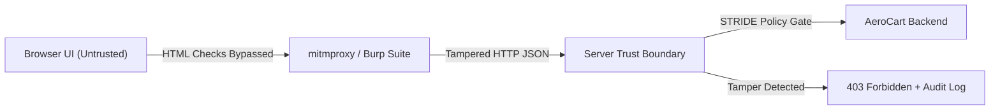

# Day-0 Threat Modeling (STRIDE), Zero-Trust Boundaries & Proxy Interception

```json continuity
{
  "previously": "Welcome to Day 1 of Course 12! Zero prior cybersecurity, ethical hacking, or cryptography background is required.",
  "painPoint": "AeroCart's React checkout form disabled the 'Apply Staff Discount' checkbox for regular passengers and capped ticket quantities at 9 in JavaScript—yet attackers bypassed the browser completely with a single curl command and booked $10,000 first-class cabins for $1.",
  "unlock": "Build AeroShield v0.1: draw explicit Zero-Trust server boundaries, systematically enumerate threats using Microsoft/OWASP STRIDE, and intercept live HTTP requests using mitmproxy, Burp Suite, and deterministic Python/Java security harnesses."
}
```

```json walkthrough
[
  {
    "time": "0:00",
    "badge": "Day-0 Mental Model",
    "title": "Why Browser UI Validation Is a Polite Suggestion, Not a Lock",
    "caption": "Anything running on the user's phone or browser (HTML disabled attributes, React state, JavaScript checks) sits outside your Trust Boundary. An intercepting proxy or curl command speaks raw HTTP directly to your API.",
    "nodes": ["Browser UI (Untrusted)", "mitmproxy / Burp Suite", "Trust Boundary", "AeroCart Backend"],
    "activeIndex": 2,
    "code": "# Browser UI blocks negative quantity, but raw HTTP bypasses UI:\ncurl -X POST https://api.aerocart.local/v1/cart \\\n  -d '{\"flight_id\":\"AI-302\",\"qty\":-5,\"role\":\"staff\"}'"
  },
  {
    "time": "0:25",
    "badge": "STRIDE Framework",
    "title": "Six Questions Every Security Engineer Asks Before Writing Tests",
    "caption": "STRIDE maps every component against 6 failure modes: Spoofing identity, Tampering with payloads, Repudiation (missing audit logs), Information Disclosure, Denial of Service, and Elevation of Privilege.",
    "nodes": ["S: Spoofing", "T: Tampering", "R: Repudiation", "I / D / E"],
    "activeIndex": 1,
    "code": "STRIDE = {\n  'S': 'Authentication', 'T': 'Integrity', 'R': 'Non-Repudiation',\n  'I': 'Confidentiality', 'D': 'Availability', 'E': 'Authorization'\n}"
  },
  {
    "time": "0:50",
    "badge": "Proxy Interception",
    "title": "Inspecting & Modifying In-Flight Traffic with mitmproxy & Burp Suite",
    "caption": "By configuring HTTP_PROXY=http://127.0.0.1:8080, every test request flows through mitmproxy, Burp Suite, or Charles Proxy—allowing QA engineers to pause, mutate headers/JSON fields, and replay requests.",
    "nodes": ["Playwright / CLI", "127.0.0.1:8080 Proxy", "Mutate JSON / Headers", "Assert 400/403"],
    "activeIndex": 1,
    "code": "mitmdump -p 8080 -s aeroshield_tamper_addon.py"
  },
  {
    "time": "1:15",
    "badge": "Big Tech Scale",
    "title": "Automated Threat-Model-as-Code Gates in CI",
    "caption": "Instead of manual clicks in Burp Repeater, Staff SDETs codify STRIDE tamper matrices into deterministic Python and Java regression suites that fire on every Pull Request.",
    "nodes": ["Baseline Request", "STRIDE Mutator", "AeroShield Gate", "Zero-Trust Verified"],
    "activeIndex": 3,
    "code": "assert gate.evaluate_request(tampered_payload).status_code == 403"
  }
]
```

```json pretraining
[
  {
    "term": "Trust Boundary",
    "formula": "Untrusted Client Zone -> Verified Server Zone",
    "meaning": "The architectural line where data crosses from a machine you do not control (a user's browser, mobile app, or partner webhook) into servers you control. Every byte crossing a trust boundary must be re-authenticated and re-validated."
  },
  {
    "term": "STRIDE Threat Model",
    "formula": "Spoofing · Tampering · Repudiation · Info Disclosure · DoS · Elevation",
    "meaning": "A mnemonic checklist created at Microsoft and adopted by OWASP to systematically discover security flaws across authentication, integrity, audit logging, confidentiality, availability, and authorization."
  },
  {
    "term": "Intercepting Proxy (mitmproxy / Burp Suite / Charles Proxy)",
    "formula": "Client -> Local Proxy (127.0.0.1:8080) -> Target API",
    "meaning": "A local intermediary server that sits between your browser/test runner and the backend API, letting you inspect, pause, edit, and replay raw HTTP/HTTPS requests after client-side JavaScript has already run."
  },
  {
    "term": "Non-Repudiation",
    "formula": "Append-Only Signed Audit Log (Actor + Timestamp + Payload Hash)",
    "meaning": "Cryptographic or tamper-evident proof that a specific user performed an action (such as issuing a $2,000 flight refund) so they cannot later deny ('repudiate') having done it."
  }
]
```

## 🌱 Step 1: Plain-English Mental Model — The Airport Wristband & The Trust Boundary

Imagine an airport lounge where passengers print their own paper boarding passes at home. On the airline's website, the **"First-Class Lounge Access"** checkbox is grayed out in HTML (`<input disabled>`) unless you pay \$800. What happens if a clever passenger opens their browser's Developer Tools, deletes the word `disabled`, or simply types `"lounge_access": true` into a raw HTTP message before sending it to the server?

If the backend server blindly trusts whatever JSON arrives from the browser, that passenger walks straight into the VIP lounge for free. This is Rule #1 of Application Security: **Client-side UI validation is only for user experience (UX); it provides zero security boundary against direct HTTP tampering.**



To protect `AeroCart` systematically instead of guessing random attacks, security engineers draw the **Trust Boundary** and apply the **STRIDE** lens to every endpoint:
1. **Spoofing**: Can someone pretend to be another passenger?
2. **Tampering**: Can someone change `fare_cents` or `quantity` in flight?
3. **Repudiation**: Can someone issue a refund with zero audit trail?
4. **Information Disclosure**: Does the API response leak other passengers' passport numbers?
5. **Denial of Service (DoS)**: Can one request lock up all database connections?
6. **Elevation of Privilege**: Can a regular shopper call an `/admin` endpoint?

---

## 🔨 Step 2: Zero-to-Running Starter & CLI — Booting `AeroShield v0.1`

In day-to-day security testing, you inspect and replay raw HTTP traffic using `curl`, `mitmproxy`, **Burp Suite**, or **Charles Proxy**. Let's see the exact CLI commands for intercepting traffic and running a zero-install STRIDE tamper harness:

```bash
# 1. Replay a raw request bypassing browser UI validation via curl
curl -i -X POST http://127.0.0.1:8090/api/health -H "X-Forwarded-For: 127.0.0.1"

# 2. Launch mitmproxy / mitmdump on port 8080 (when installed locally)
# mitmdump -p 8080 --set block_global=false
```

Let's write **`AeroShield v0.1`** in pure Python 3 stdlib—simulating an intercepting proxy tamper test and enforcing a server-side STRIDE boundary check:

```python
from __future__ import annotations
from dataclasses import dataclass


# Subgoal 1: Model an incoming HTTP request crossing the untrusted client boundary
@dataclass(frozen=True)
class CheckoutRequest:
    actor_user_id: str
    actor_role: str
    flight_id: str
    quantity: int
    client_supplied_price_cents: int
    staff_discount_flag: bool


# Subgoal 2: Enforce server-side Zero-Trust & STRIDE checks (never trust client price/role!)
CATALOG_PRICES_CENTS: dict[str, int] = {"AI-302": 44980, "BA-118": 62000}


def aeroshield_v01_checkout(req: CheckoutRequest) -> tuple[int, str, int]:
    # S (Spoofing): Reject missing identity
    if not req.actor_user_id.strip():
        return 401, "SPOOFING_BLOCKED: Missing authenticated principal", 0
    # T (Tampering): Reject non-positive or extreme quantities (DoS / overflow guard)
    if not (1 <= req.quantity <= 9):
        return 400, "TAMPERING_BLOCKED: Quantity out of server bounds [1..9]", 0
    # E (Elevation of Privilege): Block non-staff from claiming staff discount
    if req.staff_discount_flag and req.actor_role != "staff":
        return 403, "ELEVATION_BLOCKED: Staff discount requires verified staff role", 0
    # T (Tampering): Ignore client_supplied_price_cents; compute from server catalog!
    unit_price = CATALOG_PRICES_CENTS[req.flight_id]
    total_cents = unit_price * req.quantity
    return 200, "OK", total_cents


# Subgoal 3: Replay proxy-tampered payloads and assert deterministic server rejection
tampered_price_req = CheckoutRequest("usr_alice", "customer", "AI-302", 2, client_supplied_price_cents=1, staff_discount_flag=False)
status, msg, server_total = aeroshield_v01_checkout(tampered_price_req)
assert status == 200 and server_total == 89960, "Server must ignore tampered client price!"

privilege_escalation_req = CheckoutRequest("usr_alice", "customer", "AI-302", 1, client_supplied_price_cents=44980, staff_discount_flag=True)
status_esc, msg_esc, _ = aeroshield_v01_checkout(privilege_escalation_req)
assert status_esc == 403 and "ELEVATION_BLOCKED" in msg_esc
print(f"AeroShield v0.1 verified: server_total={server_total} cents, escalation={status_esc}")
```

### Java 17 Equivalent

```java
import java.util.Map;

public class AeroShieldCh01Starter {
    private static final Map<String, Long> CATALOG_CENTS = Map.of("AI-302", 44980L);

    public record CheckoutPayload(
            String userId, String role, String flightId, int qty, long clientPriceCents, boolean staffDiscount) {}

    public static void main(String[] args) {
        // Subgoal 1: Simulate proxy-tampered request where attacker sets clientPriceCents = 1
        CheckoutPayload tampered = new CheckoutPayload("usr_alice", "customer", "AI-302", 2, 1L, false);
        long computedTotal = evaluateServerBoundary(tampered);
        assert computedTotal == 89960L : "Must compute price from server catalog";

        // Subgoal 2: Verify Elevation of Privilege attempt throws SecurityException (403)
        CheckoutPayload escalated = new CheckoutPayload("usr_alice", "customer", "AI-302", 1, 44980L, true);
        boolean blocked = false;
        try {
            evaluateServerBoundary(escalated);
        } catch (SecurityException expected) {
            blocked = true;
        }
        assert blocked : "Elevation of Privilege must be blocked";
    }

    public static long evaluateServerBoundary(CheckoutPayload p) {
        if (p.userId() == null || p.userId().isBlank()) throw new SecurityException("401 Spoofing");
        if (p.qty() < 1 || p.qty() > 9) throw new IllegalArgumentException("400 Tampering");
        if (p.staffDiscount() && !"staff".equals(p.role())) throw new SecurityException("403 Elevation");
        return Math.multiplyExact(CATALOG_CENTS.get(p.flightId()), p.qty());
    }
}
```

---

## 🛠️ Step 3: Everyday Practitioner Workflows & Where Naive Code Breaks

When auditing a web or mobile app with **Burp Suite** (`Proxy -> HTTP history -> Send to Repeater`), **Charles Proxy** (`Breakpoints / Rewrite Tool`), or **mitmproxy** (`mitmdump -s addon.py`), security engineers look for **Implicit Client Trust**:
1. **Hidden Form Fields & Disabled Controls**: Changing `"is_verified": false` to `true` in the JSON body.
2. **Header Spoofing**: Injecting `X-Forwarded-For: 127.0.0.1` or `X-User-Role: admin` hoping the backend trusts unstripped client headers when reverse-proxy header sanitization is misconfigured.
3. **Missing Audit Logs (Repudiation)**: Failing to record *who* attempted a rejected `403` action and from what request correlation ID.

```json contrast
{
  "title": "Trusting Client-Supplied Security Attributes vs. Server-Derived Context",
  "leftLabel": "❌ Naive Endpoint (Trusts Client JSON & Headers)",
  "leftCode": "@app.post('/api/v1/refund')\ndef issue_refund(req_json: dict, headers: dict):\n    # Fatal 1: Trusts role from client header!\n    if headers.get('X-User-Role') != 'admin':\n        return {'error': 'Forbidden'}, 403\n    # Fatal 2: Trusts refund amount from client JSON!\n    # Fatal 3: Zero audit log (Repudiation vulnerability)\n    db.credit_wallet(req_json['user_id'], req_json['amount_cents'])\n    return {'status': 'refunded'}, 200",
  "rightLabel": "✅ Staff Zero-Trust Endpoint (STRIDE Hardened)",
  "rightCode": "@app.post('/api/v1/refund')\ndef issue_refund(req_json: dict, verified_principal: Principal):\n    # S & E: Role comes ONLY from verified server token/session\n    if 'refund:write' not in verified_principal.permissions:\n        audit_log.record('DENY_REFUND', verified_principal.sub, req_json)\n        return {'error': 'Forbidden'}, 403\n    # T: Lookup refundable balance from DB ledger, cap to max\n    refundable = db.get_Order_paid_cents(req_json['order_id'])\n    # R: Append immutable non-repudiation audit record\n    audit_log.record('ISSUE_REFUND', verified_principal.sub, refundable)\n    return {'status': 'refunded', 'amount_cents': refundable}, 200"
}
```

```json poe
{
  "question": "Predict the outcome: An e-commerce checkout frontend calculates `tax_cents` and `discount_cents` in React and sends `{\"item_id\": \"AI-302\", \"subtotal_cents\": 44980, \"discount_cents\": 44980}` to the backend. The backend validates `subtotal_cents == catalog_price(item_id)` and then charges `subtotal_cents - discount_cents`. What happens when a user intercepts the request in Burp Suite?",
  "options": [
    "The request is blocked because TLS 1.3 encrypts the payload against Burp Suite",
    "The user buys the ticket for $0.00 via Tampering because TLS only protects data in transit from third parties—not from the endpoint user holding the TLS client session who edits `discount_cents` in their own proxy",
    "CORS blocks Burp Suite from forwarding modified JSON bodies",
    "The browser automatically re-signs the JSON body with the server's private key"
  ],
  "answerIndex": 1,
  "explanation": "HTTPS/TLS encrypts traffic between the client and server against third-party network eavesdroppers, NOT against the client itself! When the user installs a local proxy CA (mitmproxy/Burp Suite) or runs curl, they control the client end of the TLS tunnel and can tamper with any unverified field like `discount_cents`."
}
```

---

## 🏢 Step 4: How Big Tech Runs It at Scale, Staff Math & Production Blueprint

### 🏢 In the Wild: Stripe, Netflix & Google Zero-Trust Threat Modeling (`NIST SP 800-207`)

At **Google** (BeyondCorp / **NIST SP 800-207 Zero Trust Architecture**), **Netflix**, and **Stripe**, security engineering teams never rely on perimeter firewalls or frontend checks:
1. **Edge Header Stripping at Envoy / Cloudflare**: Every external ingress proxy explicitly strips internal headers (`X-Internal-Actor`, `X-Tenant-Id`, `X-Forwarded-User`) from incoming internet traffic before minting a cryptographically signed internal identity header.
2. **Automated Proxy Fuzzing via `mitmproxy` Addons**: SDET pipelines record happy-path Playwright/API traffic through a headless `mitmdump` Python addon that automatically replays mutated copies of every POST/PUT/PATCH request (flipping booleans, negating integers, stripping auth headers) to verify every endpoint returns `400`/`401`/`403` rather than `200` or `500`.

### Staff Risk & Attack-Surface Coverage Math

In quantitative threat modeling, prioritized risk exposure for a threat vector $v \in \{\text{S, T, R, I, D, E}\}$ combines exploit probability $P(\text{Exploit}_v)$ and business impact $I_v$:

$$\text{Risk}(v) = P(\text{Exploit}_v) \times I_v, \qquad \text{STRIDE Coverage} = \frac{1}{6 |E|} \sum_{e \in E} \sum_{v \in \text{STRIDE}} \mathbb{I}(\text{Tested}_{e, v})$$

Where $|E|$ is the count of API endpoints Crossing a Trust Boundary and $\mathbb{I}(\text{Tested}_{e, v}) \in \{0, 1\}$ indicates whether automated negative security assertions exist for threat category $v$ on endpoint $e$.

| Interception / Modeling Tool | Best Use Case | Automation Fit | When NOT to Use It |
| :--- | :--- | :--- | :--- |
| **`mitmproxy` / `mitmdump`** | Python-scriptable HTTP/HTTPS/HTTP2 interception & CI replay | **100% CLI & Python Addon Native** | Manual GUI-heavy point-and-click exploratory fuzzing |
| **Burp Suite (Pro / Community)** | Interactive manual Repeater, Intruder & AuthZ matrix exploration | Moderate (REST API / BChecks) | Lightweight zero-cost container CI pipelines |
| **Charles Proxy** | macOS/iOS/Android mobile app SSL proxying & bandwidth throttling | Low (Desktop GUI tool) | Headless Linux CI/CD security regression gates |

### Production Blueprint: `AeroShield v0.1` STRIDE Proxy Interception & Audit Harness

```python
from __future__ import annotations
import hashlib
import json
from dataclasses import dataclass


@dataclass(frozen=True)
class AuditEntry:
    seq: int
    actor: str
    stride_category: str
    decision: str
    prev_hash: str
    entry_hash: str


class AeroShieldStrideProxyHarness:
    """Simulates a mitmproxy tamper replay suite + hash-chained non-repudiation audit log."""

    def __init__(self) -> None:
        self.audit_chain: list[AuditEntry] = []

    def _append_audit(self, actor: str, category: str, decision: str) -> AuditEntry:
        prev_hash = self.audit_chain[-1].entry_hash if self.audit_chain else "0" * 64
        seq = len(self.audit_chain) + 1
        payload = f"{seq}|{actor}|{category}|{decision}|{prev_hash}".encode("utf-8")
        digest = hashlib.sha256(payload).hexdigest()
        entry = AuditEntry(seq, actor, category, decision, prev_hash, digest)
        self.audit_chain.append(entry)
        return entry

    def handle_api_request(self, raw_headers: dict[str, str], body: dict[str, object]) -> tuple[int, dict[str, object]]:
        # Strip spoofed internal headers at ingress trust boundary
        sanitized_headers = {
            k: v for k, v in raw_headers.items() if not k.lower().startswith("x-internal-")
        }
        actor = str(sanitized_headers.get("Authorization-Sub", "")).strip()
        if not actor:
            self._append_audit("anonymous", "SPOOFING", "DENY_401")
            return 401, {"error": "Unauthorized"}

        if "x-internal-admin" in {k.lower() for k in raw_headers}:
            self._append_audit(actor, "ELEVATION_OF_PRIVILEGE", "STRIPPED_HEADER_403")
            return 403, {"error": "Spoofed internal header rejected"}

        qty = int(body.get("quantity", 0))
        if qty <= 0 or qty > 9:
            self._append_audit(actor, "TAMPERING", "DENY_400_QTY")
            return 400, {"error": "Invalid quantity"}

        self._append_audit(actor, "CLEAN", "ALLOW_200")
        return 200, {"actor": actor, "quantity": qty, "status": "booked"}

    def verify_non_repudiation_chain(self) -> bool:
        prev = "0" * 64
        for item in self.audit_chain:
            expected = hashlib.sha256(
                f"{item.seq}|{item.actor}|{item.stride_category}|{item.decision}|{prev}".encode("utf-8")
            ).hexdigest()
            if item.prev_hash != prev or item.entry_hash != expected:
                return False
            prev = item.entry_hash
        return True


if __name__ == "__main__":
    harness = AeroShieldStrideProxyHarness()
    # 1. Spoofing test (missing identity)
    s1, _ = harness.handle_api_request({}, {"quantity": 1})
    # 2. Elevation of privilege test (injecting X-Internal-Admin via proxy)
    s2, _ = harness.handle_api_request({"Authorization-Sub": "usr_1", "X-Internal-Admin": "true"}, {"quantity": 1})
    # 3. Tampering test (negative quantity)
    s3, _ = harness.handle_api_request({"Authorization-Sub": "usr_1"}, {"quantity": -3})
    # 4. Valid request
    s4, resp = harness.handle_api_request({"Authorization-Sub": "usr_1"}, {"quantity": 2})

    assert (s1, s2, s3, s4) == (401, 403, 400, 200)
    assert harness.verify_non_repudiation_chain() and len(harness.audit_chain) == 4
    print(json.dumps({"statuses": [s1, s2, s3, s4], "audit_entries": len(harness.audit_chain)}))
```

### Java 17 Equivalent

```java
import java.nio.charset.StandardCharsets;
import java.security.MessageDigest;
import java.util.ArrayList;
import java.util.HexFormat;
import java.util.List;
import java.util.Map;

public final class AeroShieldCh01Blueprint {
    public record AuditRecord(int seq, String actor, String strideCategory, String prevHash, String hash) {}

    private final List<AuditRecord> ledger = new ArrayList<>();

    public int evaluateIngress(Map<String, String> headers, int quantity) throws Exception {
        String actor = headers.getOrDefault("Authorization-Sub", "").trim();
        if (actor.isEmpty()) {
            appendAudit("anon", "SPOOFING");
            return 401;
        }
        for (String h : headers.keySet()) {
            if (h.toLowerCase().startsWith("x-internal-")) {
                appendAudit(actor, "ELEVATION_OF_PRIVILEGE");
                return 403;
            }
        }
        if (quantity < 1 || quantity > 9) {
            appendAudit(actor, "TAMPERING");
            return 400;
        }
        appendAudit(actor, "ALLOW");
        return 200;
    }

    private void appendAudit(String actor, String category) throws Exception {
        String prev = ledger.isEmpty() ? "0".repeat(64) : ledger.get(ledger.size() - 1).hash();
        int seq = ledger.size() + 1;
        MessageDigest md = MessageDigest.getInstance("SHA-256");
        byte[] digest = md.digest((seq + "|" + actor + "|" + category + "|" + prev).getBytes(StandardCharsets.UTF_8));
        ledger.add(new AuditRecord(seq, actor, category, prev, HexFormat.of().formatHex(digest)));
    }

    public static void main(String[] args) throws Exception {
        AeroShieldCh01Blueprint gate = new AeroShieldCh01Blueprint();
        assert gate.evaluateIngress(Map.of(), 1) == 401;
        assert gate.evaluateIngress(Map.of("Authorization-Sub", "u1", "X-Internal-Role", "root"), 1) == 403;
        assert gate.evaluateIngress(Map.of("Authorization-Sub", "u1"), -5) == 400;
        assert gate.evaluateIngress(Map.of("Authorization-Sub", "u1"), 2) == 200;
    }
}
```

> [!WARNING]
> **Hiring Bar-Raiser Gotcha — TLS Certificate Pinning vs. Server-Side Validation!**
> Candidates often suggest "adding mobile SSL/TLS certificate pinning" to stop users from intercepting API traffic with Burp Suite or `mitmproxy`. A Staff interviewer will immediately push back: **Certificate pinning slows down casual inspection on a mobile device, but an attacker with root/Frida access or a browser session can extract the bearer token and call the API directly.** Never treat TLS or certificate pinning as a substitute for server-side authorization and payload validation across the Trust Boundary!

*Up Next in Chapter 02*: Now that we can intercept traffic across `AeroCart`'s trust boundary, we tackle the #1 vulnerability in the **OWASP API Security Top 10 (2023)**—**BOLA / IDOR (`API1:2023`)**, **Mass Assignment (`API3:2023`)**, and **BFLA (`API5:2023`)**.

```json quiz
[
  {
    "id": "sec01-q1",
    "question": "Why does client-side React validation (`disabled={true}` or `if (qty < 1) return`) provide zero security boundary against an attacker?",
    "options": [
      "Because React compiles to WebAssembly which skips validation",
      "Because the browser executes on an untrusted client machine outside the server Trust Boundary; an attacker can intercept and modify the HTTP request in mitmproxy/Burp Suite or send raw requests via curl",
      "Because HTTP/2 compresses JSON headers automatically",
      "Because CORS disables JavaScript validation on POST requests"
    ],
    "answerIndex": 1,
    "explanation": "Any code or state inside the client browser or mobile device sits outside your Trust Boundary and is fully controlled by the user via DevTools, mitmproxy, Burp Suite, or curl."
  },
  {
    "id": "sec01-q2",
    "question": "In the STRIDE threat modeling framework, which category addresses a flaw where an admin deletes a production flight schedule and the system lacks tamper-evident audit logs proving who performed the deletion?",
    "options": [
      "Spoofing",
      "Repudiation",
      "Information Disclosure",
      "Denial of Service"
    ],
    "answerIndex": 1,
    "explanation": "Repudiation occurs when an application lacks immutable, attributable audit logs, allowing an actor to deny having performed a sensitive operation."
  },
  {
    "id": "sec01-q3",
    "question": "A microservice trusts the `X-Forwarded-For` and `X-Internal-Role` HTTP headers to identify internal admin calls. How should the API gateway / ingress boundary be hardened?",
    "options": [
      "Base64-encode both headers in the browser",
      "Strip or overwrite all client-supplied `X-Internal-*` headers at the ingress proxy boundary and derive identity/roles exclusively from cryptographically verified tokens",
      "Check the `User-Agent` header alongside `X-Internal-Role`",
      "Move the headers into URL query parameters"
    ],
    "answerIndex": 1,
    "explanation": "Untrusted clients can send arbitrary HTTP headers. Ingress proxies must strip untrusted internal headers at the perimeter and enforce cryptographic authentication."
  }
]
```

---

## 📋 Step 5: Master Cheat-Sheet, 60-Second Interview Pitch & Verified Sources

| STRIDE Threat | Violated Security Property | Typical `AeroCart` Attack Vector | Deterministic Server/QA Control |
| :--- | :--- | :--- | :--- |
| **S — Spoofing** | Authentication | Forged `X-User-Id` header or stolen token | Strip client identity headers; verify signed JWT/session |
| **T — Tampering** | Integrity | Editing `fare_cents` or `qty: -5` in Burp Suite | Recompute prices from server catalog; enforce schema bounds |
| **R — Repudiation** | Non-Repudiation | Issuing unlogged wallet refunds | Hash-chained append-only audit log with actor + trace ID |
| **I — Info Disclosure** | Confidentiality | Stack traces or verbose PII in API JSON | Strict response DTO projection & generic `500` error envelopes |
| **D — Denial of Service** | Availability | Unbounded page size `?limit=10000000` | Strict pagination caps, rate limiting & query timeouts |
| **E — Elevation of Privilege** | Authorization | Customer calling `DELETE /api/admin/flights` | Enforce server-side RBAC/ABAC and tenant ownership checks |

### 🎙️ 60-Second Interview Soundbite

> *"When I design security tests for a new microservice or checkout flow, I start by drawing the explicit Trust Boundary and running a STRIDE threat model before writing a single test script. Because client-side UI validation in React or iOS lives on an untrusted device, any field crossing the HTTP boundary can be intercepted and mutated via `mitmproxy`, Burp Suite, or `curl`. In CI, I automate proxy tamper matrices that replay happy-path requests with mutated prices, negative quantities, stripped tokens, and spoofed `X-Internal-*` headers—asserting that the server computes prices from its own catalog, enforces strict authorization, and writes non-repudiation audit logs on every privileged state transition."*

### 📚 Verified Primary Sources
- [OWASP Official Guide — Threat Modeling Process & STRIDE Methodology](https://owasp.org/www-community/Threat_Modeling_Process)
- [PortSwigger Web Security Academy — Intercepting HTTP Traffic & Access Control](https://portswigger.net/web-security)
- [mitmproxy Official Documentation — Scripting HTTP Interception Addons](https://docs.mitmproxy.org/stable/)
