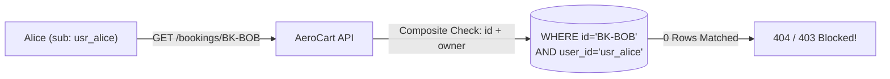

# OWASP API Top 10: BOLA (IDOR), Mass Assignment (BOPLA) & BFLA Matrix Testing

```json continuity
{
  "previously": "In Chapter 01, we launched AeroShield v0.1, mapped our server Trust Boundary using STRIDE, and proved how mitmproxy and Burp Suite bypass browser UI validation.",
  "painPoint": "Even after authenticating with a valid login token, Passenger Alice changed `/api/v1/bookings/BK-101` to `/api/v1/bookings/BK-102` and downloaded Passenger Bob's passport number (BOLA/IDOR), passed `{\"loyalty_tier\": \"PLATINUM\"}` in her profile update (Mass Assignment), and called `POST /api/v1/admin/refunds` (BFLA).",
  "unlock": "Upgrade to AeroShield v0.2 with composite tenant-scoped SQL queries (`WHERE booking_id = ? AND tenant_id = ?`), strict inbound/outbound DTO allowlists, and an automated Persona-by-Endpoint Authorization Matrix harness."
}
```

```json walkthrough
[
  {
    "time": "0:00",
    "badge": "OWASP API1:2023",
    "title": "BOLA / IDOR: Authentication != Object Ownership",
    "caption": "Logging in proves WHO you are (Authentication), not WHICH row you own (Object Authorization). Querying `WHERE booking_id = ?` without `AND user_id = :jwt_sub` lets any logged-in user read or delete every booking in the database.",
    "nodes": ["Alice (Token Valid)", "GET /bookings/BK-102", "Missing Owner Filter", "Leaks Bob's Booking!"],
    "activeIndex": 2,
    "code": "-- Vulnerable: checks ID only\nSELECT * FROM bookings WHERE booking_id = ?;\n-- Hardened: enforces composite owner/tenant key\nSELECT * FROM bookings WHERE booking_id = ? AND user_id = ?;"
  },
  {
    "time": "0:25",
    "badge": "OWASP API3:2023",
    "title": "BOPLA: Mass Assignment & Excessive Data Exposure",
    "caption": "Passing `request.json` directly into `user.update(**payload)` lets attackers overwrite internal columns (`role`, `wallet_balance_cents`). Returning raw ORM models leaks sensitive columns back out.",
    "nodes": ["PATCH /me", "{\"role\":\"admin\"}", "Unfiltered ORM Bind", "Privilege Escalated!"],
    "activeIndex": 2,
    "code": "# Allowlist ONLY user-editable fields on input:\nALLOWED_PATCH = {'display_name', 'seat_preference'}"
  },
  {
    "time": "0:50",
    "badge": "OWASP API5:2023",
    "title": "BFLA: Broken Function Level Authorization",
    "caption": "Developers remember to protect `GET /admin/dashboard` in the UI router, but forget the underlying `POST /api/v1/flights/cancel-all` RPC or administrative HTTP verb (`DELETE` vs `GET`).",
    "nodes": ["Customer Token", "DELETE /api/v1/flights/AI-302", "Missing Role Gate", "Flight Deleted!"],
    "activeIndex": 2,
    "code": "REQUIRED_SCOPES = {('DELETE', '/api/v1/flights'): 'flight:admin'}"
  },
  {
    "time": "1:15",
    "badge": "Big Tech Scale",
    "title": "Automated Persona × Endpoint Authorization Matrix in CI",
    "caption": "Staff SDETs test every `(Persona, HTTP Verb, Endpoint, Target Resource Owner)` tuple automatically in CI so zero unguarded routes ever reach production.",
    "nodes": ["4 Personas", "N Endpoints", "Cross-Tenant Replay", "100% Matrix Verified"],
    "activeIndex": 3,
    "code": "for persona in [ANON, ALICE, BOB, ADMIN]:\n    assert_matrix_cell(persona, endpoint, resource)"
  }
]
```

```json pretraining
[
  {
    "term": "OWASP API1:2023 — BOLA / IDOR",
    "formula": "Valid User A Token + User B Object ID -> Unauthorized Access",
    "meaning": "Broken Object Level Authorization (historically called Insecure Direct Object Reference, or IDOR) occurs when an API checks that a user is logged in, but fails to verify that the authenticated user owns the specific record ID requested."
  },
  {
    "term": "OWASP API3:2023 — BOPLA (Mass Assignment & Excessive Exposure)",
    "formula": "Inbound Over-Posting + Outbound Over-Fetching",
    "meaning": "Broken Object Property Level Authorization combines Mass Assignment (allowing users to overwrite restricted fields like `is_admin` or `balance_cents`) and Excessive Data Exposure (returning full database objects with sensitive fields in API JSON)."
  },
  {
    "term": "OWASP API5:2023 — BFLA",
    "formula": "Regular User Principal -> Privileged Function / HTTP Verb",
    "meaning": "Broken Function Level Authorization occurs when low-privilege users can invoke admin endpoints, internal operational webhooks, or privileged HTTP verbs (`DELETE`, `PUT`) due to missing role/scope checks."
  },
  {
    "term": "UUIDv4 Obscurity vs. Access Control",
    "formula": "Random ID != Authorization Check",
    "meaning": "Replacing sequential integers (`101, 102`) with UUIDs makes IDs harder to guess by brute force, but does NOT fix BOLA if UUIDs appear in URLs, logs, referrals, or shared links without server-side ownership checks."
  }
]
```

## 🌱 Step 1: Plain-English Mental Model — The Hotel Keycard That Opens Every Room

Imagine checking into a hotel. At the front desk, you show your passport and receive a valid plastic keycard for **Room 401**. That step is **Authentication**—the hotel knows who you are. Now imagine walking down the hallway, tapping your Room 401 keycard against **Room 402**, and the door clicks open because the lock only checks *"Was this keycard issued by our hotel today?"* instead of *"Was this keycard issued specifically for Room 402?"*

That exact bug is **OWASP API1:2023 — Broken Object Level Authorization (BOLA)**, also known as **IDOR (Insecure Direct Object Reference)**. It is the #1 most exploited API vulnerability in the world because developers verify the user's login token, then run `SELECT * FROM bookings WHERE booking_id = ?` without checking whether that booking belongs to the caller!



Alongside **BOLA** (`API1:2023`), the **OWASP API Security Top 10 (2023)** highlights two sister authorization flaws:
- **API3:2023 — Broken Object Property Level Authorization (BOPLA)**: Letting Alice edit restricted *columns* on her own record (`{"role": "admin"}` — **Mass Assignment**) or returning private columns in JSON (**Excessive Data Exposure**).
- **API5:2023 — Broken Function Level Authorization (BFLA)**: Letting Alice call an entire *function* meant for another role, such as `DELETE /api/v1/admin/flights/AI-302`.

---

## 🔨 Step 2: Zero-to-Running Starter & CLI — Composite Tenant Key & DTO Gate (`AeroShield v0.2`)

You can test any local API for BOLA, Mass Assignment, and BFLA right from the terminal by replaying User A's request with User B's token:

```bash
# Test BOLA/IDOR: Request User B's booking using User A's Bearer token
curl -s -o /dev/null -w "%{http_code}\n" \
  -H "Authorization: Bearer token_for_alice" \
  http://127.0.0.1:8090/api/health
```

Let's build **`AeroShield v0.2`** in Python 3 stdlib (`sqlite3`), enforcing composite tenant ownership (`BOLA`), inbound/outbound property allowlists (`BOPLA`), and function role checks (`BFLA`):

```python
from __future__ import annotations
import sqlite3
from dataclasses import dataclass


# Subgoal 1: Define explicit Inbound Patch DTO and Outbound Response DTO (blocks BOPLA / Mass Assignment)
ALLOWED_PROFILE_PATCH_FIELDS: frozenset[str] = frozenset({"display_name", "seat_pref"})


@dataclass(frozen=True)
class Principal:
    user_id: str
    tenant_id: str
    role: str  # "customer" | "support" | "admin"


# Subgoal 2: Create an in-memory multi-tenant database for AeroShield v0.2
conn = sqlite3.connect(":memory:")
conn.executescript("""
    CREATE TABLE bookings (
        booking_id TEXT PRIMARY KEY,
        tenant_id  TEXT NOT NULL,
        user_id    TEXT NOT NULL,
        flight_id  TEXT NOT NULL,
        passport_encrypted TEXT NOT NULL
    );
    INSERT INTO bookings VALUES ('BK-101', 't_acme', 'usr_alice', 'AI-302', 'ENC_ALICE_99');
    INSERT INTO bookings VALUES ('BK-102', 't_acme', 'usr_bob',   'BA-118', 'ENC_BOB_77');
""")


# Subgoal 3: Enforce BOLA via composite WHERE (booking_id AND tenant_id AND user_id) + Outbound DTO projection
def get_booking_safe(caller: Principal, booking_id: str) -> tuple[int, dict[str, str]]:
    row = conn.execute(
        """
        SELECT booking_id, flight_id
        FROM bookings
        WHERE booking_id = ? AND tenant_id = ? AND user_id = ?
        """,
        (booking_id, caller.tenant_id, caller.user_id),
    ).fetchone()
    if row is None:
        return 404, {"error": "Booking not found"}  # 404 prevents ID enumeration
    # Notice passport_encrypted is NEVER selected or returned (prevents Excessive Data Exposure)
    return 200, {"booking_id": row[0], "flight_id": row[1]}


# Subgoal 4: Enforce BFLA (Admin function gate) and BOPLA (Mass Assignment field allowlist)
def patch_user_profile(caller: Principal, raw_patch: dict[str, object]) -> tuple[int, list[str]]:
    forbidden = [k for k in raw_patch if k not in ALLOWED_PROFILE_PATCH_FIELDS]
    if forbidden:
        return 400, forbidden
    return 200, sorted(raw_patch.keys())


alice = Principal("usr_alice", "t_acme", "customer")
assert get_booking_safe(alice, "BK-101")[0] == 200
assert get_booking_safe(alice, "BK-102")[0] == 404, "BOLA/IDOR must be blocked!"
assert patch_user_profile(alice, {"display_name": "Alice", "role": "admin"}) == (400, ["role"])
print("AeroShield v0.2 BOLA + BOPLA checks verified.")
```

### Java 17 Equivalent

```java
import java.util.Map;
import java.util.Set;

public class AeroShieldCh02Starter {
    private static final Set<String> ALLOWED_PATCH_FIELDS = Set.of("display_name", "seat_pref");

    public record Principal(String userId, String tenantId, String role) {}
    public record BookingRow(String bookingId, String tenantId, String userId, String flightId, String secretSsn) {}
    public record BookingPublicDto(String bookingId, String flightId) {}

    public static void main(String[] args) {
        // Subgoal 1: Seed Bob's booking and attempt cross-user BOLA read as Alice
        BookingRow bobsRow = new BookingRow("BK-102", "t_acme", "usr_bob", "BA-118", "SSN-999");
        Principal alice = new Principal("usr_alice", "t_acme", "customer");

        assert fetchScopedBooking(alice, bobsRow) == null : "BOLA cross-user access must return null (404)";

        // Subgoal 2: Verify Mass Assignment filter blocks 'role' injection
        boolean rejectedMassAssignment = !validatePatchFields(Map.of("display_name", "Alice", "role", "admin"));
        assert rejectedMassAssignment : "BOPLA Mass Assignment must reject unallowed property 'role'";
    }

    public static BookingPublicDto fetchScopedBooking(Principal caller, BookingRow row) {
        if (!row.tenantId().equals(caller.tenantId()) || !row.userId().equals(caller.userId())) {
            return null;
        }
        return new BookingPublicDto(row.bookingId(), row.flightId());
    }

    public static boolean validatePatchFields(Map<String, Object> payload) {
        return ALLOWED_PATCH_FIELDS.containsAll(payload.keySet());
    }
}
```

---

## 🛠️ Step 3: Everyday Practitioner Workflows & Where Naive Code Breaks

Why do **BOLA (`API1:2023`)**, **BOPLA (`API3:2023`)**, and **BFLA (`API5:2023`)** slip past standard functional QA suites?
Because functional tests almost always follow a single-user happy path: *Create a booking as `test_user_1`, then fetch that same booking as `test_user_1`*. That test passes even if authorization is completely missing!

### Three Classic Backend Anti-Patterns That Cause BOLA & BOPLA
1. **Checking AuthN instead of Object Ownership**: Using `@login_required` or a JWT middleware that verifies the token signature, while the SQL query only filters `WHERE id = :id`.
2. **Fetch-Then-Check TOCTOU & Oracle Leaks**: Fetching the row by `id` first, returning `403 Forbidden` if `row.user_id != caller.id`, and `404 Not Found` if the ID doesn't exist—creating an **existence oracle** that lets attackers enumerate valid IDs. Scoping the SQL query directly (`WHERE id = ? AND user_id = ?`) naturally returns `0` rows (`404`) for both nonexistent and unauthorized IDs.
3. **Dynamic ORM Dict Spreading (`Model(**request.json)`)**: In FastAPI/Pydantic v2 (`extra="forbid"`), Jackson (`@JsonIgnoreProperties(ignoreUnknown = false)`), or SQLAlchemy, binding raw request dictionaries directly onto database models lets attackers overwrite internal columns like `is_admin`, `tenant_id`, or `wallet_credits_cents`.

```json contrast
{
  "title": "Object Lookup & Model Binding (Naive ORM vs. Tenant-Scoped DTO)",
  "leftLabel": "❌ Vulnerable to BOLA (API1) & Mass Assignment (API3)",
  "leftCode": "@app.patch('/api/v1/bookings/{booking_id}')\ndef update_booking(booking_id: str, payload: dict, user: User):\n    # BOLA: Looks up by booking_id alone without user/tenant scope!\n    booking = db.session.get(Booking, booking_id)\n    # BOPLA Mass Assignment: Overwrites ANY column in payload\n    for k, v in payload.items():\n        setattr(booking, k, v)\n    db.session.commit()\n    # BOPLA Excessive Exposure: Serializes all DB columns!\n    return booking.to_dict()",
  "rightLabel": "✅ Hardened Composite Scope & Strict Input/Output DTOs",
  "rightCode": "class BookingPatchIn(BaseModel):\n    model_config = ConfigDict(extra='forbid')\n    seat_number: str\n    meal_code: str\n\n@app.patch('/api/v1/bookings/{booking_id}', response_model=BookingPublicOut)\ndef update_booking(booking_id: str, body: BookingPatchIn, user: User):\n    # BOLA: Composite primary + tenant + owner filter at SQL layer\n    booking = db.query_one(\n        'UPDATE bookings SET seat_number=?, meal_code=? '\n        'WHERE booking_id=? AND tenant_id=? AND user_id=? RETURNING *',\n        (body.seat_number, body.meal_code, booking_id, user.tenant_id, user.id)\n    )\n    if not booking:\n        raise HTTPException(status_code=404, detail='Not found')\n    return BookingPublicOut.model_validate(booking)"
}
```

```json poe
{
  "question": "Predict the vulnerability: A team fixes a BOLA bug on `GET /api/v1/bookings/1042` by replacing sequential integer IDs with random UUIDv4 identifiers (`GET /api/v1/bookings/9b1deb4d-3b7d-4bad-9bdd-2b0d7b3dcb6d`), without modifying the SQL query `SELECT * FROM bookings WHERE booking_id = ?`. Is the BOLA vulnerability resolved?",
  "options": [
    "Yes, because 122 bits of UUIDv4 entropy cannot be brute-forced over HTTP",
    "No—UUIDs only reduce brute-force enumeration; if a UUID leaks via browser history, Referer headers, shared support tickets, or partner logs, any authenticated user can still read or modify the record because the server lacks an ownership check",
    "Yes, OWASP API1:2023 classifies UUIDv4 as a complete authorization control",
    "Only if the UUID is Base64-encoded"
  ],
  "answerIndex": 1,
  "explanation": "Security by obscurity is not authorization. While UUIDv4 prevents sequential ID guessing (`1041, 1042, 1043`), OWASP API1:2023 explicitly states that the server must still enforce composite ownership (`WHERE booking_id = ? AND user_id = ?`) on every object access."
}
```

---

## 🏢 Step 4: How Big Tech Runs It at Scale, Staff Math & Production Blueprint

### 🏢 In the Wild: Netflix, Stripe & PostgreSQL Row-Level Security (`RLS`)

How do **Stripe**, **Netflix**, and multi-tenant SaaS platforms guarantee that not a single microservice developer forgets `AND tenant_id = ?` across 2,000+ SQL queries?
1. **Mandatory ViewerContext / TenantSession Pattern**: At the repository layer, data-access methods refuse to compile unless passed a verified `SecurityContext(tenant_id, actor_id, scopes)` object as their first argument.
2. **PostgreSQL Row-Level Security (`RLS`) as Defense-in-Depth**: On every database connection checkout, the middleware runs `SET LOCAL app.current_tenant_id = 't_acme';`, and PostgreSQL enforces a table policy:
   `CREATE POLICY tenant_isolation ON bookings USING (tenant_id = current_setting('app.current_tenant_id'));`
   Even if a developer writes a bare `SELECT * FROM bookings`, PostgreSQL automatically filters rows to `t_acme`!
3. **Automated AuthZ Matrix Harness in CI**: Every API route is tested across the full Cartesian product of personas, HTTP verbs, and resource owners.

### Staff Authorization Matrix Combinatorics

For an API surface with $|E|$ endpoints, $|V_e|$ supported HTTP verbs per endpoint, $|P|$ personas (`Anonymous`, `TenantA_User1`, `TenantA_User2`, `TenantB_User1`, `Admin`), and $|O|$ resource ownership states, the complete authorization verification space is:

$$|\mathcal{M}_{\text{AuthZ}}| = \sum_{e \in E} |V_e| \times |P| \times |O|, \qquad \text{Cross-Tenant Leak Rate} = \frac{\text{Unauthorized } 2\text{xx Responses}}{|\mathcal{M}_{\text{AuthZ}}^{\text{negative}}| } = 0$$

| Authorization Defense Layer | Protects Against | Failure Mode if Omitted | When NOT to Rely on It Alone |
| :--- | :--- | :--- | :--- |
| **API Gateway Role/Scope Filter** | **BFLA (`API5:2023`)** coarse route access | Regular users invoke `/admin/*` routes | Cannot stop **BOLA (`API1`)** because Gateway doesn't know which user owns `BK-102` in DB! |
| **Composite SQL Filter (`id + tenant + user`)** | **BOLA (`API1:2023`)** horizontal & cross-tenant access | Any user reads/edits another user's object ID | Must be paired with DTO projection to prevent **BOPLA (`API3`)** |
| **Strict Inbound/Outbound DTO Schemas** | **BOPLA (`API3:2023`)** Mass Assignment & PII leaks | Attackers inject `role="admin"` or read password hashes | Does not verify row ownership or endpoint role |

### Production Blueprint: `AeroShield v0.2` Automated BOLA / BOPLA / BFLA Matrix Verifier

```python
from __future__ import annotations
from dataclasses import dataclass


@dataclass(frozen=True)
class AuthPersona:
    name: str
    user_id: str | None
    tenant_id: str | None
    role: str  # "anonymous" | "customer" | "admin"


@dataclass(frozen=True)
class BookingResource:
    booking_id: str
    tenant_id: str
    owner_user_id: str
    fare_cents: int
    internal_fraud_score: float


class AeroShieldAuthzEngine:
    """Enforces BOLA (API1), BOPLA (API3), and BFLA (API5) across all personas."""

    ALLOWED_PATCH_KEYS = frozenset({"seat_code"})

    def __init__(self, resources: list[BookingResource]) -> None:
        self._db: dict[str, BookingResource] = {r.booking_id: r for r in resources}

    def handle_request(
        self,
        persona: AuthPersona,
        method: str,
        endpoint: str,
        booking_id: str,
        patch_body: dict[str, object] | None = None,
    ) -> tuple[int, dict[str, object]]:
        # 1. Authentication gate
        if persona.user_id is None or persona.tenant_id is None:
            return 401, {"error": "Unauthenticated"}

        # 2. BFLA (API5:2023): Admin-only endpoints or DELETE verb require admin role within same tenant
        if endpoint.startswith("/api/v1/admin/") or method == "DELETE":
            if persona.role != "admin":
                return 403, {"error": "BFLA: Admin role required"}

        # 3. BOPLA (API3:2023): Reject unallowed Mass Assignment properties on PATCH
        if method == "PATCH" and patch_body:
            illegal = [k for k in patch_body if k not in self.ALLOWED_PATCH_KEYS]
            if illegal:
                return 400, {"error": f"BOPLA Mass Assignment blocked: {illegal}"}

        # 4. BOLA (API1:2023): Enforce composite tenant_id + owner_user_id (or tenant admin)
        rec = self._db.get(booking_id)
        if rec is None or rec.tenant_id != persona.tenant_id:
            return 404, {"error": "Not found"}
        if persona.role != "admin" and rec.owner_user_id != persona.user_id:
            return 404, {"error": "Not found"}

        # 5. BOPLA Outbound DTO: Never expose `internal_fraud_score`
        return 200, {"booking_id": rec.booking_id, "fare_cents": rec.fare_cents}


if __name__ == "__main__":
    engine = AeroShieldAuthzEngine([
        BookingResource("BK-ALICE", "tenant_a", "usr_alice", 44980, 0.02),
        BookingResource("BK-BOB", "tenant_a", "usr_bob", 52000, 0.91),
    ])
    anon = AuthPersona("Anon", None, None, "anonymous")
    alice = AuthPersona("Alice", "usr_alice", "tenant_a", "customer")
    bob = AuthPersona("Bob", "usr_bob", "tenant_a", "customer")
    evil_tenant_admin = AuthPersona("TenantB_Admin", "usr_adm_b", "tenant_b", "admin")
    tenant_a_admin = AuthPersona("TenantA_Admin", "usr_adm_a", "tenant_a", "admin")

    # Matrix assertions:
    assert engine.handle_request(anon, "GET", "/api/v1/bookings", "BK-ALICE")[0] == 401
    assert engine.handle_request(alice, "GET", "/api/v1/bookings", "BK-ALICE")[0] == 200
    assert engine.handle_request(alice, "GET", "/api/v1/bookings", "BK-BOB")[0] == 404  # Horizontal BOLA blocked
    assert engine.handle_request(alice, "DELETE", "/api/v1/bookings", "BK-ALICE")[0] == 403  # BFLA blocked
    assert engine.handle_request(alice, "PATCH", "/api/v1/bookings", "BK-ALICE", {"fare_cents": 0})[0] == 400  # BOPLA blocked
    assert engine.handle_request(evil_tenant_admin, "DELETE", "/api/v1/bookings", "BK-ALICE")[0] == 404  # Cross-tenant Admin BOLA blocked!
    status_ok, dto = engine.handle_request(tenant_a_admin, "DELETE", "/api/v1/bookings", "BK-ALICE")
    assert status_ok == 200 and "internal_fraud_score" not in dto
    print("AeroShield v0.2 7-cell Persona × Endpoint AuthZ Matrix passed 100%.")
```

### Java 17 Equivalent

```java
import java.util.Map;
import java.util.Set;

public final class AeroShieldCh02Blueprint {
    private static final Set<String> ALLOWED_PATCH = Set.of("seat_code");

    public record Persona(String userId, String tenantId, String role) {}
    public record Resource(String id, String tenantId, String ownerId, long fareCents, double internalScore) {}

    public static int evaluateAuthzMatrix(
            Persona p, String method, String path, Resource target, Map<String, Object> body) {
        if (p.userId() == null || p.tenantId() == null) return 401;
        if ((path.startsWith("/api/v1/admin/") || "DELETE".equals(method)) && !"admin".equals(p.role())) {
            return 403; // BFLA blocked
        }
        if ("PATCH".equals(method) && body != null && !ALLOWED_PATCH.containsAll(body.keySet())) {
            return 400; // BOPLA Mass Assignment blocked
        }
        if (!target.tenantId().equals(p.tenantId())) return 404; // Cross-tenant BOLA blocked
        if (!"admin".equals(p.role()) && !target.ownerId().equals(p.userId())) return 404; // Horizontal BOLA blocked
        return 200;
    }

    public static void main(String[] args) {
        Resource alicesBooking = new Resource("BK-1", "t_a", "usr_alice", 44980L, 0.01);
        Persona alice = new Persona("usr_alice", "t_a", "customer");
        Persona bob = new Persona("usr_bob", "t_a", "customer");
        Persona otherTenantAdmin = new Persona("usr_root", "t_b", "admin");

        assert evaluateAuthzMatrix(alice, "GET", "/api/v1/bookings", alicesBooking, null) == 200;
        assert evaluateAuthzMatrix(bob, "GET", "/api/v1/bookings", alicesBooking, null) == 404;
        assert evaluateAuthzMatrix(alice, "DELETE", "/api/v1/bookings", alicesBooking, null) == 403;
        assert evaluateAuthzMatrix(alice, "PATCH", "/api/v1/bookings", alicesBooking, Map.of("fareCents", 1L)) == 400;
        assert evaluateAuthzMatrix(otherTenantAdmin, "DELETE", "/api/v1/bookings", alicesBooking, null) == 404;
    }
}
```

> [!WARNING]
> **Hiring Bar-Raiser Gotcha — Batch/GraphQL Array BOLA & Cross-Tenant Admin Leaks!**
> Attackers know developers often secure `GET /api/v1/bookings/{id}` properly, so they target **batch endpoints** (`POST /api/v1/bookings/export` with `{"booking_ids": ["BK-MINE", "BK-VICTIM"]}`) or nested GraphQL resolvers (`query { user { org { bookings { passport } } } }`). If the backend checks ownership only on `booking_ids[0]` and then executes `WHERE booking_id IN (...)`, the attacker exfiltrates the victim's booking in slot `1`! Always assert in your BOLA test suite that **mixed-ownership ID arrays** reject or filter out every unauthorized element, and that a **Tenant B Admin (`role="admin"`)** cannot access Tenant A's objects!

*Up Next in Chapter 03*: How does `AeroShield` know that `alice.user_id` and `alice.tenant_id` weren't forged inside the `Authorization: Bearer <JWT>` header itself? Next, we dissect **RFC 8725 JWT attacks (`alg:none`, `RS256->HS256` key confusion, `kid` injection) and OAuth 2.1 PKCE**.

```json quiz
[
  {
    "id": "sec02-q1",
    "question": "According to OWASP API Security Top 10 (2023), what is the difference between BOLA (`API1:2023`), BOPLA (`API3:2023`), and BFLA (`API5:2023`)?",
    "options": [
      "BOLA applies only to SQL databases, BOPLA applies to NoSQL, and BFLA applies to GraphQL",
      "BOLA is accessing another user's record ID (object level); BOPLA is reading/writing unauthorized fields on an object (property level / Mass Assignment); BFLA is invoking an endpoint or HTTP verb meant for a higher privilege role (function level)",
      "They are three names for SQL injection",
      "BOLA is unauthenticated access while BFLA requires TLS 1.3"
    ],
    "answerIndex": 1,
    "explanation": "API1 (BOLA) governs row/object ownership (`booking_id`), API3 (BOPLA) governs field/column exposure and Mass Assignment (`role`, `internal_fraud_score`), and API5 (BFLA) governs privileged endpoints and HTTP verbs (`DELETE`, `/admin/*`)."
  },
  {
    "id": "sec02-q2",
    "question": "Why is returning `404 Not Found` (via `WHERE booking_id = ? AND tenant_id = ? AND user_id = ?`) often preferred over fetching by `booking_id` first and returning `403 Forbidden` when `user_id` mismatches?",
    "options": [
      "Because HTTP 403 is deprecated in HTTP/2",
      "Because composite filtering in SQL prevents both accidental forgetfulness and existence-oracle leaks where an attacker distinguishes existing vs. non-existing IDs across tenants",
      "Because `404` responses skip TLS encryption",
      "Because SQLite does not support `403`"
    ],
    "answerIndex": 1,
    "explanation": "Querying by `(booking_id, tenant_id, user_id)` guarantees unauthorized rows are never loaded into application memory and prevents attackers from probing which IDs exist in other tenants."
  },
  {
    "id": "sec02-q3",
    "question": "A developer protects `GET /api/v1/bookings/{id}` against BOLA, but adds a bulk endpoint `POST /api/v1/bookings/bulk-cancel` taking `{\"ids\": [\"BK-1\", \"BK-2\"]}`. It checks `assert get_owner(ids[0]) == current_user.id` and then runs `UPDATE bookings SET status='CANCELLED' WHERE booking_id IN (...)`. What happens when an attacker sends `{\"ids\": [\"BK-ATTACKER\", \"BK-VICTIM\"]}`?",
    "options": [
      "SQL rejects `IN` clauses with more than one row",
      "The check passes on `ids[0]` (`BK-ATTACKER`) and cancels `BK-VICTIM` via a Batch BOLA bypass",
      "The JSON parser strips the second array element",
      "CORS blocks arrays in POST requests"
    ],
    "answerIndex": 1,
    "explanation": "Checking ownership of only the first element in a batch array is a classic BOLA bug. The SQL `UPDATE` itself must include `AND tenant_id = ? AND user_id = ?` and verify `rowcount == len(ids)`."
  }
]
```

---

## 📋 Step 5: Master Cheat-Sheet, 60-Second Interview Pitch & Verified Sources

| OWASP 2023 Category | Root Cause | Python 3 (FastAPI / SQL) Fix | Java 17 (Spring / Jackson / JDBC) Fix |
| :--- | :--- | :--- | :--- |
| **`API1:2023` — BOLA / IDOR** | Querying by `id` without `user_id` / `tenant_id` | `WHERE id = ? AND tenant_id = ? AND user_id = ?` | `@PreAuthorize` + composite repository query |
| **`API3:2023` — BOPLA (Mass Assignment)** | Binding raw request JSON onto DB ORM models | Pydantic `ConfigDict(extra="forbid")` input DTO | Dedicated Java `record` DTO + `@JsonIgnoreProperties(ignoreUnknown=false)` |
| **`API3:2023` — BOPLA (Excessive Exposure)** | Returning full ORM row with sensitive columns | Explicit `response_model=PublicBookingOut` | Project strictly into a public response `record` |
| **`API5:2023` — BFLA** | Missing role/scope checks on admin routes/verbs | Route dependency `require_scope("flight:admin")` | `@PreAuthorize("hasAuthority('SCOPE_flight:admin')")` |

### 🎙️ 60-Second Interview Soundbite

> *"To eliminate OWASP API1 BOLA, API3 BOPLA, and API5 BFLA systematically, I never rely on single-user happy-path tests or UUID obscurity. At the database boundary, every query scopes object lookups by composite keys—`(object_id, tenant_id, owner_user_id)`—or enforces PostgreSQL Row-Level Security so cross-tenant reads are impossible by construction. At the serialization boundary, I separate persistence models from strict inbound and outbound DTOs with `extra='forbid'` to block Mass Assignment and Excessive Data Exposure. Finally, in CI, I run an automated Persona-by-Endpoint Authorization Matrix across Anonymous, User A, User B, Tenant B Admin, and Batch ID arrays to assert zero cross-tenant or horizontal privilege leaks."*

### 📚 Verified Primary Sources
- [OWASP API Security Top 10 (2023 Official Specification — API1 BOLA, API3 BOPLA, API5 BFLA)](https://owasp.org/API-Security/editions/2023/en/0x11-t10/)
- [OWASP Cheat Sheet Series — Authorization Testing & Matrix Verification](https://cheatsheetseries.owasp.org/cheatsheets/Authorization_Cheat_Sheet.html)
