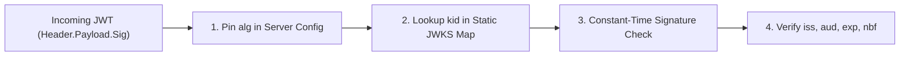

# JWT & OAuth 2.1 Security: RFC 8725 Attacks, Key Confusion & PKCE Hardening

```json continuity
{
  "previously": "In Chapter 02, AeroShield v0.2 blocked BOLA, Mass Assignment, and BFLA by checking the caller's `user_id`, `tenant_id`, and `role` on every query.",
  "painPoint": "Where do `user_id` and `role` come from? From a JSON Web Token (JWT) in the `Authorization` header! An attacker decoded AeroCart's JWT, changed `\"alg\": \"RS256\"` to `\"alg\": \"none\"`, edited `\"role\": \"admin\"`, stripped the signature, and the naive JWT parser accepted the forged token!",
  "unlock": "Upgrade to AeroShield v0.3 with an RFC 8725-compliant JWT verifier (algorithm allowlisting, kid allowlisting, strict iss/aud/exp/nbf checks), OAuth 2.1 PKCE S256 verification, and Refresh Token Rotation reuse family revocation."
}
```

```json walkthrough
[
  {
    "time": "0:00",
    "badge": "JWT Anatomy",
    "title": "Base64URL Is Encoding, Not Encryption!",
    "caption": "A JWT has 3 dot-separated Base64URL parts: `Header.Payload.Signature`. Anyone can decode and edit the Header and Payload in 1 second—only a cryptographically verified Signature proves the server minted it.",
    "nodes": ["Header (alg, kid)", "Payload (sub, aud, exp)", "Signature (HMAC/RSA)", "Server Verifier"],
    "activeIndex": 2,
    "code": "# Never call jwt.decode(..., options={'verify_signature': False})!\nheader_b64, payload_b64, sig_b64 = token.split('.')"
  },
  {
    "time": "0:25",
    "badge": "RFC 8725 Attacks",
    "title": "alg:none Stripping & RS256-to-HS256 Key Confusion",
    "caption": "If the verifier reads `alg` from the untrusted token header, an attacker sets `alg: none` (empty signature) or `alg: HS256` (signing the token with the server's public RSA key as an HMAC secret!).",
    "nodes": ["Attacker Reads Public RSA Key", "Changes Header alg -> HS256", "Signs with Public Key", "Naive Server Accepts!"],
    "activeIndex": 2,
    "code": "# Fix: Pin allowed algorithms on the server; never trust header['alg']!\nALLOWED_ALGS = frozenset({'RS256'})"
  },
  {
    "time": "0:50",
    "badge": "Claims & kid",
    "title": "kid Path Traversal & Cross-Service Audience (`aud`) Replay",
    "caption": "If `kid` (Key ID) is used as a file path, `kid: \"../../../../dev/null\"` signs with an empty string! And without checking `aud` (Audience), a JWT issued for a partner blog can be replayed against AeroCart Checkout.",
    "nodes": ["kid Allowlist", "iss == auth.aerocart", "aud == api.aerocart", "exp & nbf Window"],
    "activeIndex": 2,
    "code": "assert header['kid'] in JWKS_KEY_MAP\nassert claims['aud'] == 'https://api.aerocart.internal'"
  },
  {
    "time": "1:15",
    "badge": "OAuth 2.1 & PKCE",
    "title": "PKCE S256 Code Binding & Refresh Token Reuse Detection",
    "caption": "PKCE binds the authorization code to `BASE64URL(SHA256(code_verifier))`. And if a rotated Refresh Token is ever replayed twice, the auth server immediately revokes the entire token family!",
    "nodes": ["PKCE S256 Challenge", "Single-Use Refresh Token", "Replay Detected!", "Revoke Entire Family"],
    "activeIndex": 3,
    "code": "if token_record.already_rotated:\n    revoke_token_family(token_record.family_id)"
  }
]
```

```json pretraining
[
  {
    "term": "RFC 8725 (JWT Best Current Practices)",
    "formula": "Pin Algorithm + Validate kid + Assert iss, aud, exp, nbf",
    "meaning": "The official IETF standard cataloging real-world JSON Web Token vulnerabilities and mandating strict server-side algorithm pinning, key-ID allowlisting, and claim validation."
  },
  {
    "term": "RS256-to-HS256 Public-Key Confusion",
    "formula": "Asymmetric Public Key -> Treated as Symmetric HMAC Secret",
    "meaning": "When a server uses RSA (private key signs, public key verifies) but trusts the token's `alg` header, an attacker switches `alg` to `HS256` and signs a forged token using the server's publicly downloadable RSA public key bytes."
  },
  {
    "term": "OAuth 2.1 PKCE (`S256`)",
    "formula": "code_challenge = BASE64URL(SHA256(code_verifier))",
    "meaning": "Proof Key for Code Exchange (RFC 7636) prevents authorization-code interception by requiring the client that starts the login flow to prove possession of the random secret `code_verifier` when exchanging the code for tokens."
  },
  {
    "term": "Refresh Token Rotation & Family Revocation",
    "formula": "Reuse of Rotated Token R_1 -> Invalidate Family {R_1, R_2, ...}",
    "meaning": "Every time a refresh token is used, it is replaced with a new one. If an attacker (or victim) ever presents an already-used refresh token, the server detects the theft and revokes the entire token family immediately."
  }
]
```

## 🌱 Step 1: Plain-English Mental Model — The Self-Stamped Passport Trap

Imagine an international border checkpoint where travelers carry a passport (`JWT`). At the top of page 1, the passport has a small box labeled **"Verification Method (`alg`)"**:
- Normally, it says `"Official Hologram Stamp (RS256)"`, which only the government's private printing press can create, while border guards verify it using a public handbook.
- One day, a traveler erases that box, writes **"No Stamp Needed (`alg: none`)"**, and writes `"Diplomat (role: admin)"` on page 2. If the border guard obeys the instruction written *inside the traveler's own passport*, the traveler walks right through!
- Even worse, what if the traveler writes **"Verify Using Public Handbook Text as a Wax Seal (`alg: HS256`)"** and presses the public handbook onto warm wax? Because everyone has a copy of the public handbook, the traveler can forge any signature they want!



**IETF RFC 8725 (JSON Web Token Best Current Practices)** establishes the golden rule of token security: **Never let an untrusted token header dictate how the server verifies that token.**

---

## 🔨 Step 2: Zero-to-Running Starter & CLI — Inspecting & Hardening JWTs (`AeroShield v0.3`)

From any terminal, you can inspect a JWT's header and payload in one command—proving that Base64URL hides nothing:

```bash
# Decode a JWT header and payload from the CLI using python3 stdlib
python3 -c 'import base64, sys; t="eyJhbGciOiJub25lIn0.eyJzdWIiOiJ1c3JfMSIsInJvbGUiOiJhZG1pbiJ9."; print([base64.urlsafe_b64decode(p + "===") for p in t.split(".")[:2]])'
```

Let's build **`AeroShield v0.3`** in pure Python 3 stdlib (`hmac`, `hashlib`, `base64`, `json`), demonstrating how `AeroShield` blocks `alg:none`, algorithm confusion, `kid` path traversal, and expired/wrong-audience tokens:

```python
from __future__ import annotations
import base64
import hashlib
import hmac
import json


def _b64url_encode(data: bytes) -> str:
    return base64.urlsafe_b64encode(data).rstrip(b"=").decode("ascii")


def _b64url_decode(segment: str) -> bytes:
    pad = "=" * (-len(segment) % 4)
    return base64.urlsafe_b64decode(segment + pad)


# Subgoal 1: Mint a valid HS256 token with kid, iss, aud, exp, and nbf claims
JWKS_KEYS: dict[str, bytes] = {"aerocart-key-2026-v1": b"super-secret-32-byte-signing-key!!"}


def mint_hs256_jwt(header: dict[str, str], payload: dict[str, object], secret: bytes) -> str:
    h_b64 = _b64url_encode(json.dumps(header, separators=(",", ":")).encode())
    p_b64 = _b64url_encode(json.dumps(payload, separators=(",", ":")).encode())
    signing_input = f"{h_b64}.{p_b64}".encode("ascii")
    sig = hmac.new(secret, signing_input, hashlib.sha256).digest()
    return f"{h_b64}.{p_b64}.{_b64url_encode(sig)}"


# Subgoal 2: Enforce RFC 8725 verification (Pin alg, allowlist kid, constant-time sig, validate iss/aud/exp/nbf)
def verify_rfc8725_jwt(token: str, now_epoch: int) -> dict[str, object]:
    parts = token.split(".")
    if len(parts) != 3:
        raise ValueError("MALFORMED_JWT")
    header = json.loads(_b64url_decode(parts[0]))
    payload = json.loads(_b64url_decode(parts[1]))

    # RFC 8725 §3.1: Pin expected algorithm; reject 'none' or unexpected alg
    if header.get("alg") != "HS256":
        raise PermissionError(f"ALG_REJECTED: {header.get('alg')}")

    # RFC 8725 §3.11: Lookup kid strictly in server allowlist (never filesystem open()!)
    kid = str(header.get("kid", ""))
    if kid not in JWKS_KEYS:
        raise PermissionError("KID_NOT_IN_ALLOWLIST")

    # Constant-time signature verification
    signing_input = f"{parts[0]}.{parts[1]}".encode("ascii")
    expected_sig = hmac.new(JWKS_KEYS[kid], signing_input, hashlib.sha256).digest()
    actual_sig = _b64url_decode(parts[2])
    if not hmac.compare_digest(expected_sig, actual_sig):
        raise PermissionError("BAD_SIGNATURE")

    # RFC 8725 §3.8-3.9: Validate iss, aud, exp, nbf
    if payload.get("iss") != "https://auth.aerocart.local":
        raise PermissionError("INVALID_ISS")
    if payload.get("aud") != "https://api.aerocart.local":
        raise PermissionError("INVALID_AUD")
    if now_epoch >= int(payload.get("exp", 0)) or now_epoch < int(payload.get("nbf", 0)):
        raise PermissionError("TOKEN_EXPIRED_OR_NOT_YET_VALID")
    return payload


# Subgoal 3: Verify valid token passes while alg:none and kid traversal fail
valid_tok = mint_hs256_jwt(
    {"alg": "HS256", "typ": "JWT", "kid": "aerocart-key-2026-v1"},
    {"sub": "usr_alice", "iss": "https://auth.aerocart.local", "aud": "https://api.aerocart.local", "nbf": 1700000000, "exp": 1700003600},
    JWKS_KEYS["aerocart-key-2026-v1"],
)
assert verify_rfc8725_jwt(valid_tok, now_epoch=1700000500)["sub"] == "usr_alice"

# Forged alg:none token with empty signature
none_hdr = _b64url_encode(b'{"alg":"none"}')
none_pay = _b64url_encode(b'{"sub":"admin"}')
forged_none = f"{none_hdr}.{none_pay}."
try:
    verify_rfc8725_jwt(forged_none, now_epoch=1700000500)
    raise AssertionError("alg:none must fail")
except PermissionError as exc:
    assert "ALG_REJECTED" in str(exc)
print("AeroShield v0.3 RFC 8725 JWT verifier passed.")
```

### Java 17 Equivalent

```java
import java.nio.charset.StandardCharsets;
import java.security.MessageDigest;
import java.util.Base64;
import java.util.Map;
import javax.crypto.Mac;
import javax.crypto.spec.SecretKeySpec;

public class AeroShieldCh03Starter {
    private static final Map<String, byte[]> JWKS = Map.of(
            "aerocart-key-2026-v1", "super-secret-32-byte-signing-key!!".getBytes(StandardCharsets.UTF_8));

    public static void main(String[] args) throws Exception {
        // Subgoal 1: Verify constant-time HMAC signature and strict kid/alg pinning
        String headerJson = "{\"alg\":\"HS256\",\"kid\":\"aerocart-key-2026-v1\"}";
        String payloadJson = "{\"sub\":\"usr_alice\",\"aud\":\"https://api.aerocart.local\"}";
        String hB64 = Base64.getUrlEncoder().withoutPadding().encodeToString(headerJson.getBytes(StandardCharsets.UTF_8));
        String pB64 = Base64.getUrlEncoder().withoutPadding().encodeToString(payloadJson.getBytes(StandardCharsets.UTF_8));
        String sigB64 = signHs256(hB64 + "." + pB64, JWKS.get("aerocart-key-2026-v1"));

        assert verifyToken(hB64 + "." + pB64 + "." + sigB64, "HS256", "aerocart-key-2026-v1");
        // Subgoal 2: Reject alg:none or unknown kid traversal
        assert !verifyToken(hB64 + "." + pB64 + ".", "none", "aerocart-key-2026-v1");
        assert !verifyToken(hB64 + "." + pB64 + "." + sigB64, "HS256", "../../dev/null");
    }

    private static String signHs256(String input, byte[] secret) throws Exception {
        Mac mac = Mac.getInstance("HmacSHA256");
        mac.init(new SecretKeySpec(secret, "HmacSHA256"));
        return Base64.getUrlEncoder().withoutPadding().encodeToString(mac.doFinal(input.getBytes(StandardCharsets.US_ASCII)));
    }

    public static boolean verifyToken(String token, String algHeader, String kidHeader) throws Exception {
        if (!"HS256".equals(algHeader) || !JWKS.containsKey(kidHeader)) return false;
        String[] parts = token.split("\\.", -1);
        if (parts.length != 3 || parts[2].isEmpty()) return false;
        String expectedSig = signHs256(parts[0] + "." + parts[1], JWKS.get(kidHeader));
        return MessageDigest.isEqual(
                expectedSig.getBytes(StandardCharsets.US_ASCII),
                parts[2].getBytes(StandardCharsets.US_ASCII));
    }
}
```

---

## 🛠️ Step 3: Everyday Practitioner Workflows & Where Naive Code Breaks

### The 4 Deadliest JWT & OAuth 2.1 Vulnerabilities in Production

1. **`alg: "none"` Signature Stripping**: The original JWT spec (RFC 7519) included `"none"` for already-verified debugging messages. If a library defaults to trusting `header.alg`, any token ending in a trailing dot (`header.payload.`) bypasses signature checking completely.
2. **`RS256` $\to$ `HS256` Public-Key Confusion**: The server signs tokens with its private RSA key (`RS256`) and verifies them with its public RSA key (`PUB_KEY_PEM`). If the verification call passes `PUB_KEY_PEM` without restricting `algorithms=["RS256"]`, an attacker fetches `PUB_KEY_PEM` from `/.well-known/jwks.json`, sets `"alg": "HS256"`, and signs the token using `PUB_KEY_PEM` as an HMAC secret!
3. **`kid` Header Injection / Path Traversal / SSRF (`jku`/`x5u`)**:
   - If the server resolves `kid` via `open(f"/keys/{header['kid']}.pem")`, an attacker sends `"kid": "../../../../dev/null"` (whose file content is `b""`) and signs the token with an empty string `""`!
   - If the server trusts `jku` (JWK Set URL) in the header without an allowlist, the attacker points `jku` to their own server hosting their own public key!
4. **Missing `aud` (Audience) Validation**: If Company A's Auth0/Keycloak tenant issues tokens for both `marketing-blog` and `aerocart-payments`, and `aerocart-payments` checks `iss` (Issuer) but forgets to check `aud == "aerocart-payments"`, a compromised blog plugin can replay its token against the payment API!

```json contrast
{
  "title": "JWT Verification (Vulnerable Header-Driven vs. RFC 8725 Hardened)",
  "leftLabel": "❌ Vulnerable JWT Decode (Key Confusion + Missing Claims)",
  "leftCode": "# Fatal 1: Reads alg from untrusted JWT header!\nhdr = jwt.get_unverified_header(token)\n# Fatal 2: Path traversal via kid='../../../../dev/null'\nkey = open(f'/etc/keys/{hdr[\"kid\"]}').read()\n# Fatal 3: Accepts RS256 OR HS256 with same key variable!\n# Fatal 4: Does not validate 'aud' or 'iss'!\npayload = jwt.decode(token, key, algorithms=[hdr['alg']])",
  "rightLabel": "✅ Staff RFC 8725 Hardened Verification",
  "rightCode": "# 1. Lookup key strictly from in-memory JWKS dictionary by kid\nhdr = jwt.get_unverified_header(token)\npublic_rsa_key = JWKS_ALLOWLIST.get(hdr.get('kid'))\nif not public_rsa_key:\n    raise InvalidTokenError('Unknown kid')\n# 2. Hard-code algorithms=['RS256'] & enforce iss, aud, exp, nbf\npayload = jwt.decode(\n    token,\n    key=public_rsa_key,\n    algorithms=['RS256'],\n    issuer='https://auth.aerocart.com',\n    audience='https://api.aerocart.com',\n    options={'require': ['exp', 'nbf', 'iss', 'aud', 'sub']}\n)"
}
```

```json poe
{
  "question": "Predict the outcome: An API server verifies JWTs using `jwt.decode(token, key=RSA_PUBLIC_KEY_PEM, algorithms=['RS256', 'HS256'])`. An attacker downloads `RSA_PUBLIC_KEY_PEM` from the public `/jwks.json` endpoint, forges `{\"sub\": \"admin\"}` with header `{\"alg\": \"HS256\"}`, and signs it via `HMAC-SHA256(RSA_PUBLIC_KEY_PEM, header.payload)`. What does the server do?",
  "options": [
    "Rejects the token because RSA keys cannot be passed into HMAC functions",
    "Accepts the forged admin token! Because `'HS256'` is in the allowed list, the server feeds the public RSA PEM bytes into `HMAC-SHA256` as a symmetric secret, matching the attacker's signature byte-for-byte",
    "Throws an OpenSSL ASN.1 parsing error before checking the signature",
    "Blocks the request via CORS"
  ],
  "answerIndex": 1,
  "explanation": "To an HMAC function, an RSA public key PEM string is just an array of bytes! Allowing both asymmetric (`RS256`) and symmetric (`HS256`) algorithms against the same key variable enables classic RFC 8725 Key Confusion."
}
```

---

## 🏢 Step 4: How Big Tech Runs It at Scale, Staff Math & Production Blueprint

### 🏢 In the Wild: OAuth 2.1 PKCE (`S256`) & Refresh Token Reuse Detection at Auth0 / Okta / Google

In modern **OAuth 2.1**, the legacy Implicit Flow (`response_type=token`) is completely removed because access tokens leaked in URL fragments and browser history. Instead, every web, mobile, and CLI client uses **Authorization Code Flow + PKCE (`RFC 7636`)** paired with **Refresh Token Rotation**:
1. **PKCE `S256` Binding (`code_verifier` $\to$ `code_challenge`)**:
   - Before redirecting to login, the client generates a high-entropy secret `code_verifier` and sends only its SHA-256 hash: `code_challenge = BASE64URL(SHA256(code_verifier))` with `code_challenge_method = "S256"` (never downgrade to `"plain"`!).
   - Even if malware intercepts the temporary `authorization_code` on redirect, it cannot exchange it at `/oauth/token` without the original `code_verifier`.
2. **Refresh Token Family Revocation**:
   - Access tokens are short-lived (`5–15 minutes`); Refresh tokens are single-use (`R_1 -> R_2 -> R_3`) linked by a `family_id`.
   - If an attacker steals `R_1` and uses it after the legitimate user already rotated `R_1 -> R_2` (or vice versa), the auth server sees a **second presentation of an already-rotated token (`R_1`)** and immediately revokes the **entire `family_id`**, forcing clean re-authentication!

### Staff Cryptographic & Token Lifetime Math

Why must PKCE `code_verifier` and HMAC secrets contain at least 256 bits of cryptographic entropy? Under offline brute-force at $R = 10^{10}$ hashes/sec, expected crack time for $b$-bit entropy is:

$$T_{\text{crack}}(b) = \frac{2^{b-1}}{R} \implies T_{\text{crack}}(256) \approx \frac{2^{255}}{10^{10}} \approx 5.78 \times 10^{66}\text{ seconds}$$

And for PKCE `S256` verification (`RFC 7636 §4.6`):

$$\text{Verify}_{\text{PKCE}}(v, c) \iff \text{BASE64URL\_NOPAD}\!\left(\text{SHA-256}(\text{ASCII}(v))\right) \equiv c$$

| Token / Auth Mechanism | Primary Threat Defeated | Lifespan / Rotation Rule | When NOT to Use It |
| :--- | :--- | :--- | :--- |
| **Asymmetric JWT (`RS256` / `ES256`)** | Microservices verify tokens without holding a signing secret | `5–15 min` TTL + `leeway=30s` clock skew | Never store long-lived sessions in unrevocable stateless JWTs |
| **PKCE (`S256`, RFC 7636)** | Authorization code interception on mobile/SPA redirects | Single-use per login flow (`43–128` char verifier) | Never accept `code_challenge_method="plain"` in production |
| **Rotating Refresh Tokens** | Stolen long-lived refresh token persistence | Rotate on every refresh; revoke `family_id` on reuse | Server-to-server workloads using mTLS or short-lived client credentials |

### Production Blueprint: `AeroShield v0.3` PKCE `S256` & Refresh-Token Family Reuse Detector

```python
from __future__ import annotations
import base64
import hashlib
import hmac
import secrets
from dataclasses import dataclass


def pkce_s256_challenge(code_verifier: str) -> str:
    if not (43 <= len(code_verifier) <= 128):
        raise ValueError("RFC 7636 requires code_verifier length in [43..128]")
    digest = hashlib.sha256(code_verifier.encode("ascii")).digest()
    return base64.urlsafe_b64encode(digest).rstrip(b"=").decode("ascii")


def verify_pkce_s256(code_verifier: str, expected_challenge: str, method: str = "S256") -> bool:
    if method != "S256":
        return False  # Reject 'plain' downgrade attack!
    computed = pkce_s256_challenge(code_verifier)
    return hmac.compare_digest(computed, expected_challenge)


@dataclass
class RefreshTokenRecord:
    token_id: str
    family_id: str
    user_id: str
    used: bool = False
    revoked: bool = False


class OAuthRefreshRotationGuard:
    """Implements OAuth 2.1 Refresh Token Rotation with automatic family revocation on reuse."""

    def __init__(self) -> None:
        self._tokens: dict[str, RefreshTokenRecord] = {}

    def issue_initial_family(self, user_id: str) -> str:
        family_id = f"fam_{secrets.token_hex(6)}"
        tok_id = f"rt_{secrets.token_hex(8)}"
        self._tokens[tok_id] = RefreshTokenRecord(tok_id, family_id, user_id)
        return tok_id

    def rotate_refresh_token(self, presented_token_id: str) -> tuple[int, str]:
        rec = self._tokens.get(presented_token_id)
        if rec is None or rec.revoked:
            return 401, "INVALID_OR_REVOKED_TOKEN"

        if rec.used:
            # Theft detected! Revoke EVERY token in this family_id immediately
            for item in self._tokens.values():
                if item.family_id == rec.family_id:
                    item.revoked = True
            return 401, f"REUSE_DETECTED_FAMILY_REVOKED:{rec.family_id}"

        rec.used = True
        next_tok_id = f"rt_{secrets.token_hex(8)}"
        self._tokens[next_tok_id] = RefreshTokenRecord(next_tok_id, rec.family_id, rec.user_id)
        return 200, next_tok_id


if __name__ == "__main__":
    # 1. Verify PKCE S256 challenge & block 'plain' downgrade
    verifier = "dBjftJeZ4CVP-mB92K27uhbUJU1p1r_wW1gFWFOEjXk"
    challenge = pkce_s256_challenge(verifier)
    assert verify_pkce_s256(verifier, challenge, "S256") is True
    assert verify_pkce_s256(verifier, verifier, "plain") is False

    # 2. Verify Refresh Token Rotation & Family Revocation on replay
    guard = OAuthRefreshRotationGuard()
    rt1 = guard.issue_initial_family("usr_alice")
    status1, rt2 = guard.rotate_refresh_token(rt1)
    assert status1 == 200 and rt2.startswith("rt_")

    # Attacker replays stolen rt1 -> triggers family-wide revocation!
    status_replay, msg = guard.rotate_refresh_token(rt1)
    assert status_replay == 401 and "REUSE_DETECTED_FAMILY_REVOKED" in msg

    # Now even rt2 is revoked, forcing clean re-authentication
    status_rt2, _ = guard.rotate_refresh_token(rt2)
    assert status_rt2 == 401
    print("AeroShield v0.3 PKCE S256 & Refresh Token Family Revocation verified.")
```

### Java 17 Equivalent

```java
import java.nio.charset.StandardCharsets;
import java.security.MessageDigest;
import java.util.Base64;
import java.util.HashMap;
import java.util.Map;

public final class AeroShieldCh03Blueprint {
    public static String computePkceS256(String codeVerifier) throws Exception {
        if (codeVerifier.length() < 43 || codeVerifier.length() > 128) {
            throw new IllegalArgumentException("Invalid RFC 7636 verifier length");
        }
        MessageDigest sha256 = MessageDigest.getInstance("SHA-256");
        byte[] digest = sha256.digest(codeVerifier.getBytes(StandardCharsets.US_ASCII));
        return Base64.getUrlEncoder().withoutPadding().encodeToString(digest);
    }

    public static boolean verifyPkce(String verifier, String challenge, String method) throws Exception {
        if (!"S256".equals(method)) return false;
        String computed = computePkceS256(verifier);
        return MessageDigest.isEqual(
                computed.getBytes(StandardCharsets.US_ASCII),
                challenge.getBytes(StandardCharsets.US_ASCII));
    }

    private final Map<String, Boolean> usedTokens = new HashMap<>();
    private final Map<String, String> tokenToFamily = new HashMap<>();
    private final Map<String, Boolean> revokedFamilies = new HashMap<>();

    public void registerToken(String tokenId, String familyId) {
        usedTokens.put(tokenId, false);
        tokenToFamily.put(tokenId, familyId);
        revokedFamilies.putIfAbsent(familyId, false);
    }

    public int rotate(String tokenId, String newTokenId) {
        String family = tokenToFamily.get(tokenId);
        if (family == null || Boolean.TRUE.equals(revokedFamilies.get(family))) return 401;
        if (Boolean.TRUE.equals(usedTokens.get(tokenId))) {
            revokedFamilies.put(family, true); // Revoke entire family on replay!
            return 401;
        }
        usedTokens.put(tokenId, true);
        registerToken(newTokenId, family);
        return 200;
    }

    public static void main(String[] args) throws Exception {
        String v = "dBjftJeZ4CVP-mB92K27uhbUJU1p1r_wW1gFWFOEjXk";
        String c = computePkceS256(v);
        assert verifyPkce(v, c, "S256");
        assert !verifyPkce(v, v, "plain");

        AeroShieldCh03Blueprint rot = new AeroShieldCh03Blueprint();
        rot.registerToken("rt_1", "fam_A");
        assert rot.rotate("rt_1", "rt_2") == 200;
        assert rot.rotate("rt_1", "rt_evil") == 401; // Replay triggers revocation
        assert rot.rotate("rt_2", "rt_3") == 401;    // Family fam_A is now revoked!
    }
}
```

> [!WARNING]
> **Hiring Bar-Raiser Gotcha — `jwt.decode(..., options={"verify_signature": False})` & `kid` SQL/Path Injection!**
> Many microservices sit behind an API Gateway and call `jwt.decode(token, options={"verify_signature": False})` assuming "the gateway already verified the JWT." In any service mesh where an internal container, SSRF bug, or misconfigured route can reach the microservice directly, skipping signature verification turns every endpoint into an unauthenticated root shell! Always verify JWT signatures at the workload using cached JWKS public keys (`RS256`/`ES256`), and ensure `kid` is validated against a strict regex (`^[a-zA-Z0-9_-]{1,64}$`) before lookup!

*Up Next in Chapter 04*: Even with ironclad JWT authentication and BOLA checks, what happens if an authenticated user passes `' OR 1=1 --`, `{"$ne": null}`, `; cat /etc/passwd`, or `{{7*7}}` inside a search filter? Next, we master **SQLi, NoSQLi, OS Command Injection, and SSTI**.

```json quiz
[
  {
    "id": "sec03-q1",
    "question": "How does the RFC 8725 `RS256`-to-`HS256` Key Confusion attack work?",
    "options": [
      "The attacker factors the 2048-bit RSA modulus using a rainbow table",
      "The attacker changes the JWT header `alg` from `RS256` to `HS256` and signs the token using the server's publicly known RSA public key bytes as a symmetric HMAC secret",
      "The attacker compresses the JWT payload with gzip",
      "The attacker sets `exp` to a negative timestamp"
    ],
    "answerIndex": 1,
    "explanation": "If the server passes its RSA public key into `jwt.decode()` without strictly pinning `algorithms=['RS256']`, the library treats the RSA public key bytes as an HMAC secret when `alg` is `HS256`."
  },
  {
    "id": "sec03-q2",
    "question": "Why does OAuth 2.1 mandate PKCE with `code_challenge_method = S256` and forbid downgrading to `plain`?",
    "options": [
      "Because `plain` challenges cannot be URL-encoded",
      "Because under `plain`, `code_challenge == code_verifier`, so any attacker who observes the initial authorization request on the device or network immediately learns the `code_verifier` needed to redeem the code",
      "Because `S256` encrypts the user's password inside the cookie",
      "Because `plain` only works with HTTP/1.0"
    ],
    "answerIndex": 1,
    "explanation": "With `S256`, the authorization request carries only `BASE64URL(SHA256(code_verifier))`. Since SHA-256 is one-way, observing the authorization request does not reveal `code_verifier`."
  },
  {
    "id": "sec03-q3",
    "question": "In OAuth 2.1 Refresh Token Rotation, Refresh Token `RT_1` is exchanged by the legitimate mobile app for `RT_2`. Two minutes later, an attacker who stole `RT_1` from device logs attempts to exchange `RT_1`. What must the authorization server do?",
    "options": [
      "Re-issue a copy of `RT_2` for idempotency",
      "Reject `RT_1` and immediately revoke the entire token family (including `RT_2`), forcing the user to re-authenticate",
      "Extend the expiration of `RT_2` by 30 days",
      "Downgrade `RT_2` to read-only scope"
    ],
    "answerIndex": 1,
    "explanation": "When a single-use rotated refresh token (`RT_1`) is presented a second time, the server knows a token in that family was compromised and revokes the entire `family_id`."
  }
]
```

---

## 📋 Step 5: Master Cheat-Sheet, 60-Second Interview Pitch & Verified Sources

| JWT / OAuth Vector | Attack Payload | Server Hardening Control | Security Test Assertion |
| :--- | :--- | :--- | :--- |
| **`alg: "none"`** | `{"alg":"none"}.{"sub":"admin"}.` | Pin `algorithms=["RS256"]` on server | Assert `401` on `alg: none` & `Alg: None` |
| **`RS256 -> HS256` Confusion** | Sign with RSA public key as HMAC secret | Never mix asymmetric & symmetric algs | Sign with `/jwks.json` PEM in test; assert `401` |
| **`kid` Header Injection** | `"kid": "../../../../dev/null"` | Lookup `kid` in static/cached dict only | Assert `401` on path traversal & SQL chars in `kid` |
| **Cross-Service Replay** | Token for `service-a` sent to `service-b` | Require `aud` & `iss` match in verifier | Mint valid token with wrong `aud`; assert `401` |
| **OAuth Code Interception** | Steal `?code=...` from redirect URI | Require PKCE `S256` (`code_verifier`) | Assert `/token` rejects wrong verifier or `plain` |
| **Refresh Token Theft** | Replay already-rotated `RT_1` | Refresh Token Rotation + Family Revocation | Replay `RT_1` after rotation; assert `RT_2` is revoked |

### 🎙️ 60-Second Interview Soundbite

> *"When auditing JWT and OAuth 2.1 implementations against IETF RFC 8725, I focus on four high-severity failure modes. First, the verifier must never trust header metadata to choose its cryptography: I test `alg: none` signature stripping, `RS256`-to-`HS256` public-key confusion using the server's own JWKS public key, and `kid` path traversal (`../../../../dev/null`). Second, I test claim boundaries by replaying valid tokens with mismatched `aud` (Audience), `iss` (Issuer), and boundary `exp`/`nbf` timestamps. Finally, on the OAuth 2.1 lifecycle, I verify that PKCE enforces `S256` while rejecting `plain` downgrades, and that replaying an already-rotated Refresh Token immediately revokes the entire token family."*

### 📚 Verified Primary Sources
- [IETF RFC 8725 — JSON Web Token (JWT) Best Current Practices](https://datatracker.ietf.org/doc/html/rfc8725)
- [IETF RFC 7636 — Proof Key for Code Exchange (PKCE) by OAuth Public Clients](https://datatracker.ietf.org/doc/html/rfc7636)
- [PortSwigger Web Security Academy — JWT Attacks & Key Confusion Labs](https://portswigger.net/web-security/jwt)
