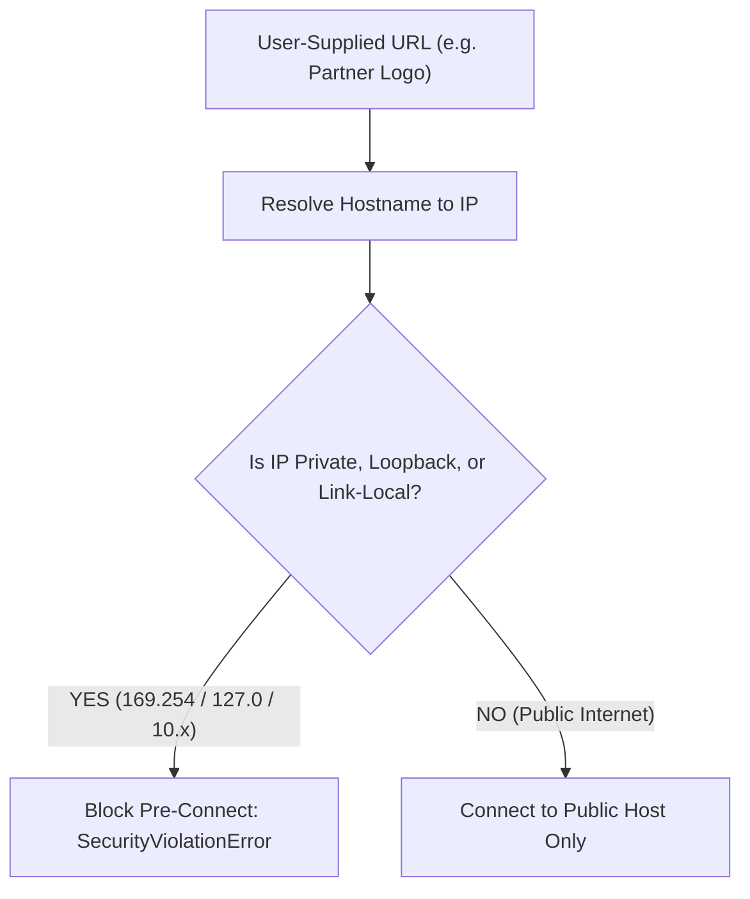

# SSRF Defense, Cloud Metadata IMDSv2 & Stripe-Style HMAC Webhook Verification

```json continuity
{
  "previously": "In Chapter 05, we hardened browser defenses against XSS, CSRF, and CORS origin reflection misconfigurations.",
  "painPoint": "AeroCart added a feature allowing airline partners to supply custom logo image URLs. An attacker entered `http://169.254.169.254/latest/meta-data/iam/security-credentials/`, extracting the Kubernetes pod's AWS IAM role credentials and dumping production S3 buckets!",
  "unlock": "Build AeroShield v0.6: understand OWASP API7 Server-Side Request Forgery, enforce pre-connect resolved-IP validation against RFC 1918 and loopback addresses, configure AWS IMDSv2 hop limits, and verify timestamped HMAC webhook signatures."
}
```

```json walkthrough
[
  {
    "time": "0:00",
    "badge": "SSRF Exploitation",
    "title": "OWASP API7 SSRF: Tricking the Backend into Calling Itself",
    "caption": "When a backend server fetches a user-supplied URL (logo upload, webhook test), attackers provide internal IP addresses: cloud instance metadata (169.254.169.254), loopback (127.0.0.1), or private VPC subnets (10.0.0.0/8).",
    "nodes": ["Attacker URL (169.254.169.254)", "AeroCart Backend", "AWS Metadata Endpoint", "Leaks IAM Secret Keys!"],
    "activeIndex": 1,
    "code": "# Attacker payload targeting AWS metadata service:\nPOST /api/partner/logo\n{\"logo_url\": \"http://169.254.169.254/latest/meta-data/iam/security-credentials/\"}"
  },
  {
    "time": "0:25",
    "badge": "DNS Rebinding",
    "title": "Why Hostname Regex Filters Fail: DNS Rebinding Bypasses",
    "caption": "Filtering string hostnames ('cannot contain 169.254') is easily bypassed: attackers use decimal IPs (2852039166) or DNS rebinding (domain resolves to 1.1.1.1 on check, but 127.0.0.1 on connection)!",
    "nodes": ["Regex Check: evil.com", "Resolves to 1.1.1.1 (PASS)", "TTL=0 Rebind", "Connects to 127.0.0.1!"],
    "activeIndex": 3,
    "code": "# Pre-connect socket IP validation is the ONLY bulletproof defense:\nip = resolve_ip(hostname)\nassert not (ip.is_private or ip.is_loopback or ip.is_link_local)"
  },
  {
    "time": "0:50",
    "badge": "AWS IMDSv2",
    "title": "AWS IMDSv2: Session Token & Hop-Limit=1 Container Defense",
    "caption": "IMDSv2 replaces simple GET requests with a mandatory session token (PUT X-aws-ec2-metadata-token). Setting http-put-response-hop-limit=1 prevents containerized pods from reaching metadata across Docker bridges!",
    "nodes": ["Container Pod", "Bridge (Hop 1)", "Host Network (Hop 2)", "IMDSv2 Hop Limit = 1 (DROPPED)"],
    "activeIndex": 2,
    "code": "# AWS EC2 Metadata option enforcing token and hop-limit:\naws ec2 modify-instance-metadata-options \\\n  --http-tokens required \\\n  --http-put-response-hop-limit 1"
  },
  {
    "time": "1:15",
    "badge": "Stripe HMAC Webhooks",
    "title": "Stripe-Style HMAC-SHA256 Webhook Signatures & Replay Windows",
    "caption": "Webhooks arriving from Stripe or partners must be signed with HMAC-SHA256. Verifying t=timestamp alongside v1=signature using constant-time compare_digest prevents forgery and replay attacks.",
    "nodes": ["Incoming Webhook", "Extract Timestamp & v1", "Check |now - t| < 300s", "hmac.compare_digest(sig)"],
    "activeIndex": 3,
    "code": "Stripe-Signature: t=1700000000,v1=5257ab...\\n# Signed payload: f'{t}.{payload_bytes}'"
  }
]
```

```json pretraining
[
  {
    "term": "Server-Side Request Forgery (SSRF)",
    "formula": "Attacker supplies internal URI -> Backend server fetches internal asset",
    "meaning": "A security vulnerability that allows an attacker to induce the server-side application to make HTTP requests to an arbitrary domain of the attacker's choosing."
  },
  {
    "term": "Cloud Instance Metadata Service (IMDS)",
    "formula": "http://169.254.169.254/latest/meta-data/",
    "meaning": "A link-local IP address accessible only from within virtual machines in AWS, GCP, and Azure that provides temporary IAM credentials and configuration."
  },
  {
    "term": "DNS Rebinding",
    "formula": "Check DNS -> 93.184.216.34 (Valid) -> Fetch DNS -> 127.0.0.1 (Exploit)",
    "meaning": "An attack technique where a domain's DNS response changes dynamically between the time of validation and the time of connection to bypass firewall controls."
  },
  {
    "term": "Constant-Time Comparison",
    "formula": "hmac.compare_digest(a, b) -> Timing Attack Resistant",
    "meaning": "A cryptographic comparison function that takes the same amount of time regardless of how many bytes match, preventing timing side-channel attacks."
  }
]
```

## 🌱 Step 1: Plain-English Mental Model — The Fake Postman and The Sealed Courier

Imagine an office security gate.
- **The SSRF Attack**: An attacker outside cannot enter the vault. So they write a note: *"Please mail this envelope to room 104 in the basement and bring me whatever is inside"* (`169.254.169.254`). If the mailroom clerk blindly follows instructions, the clerk fetches the company secret keys and hands them directly to the stranger!
- **Pre-Connect IP Guard**: The clerk opens their address book. If the destination is an internal room (`RFC 1918`) or the basement security vault (`link-local`), the clerk throws the note in the trash immediately!
- **HMAC Webhook Courier**: When Stripe sends a payment notification, they stamp it with a wax seal created using a shared secret wax stamp. If someone photocopies the letter or tampers with the payment amount, the seal is broken (`HMAC mismatch`).



---

## 🔨 Step 2: Zero-to-Running Starter & CLI — Inspecting IP Ranges & HMACs

Inspect private and link-local IP addresses from your terminal:

```bash
# Verify how Python parses private and cloud metadata IPs
python3 -c "import ipaddress; ip = ipaddress.ip_address('169.254.169.254'); print('Is link-local:', ip.is_link_local)"
```

Let's build a Python SSRF resolved-IP guard and Stripe-style HMAC webhook verifier in stdlib:

```python
from __future__ import annotations
import hashlib
import hmac
import ipaddress
import time

# Subgoal 1: Validate resolved IP addresses before establishing network sockets
def is_safe_public_ip(ip_str: str) -> bool:
    try:
        ip = ipaddress.ip_address(ip_str)
        # Block private subnets (10.x, 172.16.x, 192.168.x), loopback (127.x), and AWS/GCP metadata (169.254.x)
        if ip.is_private or ip.is_loopback or ip.is_link_local or ip.is_reserved or ip.is_multicast:
            return False
        return True
    except ValueError:
        return False

# Subgoal 2: Stripe-style HMAC-SHA256 signature and replay-window verification
def verify_webhook_signature(
    payload_bytes: bytes,
    signature_header: str,
    secret_bytes: bytes,
    now_epoch: int,
    tolerance_sec: int = 300,
) -> bool:
    # Header format: t=1700000000,v1=5257ab...
    parts = dict(item.split("=", 1) for item in signature_header.split(",") if "=" in item)
    if "t" not in parts or "v1" not in parts:
        return False

    ts = int(parts["t"])
    if abs(now_epoch - ts) > tolerance_sec:
        # Replay attack: timestamp too old or far in future!
        return False

    signed_payload = f"{ts}.".encode("ascii") + payload_bytes
    expected_hex = hmac.new(secret_bytes, signed_payload, hashlib.sha256).hexdigest()
    # Constant-time comparison
    return hmac.compare_digest(expected_hex, parts["v1"])

if __name__ == "__main__":
    # Test 1: SSRF IP guards
    assert not is_safe_public_ip("169.254.169.254")  # AWS metadata
    assert not is_safe_public_ip("127.0.0.1")        # Loopback
    assert not is_safe_public_ip("10.0.1.15")        # RFC 1918
    assert is_safe_public_ip("93.184.216.34")        # Public internet

    # Test 2: Webhook HMAC
    secret = b"whsec_test_secret_32bytes_value!"
    body = b'{"event": "flight.booked", "pnr": "AI-101"}'
    t = 1700000000
    sig = hmac.new(secret, f"{t}.".encode("ascii") + body, hashlib.sha256).hexdigest()
    header = f"t={t},v1={sig}"

    assert verify_webhook_signature(body, header, secret, now_epoch=t + 30)
    # Stale replay after 600s fails
    assert not verify_webhook_signature(body, header, secret, now_epoch=t + 600)
    print("AeroShieldCh06 Starter verified: SSRF IP guard & HMAC verification passed.")
```

### Java 17 Equivalent

```java
import java.net.InetAddress;
import java.nio.charset.StandardCharsets;
import java.security.MessageDigest;
import javax.crypto.Mac;
import javax.crypto.spec.SecretKeySpec;

public class AeroShieldCh06Starter {
    public static boolean isSafeIp(String ipStr) {
        try {
            InetAddress addr = InetAddress.getByName(ipStr);
            return !addr.isSiteLocalAddress() && !addr.isLoopbackAddress() && !addr.isLinkLocalAddress();
        } catch (Exception e) {
            return false;
        }
    }

    public static void main(String[] args) {
        assert !isSafeIp("127.0.0.1");
        assert !isSafeIp("169.254.169.254");
        assert isSafeIp("93.184.216.34");
        System.out.println("Java AeroShieldCh06Starter IP verification passed.");
    }
}
```

---

## 🛠️ Step 3: Everyday Practitioner Workflows & Where Naive Code Breaks

What are the most common security failures in webhook and URL handling?
- **Naive URL String Blacklists**: Filtering `if "169.254" in url` is easily bypassed using octal (`http://0251.0376.0251.0376`), hexadecimal (`http://0xa9fea9fe`), or decimal integers (`http://2852039166`).
- **Timing Attacks on Signature Checks**: Using standard string equality (`if expected_sig == actual_sig`) leaks timing information byte-by-byte. Attackers measure microsecond differences to forge valid HMAC signatures! Always use `hmac.compare_digest` in Python or `MessageDigest.isEqual` in Java.
- **Webhook Replay Attacks**: Verifying only the cryptographic signature without checking the timestamp allows an attacker who intercepted an old `payment.succeeded` webhook to re-send it 100 times, double-crediting an account.

```json contrast
{
  "title": "Webhook Signature Verification: Naive String Equality vs. Timestamped Constant-Time HMAC",
  "leftLabel": "❌ Naive Verification (Vulnerable to Replay & Timing)",
  "leftCode": "# Insecure: Leaks timing information and ignores replay timestamp!\ncomputed = hmac.new(secret, payload, 'sha256').hexdigest()\nif computed == signature:\n    credit_account() # Timing attack + Replay vulnerability!",
  "rightLabel": "✅ Staff Timestamped Constant-Time Verification",
  "rightCode": "# Binds timestamp and payload; verifies replay window\nif abs(now - timestamp) > 300:\n    raise SecurityException('Replay window exceeded')\nexpected = hmac.new(secret, f'{timestamp}.{payload}', 'sha256').hexdigest()\nif not hmac.compare_digest(expected, signature):\n    raise SecurityException('Signature mismatch')"
}
```

```json poe
{
  "question": "An application checks if a user-supplied logo URL is safe by resolving its domain name to an IP address before fetching. However, an attacker configures an authoritative DNS server that returns 93.184.216.34 on the first DNS query (validation) and 169.254.169.254 on the second query (HTTP fetch). What attack is this?",
  "options": [
    "Cross-Site Scripting (XSS)",
    "DNS Rebinding Time-Of-Check to Time-Of-Use (TOCTOU) SSRF attack",
    "SQL Injection",
    "Padding Oracle Attack"
  ],
  "answerIndex": 1,
  "explanation": "DNS rebinding exploits the gap between validating an IP address and opening the actual socket. To defeat it, the HTTP client must pin the validated IP address directly when opening the TCP socket, bypassing secondary DNS lookups."
}
```

---

## 🏢 Step 4: How Big Tech Runs It at Scale, Staff Math & Production Blueprint

### 🏢 In the Wild: AWS IMDSv2 & Stripe Webhook Infrastructure

At **AWS** and **Stripe**, defense-in-depth guarantees protection against SSRF and payment forgery:
1. **AWS IMDSv2 Hop-Limit Defense**:
   Under IMDSv2, requests require an initial session token:
   $$\text{TOKEN} = \text{PUT } \texttt{http://169.254.169.254/latest/api/token} \quad (\text{TTL}=21600)$$
   Furthermore, setting `http-put-response-hop-limit: 1` ensures that the IP packet's Time-To-Live (TTL) is 1. When a containerized application running in Docker or Kubernetes attempts to send a packet across the bridge network to the host's metadata service, the bridge decrements the TTL to 0, and the kernel drops the packet immediately!
2. **Cryptographic Constant-Time Comparison Invariant**:
   Standard string comparison short-circuits on the first mismatched byte:
   $$T_{\text{eq}}(k) = k \cdot \tau + C$$
   where $k$ is the number of matching leading bytes and $\tau$ is the comparison cycle cost. By measuring millions of requests, an attacker reconstructs valid signatures. `hmac.compare_digest` executes an XOR accumulator over all bytes:
   $$\text{Diff} = \bigvee_{i=1}^L (A[i] \oplus B[i])$$
   guaranteeing identical execution time regardless of mismatch position.

| Security Surface | Common Attack Vector | Industry Standard Defense |
| :--- | :--- | :--- |
| **Cloud Metadata** | `GET http://169.254.169.254` | Enforce IMDSv2 + `http-put-response-hop-limit: 1` |
| **DNS Rebinding** | Fast-flux DNS switching to 127.0.0.1 | Pre-connect socket IP binding & RFC 1918 block |
| **Webhook Forgery** | Tampered JSON payload | HMAC-SHA256 signature verification |
| **Webhook Replay** | Intercepted webhook re-transmitted | Timestamp binding with 300s window & idempotency keys |

```python
from __future__ import annotations
import hashlib
import hmac
import time

class AeroShieldSSRFAndWebhookGuard:
    """Production SSRF socket pre-filter and Stripe-grade HMAC webhook gate."""

    @staticmethod
    def audit_outbound_ip(ip_str: str) -> tuple[bool, str]:
        import ipaddress
        try:
            ip = ipaddress.ip_address(ip_str)
            if ip.is_private or ip.is_loopback or ip.is_link_local:
                return False, "FORBIDDEN_IP"
            return True, "SAFE_PUBLIC_IP"
        except Exception as exc:
            return False, str(exc)

    @staticmethod
    def generate_signed_webhook(payload: bytes, secret: bytes, timestamp: int) -> str:
        signed_bytes = f"{timestamp}.".encode("ascii") + payload
        sig_hex = hmac.new(secret, signed_bytes, hashlib.sha256).hexdigest()
        return f"t={timestamp},v1={sig_hex}"

if __name__ == "__main__":
    secret = b"production-signing-secret-32-bytes"
    payload = b'{"event":"ticket.issued","booking_id":"BK-999"}'
    ts = int(time.time())

    header = AeroShieldSSRFAndWebhookGuard.generate_signed_webhook(payload, secret, ts)
    assert "t=" in header and "v1=" in header

    # Verify SSRF IP guard
    safe_ok, _ = AeroShieldSSRFAndWebhookGuard.audit_outbound_ip("93.184.216.34")
    bad_ok, _ = AeroShieldSSRFAndWebhookGuard.audit_outbound_ip("169.254.169.254")
    assert safe_ok and not bad_ok
    print("AeroShieldCh06Blueprint verified: SSRF and HMAC webhook gates passed.")
```

### Java 17 Equivalent

```java
import java.security.MessageDigest;

public class AeroShieldCh06Blueprint {
    public static boolean constantTimeEquals(byte[] a, byte[] b) {
        return MessageDigest.isEqual(a, b);
    }

    public static void main(String[] args) {
        byte[] sigA = "abcdef123456".getBytes();
        byte[] sigB = "abcdef123456".getBytes();
        byte[] sigC = "xxxxxx123456".getBytes();
        assert constantTimeEquals(sigA, sigB);
        assert !constantTimeEquals(sigA, sigC);
        System.out.println("Java AeroShieldCh06Blueprint constant-time compare verified.");
    }
}
```

> [!WARNING]
> **Hiring Bar-Raiser Gotcha — Webhook Idempotency vs. Signature Verification!**
> Verifying an HMAC signature proves the webhook was sent by Stripe, but **it does not prevent network retries from executing the same flight refund twice**! In high-scale payment architectures, signature verification must always be paired with an **Idempotency Key Database Table** (`UNIQUE(webhook_id)`), ensuring that duplicate delivery attempts return HTTP 200 without re-executing state transitions!

```json quiz
[
  {
    "id": "sec06-q1",
    "question": "What is the primary risk of an unmitigated Server-Side Request Forgery (SSRF) vulnerability on an AWS EC2 or EKS pod?",
    "options": [
      "The server's hard drive is wiped immediately",
      "An attacker can query the link-local Instance Metadata Service (169.254.169.254) to steal temporary IAM role credentials and access cloud storage and databases",
      "The server switches from Linux to Windows",
      "CSS stylesheets fail to load"
    ],
    "answerIndex": 1,
    "explanation": "Cloud instance metadata at 169.254.169.254 provides IAM credentials for the host's assumed role. SSRF allows external callers to exfiltrate these credentials."
  },
  {
    "id": "sec06-q2",
    "question": "How does AWS IMDSv2 with http-put-response-hop-limit: 1 protect containerized workloads from SSRF metadata theft?",
    "options": [
      "It disables the metadata service entirely",
      "Because containers communicate across a virtual bridge network (which counts as 1 network hop), a hop limit of 1 causes the IP packet to expire before reaching the host metadata endpoint",
      "It requires a biometric fingerprint scan",
      "It encrypts all HTTP headers with RSA 4096"
    ],
    "answerIndex": 1,
    "explanation": "Setting the IP TTL / hop limit to 1 ensures packets originating from inside a container bridge network decrement to 0 and are dropped before reaching the host's metadata service."
  },
  {
    "id": "sec06-q3",
    "question": "Why must cryptographic webhook signatures be checked using constant-time comparison (e.g. hmac.compare_digest)?",
    "options": [
      "To prevent timing attacks where attackers measure sub-microsecond differences in string comparison to guess valid signature bytes",
      "Because standard string comparison is not supported in Python 3",
      "To speed up execution by 100x",
      "To compress the signature string"
    ],
    "answerIndex": 0,
    "explanation": "Standard string comparison short-circuits on the first mismatched byte, allowing attackers to incrementally infer signature characters by measuring execution time."
  }
]
```

---

## 📋 Step 5: Master Cheat-Sheet, 60-Second Interview Pitch & Verified Sources

| Security Boundary | Threat Vector | Automated Detection / Defense | Invariant Enforced |
| :--- | :--- | :--- | :--- |
| **Outbound Webhooks** | SSRF against `169.254.169.254` | Pre-connect resolved IP validation | Reject RFC 1918 / link-local / loopback |
| **AWS Metadata** | Tokenless metadata scraping | AWS IMDSv2 + hop-limit=1 | Containers cannot reach metadata across bridge |
| **Incoming Webhooks** | Signature tampering | HMAC-SHA256 with `hmac.compare_digest` | Zero timing side-channel leakage |
| **Replay Attacks** | Intercepted webhook re-sent | Timestamp window ($< 300\text{s}$) + `UNIQUE(id)` | Idempotent single execution |

### 🎙️ 60-Second Interview Soundbite

> *"Securing application and API boundaries requires addressing both outbound request forgery and incoming webhook authentication. For outbound integrations like partner logo fetchers, we prevent OWASP API7 SSRF by enforcing pre-connect socket IP resolution, strictly blocking private RFC 1918 ranges, loopback addresses, and link-local cloud metadata (169.254.169.254). At the cloud layer, we mandate AWS IMDSv2 with a hop-limit of 1 so containerized pods cannot access host credentials across bridge networks. For incoming webhooks, we follow Stripe's security architecture: we bind timestamps to the payload using HMAC-SHA256, verify signatures using constant-time `compare_digest` to prevent timing attacks, enforce a 300-second replay window, and record event IDs in an idempotent database table to prevent duplicate transaction execution."*

### 📚 Verified Primary Sources
- [OWASP API Security Top 10 — API7:2023 Server Side Request Forgery](https://owasp.org/API-Security/editions/2023/en/0xa7-server-side-request-forgery/)
- [Stripe Security Documentation — Webhook Signatures and Replay Defense](https://docs.stripe.com/webhooks/signatures)
