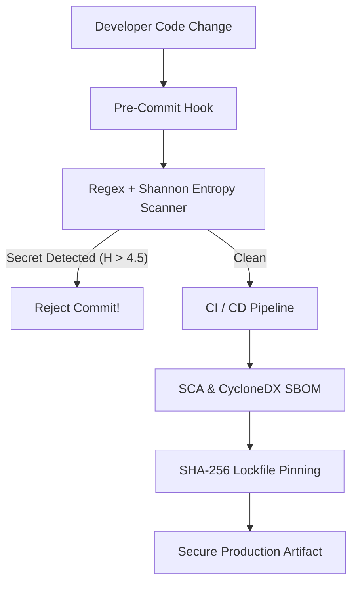

# Supply Chain Security: SCA, SBOMs, Shannon Entropy & Secret Scanning

```json continuity
{
  "previously": "In Chapter 08, we defended Generative AI support agents against prompt injection and excessive autonomous agency.",
  "painPoint": "A junior engineer accidentally committed a production Stripe secret key to a public git pull request. Simultaneously, an attacker registered a malicious package named `@aerocart/auth-utils` on public npm, tricking AeroCart's CI pipeline into downloading backdoored code instead of the private internal artifact!",
  "unlock": "Build AeroShield v0.9: mathematically detect high-entropy API secrets using Shannon entropy and regex, generate CycloneDX Software Bill of Materials (SBOM), enforce SHA-256 hash pinning in package lockfiles, and configure scoped package registries to eliminate dependency confusion."
}
```

```json walkthrough
[
  {
    "time": "0:00",
    "badge": "Secret Leaks in Git",
    "title": "Why Secrets in Git Are Fatal: Git History Is Immutable",
    "caption": "Once a private token is committed to git, it persists across all branches and history even if deleted in a subsequent commit. Automated bot crawlers scrape public commits in seconds.",
    "nodes": ["Developer Commits Secret", "Git Commit Object", "Pushed to Remote", "Bot Scrapes in <30s!"],
    "activeIndex": 3,
    "code": "# Leaked token in commit:\nconst STRIPE_SECRET = \"sk_test_51Msz...\"\n# Even after git rm, the blob remains in .git/objects!"
  },
  {
    "time": "0:25",
    "badge": "Shannon Entropy",
    "title": "Mathematical Secret Detection: Shannon Entropy Scoring",
    "caption": "Plain English words like 'password123' have low entropy (predictable distribution). Cryptographic keys ('xK9#mQ2$pL7!zR4') have high information entropy. We combine regex with Shannon entropy to flag true secrets.",
    "nodes": ["Source Code Diff", "Regex Filter", "Calculate H(X) Entropy", "H > 4.5: Block Commit"],
    "activeIndex": 2,
    "code": "# Shannon Entropy formula:\nH = -sum(p * log2(p))\n# Cryptographic base64/hex keys consistently score H > 4.5"
  },
  {
    "time": "0:50",
    "badge": "Dependency Confusion",
    "title": "Dependency Confusion: Public vs Private Registry Collisions",
    "caption": "Build tools like npm and pip search public registries if an internal package is not properly scoped. If an attacker publishes version 99.0.0 of your internal package on npmjs.com, CI pulls the attacker's package!",
    "nodes": ["Internal Package: @corp/auth", "Attacker Registers on npmjs (v99)", "CI Build Runs npm install", "Compromised Artifact Installed!"],
    "activeIndex": 3,
    "code": "// Vulnerable package.json:\n\"dependencies\": { \"internal-billing\": \"^1.0.0\" }\n// Fix: Enforce scoped names: \"@aerocart/internal-billing\""
  }
]
```

---

## 🌱 Step 1: Plain-English Mental Model

Imagine building a luxury airplane. 

You don't manufacture every bolt, tire, or computer chip from raw ore yourself; you buy them from thousands of external suppliers. This is your **Supply Chain**. If a rogue vendor delivers screws made of brittle plastic, the plane fails even if your engine design is flawless.

In modern software, 80% to 90% of an application's codebase consists of open-source third-party dependencies (`npm`, `pip`, `maven`). A **Software Bill of Materials (SBOM)** is the complete ingredient list of every component, version, and license that goes into your software container.



To prevent poisoned components from sneaking into our builds, we enforce **Cryptographic SHA-256 Lockfile Pinning** and generate standard machine-readable SBOMs (CycloneDX) to audit known CVE vulnerabilities instantly.

---

## 🔨 Step 2: Zero-to-Running Starter & CLI

Let's run a practical script that calculates the Shannon entropy of arbitrary strings to differentiate between standard source code identifiers and high-entropy cryptographic secrets.

### Terminal Commands

```bash
# Verify Python math and standard library
python3 -c "import math; print('Math module ready for entropy calculations')"
```

### Python 3 Runnable Implementation

```python
import math
import re
from typing import Dict, List, Tuple

# Subgoal 1: Shannon Entropy Calculation
def calculate_shannon_entropy(data: str) -> float:
    """Calculates the Shannon information entropy H(X) of a given string.
    Random base64/hex keys have high entropy (~4.0 - 6.0), while English text has low entropy (~2.0 - 3.5).
    """
    if not data:
        return 0.0
    
    char_counts: Dict[str, int] = {}
    for char in data:
        char_counts[char] = char_counts.get(char, 0) + 1

    length = len(data)
    entropy = 0.0
    for count in char_counts.values():
        p = count / length
        entropy -= p * math.log2(p)

    return entropy

# Subgoal 2: Secret Detector combining Regex with Entropy
KNOWN_SECRET_PREFIXES = [
    re.compile(r'(?:sk_test_[0-9a-zA-Z]{24,})'),
    re.compile(r'(?:AKIA[0-9A-Z]{16})'),
    re.compile(r'(?:ghp_[0-9a-zA-Z]{36})')
]

def scan_text_for_secrets(content: str, entropy_threshold: float = 4.3) -> List[Tuple[str, str, float]]:
    findings = []
    # 1. Check known prefixes
    for regex in KNOWN_SECRET_PREFIXES:
        for match in regex.finditer(content):
            val = match.group(0)
            findings.append((val, "KNOWN_PREFIX", calculate_shannon_entropy(val)))

    # 2. Check standalone high-entropy tokens
    tokens = re.findall(r'[a-zA-Z0-9+/=_-]{24,}', content)
    for token in tokens:
        ent = calculate_shannon_entropy(token)
        if ent >= entropy_threshold:
            # Avoid duplicate if already matched by prefix
            if not any(token in f[0] for f in findings):
                findings.append((token, "HIGH_ENTROPY", ent))

    return findings

# Subgoal 3: Verify assertions
# Test sample 1: Benign variable name (Low entropy)
benign_str = "aerocart_production_order_checkout_service"
benign_ent = calculate_shannon_entropy(benign_str)
assert benign_ent < 3.8, f"Benign string had unexpectedly high entropy: {benign_ent}"

# Test sample 2: High-entropy cryptographic API key
crypto_secret = "xK9mQ2pL7zR4vB1wN8jF3gH5tY6uI0oS"
crypto_ent = calculate_shannon_entropy(crypto_secret)
assert crypto_ent >= 4.5, f"Secret entropy was too low: {crypto_ent}"

# Test scan on realistic code block
code_snippet = """
# Configuration file
DATABASE_URL = "postgresql://localhost:5432/aerocart"
STRIPE_KEY = "sk_test_51MszSampleSecretKeyForTestingProduction99"
JWT_HMAC_SECRET = "xK9mQ2+pL7zR4vB1wN8jF3gH5tY6uI0oS="
"""
leaks = scan_text_for_secrets(code_snippet)
assert len(leaks) >= 2, f"Failed to detect secrets! Found: {leaks}"
assert any("sk_test_" in l[0] for l in leaks), "Stripe key not caught!"

print("✅ Starter verified: Shannon entropy calculator and secret scanner operational.")
```

### Java 17 Compilable Verification

```java
import java.util.HashMap;
import java.util.Map;

public class AeroShieldCh09Starter {
    // Subgoal 1: Compute Shannon Entropy in Java 17
    public static double computeShannonEntropy(String input) {
        if (input == null || input.isEmpty()) return 0.0;
        Map<Character, Integer> counts = new HashMap<>();
        for (char c : input.toCharArray()) {
            counts.put(c, counts.getOrDefault(c, 0) + 1);
        }

        double len = input.length();
        double entropy = 0.0;
        for (int count : counts.values()) {
            double p = count / len;
            entropy -= p * (Math.log(p) / Math.log(2.0));
        }
        return entropy;
    }

    public static void main(String[] args) {
        // Subgoal 2: Validate entropy thresholds
        String secret = "dGVzdC1zZWNyZXQta2V5LTk5MjE4MzgxMg==";
        double ent = computeShannonEntropy(secret);

        if (ent < 4.0) {
            throw new AssertionError("Entropy calculation failed: expected >= 4.0, got " + ent);
        }
        System.out.println("✅ Java 17 Starter verified: Shannon entropy computation passed with score: " + ent);
    }
}
```

---

## 🛠️ Step 3: Everyday Practitioner Workflows & Where Naive Code Breaks

```json contrast
{
  "title": "Architectural Contrast: Unpinned Supply Chain vs AeroShield Locked SBOM Architecture",
  "naiveApproach": {
    "title": "Unpinned Dynamic Dependencies",
    "points": [
      "Uses unpinned ranges in requirements/package.json (e.g. `express: ^4.18` or `requests >= 2.20`)",
      "Omits lockfiles (`package-lock.json`, `poetry.lock`) from git, resulting in non-deterministic CI builds",
      "Stores internal private packages with unscoped names on public mirrors, inviting Dependency Confusion attacks",
      "Relies on manual manual code review to find committed AWS secrets and private keys"
    ]
  },
  "hardenedApproach": {
    "title": "AeroShield Cryptographic Supply Chain Architecture",
    "points": [
      "Strict exact-version lockfile pinning with SHA-256/SHA-512 cryptographic integrity hashes verified on every install",
      "Automated CycloneDX Software Bill of Materials (SBOM) generation tracked across all production releases",
      "Enforces private enterprise namespaces (`@aerocart/*`) configured strictly to private artifact registries",
      "Mandatory pre-commit git hooks running regex + Shannon entropy scanners that block commits before pushing"
    ]
  }
}
```

```json poe
{
  "title": "Process of Elimination: Preventing Dependency Confusion Attacks",
  "question": "An enterprise maintains a proprietary internal library named `payment-gateway` hosted on an internal Artifactory server. An external security researcher publishes a malicious package named `payment-gateway` with version `99.0.0` to the public npm registry. How does the organization prevent build machines from pulling the malicious package?",
  "options": [
    {
      "letter": "A",
      "text": "Email the public npm registry to request that all external packages with that name be permanently removed",
      "status": "INCORRECT",
      "reason": "Public registries cannot reserve arbitrary generic names without formal trademark enforcement or scoped namespaces."
    },
    {
      "letter": "B",
      "text": "Enforce organization-scoped package names (e.g. `@aerocart/payment-gateway`) and configure npm/.npmrc to route the entire `@aerocart` scope strictly to the internal private registry",
      "status": "CORRECT",
      "reason": "Scoped namespaces guarantee that package managers will never query public registries for internal dependencies."
    },
    {
      "letter": "C",
      "text": "Always pass `--force` to `npm install` during the CI build process",
      "status": "INCORRECT",
      "reason": "`--force` bypasses dependency resolution conflicts and exacerbates supply chain tampering."
    },
    {
      "letter": "D",
      "text": "Upgrade the local Node.js version from 18 to 22",
      "status": "INCORRECT",
      "reason": "Node.js runtime upgrades do not alter default package resolution rules in npm or yarn."
    }
  ]
}
```

---

## 🏢 Step 4: How Big Tech Runs It at Scale, Staff Math & Production Blueprint

### 🏢 In the Wild: Google SLSA Framework, GitHub Secret Scanning & CycloneDX SBOMs

At Google, GitHub, and Netflix, supply chain security is governed by the **SLSA Framework (Supply-chain Levels for Software Artifacts)**. The foundational premise of SLSA Level 3/4 is: **Builds must be hermetic and tamper-evident**.

Every artifact deployed to production must satisfy three cryptographic invariants:
1. **Source Integrity**: Commits must be cryptographically signed via SSH or GPG.
2. **Deterministic Build Reproducibility**: Builds must run in isolated containers where all external dependency downloads are verified against an immutable cryptographic hash (`sha256:abc...`).
3. **Automated Bill of Materials**: Builds emit a standardized CycloneDX JSON SBOM containing purl (Package URL) identifiers, licenses, and hashes.

### Staff Math: Shannon Information Entropy Calculation

Shannon entropy $H(X)$ measures the average amount of information (in bits) produced by a stochastic source of data symbols $x \in \mathcal{X}$:

$$H(X) = - \sum_{i=1}^{n} P(x_i) \log_2 P(x_i)$$

Where:
- $n$ is the number of distinct characters appearing in the candidate string.
- $P(x_i) = \frac{\text{count}(x_i)}{\text{total length}}$ is the empirical probability of character $x_i$.

For a completely uniform 32-character hexadecimal key (where each hex character $0-9, a-f$ appears with equal probability $P = \frac{1}{16}$):

$$H(\text{Hex Key}) = - 16 \times \left(\frac{1}{16} \log_2 \frac{1}{16}\right) = - \log_2 2^{-4} = 4.0 \text{ bits/char}$$

For a uniform Base64 string ($|\mathcal{X}| = 64$):

$$H(\text{Base64 Key}) = - 64 \times \left(\frac{1}{64} \log_2 \frac{1}{64}\right) = - \log_2 2^{-6} = 6.0 \text{ bits/char}$$

By establishing a threshold $H \ge 4.3 \text{ bits/char}$ for strings of length $\ge 24$, secret scanning tools achieve high detection rates for API keys while ignoring standard lowercase programming identifiers like `get_airline_flight_status` ($H \approx 3.1$).

| Supply Chain Defense | Threat Vector Addressed | Industry Standard / Tool | CI Gate Action |
| :--- | :--- | :--- | :--- |
| **Shannon Entropy Hook** | Leaked cloud & payment secrets | `git-secrets`, `trufflehog` | Rejects git push if $H \ge 4.3$ |
| **Lockfile SHA Pinning** | Tampered upstream package blobs | `npm ci`, `poetry --sync` | Fails build if SHA-256 mismatches |
| **CycloneDX SBOM** | Zero-day CVE discovery (Log4j style) | CycloneDX v1.5 JSON spec | Indexed in Central Vulnerability DB |
| **Scoped Registries** | Dependency Confusion / Typosquatting | `@aerocart/*` in `.npmrc` | Restricts downloads to internal Artifactory |

### Python 3 Production Blueprint: CycloneDX SBOM Generator & Integrity Validator

```python
import hashlib
import json
import math
import os
import tempfile
from typing import Dict, List, Any

# Subgoal 1: CycloneDX 1.5 Minimal SBOM Generator
def generate_cyclonedx_sbom(components: List[Dict[str, str]]) -> Dict[str, Any]:
    """Generates a valid CycloneDX v1.5 JSON Software Bill of Materials."""
    sbom = {
        "bomFormat": "CycloneDX",
        "specVersion": "1.5",
        "version": 1,
        "metadata": {
            "component": {
                "name": "aerocart-platform",
                "version": "1.0.0",
                "type": "application"
            }
        },
        "components": []
    }

    for comp in components:
        sbom["components"].append({
            "type": "library",
            "name": comp["name"],
            "version": comp["version"],
            "purl": f"pkg:pypi/{comp['name']}@{comp['version']}",
            "hashes": [
                {
                    "alg": "SHA-256",
                    "content": comp["sha256"]
                }
            ]
        })

    return sbom

# Subgoal 2: Lockfile Cryptographic Integrity Checker
class SecurityIntegrityError(Exception):
    """Raised when an artifact checksum does not match cryptographic lockfile pin."""
    pass

def verify_lockfile_integrity(lockfile_data: Dict[str, Any], downloaded_files: Dict[str, bytes]) -> bool:
    """Verifies that every downloaded artifact's SHA-256 strictly matches the lockfile hash."""
    for pkg_name, expected_info in lockfile_data.items():
        if pkg_name not in downloaded_files:
            raise ValueError(f"Missing dependency: {pkg_name}")
        
        actual_bytes = downloaded_files[pkg_name]
        actual_hash = hashlib.sha256(actual_bytes).hexdigest()
        if actual_hash != expected_info["sha256"]:
            raise SecurityIntegrityError(
                f"INTEGRITY MISMATCH: Package {pkg_name} hash {actual_hash} != expected {expected_info['sha256']}"
            )
    return True

# Subgoal 3: Verify SBOM Generation and Integrity Assertions
mock_dependencies = [
    {
        "name": "fastapi",
        "version": "0.110.0",
        "sha256": "4a5e3e2b1c0d9e8f7a6b5c4d3e2f1a0b9c8d7e6f5a4b3c2d1e0f9a8b7c6d5e4f"
    },
    {
        "name": "cryptography",
        "version": "42.0.5",
        "sha256": "8b7c6d5e4f3a2b1c0d9e8f7a6b5c4d3e2f1a0b9c8d7e6f5a4b3c2d1e0f9a8b7c"
    }
]

# 1. Generate CycloneDX SBOM
sbom_doc = generate_cyclonedx_sbom(mock_dependencies)
assert sbom_doc["bomFormat"] == "CycloneDX"
assert len(sbom_doc["components"]) == 2
assert "pkg:pypi/fastapi@0.110.0" == sbom_doc["components"][0]["purl"]

# 2. Lockfile verification with identical content
dummy_fastapi_content = b"print('valid fastapi code')"
dummy_hash = hashlib.sha256(dummy_fastapi_content).hexdigest()

lock_manifest = {
    "fastapi": {"version": "0.110.0", "sha256": dummy_hash}
}
downloaded = {
    "fastapi": dummy_fastapi_content
}

assert verify_lockfile_integrity(lock_manifest, downloaded) is True, "Valid package failed integrity check"

# 3. Tampered package must trigger SecurityError
tampered_downloaded = {
    "fastapi": b"print('injected malicious backdoor')"
}
try:
    verify_lockfile_integrity(lock_manifest, tampered_downloaded)
    assert False, "Tampered package should have triggered SecurityIntegrityError!"
except SecurityIntegrityError as e:
    assert "INTEGRITY MISMATCH" in str(e)

print("✅ Production Supply Chain Blueprint verified: CycloneDX SBOM & SHA-256 integrity check passed.")
```

### Java 17 Production Blueprint: Lockfile Integrity Hash Gate

```java
import java.nio.charset.StandardCharsets;
import java.security.MessageDigest;

public class AeroShieldCh09Blueprint {
    // Subgoal 1: Compute SHA-256 hash of dependency bytes
    public static String computeSha256(byte[] content) throws Exception {
        MessageDigest digest = MessageDigest.getInstance("SHA-256");
        byte[] hash = digest.digest(content);
        StringBuilder hexString = new StringBuilder();
        for (byte b : hash) {
            hexString.append(String.format("%02x", b));
        }
        return hexString.toString();
    }

    // Subgoal 2: Validate against locked signature
    public static boolean verifyLock(String expectedHash, byte[] artifactContent) throws Exception {
        String actualHash = computeSha256(artifactContent);
        return actualHash.equalsIgnoreCase(expectedHash);
    }

    public static void main(String[] args) throws Exception {
        // Subgoal 3: Verify gate enforcement
        byte[] legitimateJar = "package com.aerocart.auth; public class AuthGate {}".getBytes(StandardCharsets.UTF_8);
        String expectedHash = computeSha256(legitimateJar);

        boolean pass = verifyLock(expectedHash, legitimateJar);
        if (!pass) {
            throw new AssertionError("Valid JAR failed SHA-256 lock verification!");
        }

        byte[] backdooredJar = "package com.aerocart.auth; public class AuthGate { static { evil(); } }".getBytes(StandardCharsets.UTF_8);
        boolean fail = verifyLock(expectedHash, backdooredJar);
        if (fail) {
            throw new AssertionError("Tampered JAR bypassed SHA-256 lock verification!");
        }

        System.out.println("✅ Java 17 Blueprint verified: Cryptographic lockfile validation defeated supply chain tampering.");
    }
}
```

> [!WARNING]
> **Never commit `.env` files or API secrets into git repositories, even temporarily on feature branches!** Git commits are content-addressable objects indexed in `.git/objects`. Simply running `git rm .env` and committing again leaves the secret completely intact in the historical commit tree. Anyone with read access to the repo can inspect `git log -p` and dump your keys. Always configure `.gitignore` before creating keys, and enforce pre-commit rejection hooks.

```json quiz
[
  {
    "id": "sec09-q1",
    "question": "What is the primary function of a Software Bill of Materials (SBOM) in modern application security?",
    "options": [
      "To increase the speed of the JavaScript compiler",
      "To provide an inventory of all third-party libraries, transitive dependencies, versions, licenses, and cryptographic hashes contained in a software artifact",
      "To replace the need for unit testing",
      "To convert Python code to C++"
    ],
    "answerIndex": 1,
    "explanation": "An SBOM is a formal, machine-readable inventory of software components that allows rapid identification of newly disclosed vulnerabilities (such as Log4Shell)."
  },
  {
    "id": "sec09-q2",
    "question": "Why does Shannon information entropy scoring effectively detect cryptographic keys in source code diffs?",
    "options": [
      "Because cryptographic keys always start with the word 'key'",
      "Because high-entropy strings have a near-uniform probability distribution across a large character set, making them mathematically distinct from repetitive natural language or standard code syntax",
      "Because Shannon entropy only works on prime numbers",
      "Because it counts the number of spaces in a line"
    ],
    "answerIndex": 1,
    "explanation": "Random cryptographic tokens exhibit high information entropy (~4.5 to 6.0 bits/char) compared to standard programming identifiers (~2.5 to 3.5 bits/char)."
  },
  {
    "id": "sec09-q3",
    "question": "How does an organization completely eliminate Dependency Confusion attacks?",
    "options": [
      "By restarting the build server every evening",
      "By scoping private package names (e.g. @org/package) and configuring package managers to route that entire scope strictly to the internal private registry",
      "By renaming all packages to lowercase",
      "By disabling internet access for all developer laptops"
    ],
    "answerIndex": 1,
    "explanation": "Scoped package registries guarantee that package managers will never query public repositories for internal organization namespaces."
  }
]
```

---

## 📋 Step 5: Master Cheat-Sheet, 60-Second Interview Pitch & Verified Sources

| Supply Chain Control | Vector Prevented | Detection / Enforcement Tool | Target Metric |
| :--- | :--- | :--- | :--- |
| **Shannon Entropy** | Leaked API keys & private certs | Pre-commit git hooks | $H \ge 4.3 \text{ bits/char}$ |
| **Lockfile SHA-256** | Tampered upstream vendor packages | `npm ci`, `poetry.lock` | Strict checksum match |
| **CycloneDX SBOM** | Zero-day CVE vulnerability discovery | CycloneDX CLI, Syft | 100% component inventory |
| **Scoped Namespaces** | Dependency confusion / typosquatting | `.npmrc`, Artifactory Virtual Repo | `@company/*` internal routing |
| **Hermetic Builds** | Build-time environmental pollution | Docker multi-stage builds | Zero unpinned network calls |

### 🎙️ 60-Second Interview Soundbite

> *"Supply chain security requires recognizing that over 80% of our production attack surface lives within third-party open-source dependencies. To harden this perimeter, we enforce SLSA-compliant controls across the development lifecycle. First, at the developer workstation, pre-commit git hooks combine known credential regexes with Shannon entropy scoring ($H \ge 4.3$), blocking hardcoded AWS or Stripe secrets before they ever touch git commit history. Second, to defend against dependency confusion and typosquatting attacks, all internal microservices and libraries are published under strictly scoped namespaces (`@aerocart/*`), configured in `.npmrc` to route exclusively to our private artifact registry. Third, in CI/CD, we enforce exact cryptographic SHA-256 lockfile pinning using `npm ci` or `poetry install --sync`, rejecting any mutated upstream package. Finally, every release candidate generates an automated CycloneDX SBOM, enabling our security operations center to query and remediate newly disclosed CVEs across our entire fleet in minutes."*

### 📚 Verified Primary Sources
- [OWASP Cheat Sheet Series — Vulnerability Disclosure & Dependency Security](https://cheatsheetseries.owasp.org/)
- [OASIS Standard — Static Analysis Results Interchange Format (SARIF) v2.1.0](https://docs.oasis-open.org/sarif/sarif/v2.1.0/sarif-v2.1.0.html)
