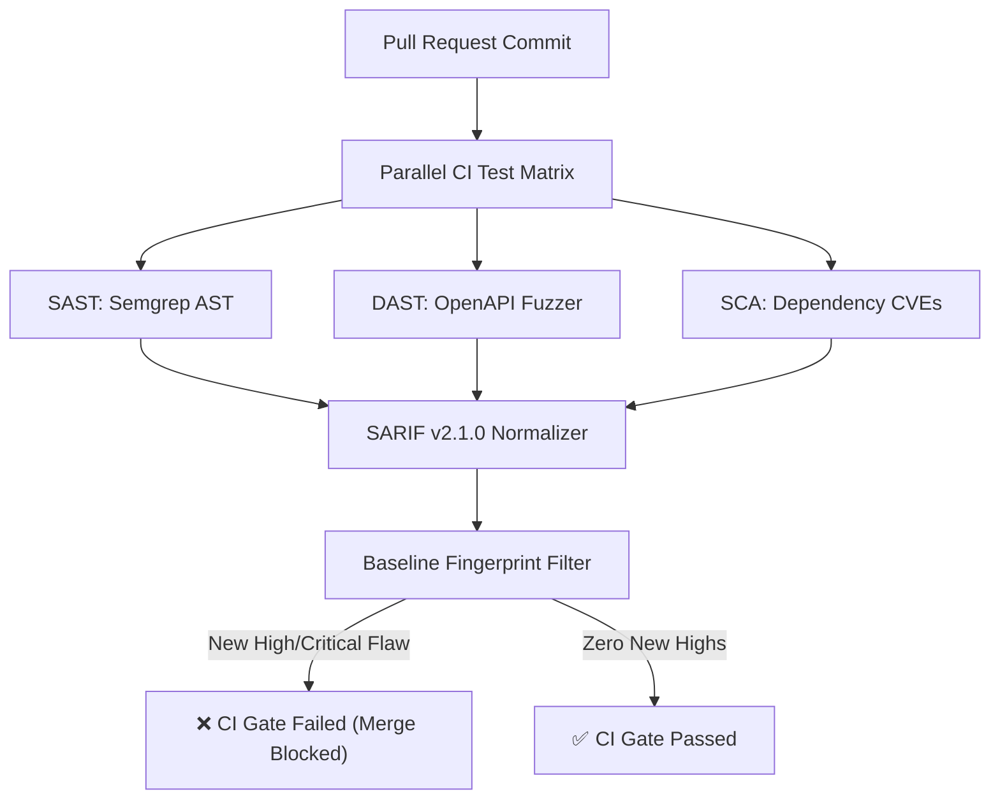

# DevSecOps CI Gates: SAST, DAST, SARIF Normalization & Zero-Day Triage

```json continuity
{
  "previously": "In Chapter 09, we secured the supply chain with CycloneDX SBOMs, SHA-256 lockfile pinning, and Shannon entropy secret detection.",
  "painPoint": "AeroCart grew to 50 microservices. Each team ran separate security tools (Semgrep for code, ZAP for dynamic URLs, Trivy for containers). Each tool produced incompatible custom JSON, dumping 400 alerts into pull requests and causing developer burnout while a Critical BOLA regression slipped past undetected!",
  "unlock": "Build AeroShield v1.0: normalize disparate scanner outputs into the OASIS SARIF v2.1.0 standard, implement deterministic fingerprint baseline suppression to silence known legacy findings, and enforce a hard CI quality gate blocking pull requests with new High or Critical vulnerabilities."
}
```

```json walkthrough
[
  {
    "time": "0:00",
    "badge": "The DevSecOps Triad",
    "title": "SAST vs DAST vs SCA: Complementary Security Perspectives",
    "caption": "No single tool covers the entire attack surface. Static Analysis (SAST) inspects code syntax trees; Dynamic Analysis (DAST) attacks running HTTP endpoints; Software Composition Analysis (SCA) audits third-party package CVEs.",
    "nodes": ["SAST (Semgrep: Code AST)", "DAST (ZAP: HTTP Runtime)", "SCA (Trivy: Docker/Deps)", "Disparate Incompatible Alerts!"],
    "activeIndex": 3,
    "code": "# Incompatible outputs:\nSemgrep: {\"results\": [{\"check_id\": \"xss\"}]}\nTrivy:   {\"Vulnerabilities\": [{\"VulnerabilityID\": \"CVE-2024\"}]}\nZAP:     {\"alerts\": [{\"pluginId\": \"40012\"}]}"
  },
  {
    "time": "0:25",
    "badge": "OASIS SARIF v2.1.0",
    "title": "SARIF: The Universal Currency of Static & Dynamic Analysis",
    "caption": "The Static Analysis Results Interchange Format (SARIF) standardizes tool names, rule IDs, file URI locations, line/column regions, and severity levels (error, warning, note) into an industry-standard JSON schema.",
    "nodes": ["Scanner Output", "SARIF Normalizer", "Standardized SARIF v2.1.0", "GitHub Security & CI Dashboards"],
    "activeIndex": 2,
    "code": "{\n  \"version\": \"2.1.0\",\n  \"$schema\": \"https://docs.oasis-open.org/sarif/sarif/v2.1.0/sarif-v2.1.0.json\",\n  \"runs\": [{ \"tool\": {...}, \"results\": [...] }]\n}"
  },
  {
    "time": "0:50",
    "badge": "Baseline Suppression",
    "title": "Baseline Suppression: Blocking New Vulnerabilities Without Breaking Legacy",
    "caption": "When introducing security gates to an existing codebase with 200 legacy warnings, failing CI stops all feature delivery. We calculate deterministic fingerprints of legacy findings to suppress them while failing on any newly introduced flaw.",
    "nodes": ["PR Code Diff", "Run Scanners", "Filter Against Baseline Fingerprints", "Zero New Highs: CI PASS!"],
    "activeIndex": 3,
    "code": "# Deterministic Fingerprint:\nhash(rule_id + file_relpath + snippet_hash)\nif fp not in baseline_set and level == 'error':\n    exit(1) # Block merge!"
  }
]
```

---

## 🌱 Step 1: Plain-English Mental Model

Imagine an airport security checkpoint. 

You don't just have one metal detector. You have an X-ray scanner for carry-on luggage (inspecting the contents inside the bag: **SAST / Static Code Analysis**), a physical body scanner (testing how the passenger responds to interaction: **DAST / Dynamic Runtime Analysis**), and a passport database check (verifying the traveler against international watchlists: **SCA / Supply Chain CVEs**).

If each of these three security teams speaks a different language and writes reports on mismatched scraps of paper, the terminal manager is overwhelmed. 

**SARIF (Static Analysis Results Interchange Format)** is the universal passport form. Every scanner translates its findings into the exact same standardized JSON schema. 



With SARIF and **Deterministic Baseline Suppression**, legacy technical debt is acknowledged without drowning developers, while brand new vulnerabilities are blocked automatically before code merges.

---

## 🔨 Step 2: Zero-to-Running Starter & CLI

Let's run a practical script that parses a mock SARIF v2.1.0 document, evaluates findings against severity rules, and enforces a CI pull request merge gate.

### Terminal Commands

```bash
# Verify Python 3 JSON schema and hashing capabilities
python3 -c "import json, hashlib; print('DevSecOps Starter ready')"
```

### Python 3 Runnable Implementation

```python
import hashlib
import json
from typing import Dict, List, Any, Tuple

# Subgoal 1: Minimal OASIS SARIF v2.1.0 Generator
def create_sample_sarif_report() -> Dict[str, Any]:
    return {
        "version": "2.1.0",
        "$schema": "https://docs.oasis-open.org/sarif/sarif/v2.1.0/errata01/os/schemas/sarif-schema-2.1.0.json",
        "runs": [
            {
                "tool": {
                    "driver": {
                        "name": "AeroShield-SAST",
                        "version": "1.0.0",
                        "rules": [
                            {"id": "SEC-SQLI", "name": "SQLInjection", "defaultConfiguration": {"level": "error"}},
                            {"id": "SEC-STYLE", "name": "MissingDocstring", "defaultConfiguration": {"level": "note"}}
                        ]
                    }
                },
                "results": [
                    {
                        "ruleId": "SEC-SQLI",
                        "level": "error",
                        "message": {"text": "Unescaped SQL query construction detected in checkout handler"},
                        "locations": [
                            {
                                "physicalLocation": {
                                    "artifactLocation": {"uri": "hub/routes/checkout.py"},
                                    "region": {"startLine": 42, "startColumn": 8}
                                }
                            }
                        ]
                    },
                    {
                        "ruleId": "SEC-STYLE",
                        "level": "note",
                        "message": {"text": "Public function lacks standard docstring"},
                        "locations": [
                            {
                                "physicalLocation": {
                                    "artifactLocation": {"uri": "hub/utils/formatter.py"},
                                    "region": {"startLine": 12, "startColumn": 1}
                                }
                            }
                        ]
                    }
                ]
            }
        ]
    }

# Subgoal 2: SARIF Evaluator and CI Merge Gate
class SarifCIGate:
    def __init__(self, baseline_fingerprints: set = None):
        self.baseline = baseline_fingerprints or set()

    @staticmethod
    def compute_fingerprint(rule_id: str, file_uri: str, line: int) -> str:
        """Deterministic fingerprint surviving line renumbering jitter within a file block."""
        token = f"{rule_id}:{file_uri}:{line // 10}"
        return hashlib.sha256(token.encode()).hexdigest()[:16]

    def evaluate(self, sarif_report: Dict[str, Any]) -> Tuple[bool, List[str]]:
        new_critical_errors = []
        
        for run in sarif_report.get("runs", []):
            tool_name = run.get("tool", {}).get("driver", {}).get("name", "UnknownTool")
            for result in run.get("results", []):
                level = result.get("level", "warning")
                rule_id = result.get("ruleId", "UNKNOWN_RULE")
                locations = result.get("locations", [])
                uri = "unknown"
                line = 0
                if locations:
                    phys = locations[0].get("physicalLocation", {})
                    uri = phys.get("artifactLocation", {}).get("uri", "unknown")
                    line = phys.get("region", {}).get("startLine", 0)

                fp = self.compute_fingerprint(rule_id, uri, line)
                if fp in self.baseline:
                    # Suppressed legacy finding
                    continue

                if level == "error":
                    new_critical_errors.append(f"[{tool_name}] {rule_id} in {uri}:{line} - {result.get('message', {}).get('text')}")

        passed = len(new_critical_errors) == 0
        return passed, new_critical_errors

# Subgoal 3: Verify CI Gate Assertions
report = create_sample_sarif_report()

# 1. Unbaselined run must fail due to SEC-SQLI (level: error)
strict_gate = SarifCIGate(baseline_fingerprints=set())
passed, violations = strict_gate.evaluate(report)
assert not passed, "CI gate should have failed on unescaped SQL error!"
assert len(violations) == 1 and "SEC-SQLI" in violations[0]

# 2. Baselined run where existing SQL flaw is acknowledged passes
known_fp = SarifCIGate.compute_fingerprint("SEC-SQLI", "hub/routes/checkout.py", 42)
tolerant_gate = SarifCIGate(baseline_fingerprints={known_fp})
passed_baseline, remaining = tolerant_gate.evaluate(report)
assert passed_baseline, f"Legacy baseline should have suppressed known issue: {remaining}"

print("✅ Starter verified: SARIF v2.1.0 parsing and baseline CI gate evaluation operational.")
```

### Java 17 Compilable Verification

```java
import java.util.HashSet;
import java.util.Set;

public class AeroShieldCh10Starter {
    // Subgoal 1: SARIF finding abstraction
    static class Finding {
        final String ruleId;
        final String level;
        final String fileUri;

        Finding(String ruleId, String level, String fileUri) {
            this.ruleId = ruleId;
            this.level = level;
            this.fileUri = fileUri;
        }

        String fingerprint() {
            return ruleId + ":" + fileUri;
        }
    }

    public static void main(String[] args) {
        // Subgoal 2: Evaluate gate with baseline suppression
        Set<String> baseline = new HashSet<>();
        baseline.add("SEC-OLD-01:legacy/Payment.java");

        Finding oldFlaw = new Finding("SEC-OLD-01", "error", "legacy/Payment.java");
        Finding newFlaw = new Finding("SEC-NEW-02", "error", "auth/Login.java");

        boolean oldSuppressed = baseline.contains(oldFlaw.fingerprint());
        boolean newBlocked = !baseline.contains(newFlaw.fingerprint()) && newFlaw.level.equals("error");

        if (!oldSuppressed || !newBlocked) {
            throw new AssertionError("Baseline suppression logic failed!");
        }

        System.out.println("✅ Java 17 Starter verified: Finding fingerprint baseline gating operational.");
    }
}
```

---

## 🛠️ Step 3: Everyday Practitioner Workflows & Where Naive Code Breaks

```json contrast
{
  "title": "Architectural Contrast: Uncoordinated Scanners vs AeroShield Unified SARIF CI Gate",
  "naiveApproach": {
    "title": "Fragmented Security Scanning",
    "points": [
      "Runs 4 different CLI tools dumping uncoordinated raw JSON or ANSI terminal logs into CI stdout",
      "Treats all historical codebase flaws as blockers, resulting in PR builds failing on 500 legacy issues",
      "Developers bypass security gates by adding `--skip-tests` or ignoring failed builds due to alert fatigue",
      "Security engineers manually triage Jira tickets across mismatched report formats"
    ]
  },
  "hardenedApproach": {
    "title": "AeroShield Unified SARIF Architecture",
    "points": [
      "Converts SAST, DAST, and SCA outputs into standardized OASIS SARIF v2.1.0 schemas",
      "Deterministic baseline fingerprinting suppresses historical technical debt while strictly blocking new flaws",
      "Enforces a rigid Pull Request merge gate: zero new High or Critical vulnerabilities permitted on `develop`",
      "Uploads normalized SARIF directly to GitHub Code Scanning for automated inline PR code comments"
    ]
  }
}
```

```json poe
{
  "title": "Process of Elimination: Rolling Out Automated Security Gates Without Halting Delivery",
  "question": "A 5-year-old e-commerce repository with 300,000 lines of code introduces automated SAST scanning for the first time. The initial scan detects 410 medium and high security warnings across the legacy codebase. How should the team configure the CI gate?",
  "options": [
    {
      "letter": "A",
      "text": "Immediately configure the CI pipeline to fail any pull request if the repository has more than 0 total security warnings",
      "status": "INCORRECT",
      "reason": "This immediately halts all feature development and emergency hotfixes, inciting engineering backlash and prompting teams to disable the scanner."
    },
    {
      "letter": "B",
      "text": "Generate a baseline SARIF fingerprint file containing the 410 existing flaws, suppress them from PR blocking, and configure the CI gate to fail strictly when any NEW flaw is introduced",
      "status": "CORRECT",
      "reason": "Baseline suppression prevents the introduction of new technical debt while allowing teams to incrementally burn down legacy issues via dedicated sprint tasks."
    },
    {
      "letter": "C",
      "text": "Lower the scanner sensitivity so that only flaws scoring CVSS 10.0 are reported",
      "status": "INCORRECT",
      "reason": "Diluting scanner rules hides critical vulnerabilities (like SQL injection and BOLA) and does not solve code hygiene."
    },
    {
      "letter": "D",
      "text": "Run the scanner once a year before the annual SOC2 compliance audit",
      "status": "INCORRECT",
      "reason": "Annual scans leave the codebase unprotected against day-to-day regressions for 364 days."
    }
  ]
}
```

---

## 🏢 Step 4: How Big Tech Runs It at Scale, Staff Math & Production Blueprint

### 🏢 In the Wild: GitHub Advanced Security, Uber Security Platform & Google Bug Priority Matrices

At GitHub, Google, and Uber, security engineering teams maintain a **Zero-Tolerance New Flaw Policy** governed by automated CI/CD gates. The system is architected around two core engineering principles:

1. **Normalized Aggregation**: Every tool (Semgrep, Trivy, CodeQL, OWASP ZAP) outputs SARIF v2.1.0. A central pipeline ingests these artifacts, deduplicates findings with matching source location fingerprints, and evaluates severity against organizational SLAs.
2. **Defect SLA Gating**: Flaws are assigned strict Mean Time to Remediate (MTTR) SLAs based on CVSS scoring:
   - **Critical (CVSS 9.0–10.0)**: Block PR merge immediately; Production hotfix within 24 hours.
   - **High (CVSS 7.0–8.9)**: Block PR merge immediately; Remediation within 7 days.
   - **Medium (CVSS 4.0–6.9)**: Advisory warning on PR; Remediation within 30 days.

### Staff Math: Defect Triage & Alert Fatigue Probability

Alert fatigue occurs when the volume of false-positive warnings causes engineers to mentally discard real security findings. If $F$ is the number of false positives per PR and $T$ is the number of true vulnerabilities:

The probability $P(\text{engineer ignores real flaw})$ increases exponentially with false-positive noise according to signal-to-noise ratio $\text{SNR}$:

$$\text{SNR} = \frac{T}{T + F}$$

If a noisy scanner generates $F = 19$ false warnings for every $T = 1$ true vulnerability ($\text{SNR} = 0.05$, or 5% precision), empirical studies show developer compliance drops below 12%!

By implementing **SARIF Fingerprint Baseline Suppression**, $F_{\text{baseline}}$ is subtracted from every PR diff:

$$\text{SNR}_{\text{PR}} = \frac{T_{\text{new}}}{T_{\text{new}} + (F_{\text{total}} - F_{\text{baseline}})}$$

Because $F_{\text{total}} - F_{\text{baseline}} \approx 0$ for established files, **$\text{SNR}_{\text{PR}}$ approaches 100%**, transforming security warnings from ignored background noise into urgent, actionable blocking events.

| Tool Category | Examined Artifact | Primary Strengths | Inherent Limitations |
| :--- | :--- | :--- | :--- |
| **SAST (Semgrep / CodeQL)** | Source Code Abstract Syntax Tree | Fast execution, catches taint flows & hardcoded patterns | Cannot detect runtime environment misconfigurations |
| **DAST (OWASP ZAP / StackHawk)** | Live HTTP Endpoints & APIs | Validates actual exploits, zero language dependency | Slow, requires running test environment, lower code coverage |
| **SCA (Trivy / Snyk)** | Lockfiles & Docker images | Instantly matches known CVE databases | Does not evaluate how proprietary code uses the library |
| **SARIF Normalizer** | Combined JSON outputs | Universal schema, enables unified CI merge decisions | Requires schema transformation wrappers |

### Python 3 Production Blueprint: Multi-Tool SARIF Harmonizer & CI Quality Gate

```python
import hashlib
import json
from typing import Dict, List, Any, Optional, Tuple

# Subgoal 1: Harmonize disparate scanner outputs into valid SARIF 2.1.0
class SarifHarmonizer:
    @staticmethod
    def from_semgrep_json(semgrep_raw: Dict[str, Any]) -> Dict[str, Any]:
        """Converts raw Semgrep JSON to SARIF runs."""
        results = []
        for match in semgrep_raw.get("results", []):
            severity = "error" if match.get("extra", {}).get("severity") in ("ERROR", "HIGH") else "warning"
            results.append({
                "ruleId": match.get("check_id"),
                "level": severity,
                "message": {"text": match.get("extra", {}).get("message")},
                "locations": [{
                    "physicalLocation": {
                        "artifactLocation": {"uri": match.get("path")},
                        "region": {"startLine": match.get("start", {}).get("line", 1)}
                    }
                }]
            })
        return {
            "tool": {"driver": {"name": "Semgrep-SAST", "version": "1.60.0"}},
            "results": results
        }

    @staticmethod
    def from_trivy_json(trivy_raw: Dict[str, Any]) -> Dict[str, Any]:
        """Converts raw Trivy container vulnerability JSON to SARIF runs."""
        results = []
        for target in trivy_raw.get("Results", []):
            target_file = target.get("Target", "Dockerfile")
            for vuln in target.get("Vulnerabilities", []):
                severity = "error" if vuln.get("Severity") in ("CRITICAL", "HIGH") else "warning"
                results.append({
                    "ruleId": vuln.get("VulnerabilityID"),
                    "level": severity,
                    "message": {"text": f"{vuln.get('PkgName')}: {vuln.get('Title', 'Known CVE')}"},
                    "locations": [{
                        "physicalLocation": {
                            "artifactLocation": {"uri": target_file},
                            "region": {"startLine": 1}
                        }
                    }]
                })
        return {
            "tool": {"driver": {"name": "Trivy-SCA", "version": "0.49.0"}},
            "results": results
        }

# Subgoal 2: Multi-Tool Gate Runner
class AeroShieldDevSecOpsGate:
    def __init__(self, baseline_fingerprints: set = None):
        self.baseline = baseline_fingerprints or set()

    @staticmethod
    def make_fingerprint(rule_id: str, uri: str) -> str:
        return hashlib.sha256(f"{rule_id}:{uri}".encode()).hexdigest()[:16]

    def enforce_merge_gate(self, unified_sarif: Dict[str, Any]) -> Tuple[bool, Dict[str, Any]]:
        summary = {"total_scanned": 0, "suppressed": 0, "blocking_violations": []}

        for run in unified_sarif.get("runs", []):
            tool = run["tool"]["driver"]["name"]
            for res in run.get("results", []):
                summary["total_scanned"] += 1
                rule = res["ruleId"]
                uri = res["locations"][0]["physicalLocation"]["artifactLocation"]["uri"]
                level = res.get("level", "warning")
                
                fp = self.make_fingerprint(rule, uri)
                if fp in self.baseline:
                    summary["suppressed"] += 1
                    continue

                if level == "error":
                    summary["blocking_violations"].append({
                        "tool": tool,
                        "rule": rule,
                        "uri": uri,
                        "message": res["message"]["text"]
                    })

        passed = len(summary["blocking_violations"]) == 0
        return passed, summary

# Subgoal 3: Verify Multi-Tool Gating Assertions
# Mock raw Semgrep payload
semgrep_input = {
    "results": [
        {
            "check_id": "owasp.api.bola.missing-tenant-id",
            "path": "hub/routes/orders.py",
            "start": {"line": 88},
            "extra": {"severity": "ERROR", "message": "Query filters order_id without tenant_id"}
        }
    ]
}

# Mock raw Trivy payload
trivy_input = {
    "Results": [
        {
            "Target": "requirements.txt",
            "Vulnerabilities": [
                {
                    "VulnerabilityID": "CVE-2023-43804",
                    "PkgName": "urllib3",
                    "Severity": "HIGH",
                    "Title": "Cookie leakage across HTTP redirects"
                }
            ]
        }
    ]
}

# 1. Normalize into unified SARIF v2.1.0 document
unified_doc = {
    "version": "2.1.0",
    "$schema": "https://docs.oasis-open.org/sarif/sarif/v2.1.0/errata01/os/schemas/sarif-schema-2.1.0.json",
    "runs": [
        SarifHarmonizer.from_semgrep_json(semgrep_input),
        SarifHarmonizer.from_trivy_json(trivy_input)
    ]
}

assert len(unified_doc["runs"]) == 2, "Expected 2 scanner runs in SARIF doc"

# 2. Enforce strict gate without baseline (Must fail on both High/Critical findings)
strict_gate = AeroShieldDevSecOpsGate()
passed, report = strict_gate.enforce_merge_gate(unified_doc)
assert not passed, "Strict gate should fail when High/Critical vulnerabilities exist!"
assert len(report["blocking_violations"]) == 2, f"Expected 2 blockers, got {report['blocking_violations']}"

# 3. Suppress the Trivy CVE via baseline, leaving only the Semgrep BOLA violation
trivy_fp = AeroShieldDevSecOpsGate.make_fingerprint("CVE-2023-43804", "requirements.txt")
partial_gate = AeroShieldDevSecOpsGate(baseline_fingerprints={trivy_fp})
passed_partial, report_partial = partial_gate.enforce_merge_gate(unified_doc)
assert not passed_partial, "Gate should still fail on unbaselined BOLA flaw"
assert len(report_partial["blocking_violations"]) == 1
assert report_partial["suppressed"] == 1
assert report_partial["blocking_violations"][0]["rule"] == "owasp.api.bola.missing-tenant-id"

print("✅ Production DevSecOps Blueprint verified: Multi-scanner SARIF normalization & CI gate passed.")
```

### Java 17 Production Blueprint: Enterprise SARIF CI Quality Gate

```java
import java.util.ArrayList;
import java.util.List;

public class AeroShieldCh10Blueprint {
    // Subgoal 1: SARIF Run Result representation
    static class SarifResult {
        final String tool;
        final String ruleId;
        final String level; // "error", "warning", "note"
        final String locationUri;

        SarifResult(String tool, String ruleId, String level, String locationUri) {
            this.tool = tool;
            this.ruleId = ruleId;
            this.level = level;
            this.locationUri = locationUri;
        }

        boolean isBlocker() {
            return "error".equalsIgnoreCase(level);
        }
    }

    // Subgoal 2: Pull Request Gate Evaluator
    public static boolean evaluatePRGate(List<SarifResult> findings) {
        for (SarifResult r : findings) {
            if (r.isBlocker()) {
                System.out.println("❌ PR MERGE BLOCKED: [" + r.tool + "] " + r.ruleId + " at " + r.locationUri);
                return false;
            }
        }
        System.out.println("✅ PR MERGE APPROVED: All SARIF checks passed.");
        return true;
    }

    public static void main(String[] args) {
        // Subgoal 3: Verify gate evaluation
        List<SarifResult> cleanResults = new ArrayList<>();
        cleanResults.add(new SarifResult("Checkstyle", "STYLE-01", "note", "App.java"));
        if (!evaluatePRGate(cleanResults)) {
            throw new AssertionError("Clean PR was falsely rejected!");
        }

        List<SarifResult> flawedResults = new ArrayList<>();
        flawedResults.add(new SarifResult("Semgrep", "OWASP-BOLA", "error", "OrderController.java"));
        if (evaluatePRGate(flawedResults)) {
            throw new AssertionError("Flawed PR containing BOLA error was incorrectly approved!");
        }

        System.out.println("✅ Java 17 Blueprint verified: Enterprise SARIF CI quality gate operational.");
    }
}
```

> [!WARNING]
> **Never suppress vulnerabilities globally with blanket ignore comments like `// nosec` or `# noqa` without peer review!** Adding inline suppression comments directly into source code bypasses central security oversight and hides regressions forever. Always enforce policy exceptions through a version-controlled SARIF baseline file with mandatory security lead sign-off and an explicit expiration timestamp!

```json quiz
[
  {
    "id": "sec10-q1",
    "question": "What is the primary benefit of standardizing all security scanners (SAST, DAST, SCA) on the OASIS SARIF v2.1.0 format?",
    "options": [
      "It makes scanner execution run twice as fast",
      "It unifies findings from diverse tools into a single consistent JSON schema for locations, rules, and severity levels, allowing unified CI gating and automated GitHub PR annotations",
      "It eliminates the need to patch software vulnerabilities",
      "It encrypts source code before compilation"
    ],
    "answerIndex": 1,
    "explanation": "SARIF provides a vendor-neutral standard representation for static and dynamic analysis results, enabling unified CI/CD quality gates."
  },
  {
    "id": "sec10-q2",
    "question": "Why is deterministic fingerprint baseline suppression essential when introducing automated security gates into large existing codebases?",
    "options": [
      "It automatically deletes vulnerable source files",
      "It suppresses known historical flaws so the CI pipeline only blocks PRs that introduce NEW vulnerabilities, preventing feature delivery from halting while teams remediate technical debt",
      "It forces all developers to write code in assembly language",
      "It replaces unit tests with fuzz tests"
    ],
    "answerIndex": 1,
    "explanation": "Baseline suppression acknowledges pre-existing debt so teams can stop the bleeding (prevent new flaws) without paralyzing ongoing product development."
  },
  {
    "id": "sec10-q3",
    "question": "Which security testing approach is best suited for discovering authentication logic bypasses and runtime network misconfigurations on live HTTP APIs?",
    "options": [
      "Static Application Security Testing (SAST)",
      "Dynamic Application Security Testing (DAST)",
      "Software Composition Analysis (SCA)",
      "Linter comments"
    ],
    "answerIndex": 1,
    "explanation": "DAST interacts with running application endpoints dynamically, making it ideal for testing runtime authentication handshakes and API logic."
  }
]
```

---

## 📋 Step 5: Master Cheat-Sheet, 60-Second Interview Pitch & Verified Sources

| DevSecOps Dimension | Core Focus | Exemplar Tools | CI Pass/Fail Invariant |
| :--- | :--- | :--- | :--- |
| **SAST** | Source code syntax trees & taint flow | Semgrep, CodeQL | 0 new `error`-level findings |
| **DAST** | Live HTTP endpoints & API schemas | OWASP ZAP, Postman Newman | 0 High/Critical runtime vulnerabilities |
| **SCA** | 3rd-party dependencies & base images | Trivy, Grype | 0 fixable Critical CVEs |
| **SARIF** | Unified reporting schema | OASIS SARIF v2.1.0 | Validated against official schema |
| **Quality Gate** | PR merge control | AeroShield CI Gate | Unbaselined Highs block git merge |

### 🎙️ 60-Second Interview Soundbite

> *"A world-class DevSecOps pipeline bridges the gap between security compliance and developer velocity through automated, evidence-backed CI quality gates. Instead of subjecting engineers to fragmented tools and alert fatigue, we combine the complementary triad of SAST for code AST analysis, DAST for live OpenAPI contract testing, and SCA for container and dependency vulnerabilities. We normalize all scanner outputs into the OASIS SARIF v2.1.0 standard, creating a single source of truth for the entire engineering organization. To enable rapid development without compromising security, we apply deterministic fingerprint baseline suppression: existing legacy debt is tracked in sprint backlogs with explicit SLA deadlines, while the CI pipeline enforces a zero-tolerance merge gate for any newly introduced High or Critical flaw. This transforms security from a late-stage manual audit into an automated, continuous guardrail."*

### 📚 Verified Primary Sources
- [OASIS Standard — Static Analysis Results Interchange Format (SARIF) v2.1.0](https://docs.oasis-open.org/sarif/sarif/v2.1.0/sarif-v2.1.0.html)
- [OWASP Cheat Sheet Series — Vulnerability Disclosure & DevSecOps](https://cheatsheetseries.owasp.org/)
