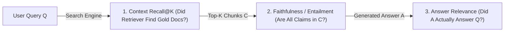

# Build AeroEval v0.3: The RAG Evaluation Triad, Context Recall & Atomic Claim Verification

```json continuity
{
  "previously": "In Chapter 02, we built `AeroEval v0.2` with a 500-case Stratified Golden Dataset storing `gold_chunk_ids`, `must_include_claims`, and `must_not_claim` alongside a 5-gram Jaccard decontamination gate.",
  "painPoint": "When a Golden test case fails on `AeroBrain`, the search team blames the LLM prompt and the prompt team blames the vector database! Worse, someone added a naive `cosine_similarity(context, answer) >= 0.85` check that gave a 0.96 PASS when `AeroBrain` said 'Basic Economy IS refundable' instead of 'NOT refundable'!",
  "unlock": "Upgrade to `AeroEval v0.3`: build the 3-part RAG Evaluation Triad (`Context Recall@K`, `Atomic Claim Faithfulness`, and `Answer Relevance`) to isolate Retriever bugs from Generator hallucinations!"
}
```

```json walkthrough
[
  {
    "time": "0:00",
    "badge": "Slide 1 / 4 · Why Cosine Similarity Passes Opposite Policies!",
    "caption": "Compare 'Basic Economy tickets are non-refundable after 24 hours' vs. 'Basic Economy tickets are refundable after 24 hours'. Because 90% of the topic words are identical, vector cosine similarity scores 0.96 PASS—even though the meaning is 100% inverted!",
    "code": "ctx = \"Basic Economy tickets are strictly non-refundable after 24 hours.\"\nans = \"Basic Economy tickets are fully refundable after 24 hours.\"\n# cosine_similarity(embed(ctx), embed(ans)) -> 0.96 (CATASTROPHIC FALSE PASS!)"
  },
  {
    "time": "0:26",
    "badge": "Slide 2 / 4 · Leg 1: Context Recall@K (Did Search Find the Policy?)",
    "caption": "Instead of one blurry score, AeroEval v0.3 splits RAG quality into 3 legs. Leg 1 checks the Retriever alone: what fraction of the Golden `gold_chunk_ids` showed up in the top-K search results?",
    "code": "retrieved = [\"doc_14\", \"doc_99\", \"doc_eu261\"]\ngold      = {\"doc_14\", \"doc_eu261\"}\ncontext_recall = len(set(retrieved) & gold) / len(gold)  # 2 / 2 = 1.0!"
  },
  {
    "time": "0:54",
    "badge": "Slide 3 / 4 · Leg 2: Faithfulness via Atomic Claim Splitting",
    "caption": "Leg 2 checks the LLM Generator: split the answer into bite-sized atomic claims and verify that EVERY single claim is supported by the retrieved chunks (with no negation flips!).",
    "code": "claims = [\"Cancellations within 24h are free\", \"Pets fly free in cabin\"]\n# Claim 1 -> Supported by doc_14 ✓\n# Claim 2 -> Not in retrieved chunks ✗\n# Faithfulness = 1 / 2 = 0.50 (FAIL: Generator Hallucination!)"
  },
  {
    "time": "1:20",
    "badge": "Slide 4 / 4 · Leg 3: Answer Relevance & Instant Triage",
    "caption": "What if Context Recall is 1.0 and Faithfulness is 1.0, yet the user is still angry? Leg 3 checks Answer Relevance—catching overly timid prompts that recite true boilerplate without answering the question!",
    "code": "# Recall = 0.20, Faithfulness = 1.00 -> Fix Vector Retriever / Chunker!\n# Recall = 0.95, Faithfulness = 0.40 -> Fix LLM Grounding Prompt!\n# Recall = 0.95, Faithfulness = 1.00, Relevance = 0.25 -> Fix Over-Refusal!"
  }
]
```

```json pretraining
[
  {
    "term": "Context Precision & Recall@K",
    "formula": "|C_retrieved ∩ C_gold| / |C_gold|",
    "meaning": "Checks whether your search engine actually pulled the right policy documents into the top K results before the LLM even starts writing."
  },
  {
    "term": "RAG Entailment (Faithfulness)",
    "formula": "|Claims_entailed| / |Claims_total|",
    "meaning": "Breaks the AI's paragraph into individual single-fact sentences ('atomic claims') and checks what percentage are strictly proven by the retrieved documents."
  },
  {
    "term": "Answer Relevance",
    "formula": "Addresses(Answer, Query_intent)",
    "meaning": "Checks whether the AI directly answered the user's specific question instead of dodging or reciting unrelated true facts from the document."
  },
  {
    "term": "Extrinsic vs. Intrinsic Hallucination",
    "formula": "Unsupported vs. Contradicted",
    "meaning": "An extrinsic hallucination invents a new fact not mentioned in the docs; an intrinsic hallucination directly contradicts a fact written in the docs."
  }
]
```

```json poe
{
  "question": "During a RAG regression triage, your AeroEval v0.3 dashboard shows Context Recall@5 = 0.96, RAG Entailment (Faithfulness) = 1.00, yet Answer Relevance = 0.28 and users are furious. Without reading a single trace yet, what exact failure pattern is occurring?",
  "options": [
    "The vector database index is corrupted and returning empty strings",
    "The Retriever found the right policy chunks and the LLM made zero hallucinated claims, but the prompt/guardrail is over-refusing or summarizing tangential boilerplate from the chunks instead of answering the user's specific question",
    "The LLM is inventing fake order numbers at temperature=1.4",
    "The chunk overlap size is negative"
  ],
  "answerIndex": 1,
  "explanation": "That exact signature (High Context Recall + 1.0 Faithfulness + Low Answer Relevance) isolates overly defensive system prompts or extractive summaries that state true facts from the retrieved context while failing to address the user's actual query intent."
}
```

## 🌱 Step 1: Plain-English Story — Why Cosine Similarity Passes Opposite Answers!

Suppose a passenger asks `AeroBrain`: *"Can I get a refund on my Basic Economy ticket 3 days after booking?"*
Your search engine retrieves `doc_14`:
> *"Basic Economy tickets are strictly **non-refundable** after 24 hours."*

Unfortunately, `AeroBrain` hallucinates and replies:
> *"Basic Economy tickets are fully **refundable** after 24 hours."*

If your test suite checks quality using **Embedding Cosine Similarity** (`cosine(embed(doc_14), embed(answer)) >= 0.85`), what happens?
**It passes with a `0.96` score!**
Why? Because standard embedding models measure **topic similarity** (*"Are both sentences talking about Basic Economy ticket refunds after 24 hours?"*), not logical truth! Dropping the three letters `"non"` barely nudges the topic vector, even though it reverses the airline's entire refund policy!

Worse still, when a RAG test fails, a single end-to-end score can't tell you **who broke it**:
- Did the **Retriever** fail to find `doc_14` in the database?
- Or did theRetriever find `doc_14`, and the **LLM Generator** ignored it and made something up?



To end the finger-pointing between search engineers and prompt engineers forever, we upgrade to **`AeroEval v0.3`** and measure the **RAG Evaluation Triad** (popularized by TruLens and RAGAS):
1. **Context Recall & Precision@K** (grades the **Retriever**),
2. **RAG Entailment / Faithfulness** (grades the **Generator** claim-by-claim), and
3. **Answer Relevance** (grades **Intent Alignment**).

## 🔨 Step 2: First Lines of Code — Build the `AeroEval v0.3` RAG Triad Scorer

Let's write a clean, self-contained `AeroEval v0.3` scorer that computes **Context Recall@K** and **Atomic Claim Faithfulness**—and automatically diagnoses whether a failure came from the **Retriever** or the **Generator**:

```python
def score_rag_triad(
    retrieved_ids: list[str],
    gold_ids: set[str],
    claims: list[str],
    supported_flags: list[bool],
    answer_relevance: float,
) -> dict:
    """AeroEval v0.3: Computes the 3 RAG Triad legs and pinpoints the failing subsystem."""
    recall = len(set(retrieved_ids) & gold_ids) / max(1, len(gold_ids))
    faithfulness = sum(supported_flags) / max(1, len(claims))
    status = "HEALTHY"
    if recall < 0.70:
        status = "RETRIEVER_FAILURE"
    elif faithfulness < 0.90:
        status = "GENERATOR_HALLUCINATION"
    elif answer_relevance < 0.75:
        status = "OVER_REFUSAL_OR_OFF_TOPIC"
    return {"recall": round(recall, 2), "faithfulness": round(faithfulness, 2), "diagnosis": status}


print(score_rag_triad(["doc_14"], {"doc_14", "doc_22"}, ["24h refund"], [True], 0.92))
```

### Java 17 Equivalent

```java
import java.util.List;
import java.util.Set;

public class AeroEvalV03Triad {
    public record TriadVerdict(double recall, double faithfulness, double relevance, String diagnosis) {}

    public static TriadVerdict scoreRagTriad(
            List<String> retrievedIds, Set<String> goldIds, List<Boolean> claimSupported, double relevance) {
        long hits = retrievedIds.stream().filter(goldIds::contains).distinct().count();
        double recall = goldIds.isEmpty() ? 1.0 : (double) hits / goldIds.size();
        long validClaims = claimSupported.stream().filter(Boolean::booleanValue).count();
        double faithfulness = claimSupported.isEmpty() ? 1.0 : (double) validClaims / claimSupported.size();

        String status = "HEALTHY";
        if (recall < 0.70) status = "RETRIEVER_FAILURE";
        else if (faithfulness < 0.90) status = "GENERATOR_HALLUCINATION";
        else if (relevance < 0.75) status = "OVER_REFUSAL_OR_OFF_TOPIC";
        return new TriadVerdict(recall, faithfulness, relevance, status);
    }
}
```

## ⚡ Step 3: Where It Breaks in Real Life — Context Dilution & Pre-Training Memory Leaks

Watch what happens when you deploy `AeroEval v0.3` on real enterprise traffic—two subtle failure modes immediately jump out on your dashboard:

1. **Failure Mode 1: High Recall (`0.95`), Low Context Precision (`0.20`) — "Lost in the Middle"**
   A search engineer tries to boost `Context Recall` by changing `top_k` from `5` to `25`. Now the gold policy chunk is almost always retrieved (`Recall = 0.95`), **but** it is buried inside 24 noisy, irrelevant chunks (`Precision = 0.20`)! Stuffing 24 noise chunks into the prompt dilutes the LLM's attention and causes `Faithfulness` to drop from `0.94` to `0.72`.
2. **Failure Mode 2: Parametric Memory Leaks (Right Answer from the Wrong Place!)**
   What if a user asks an unauthorized question, the Retriever returns **zero** documents (`retrieved = []`), and the LLM still answers accurately using public facts it memorized from the internet during pre-training? In enterprise RAG, **answering from pre-training memory when context is empty is a critical `Faithfulness = 0.0` failure** because it bypasses tenant access controls and outdated-policy overrides!

```json contrast
{
  "title": "RAG Pipeline Quality Diagnosis",
  "naiveTitle": "End-to-End Cosine Similarity Blob Check",
  "naiveMetric": "0.96 Score on Opposite Policy!",
  "naivePoints": [
    "Computes one dense vector for a 300-word answer and compares cosine similarity to context",
    "Cannot tell whether a wrong answer was caused by bad chunking, missing metadata filters, or LLM hallucination",
    "Passes subtle numeric inventions ($50 fee vs $150 fee) and negation inversions",
    "Rewards verbose copy-pasting of irrelevant context paragraphs"
  ],
  "staffTitle": "Orthogonal RAG Triad + Atomic Claim Entailment",
  "staffMetric": "Pinpoints Retriever vs Generator Faults",
  "staffPoints": [
    "Measures Retrieval independently via Recall@K, MRR, and Context Precision (signal-to-noise)",
    "Splits generated prose into atomic claims c_1..c_m and checks strict NLI / RAG Entailment per claim",
    "Cross-checks Answer Relevance so true-but-useless boilerplate responses are caught",
    "Flags ungrounded parametric knowledge leaks even when the fact happens to be true on the public web"
  ]
}
```

## 🚀 Step 4: Staff Engineer Deep-Dive — Atomic Claim Entailment & Average Precision@K Math

Instead of grading a multi-paragraph response as one blob, `AeroEval v0.3` decomposes generated answer $A$ into minimal, self-contained atomic propositions $\{c_1, c_2, \dots, c_m\}$ and computes **RAG Entailment (`Faithfulness`)** against retrieved context $C = \{C_1, \dots, C_K\}$:

$$\text{Faithfulness}(A, C) = \frac{|\{c_i \in A : C \models c_i\}|}{|\{c_1, c_2, \dots, c_m\}|}$$

To grade the **Retriever** not just on whether it fetched the gold chunks, but whether it ranked them at the **very top** (positions $1..2$ instead of position $19$), we pair `Recall@K` with **Context Average Precision (`AP@K`)**:

$$\text{AP}@K = \frac{1}{|C_{\text{gold}}|} \sum_{k=1}^{K} \text{Precision}@k \cdot \mathbb{I}(C_k \in C_{\text{gold}})$$

| Context Recall | Context Precision | RAG Entailment (Faithfulness) | Answer Relevance | Exact Root Cause & Architectural Fix |
| :--- | :--- | :--- | :--- | :--- |
| **Low ($<0.50$)** | Low | High ($1.00$) | Low (Abstains) | **Retriever / Chunker Blindness**: Missing hybrid BM25 lexical leg, broken PDF table chunking, or wrong tenant filter. |
| **High ($0.95$)** | **Low ($0.20$)** | Medium ($0.72$) | Medium | **Context Dilution (*Lost-in-the-Middle*)**: Top-$20$ chunks stuff noise around 1 gold chunk; add a **Cross-Encoder Reranker** trimming to top-$5$. |
| **High ($0.95$)** | High ($0.90$) | **Low ($0.45$)** | High | **Generator Hallucination / Parametric Leak**: LLM ignores context or fabricates clauses; tighten grounding prompt + lower temperature + enforce per-claim inline citations. |
| **High ($0.95$)** | High ($0.90$) | **High ($1.00$)** | **Low ($0.30$)** | **Over-Refusal / Tangent Summary**: Safety guardrail or prompt template dumps true context facts without answering $Q$. |

### Production Blueprint: RAG Triad Evaluator (`Recall@K + AP@K + Atomic RAG Entailment`)

```python
NEGATION_TOKENS = {
    "not", "no", "never", "neither", "non", "without",
    "unrefundable", "non-refundable", "prohibited", "ineligible",
}


def compute_retrieval_metrics(retrieved_ids: list[str], gold_ids: set[str]) -> dict:
    if not gold_ids:
        return {"contextRecall": 1.0, "contextPrecisionAtK": 1.0 if not retrieved_ids else 0.0}
    hits = [cid for cid in retrieved_ids if cid in gold_ids]
    recall = len(set(hits)) / len(gold_ids)
    # Average Precision@K rewards ranking gold chunks at positions 1..2 rather than buried at K!
    precisions = []
    running_hits = 0
    for rank, cid in enumerate(retrieved_ids, start=1):
        if cid in gold_ids:
            running_hits += 1
            precisions.append(running_hits / rank)
    ap_at_k = sum(precisions) / len(gold_ids) if precisions else 0.0
    return {
        "contextRecall": round(recall, 3),
        "contextPrecisionAtK": round(ap_at_k, 3),
    }


def evaluate_claim_entailment(context_chunks: list[str], atomic_claims: list[str]) -> dict:
    """Deterministic RAG Entailment & Polarity Guard over decomposed atomic claims."""
    ctx_lower = " ".join(context_chunks).lower()
    ctx_words = set(ctx_lower.replace(".", " ").replace(",", " ").split())
    ctx_has_neg = bool(ctx_words & NEGATION_TOKENS)

    supported = 0
    flagged_claims = []
    for claim in atomic_claims:
        words = [w.strip(".,!?;:") for w in claim.lower().split() if len(w) > 2]
        overlap = sum(1 for w in words if w in ctx_words) / max(1, len(words))
        claim_has_neg = bool(set(words) & NEGATION_TOKENS)
        polarity_conflict = (claim_has_neg != ctx_has_neg) and overlap > 0.5
        if overlap >= 0.6 and not polarity_conflict:
            supported += 1
        else:
            flagged_claims.append({
                "claim": claim,
                "overlap": round(overlap, 2),
                "polarityConflict": polarity_conflict,
            })

    return {
        "faithfulness": round(supported / max(1, len(atomic_claims)), 3),
        "supportedClaims": supported,
        "totalClaims": len(atomic_claims),
        "flaggedClaims": flagged_claims,
    }
```

### Java 17 Equivalent

```java
import java.util.List;
import java.util.Set;

public final class RagTriadScorer {
    public record ClaimVerdict(String claim, boolean entailed, boolean negationFlip) {}

    public record TriadReport(
            double contextRecall,
            double faithfulness,
            double answerRelevance,
            String failingSubsystem) {}

    public static double computeFaithfulness(List<ClaimVerdict> verdicts) {
        if (verdicts.isEmpty()) return 1.0;
        long supported = verdicts.stream().filter(v -> v.entailed() && !v.negationFlip()).count();
        return (double) supported / verdicts.size();
    }

    public static TriadReport diagnose(
            List<String> retrievedChunkIds,
            Set<String> goldChunkIds,
            List<ClaimVerdict> claimVerdicts,
            double answerRelevance) {
        double recall = goldChunkIds.isEmpty()
                ? 1.0
                : (double) retrievedChunkIds.stream().filter(goldChunkIds::contains).distinct().count()
                        / goldChunkIds.size();
        double faithfulness = computeFaithfulness(claimVerdicts);

        String diagnosis = "HEALTHY";
        if (recall < 0.70) {
            diagnosis = "RETRIEVER_RECALL_BOTTLENECK";
        } else if (faithfulness < 0.90) {
            diagnosis = "GENERATOR_HALLUCINATION_OR_POLARITY_FLIP";
        } else if (answerRelevance < 0.75) {
            diagnosis = "PROMPT_OVER_REFUSAL_OR_OFF_TOPIC";
        }
        return new TriadReport(recall, faithfulness, answerRelevance, diagnosis);
    }
}
```

> [!WARNING]
> **Staff Interview Gotcha — Parametric Truth Is Still a RAG Faithfulness Failure**:
> Suppose an enterprise legal RAG bot is asked *"What is the GDPR statutory fine ceiling?"*, the Retriever fetches **zero** GDPR chunks due to a broken filter, and the LLM answers *"Up to 4% of global annual turnover"* from pre-training memory. Is Faithfulness (`RAG Entailment`) `1.0` or `0.0`? **Strictly `0.0`!** In enterprise RAG, any factual claim not entailed by the retrieved tenant context—even if publicly true—bypasses document access controls and policy versioning (e.g., an internal stricter `1%` compliance cap).

**Up Next in Chapter 04**: What if every single number and word in `AeroBrain`'s claim *does* exist in the retrieved context, yet the AI swapped `Tier-1`'s `$25` fee with `Tier-2`'s `$0` fee—or attached `[doc_4]` to a sentence `doc_4` doesn't actually support (*Citation Laundering*)? In Chapter 04, we'll upgrade to **`AeroEval v0.4`: NLI Cross-Encoders, Citation-Span Grounding & Abstention QA**!

```json quiz
[
  {
    "id": "ai-01-q1",
    "question": "Why does embedding cosine similarity between the retrieved context and the LLM answer fail to detect negation hallucinations?",
    "options": [
      "Because embeddings only support ASCII characters",
      "Because dense bi-encoder embeddings weight topical vocabulary overlap heavily, so 'tickets are refundable' and 'tickets are non-refundable' have >0.94 cosine similarity despite opposite meanings",
      "Because cosine similarity ranges from 0 to 100",
      "Because vector databases use Euclidean distance exclusively"
    ],
    "answerIndex": 1,
    "explanation": "Bi-encoder embeddings map sentences about the same topic ('ticket refund policy') to nearly identical coordinates in vector space, masking negation inversions."
  },
  {
    "id": "ai-01-q2",
    "question": "In the RAG Triad, if Context Recall is 0.15 (low) and Faithfulness is 1.00 (perfect), which subsystem is failing?",
    "options": [
      "The LLM generator is hallucinating",
      "The Retriever / Chunker / Reranker pipeline is failing to fetch the relevant source documents, and the LLM is faithfully refusing or only using the tiny fragment retrieved",
      "The temperature parameter is too high",
      "The tokenizer is corrupting UTF-8 bytes"
    ],
    "answerIndex": 1,
    "explanation": "Low Context Recall + High Faithfulness pinpoints a Retrieval bottleneck (bad chunk boundaries, missing metadata filters, or weak reranking), not a generation hallucination."
  },
  {
    "id": "ai-01-q3",
    "question": "How is the RAG Faithfulness (Groundedness / RAG Entailment) metric formally computed?",
    "options": [
      "Total tokens in answer divided by total tokens in prompt",
      "Number of atomic claims in the answer that are strictly entailed by the retrieved context divided by the total number of atomic claims in the answer",
      "1.0 minus the LLM temperature",
      "BLEU score against the user query"
    ],
    "answerIndex": 1,
    "explanation": "Decomposing the answer into atomic claims and computing (Entailed Claims / Total Claims) provides a granular, interpretable faithfulness score."
  },
  {
    "id": "ai-01-q4",
    "question": "A tenant-isolated RAG assistant retrieves an empty context array because the user lacks permission to view HR salary docs, yet the LLM answers accurately using public Glassdoor data memorized during pre-training. How must your RAG Entailment gate score this response?",
    "options": [
      "Faithfulness = 1.0 because the public numbers are approximately true",
      "Faithfulness = 0.0 (FAIL) because every factual claim must be entailed by the retrieved authorized context; relying on parametric memory bypasses RBAC and document staleness controls",
      "Context Recall = 1.0 because the LLM remembered the answer",
      "Skip evaluation whenever retrieved_chunks is empty"
    ],
    "answerIndex": 1,
    "explanation": "RAG Entailment verifies strict conditional grounding against the authorized retrieved context, never world knowledge."
  }
]
```
