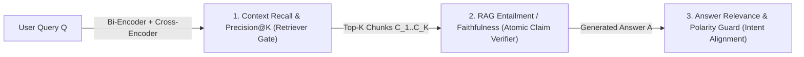

# The RAG Evaluation Triad: Context Recall, RAG Entailment & Claim Verification

```json pretraining
[
  {
    "term": "Context Precision & Recall@K",
    "formula": "|C_retrieved ∩ C_gold| / |C_gold|",
    "meaning": "Measures whether the Retriever + Reranker surfaced all ground-truth evidence chunks into the top-K context window."
  },
  {
    "term": "RAG Entailment (Faithfulness)",
    "formula": "|Claims_entailed| / |Claims_total|",
    "meaning": "Decomposes the generated answer into atomic factual propositions and verifies each is strictly entailed by retrieved chunks—not parametric memory."
  },
  {
    "term": "Answer Relevance",
    "formula": "Addresses(Answer, Query_intent)",
    "meaning": "Verifies the response directly resolves the user's specific question without evasive tangents or polarity inversions."
  },
  {
    "term": "Extrinsic vs. Intrinsic Hallucination",
    "formula": "Unsupported vs. Contradicted",
    "meaning": "Extrinsic hallucinations invent facts absent from context; intrinsic hallucinations directly contradict facts present in the retrieved chunks."
  }
]
```

```json poe
{
  "question": "During a RAG regression triage, your dashboard shows Context Recall@5 = 0.96, RAG Entailment (Faithfulness) = 1.00, yet Answer Relevance = 0.28 and users are furious. Without reading a single trace yet, what exact failure pattern is occurring?",
  "options": [
    "The vector database index is corrupted and returning empty strings",
    "The Retriever found the right policy chunks and the LLM made zero hallucinated claims, but the prompt/guardrail is over-refusing or summarizing tangential boilerplate from the chunks instead of answering the user's specific question",
    "The LLM is inventing fake order numbers at temperature=1.4",
    "The chunk overlap size is negative"
  ],
  "answerIndex": 1,
  "explanation": "That exact signature (High Context Recall + 1.0 Faithfulness + Low Answer Relevance) isolates overly defensive system prompts or extractive summaries that state true facts from the retrieved context while failing to address the user's actual query intent."
}
```

## Part I — First-Principles Mental Model & Visual Cue

Why does a naive **Cosine Similarity check** (`cosine(embed(context), embed(answer)) >= 0.85`) catastrophically fail as a production safety gate for Retrieval-Augmented Generation (`RAG`)?

Because dense bi-encoder embedding models measure **topical proximity**, not **RAG Entailment**:
- **Retrieved Policy Chunk**: *"Basic Economy tickets are strictly **non-refundable** after 24 hours."*
- **Hallucinated LLM Output**: *"Basic Economy tickets are fully **refundable** after 24 hours."*
- **Cosine Similarity Score**: **$0.96$ (PASS!)** — nearly every token shares identical topical coordinates in embedding space except the single negation prefix!

### The RAG Triad Decomposition
To evaluate a RAG pipeline deterministically and isolate Retrieval bugs from Generation bugs, you must decompose evaluation across **three orthogonal axes** (popularized by TruLens and RAGAS):



```json contrast
{
  "title": "RAG Pipeline Quality Diagnosis",
  "naiveTitle": "End-to-End Cosine Similarity Blob Check",
  "naiveMetric": "0.96 Score on Opposite Policy!",
  "naivePoints": [
    "Computes one dense vector for a 300-word answer and compares cosine similarity to context",
    "Cannot tell whether a wrong answer was caused by bad chunking, missing metadata filters, or LLM hallucination",
    "Passes subtle numeric inventions ($50 fee vs $150 fee) and negation inversions",
    "Rewards verbose copy-pasting of irrelevant context paragraphs"
  ],
  "staffTitle": "Orthogonal RAG Triad + Atomic Claim Entailment",
  "staffMetric": "Pinpoints Retriever vs Generator Faults",
  "staffPoints": [
    "Measures Retrieval independently via Recall@K, MRR, and Context Precision (signal-to-noise)",
    "Splits generated prose into atomic claims c_1..c_m and checks strict NLI / RAG Entailment per claim",
    "Cross-checks Answer Relevance so true-but-useless boilerplate responses are caught",
    "Flags ungrounded parametric knowledge leaks even when the fact happens to be true on the public web"
  ]
}
```

---

## Part II — Atomic Claim Decomposition & Diagnostic Matrix

Instead of scoring a 3-paragraph LLM response as a single unstructured string:
1. **Sentence / Claim Splitting**: Break the generated response into minimal, self-contained atomic factual propositions $c_1, c_2, \dots, c_m$ (resolving coreferences like *"It"* $\to$ *"The Basic Economy fare"*).
2. **Per-Claim RAG Entailment Verification**: Each claim $c_i$ is verified against retrieved chunks $C_1 \dots C_K$ using an NLI Cross-Encoder (`DeBERTa-v3-large-MNLI` outputting `ENTAILMENT`, `NEUTRAL`, `CONTRADICTION`) or a structured claim-verification rubric:
   - **Lexical & Entity Grounding**: Numbers, dates, error codes, and SKU identifiers in $c_i$ must exist verbatim or mathematically in $C$.
   - **Negation Polarity Consistency**: Negation markers (`not`, `never`, `non-`, `prohibited`, `except`) must preserve logical entailment relative to the cited span.
3. **Faithfulness Formula**:

$$\text{Faithfulness (RAG Entailment)} = \frac{|\{c_i \in A : C \models c_i\}|}{|\{c_1, c_2, \dots, c_m\}|}$$

### The Staff RAG Diagnostic Triage Table

| Context Recall | Context Precision | RAG Entailment (Faithfulness) | Answer Relevance | Exact Root Cause & Architectural Fix |
| :--- | :--- | :--- | :--- | :--- |
| **Low ($<0.50$)** | Low | High ($1.00$) | Low (Abstains) | **Retriever / Chunker Blindness**: Missing hybrid BM25 lexical leg, broken PDF table chunking, or wrong tenant filter. |
| **High ($0.95$)** | **Low ($0.20$)** | Medium ($0.72$) | Medium | **Context Dilution (*Lost-in-the-Middle*)**: Top-$20$ chunks stuff noise around 1 gold chunk; add a **Cross-Encoder Reranker** trimming to top-$5$. |
| **High ($0.95$)** | High ($0.90$) | **Low ($0.45$)** | High | **Generator Hallucination / Parametric Leak**: LLM ignores context or fabricates clauses; tighten grounding prompt + lower temperature + enforce per-claim inline citations. |
| **High ($0.95$)** | High ($0.90$) | **High ($1.00$)** | **Low ($0.30$)** | **Over-Refusal / Tangent Summary**: Safety guardrail or prompt template dumps true context facts without answering $Q$. |

---

## Part III — Production Implementation Blueprints (Python 3 & Java 17)

### Python 3 Blueprint: RAG Triad Evaluator (`Recall@K + Precision@K + Atomic RAG Entailment`)
```python
NEGATION_TOKENS = {
    "not", "no", "never", "neither", "non", "without",
    "unrefundable", "non-refundable", "prohibited", "ineligible",
}


def compute_retrieval_metrics(retrieved_ids: list[str], gold_ids: set[str]) -> dict:
    if not gold_ids:
        return {"contextRecall": 1.0, "contextPrecisionAtK": 1.0 if not retrieved_ids else 0.0}
    hits = [cid for cid in retrieved_ids if cid in gold_ids]
    recall = len(set(hits)) / len(gold_ids)
    # Average Precision@K rewards ranking gold chunks at positions 1..2 rather than buried at K!
    precisions = []
    running_hits = 0
    for rank, cid in enumerate(retrieved_ids, start=1):
        if cid in gold_ids:
            running_hits += 1
            precisions.append(running_hits / rank)
    ap_at_k = sum(precisions) / len(gold_ids) if precisions else 0.0
    return {
        "contextRecall": round(recall, 3),
        "contextPrecisionAtK": round(ap_at_k, 3),
    }


def evaluate_claim_entailment(context_chunks: list[str], atomic_claims: list[str]) -> dict:
    """Deterministic RAG Entailment & Polarity Guard over decomposed atomic claims."""
    ctx_lower = " ".join(context_chunks).lower()
    ctx_words = set(ctx_lower.replace(".", " ").replace(",", " ").split())
    ctx_has_neg = bool(ctx_words & NEGATION_TOKENS)

    supported = 0
    flagged_claims = []
    for claim in atomic_claims:
        words = [w.strip(".,!?;:") for w in claim.lower().split() if len(w) > 2]
        overlap = sum(1 for w in words if w in ctx_words) / max(1, len(words))
        claim_has_neg = bool(set(words) & NEGATION_TOKENS)
        polarity_conflict = (claim_has_neg != ctx_has_neg) and overlap > 0.5
        if overlap >= 0.6 and not polarity_conflict:
            supported += 1
        else:
            flagged_claims.append({
                "claim": claim,
                "overlap": round(overlap, 2),
                "polarityConflict": polarity_conflict,
            })

    return {
        "faithfulness": round(supported / max(1, len(atomic_claims)), 3),
        "supportedClaims": supported,
        "totalClaims": len(atomic_claims),
        "flaggedClaims": flagged_claims,
    }
```

### Java 17 Blueprint: Full RAG Triad Verdict & Subsystem Fault Classifier
```java
import java.util.List;
import java.util.Set;

public final class RagTriadScorer {
    public record ClaimVerdict(String claim, boolean entailed, boolean negationFlip) {}

    public record TriadReport(
            double contextRecall,
            double faithfulness,
            double answerRelevance,
            String failingSubsystem) {}

    public static double computeFaithfulness(List<ClaimVerdict> verdicts) {
        if (verdicts.isEmpty()) return 1.0;
        long supported = verdicts.stream().filter(v -> v.entailed() && !v.negationFlip()).count();
        return (double) supported / verdicts.size();
    }

    public static TriadReport diagnose(
            List<String> retrievedChunkIds,
            Set<String> goldChunkIds,
            List<ClaimVerdict> claimVerdicts,
            double answerRelevance) {
        double recall = goldChunkIds.isEmpty()
                ? 1.0
                : (double) retrievedChunkIds.stream().filter(goldChunkIds::contains).distinct().count()
                        / goldChunkIds.size();
        double faithfulness = computeFaithfulness(claimVerdicts);

        String diagnosis = "HEALTHY";
        if (recall < 0.70) {
            diagnosis = "RETRIEVER_RECALL_BOTTLENECK";
        } else if (faithfulness < 0.90) {
            diagnosis = "GENERATOR_HALLUCINATION_OR_POLARITY_FLIP";
        } else if (answerRelevance < 0.75) {
            diagnosis = "PROMPT_OVER_REFUSAL_OR_OFF_TOPIC";
        }
        return new TriadReport(recall, faithfulness, answerRelevance, diagnosis);
    }
}
```

> [!WARNING]
> **Staff Interview Gotcha — Parametric Truth Is Still a RAG Faithfulness Failure**:
> Suppose an enterprise legal RAG bot is asked *"What is the GDPR statutory fine ceiling?"*, the Retriever fetches **zero** GDPR chunks due to a broken filter, and the LLM answers *"Up to 4% of global annual turnover"* from pre-training memory. Is Faithfulness (`RAG Entailment`) `1.0` or `0.0`? **Strictly `0.0`!** In enterprise RAG, any factual claim not entailed by the retrieved tenant context—even if publicly true—bypasses document access controls and policy versioning (e.g., an internal stricter `1%` compliance cap).

---

## Part IV — End-of-Chapter Mastery Check

```json quiz
[
  {
    "id": "ai-01-q1",
    "question": "Why does embedding cosine similarity between the retrieved context and the LLM answer fail to detect negation hallucinations?",
    "options": [
      "Because embeddings only support ASCII characters",
      "Because dense bi-encoder embeddings weight topical vocabulary overlap heavily, so 'tickets are refundable' and 'tickets are non-refundable' have >0.94 cosine similarity despite opposite meanings",
      "Because cosine similarity ranges from 0 to 100",
      "Because vector databases use Euclidean distance exclusively"
    ],
    "answerIndex": 1,
    "explanation": "Bi-encoder embeddings map sentences about the same topic ('ticket refund policy') to nearly identical coordinates in vector space, masking negation inversions."
  },
  {
    "id": "ai-01-q2",
    "question": "In the RAG Triad, if Context Recall is 0.15 (low) and Faithfulness is 1.00 (perfect), which subsystem is failing?",
    "options": [
      "The LLM generator is hallucinating",
      "The Retriever / Chunker / Reranker pipeline is failing to fetch the relevant source documents, and the LLM is faithfully refusing or only using the tiny fragment retrieved",
      "The temperature parameter is too high",
      "The tokenizer is corrupting UTF-8 bytes"
    ],
    "answerIndex": 1,
    "explanation": "Low Context Recall + High Faithfulness pinpoints a Retrieval bottleneck (bad chunk boundaries, missing metadata filters, or weak reranking), not a generation hallucination."
  },
  {
    "id": "ai-01-q3",
    "question": "How is the RAG Faithfulness (Groundedness / RAG Entailment) metric formally computed?",
    "options": [
      "Total tokens in answer divided by total tokens in prompt",
      "Number of atomic claims in the answer that are strictly entailed by the retrieved context divided by the total number of atomic claims in the answer",
      "1.0 minus the LLM temperature",
      "BLEU score against the user query"
    ],
    "answerIndex": 1,
    "explanation": "Decomposing the answer into atomic claims and computing (Entailed Claims / Total Claims) provides a granular, interpretable faithfulness score."
  },
  {
    "id": "ai-01-q4",
    "question": "A tenant-isolated RAG assistant retrieves an empty context array because the user lacks permission to view HR salary docs, yet the LLM answers accurately using public Glassdoor data memorized during pre-training. How must your RAG Entailment gate score this response?",
    "options": [
      "Faithfulness = 1.0 because the public numbers are approximately true",
      "Faithfulness = 0.0 (FAIL) because every factual claim must be entailed by the retrieved authorized context; relying on parametric memory bypasses RBAC and document staleness controls",
      "Context Recall = 1.0 because the LLM remembered the answer",
      "Skip evaluation whenever retrieved_chunks is empty"
    ],
    "answerIndex": 1,
    "explanation": "RAG Entailment verifies strict conditional grounding against the authorized retrieved context, never world knowledge."
  }
]
```
