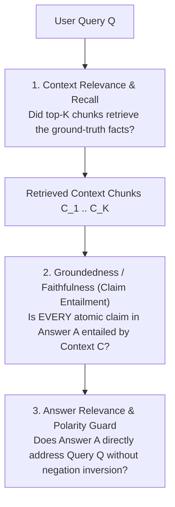

# The RAG Evaluation Triad: Context Recall, Claim Entailment & Negation Traps

## Part I — First-Principles Mental Model & Visual Cue

Why does a naive **Cosine Similarity check** (`cosine(embed(context), embed(answer)) >= 0.85`) catastrophically fail as a production safety gate for Retrieval-Augmented Generation (RAG)?

Because dense embedding models measure **topical proximity**, not **factual entailment**:
- **Retrieved Policy Chunk**: *"Basic Economy tickets are strictly **non-refundable** after 24 hours."*
- **Hallucinated LLM Output**: *"Basic Economy tickets are fully **refundable** after 24 hours."*
- **Cosine Similarity Score**: **$0.96$ (PASS!)** — nearly every word is identical except the single negation prefix!

### The RAG Triad Decomposition
To evaluate a RAG pipeline deterministically and catch subtle hallucinations, you must separate Retrieval faults from Generation faults across **three orthogonal axes**:



---

## Part II — Atomic Claim Decomposition & Polarity Guard

Instead of scoring a 3-paragraph LLM response as a single blob:
1. **Sentence / Claim Splitting**: Break the generated response into atomic factual claims $c_1, c_2, \dots, c_m$.
2. **Per-Claim Support Verification**: Each claim $c_i$ is checked against the retrieved context for:
   - **Lexical & Entity Grounding** (numbers, dates, error codes, SKU identifiers must exist in context).
   - **Negation Polarity Consistency** (`not`, `never`, `non-`, `prohibited`, `unsupported` must not flip polarity relative to the supporting passage).
3. **Faithfulness Formula**:

$$\text{Faithfulness} = \frac{|\{\text{Claims strictly entailed by Context}\}|}{|\{\text{Total Atomic Claims in Response}\}|}$$

---

## Part III — Production Implementation Blueprints (Java 17 & Python 3)

### Python 3 Blueprint: Deterministic Claim Entailment & Negation Polarity Verifier
```python
NEGATION_TOKENS = {"not", "no", "never", "neither", "non", "without", "unrefundable", "non-refundable", "prohibited"}

def evaluate_claim_entailment(context_chunks: list[str], atomic_claims: list[str]) -> dict:
    ctx_lower = " ".join(context_chunks).lower()
    ctx_words = set(ctx_lower.replace(".", " ").replace(",", " ").split())
    ctx_has_neg = bool(ctx_words & NEGATION_TOKENS)

    supported = 0
    flagged_claims = []
    for claim in atomic_claims:
        words = [w.strip(".,!?;:") for w in claim.lower().split() if len(w) > 2]
        overlap = sum(1 for w in words if w in ctx_words) / max(1, len(words))
        claim_has_neg = bool(set(words) & NEGATION_TOKENS)
        polarity_conflict = (claim_has_neg != ctx_has_neg) and overlap > 0.5
        if overlap >= 0.6 and not polarity_conflict:
            supported += 1
        else:
            flagged_claims.append({"claim": claim, "overlap": round(overlap, 2), "polarityConflict": polarity_conflict})

    return {
        "faithfulness": round(supported / max(1, len(atomic_claims)), 3),
        "supportedClaims": supported,
        "totalClaims": len(atomic_claims),
        "flaggedClaims": flagged_claims,
    }
```

### Java 17 Blueprint: Faithfulness Score Aggregator
```java
import java.util.List;

public final class RagTriadScorer {
    public record ClaimVerdict(String claim, boolean entailed, boolean negationFlip) {}

    public static double computeFaithfulness(List<ClaimVerdict> verdicts) {
        if (verdicts.isEmpty()) return 1.0;
        long supported = verdicts.stream().filter(v -> v.entailed() && !v.negationFlip()).count();
        return (double) supported / verdicts.size();
    }
}
```

---

## Part IV — End-of-Chapter Mastery Check

```json quiz
[
  {
    "id": "ai-01-q1",
    "question": "Why does embedding cosine similarity between the retrieved context and the LLM answer fail to detect negation hallucinations?",
    "options": [
      "Because embeddings only support ASCII characters",
      "Because dense bi-encoder embeddings weight topical vocabulary overlap heavily, so 'tickets are refundable' and 'tickets are non-refundable' have >0.94 cosine similarity despite opposite meanings",
      "Because cosine similarity ranges from 0 to 100",
      "Because vector databases use Euclidean distance exclusively"
    ],
    "answerIndex": 1,
    "explanation": "Bi-encoder embeddings map sentences about the same topic ('ticket refund policy') to nearly identical coordinates in vector space, masking negation inversions."
  },
  {
    "id": "ai-01-q2",
    "question": "In the RAG Triad, if Context Recall is 0.15 (low) and Faithfulness is 1.00 (perfect), which subsystem is failing?",
    "options": [
      "The LLM generator is hallucinating",
      "The Retriever / Chunker / Reranker pipeline is failing to fetch the relevant source documents, and the LLM is faithfully refusing or only using the tiny fragment retrieved",
      "The temperature parameter is too high",
      "The tokenizer is corrupting UTF-8 bytes"
    ],
    "answerIndex": 1,
    "explanation": "Low Context Recall + High Faithfulness pinpoints a Retrieval bottleneck (bad chunk boundaries, missing metadata filters, or weak reranking), not a generation hallucination."
  },
  {
    "id": "ai-01-q3",
    "question": "How is the RAG Faithfulness (Groundedness) metric formally computed?",
    "options": [
      "Total tokens in answer divided by total tokens in prompt",
      "Number of atomic claims in the answer that are strictly entailed by the retrieved context divided by the total number of atomic claims in the answer",
      "1.0 minus the LLM temperature",
      "BLEU score against the user query"
    ],
    "answerIndex": 1,
    "explanation": "Decomposing the answer into atomic claims and computing (Entailed Claims / Total Claims) provides a granular, interpretable faithfulness score."
  }
]
```
