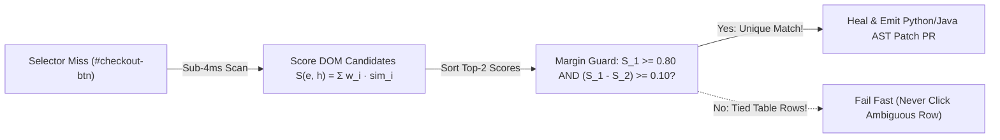

# Build AeroEval v0.9: Self-Healing AST & Multi-Attribute DOM Confidence Engines

```json continuity
{
  "previously": "In Chapter 08, we built `AeroEval v0.8` with a Stateful Mock MCP Sandbox to verify autonomous agent trajectories, causal read-before-write DAGs, and final world states.",
  "painPoint": "Now our UI automation team wants AI help too! A frontend refactor renamed `<button id='checkout-btn'>` to `<button data-testid='pay-now-cta'>`. Someone installed a naive 'AI Self-Healing' plugin that shipped 100KB of HTML to an LLM API on every broken selector—adding 3.5 seconds per failure, clicking the wrong row's 'Cancel Flight' button when 5 rows looked similar, and silently hiding a broken accessibility button!",
  "unlock": "Upgrade to `AeroEval v0.9`: build a sub-4ms deterministic Multi-Attribute DOM Fingerprint scorer, enforce the Ambiguity Margin Guard (`S_1 - S_2 >= 0.10`), and auto-generate AST Codemod PR diffs!"
}
```

```json walkthrough
[
  {
    "time": "0:00",
    "badge": "Slide 1 / 4 · Why Runtime LLM HTML Dumps Fail at Scale",
    "caption": "Sending 100KB of raw DOM HTML to an external LLM API whenever a Playwright selector fails adds 3+ seconds of latency, leaks staging data, and can pass at 10:00 AM then fail at 10:05 AM! Instead, we snapshot a lightweight 6-attribute DOM Fingerprint on green runs.",
    "code": "baseline_fingerprint = {\n    \"tag\": \"button\", \"role\": \"button\",\n    \"ariaLabel\": \"Complete Checkout\", \"text\": \"Pay Now\", \"parentTag\": \"form\"\n}"
  },
  {
    "time": "0:26",
    "badge": "Slide 2 / 4 · Sub-4ms Weighted Multi-Attribute Scoring S(e, h)",
    "caption": "When `#checkout-btn` disappears, AeroEval v0.9 scans interactive elements on the page in <4ms and scores each candidate against our baseline fingerprint across role, aria-label, text Jaccard, and parent tag!",
    "code": "# Candidate `<button data-testid='pay-now-cta' aria-label='Complete Checkout'>Pay Now</button>`\n# Matches tag (0.20) + role (0.20) + ariaLabel (0.25) + text (0.25) + parent (0.10) = 1.00!"
  },
  {
    "time": "0:53",
    "badge": "Slide 3 / 4 · The Ambiguity Margin Guard (S_1 - S_2 >= 0.10)",
    "caption": "What if a table has 5 identical `<button>Cancel Flight</button>` rows, and both Row 1 and Row 2 score S = 0.88? Checking only `S_1 >= 0.80` clicks a random row! AeroEval v0.9 requires `S_1 - S_2 >= 0.10` (Margin Guard)!",
    "code": "safe_to_heal = (best_score >= 0.80) and ((best_score - second_best_score) >= 0.10)\n# If Row 1 = 0.88 and Row 2 = 0.88 -> margin = 0.00 -> REJECT (Fail Fast Safely!)"
  },
  {
    "time": "1:18",
    "badge": "Slide 4 / 4 · Never Mask Bugs Silently — Emit an AST Patch PR!",
    "caption": "Silently passing broken locators forever leaves dead code in Git! AeroEval v0.9 parses the test file's Abstract Syntax Tree (`ast`) and generates a clean 1-line PR diff updating the selector for human review.",
    "code": "# AST Rewriter transforms:\n# - page.locator(\"#checkout-btn\")\n# + page.locator(\"[data-testid='pay-now-cta']\")"
  }
]
```

```json pretraining
[
  {
    "term": "Multi-Attribute DOM Fingerprint",
    "formula": "S(e, h) = Σ_i w_i · sim(e_i, h_i)",
    "meaning": "Saving 6 backup clues about a button (its accessibility role, aria-label, visible text, tag name, test ID, and parent container) on passing test runs so you can still recognize it if its CSS ID changes."
  },
  {
    "term": "Ambiguity Margin Guard (Δ)",
    "formula": "S(c_1) ≥ 0.80  ∧  (S(c_1) - S(c_2)) ≥ 0.10",
    "meaning": "A safety rule that refuses to auto-heal if the #1 best-matching button and the #2 runner-up button have almost the same score (like 5 'Cancel' buttons in a table)."
  },
  {
    "term": "Silent-Masking Anti-Pattern",
    "formula": "Never Hide Broken Accessibility (getByRole)",
    "meaning": "Why self-healing must never quietly pass a test if a developer accidentally broke screen-reader accessibility (like turning a real `<button>` into a broken `<div>`)."
  },
  {
    "term": "AST Locator Codemod",
    "formula": "Parse(Code) → RewriteNode → GitHub PR Diff",
    "meaning": "Using a code syntax parser (Python `ast` or JavaParser) to automatically propose a clean pull request updating the outdated selector in your test file."
  }
]
```

```json poe
{
  "question": "An orders table renders 5 rows, each with `<button class='btn-danger'>Cancel Order</button>`. A frontend refactor removes `#cancel-order-row-1`. Your self-healing scorer scans the DOM and finds 5 buttons: candidate c_1 scores S = 0.88 and candidate c_2 scores S = 0.88. If your engine checks ONLY `S(c_1) >= 0.80`, what happens?",
  "options": [
    "Playwright automatically clicks all 5 buttons simultaneously",
    "The engine commits a catastrophic False-Positive Heal—clicking an arbitrary row's 'Cancel Order' button and passing a broken test! Enforcing the Ambiguity Margin Guard (S_1 - S_2 = 0.00 < 0.10) forces a safe Fail-Fast abort",
    "The browser throws an OutOfMemoryError",
    "CSS flexbox sorts candidates by UUID"
  ],
  "answerIndex": 1,
  "explanation": "High absolute similarity S(c_1) is necessary but NOT sufficient on repeating UI lists/tables. Whenever S(c_1) - S(c_2) < Δ_margin, the target is structurally ambiguous and MUST fail fast rather than mutate the wrong entity."
}
```

## 🌱 Step 1: Plain-English Story — Why "Send HTML to GPT" Is a Terrible Way to Heal UI Tests

Imagine a frontend engineer renames `<button id="checkout-btn">Pay Now</button>` to `<button data-testid="pay-now-cta">Pay Now</button>`.
Your legacy Playwright test looking for `#checkout-btn` fails.

Many vendors sell "AI Self-Healing" tools that handle this by grabbing the entire `100KB` HTML of the page and sending it to an external LLM API during the test run: *"Hey LLM, where did `#checkout-btn` go?"*
In production CI, that approach fails for three reasons:
1. **Slow & Expensive**: Waiting `3.5 seconds` per broken selector across 500 parallel tests grinds CI to a halt.
2. **The Table-Row Trap (Wrong-Button Clicks!)**: Suppose your page has 5 bookings in a table, each with a `<button>Cancel Flight</button>`. If `#cancel-row-1` disappears, a naive similarity check sees that Row 2's `Cancel Flight` button is an `88%` match—and clicks Row 2!
3. **Rotting Code & Masked Bugs**: If the tool silently passes CI without updating your code, your Git repo fills up with dead selectors—or worse, hides a real P1 bug when a developer replaces an accessible `<button>` with a broken `<div>`!



Let's build **`AeroEval v0.9`** using **Deterministic Multi-Attribute DOM Fingerprints**, an **Ambiguity Margin Guard**, and **AST Codemod PRs**!

## 🔨 Step 2: First Lines of Code — Build the `AeroEval v0.9` Scorer & Margin Guard in 16 Lines!

Look how fast and deterministic `AeroEval v0.9` is: we score each candidate DOM element against our baseline fingerprint (`tag`, `role`, `ariaLabel`, `text`), sort the scores, and require **both** `best_score >= 0.80` **and** a clear lead `best_score - second_score >= 0.10` over the runner-up!

```python
def heal_dom_selector(baseline: dict, candidates: list[dict]) -> dict:
    """AeroEval v0.9: Scores DOM candidates in <4ms and enforces the Ambiguity Margin Guard!"""
    scored = []
    for c in candidates:
        s = (
            0.25 * (baseline.get("role") == c.get("role"))
            + 0.35 * (baseline.get("ariaLabel") == c.get("ariaLabel"))
            + 0.25 * (baseline.get("text") == c.get("text"))
            + 0.15 * (baseline.get("tag") == c.get("tag"))
        )
        scored.append((round(s, 3), c["selector"]))
    scored.sort(reverse=True)
    s1, sel1 = scored[0]
    s2 = scored[1][0] if len(scored) > 1 else 0.0
    margin = round(s1 - s2, 3)
    return {"healed": (s1 >= 0.80 and margin >= 0.10), "selector": sel1, "score": s1, "margin": margin}


base = {"tag": "button", "role": "button", "ariaLabel": "Checkout", "text": "Pay Now"}
cands = [{"selector": "[data-testid='pay-cta']", "tag": "button", "role": "button", "ariaLabel": "Checkout", "text": "Pay Now"},
         {"selector": "#cancel-btn", "tag": "button", "role": "button", "ariaLabel": "Cancel", "text": "Cancel"}]
print(heal_dom_selector(base, cands))
```

### Java 17 Equivalent

```java
import java.util.Comparator;
import java.util.List;

public class AeroEvalV09DomHealer {
    public record DomCandidate(String selector, String tag, String role, String ariaLabel, String text) {}
    public record HealResult(boolean healed, String selector, double score, double margin) {}

    public static HealResult healDomSelector(DomCandidate base, List<DomCandidate> candidates) {
        var scored = candidates.stream()
                .map(c -> {
                    double s = (base.role().equals(c.role()) ? 0.25 : 0.0)
                            + (base.ariaLabel().equals(c.ariaLabel()) ? 0.35 : 0.0)
                            + (base.text().equals(c.text()) ? 0.25 : 0.0)
                            + (base.tag().equals(c.tag()) ? 0.15 : 0.0);
                    return new HealResult(false, c.selector(), s, 0.0);
                })
                .sorted(Comparator.comparingDouble(HealResult::score).reversed())
                .toList();
        double s1 = scored.get(0).score();
        double s2 = scored.size() > 1 ? scored.get(1).score() : 0.0;
        double margin = s1 - s2;
        return new HealResult(s1 >= 0.80 && margin >= 0.10, scored.get(0).selector(), s1, margin);
    }
}
```

## ⚡ Step 3: Where It Breaks in Real Life — Never Heal Downward From `getByRole` Accessibility!

Suppose your test uses Playwright's gold-standard accessibility locator:
`page.getByRole("button", name="Complete Checkout")`

One afternoon, a developer accidentally refactors `<button>Complete Checkout</button>` into `<div class="pay-box" onclick="pay()">Complete Checkout</div>`.
Because a plain `<div>` has no `role="button"` and no keyboard `Tab`/`Enter` support, **blind passengers using screen readers and keyboard-only users are now completely locked out of buying a ticket!**

If a naive self-healing tool says *"Oh, I found `div.pay-box` with matching text `'Complete Checkout'`, let me heal the test and mark CI green!"*, your test suite just **betrayed your users** by hiding a P1 accessibility regression!
- **Rule 1**: Only self-heal brittle implementation selectors (`#legacy-id`, `.css-class`). **Never** silently heal downward when a semantic `role` or `aria-label` disappears!
- **Rule 2**: Instead of hiding dead locators at runtime forever, emit an **AST Codemod PR** so a human engineer reviews and merges the updated selector into Git.

```json contrast
{
  "title": "UI Locator Self-Healing Architecture",
  "naiveTitle": "Runtime LLM HTML Dump + Silent Pass",
  "naiveMetric": "3.2s Latency · Masks Real A11y Bugs",
  "naivePoints": [
    "Ships raw 100KB page.content() HTML to an external LLM API on every timeout",
    "Uses only single-top-score threshold without checking runner-up margin on table rows",
    "Silently marks CI green forever without updating source code, leaving dead locators in Git",
    "Masks genuine accessibility regressions when aria-label or button role is accidentally removed"
  ],
  "staffTitle": "Deterministic DOM Fingerprint + Margin Guard + AST PR",
  "staffMetric": "<4ms CPU · Zero Silent Regression Masking",
  "staffPoints": [
    "Scores candidates locally in <4ms using weighted WAI-ARIA, text Jaccard, and ancestor tree features",
    "Enforces strict Ambiguity Margin (S_1 - S_2 >= 0.10) to block wrong-row table mutations",
    "Never hides broken accessibility contracts if role='button' or accessible name disappears",
    "Parses test source AST (Python ast / JavaParser) to open a human-reviewed locator-update PR diff"
  ]
}
```

## 🚀 Step 4: Staff Engineer Deep-Dive — Multi-Attribute Similarity $S(e, h)$ & AST Rewriting

Given a historical baseline fingerprint $h$ and live candidate DOM element $e$ across $K$ orthogonal feature extractors $\phi_k \in \{\text{tag}, \text{role}, \text{ariaLabel}, \text{textTokens}, \text{ancestorPath}\}$ with normalized weights $\sum_{k=1}^{K} w_k = 1$, the deterministic similarity score is:

$$S(e, h) = \sum_{k=1}^{K} w_k \cdot \text{sim}_k\bigl(\phi_k(e), \phi_k(h)\bigr) \in [0, 1]$$

Sorting all interactive candidates on the page such that $S(e_{(1)}, h) \ge S(e_{(2)}, h) \ge \dots \ge S(e_{(m)}, h)$, a candidate $e_{(1)}$ qualifies for unambiguous resolution if and only if:

$$S(e_{(1)}, h) \ge \tau_{\min} \quad (\tau_{\min} = 0.80) \qquad \land \qquad S(e_{(1)}, h) - S(e_{(2)}, h) \ge \Delta_{\text{margin}} \quad (\Delta_{\text{margin}} = 0.10)$$

| Healing Mode | Blocking PR Behaviour | Source Code Action | When to Use |
| :--- | :--- | :--- | :--- |
| **Strict Contract Mode (`getByRole`)** | **Fails Build** if accessible role/name breaks | None (Developer must restore a11y!) | Primary WCAG / Accessibility-contracted user journeys |
| **Advisory Diagnostics + AST Patch** | **Fails Build** with exact suggested new locator + 1-click AST diff | Generates `.patch` artifact in CI | **Recommended Staff Default** for blocking PR gates |
| **Quarantine Auto-Heal** | Soft-passes non-critical CSS/ID drift for $\le 24\text{h}$ | Auto-opens GitHub PR rewriting AST node | Nightly staging E2E suites across legacy non-`testid` apps |

### Production Blueprint: Multi-Attribute Scorer, Margin Gate & `ast` Locator Rewriter

```python
import ast


def score_dom_candidate(baseline: dict, candidate: dict) -> float:
    score = 0.0
    if baseline.get("tag") == candidate.get("tag"):
        score += 0.20
    if baseline.get("role") and baseline.get("role") == candidate.get("role"):
        score += 0.20
    if baseline.get("ariaLabel") and baseline.get("ariaLabel") == candidate.get("ariaLabel"):
        score += 0.25
    b_tokens = set((baseline.get("text") or "").lower().split())
    c_tokens = set((candidate.get("text") or "").lower().split())
    if b_tokens and c_tokens:
        score += 0.25 * (len(b_tokens & c_tokens) / len(b_tokens | c_tokens))
    if baseline.get("parentTag") == candidate.get("parentTag"):
        score += 0.10
    return round(min(1.0, score), 4)


def select_unambiguous_heal(
    baseline: dict,
    candidates: list[dict],
    min_confidence: float = 0.80,
    min_margin: float = 0.10,
) -> dict:
    scored = sorted(
        ((score_dom_candidate(baseline, c), c) for c in candidates),
        key=lambda pair: pair[0],
        reverse=True,
    )
    if not scored:
        return {"autoHealed": False, "reason": "NO_INTERACTIVE_CANDIDATES"}

    best_score, best_node = scored[0]
    second_score = scored[1][0] if len(scored) > 1 else 0.0
    margin = round(best_score - second_score, 4)
    safe = (best_score >= min_confidence) and (margin >= min_margin)
    return {
        "autoHealed": safe,
        "bestSelector": best_node.get("selector"),
        "confidence": best_score,
        "margin": margin,
        "reason": "HEALED_UNAMBIGUOUS" if safe else "REJECTED_LOW_CONFIDENCE_OR_AMBIGUOUS_SIBLING",
    }


class LocatorStringAstRewriter(ast.NodeTransformer):
    """Safely rewrites page.locator(old_sel) -> page.locator(new_sel) via Python AST."""

    def __init__(self, old_selector: str, new_selector: str):
        self.old_selector = old_selector
        self.new_selector = new_selector
        self.replacements = 0

    def visit_Call(self, node: ast.Call) -> ast.AST:
        self.generic_visit(node)
        if (
            isinstance(node.func, ast.Attribute)
            and node.func.attr == "locator"
            and node.args
            and isinstance(node.args[0], ast.Constant)
            and node.args[0].value == self.old_selector
        ):
            node.args[0] = ast.Constant(value=self.new_selector)
            self.replacements += 1
        return node
```

### Java 17 Equivalent

```java
import java.util.Comparator;
import java.util.List;

public record HealDecision(String selector, double confidence, double margin, boolean autoHealed) {
    public record ScoredCandidate(String selector, double score) {}

    public static HealDecision evaluate(String bestSelector, double bestScore, double secondBestScore) {
        double margin = bestScore - secondBestScore;
        boolean safe = bestScore >= 0.80 && margin >= 0.10;
        return new HealDecision(bestSelector, bestScore, margin, safe);
    }

    public static HealDecision rankAndGate(List<ScoredCandidate> candidates) {
        if (candidates == null || candidates.isEmpty()) {
            return new HealDecision("", 0.0, 0.0, false);
        }
        List<ScoredCandidate> sorted = candidates.stream()
                .sorted(Comparator.comparingDouble(ScoredCandidate::score).reversed())
                .toList();
        double s1 = sorted.get(0).score();
        double s2 = sorted.size() > 1 ? sorted.get(1).score() : 0.0;
        return evaluate(sorted.get(0).selector(), s1, s2);
    }
}
```

> [!WARNING]
> **Staff Interview Gotcha — Self-Healing Must NEVER Silently Mask Broken Accessibility (`getByRole`)**:
> If your test uses Playwright's semantic `page.getByRole("button", { name: "Complete Checkout" })` and a frontend developer replaces `<button>` with an inaccessible `<div onclick="...">` (breaking keyboard navigation and screen readers!), a naive self-healing plugin that falls back to `div.checkout-box` and marks CI green **just shipped a P1 ADA/WCAG regression to production**! Only allow self-healing across brittle legacy implementation selectors (`#id`, `.class`, XPath)—never heal *downward* from semantic accessibility contracts to non-semantic `<div>`s.

**Up Next in Chapter 10 (Course Finale!)**: We now have every piece of `AeroEval` (`v0.1` $\to$ `v0.9`)! How do we wire all of them into a **3-Tier Production CI/CD & Drift Monitoring Pipeline (`AeroEval v1.0`)** that runs PR checks in `< 90 seconds`, catches weekend model/data drift with **Population Stability Index (`PSI`)**, and adds **0ms** of latency to live flyers? Let's finish strong in Chapter 10!

```json quiz
[
  {
    "id": "ai-02-q1",
    "question": "Why must a self-healing DOM locator engine enforce a minimum margin (S_1 - S_2 >= delta) between the top candidate and the second-best candidate?",
    "options": [
      "To speed up CSS parsing",
      "To prevent ambiguous false-positive healing when multiple similar elements (e.g., multiple 'Delete' or 'Edit' row buttons) have nearly identical similarity scores",
      "Because XPath indexes start at 1",
      "To reduce browser memory usage"
    ],
    "answerIndex": 1,
    "explanation": "If two candidates score 0.86 and 0.84, the match is ambiguous. Enforcing a separation margin prevents clicking the wrong row action."
  },
  {
    "id": "ai-02-q2",
    "question": "Which DOM attributes are the most resilient signals against CSS utility refactoring (such as Tailwind class renames)?",
    "options": [
      "Generated CSS class hashes (.css-1x9a2b)",
      "Absolute nth-child XPath (/html/body/div[4]/div[2]/button[1])",
      "WAI-ARIA role, accessible name (aria-label), data-testid, and semantic text tokens",
      "Element pixel coordinates (x, y)"
    ],
    "answerIndex": 2,
    "explanation": "Semantic accessibility attributes (role, aria-label) and explicit test contracts (data-testid) reflect user-facing intent rather than styling layout."
  },
  {
    "id": "ai-02-q3",
    "question": "A Playwright test asserting `page.getByRole('button', name='Submit Payment')` fails because a commit refactored `<button>` into `<div class='pay-div'>Submit Payment</div>`. Why should a Staff-grade self-healing engine REFUSE to silently pass this test?",
    "options": [
      "Because `<div>` tags cannot have CSS classes",
      "Because replacing `<button>` with an un-roled `<div>` broke keyboard Tab/Enter focus and screen-reader accessibility; silently healing from a semantic ARIA role down to a CSS class masks a real user-facing WCAG defect!",
      "Because AST parsers cannot edit strings containing spaces",
      "Because Jaccard similarity is 0.0"
    ],
    "answerIndex": 1,
    "explanation": "Self-healing exists to survive benign implementation refactors (e.g., CSS class or legacy ID renames), never to mask broken user-facing accessibility contracts."
  }
]
```
