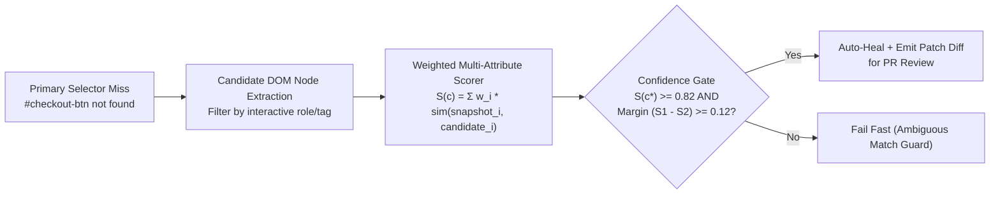

# Self-Healing AST & Multi-Attribute DOM Confidence Engines

## Part I — First-Principles Mental Model & Visual Cue

When a frontend commit renames a CSS utility class or changes `<button id="checkout-btn">` to `<button data-testid="pay-now-cta" aria-label="Complete Checkout">`, brittle single-selector tests break immediately.

However, calling an external LLM API on every `LocatorNotFoundException` in CI introduces **3 fatal production flaws**:
1. **Latency**: $1.5\text{s}–4.0\text{s}$ per failed selector across 500 parallel tests.
2. **Non-Determinism**: The same test run can pass at 10:00 AM and fail at 10:05 AM.
3. **False-Positive Clicks**: Clicking the wrong `"Delete Account"` button because it looked semantically similar to `"Cancel Order"`.

### The Deterministic Solution: Weighted Multi-Attribute DOM Fingerprinting
Every interactive DOM element is snapshotted as a **Structural Fingerprint Vector** across 6 attributes:
- `role` / `tagName` ($w = 0.20$)
- `aria-label` / accessible name ($w = 0.25$)
- `innerText` token Jaccard similarity ($w = 0.25$)
- `name` / `placeholder` / `type` ($w = 0.15$)
- Ancestor DOM path (`form > footer > button`) ($w = 0.15$)



---

## Part II — The Ambiguity Margin Guard ($S_1 - S_2 \ge \Delta$)

Even if the top candidate $c_1$ achieves a high similarity score $S(c_1) = 0.85$, if a second sibling button $c_2$ scores $S(c_2) = 0.83$, healing is **unsafe** because two nearly identical buttons exist on the page.
Therefore, a production self-healing engine requires **both**:
1. **Absolute Confidence Threshold**: $S(c_1) \ge \tau_{\text{min}}$ (e.g., $0.80$)
2. **Minimum Margin Over Runner-Up**: $S(c_1) - S(c_2) \ge \Delta_{\text{margin}}$ (e.g., $0.10$)

---

## Part III — Production Implementation Blueprints (Java 17 & Python 3)

### Python 3 Blueprint: Multi-Attribute DOM Confidence Scorer
```python
def score_dom_candidate(baseline: dict, candidate: dict) -> float:
    score = 0.0
    if baseline.get("tag") == candidate.get("tag"):
        score += 0.20
    if baseline.get("role") and baseline.get("role") == candidate.get("role"):
        score += 0.20
    if baseline.get("ariaLabel") and baseline.get("ariaLabel") == candidate.get("ariaLabel"):
        score += 0.25
    b_tokens = set((baseline.get("text") or "").lower().split())
    c_tokens = set((candidate.get("text") or "").lower().split())
    if b_tokens and c_tokens:
        score += 0.25 * (len(b_tokens & c_tokens) / len(b_tokens | c_tokens))
    if baseline.get("parentTag") == candidate.get("parentTag"):
        score += 0.10
    return round(min(1.0, score), 4)
```

### Java 17 Blueprint: Confidence & Margin Gate
```java
public record HealDecision(String selector, double confidence, double margin, boolean autoHealed) {
    public static HealDecision evaluate(String bestSelector, double bestScore, double secondBestScore) {
        double margin = bestScore - secondBestScore;
        boolean safe = bestScore >= 0.80 && margin >= 0.10;
        return new HealDecision(bestSelector, bestScore, margin, safe);
    }
}
```

---

## Part IV — End-of-Chapter Mastery Check

```json quiz
[
  {
    "id": "ai-02-q1",
    "question": "Why must a self-healing DOM locator engine enforce a minimum margin (S_1 - S_2 >= delta) between the top candidate and the second-best candidate?",
    "options": [
      "To speed up CSS parsing",
      "To prevent ambiguous false-positive healing when multiple similar elements (e.g., multiple 'Delete' or 'Edit' row buttons) have nearly identical similarity scores",
      "Because XPath indexes start at 1",
      "To reduce browser memory usage"
    ],
    "answerIndex": 1,
    "explanation": "If two candidates score 0.86 and 0.84, the match is ambiguous. Enforcing a separation margin prevents clicking the wrong row action."
  },
  {
    "id": "ai-02-q2",
    "question": "Which DOM attributes are the most resilient signals against CSS utility refactoring (such as Tailwind class renames)?",
    "options": [
      "Generated CSS class hashes (.css-1x9a2b)",
      "Absolute nth-child XPath (/html/body/div[4]/div[2]/button[1])",
      "WAI-ARIA role, accessible name (aria-label), data-testid, and semantic text tokens",
      "Element pixel coordinates (x, y)"
    ],
    "answerIndex": 2,
    "explanation": "Semantic accessibility attributes (role, aria-label) and explicit test contracts (data-testid) reflect user-facing intent rather than styling layout."
  }
]
```
