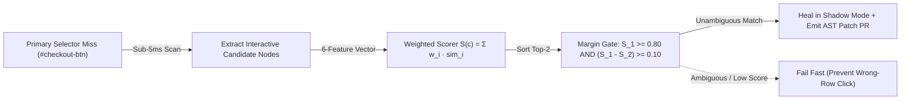

# Self-Healing AST & Multi-Attribute DOM Confidence Engines

```json pretraining
[
  {
    "term": "Multi-Attribute DOM Fingerprint",
    "formula": "S(c) = Σ_i w_i · sim(b_i, c_i)",
    "meaning": "Snapshotting 6 orthogonal element signals (WAI-ARIA role, aria-label, token Jaccard text, data-testid/name, tag, ancestor path) so single-attribute renames don't break resolution."
  },
  {
    "term": "Ambiguity Margin Guard (Δ)",
    "formula": "S(c_1) ≥ τ_min  ∧  (S(c_1) - S(c_2)) ≥ Δ",
    "meaning": "Blocks unsafe auto-healing when two sibling row buttons ('Delete Row 1' vs 'Delete Row 2') achieve nearly identical similarity scores."
  },
  {
    "term": "Silent-Masking Anti-Pattern",
    "formula": "Never Mutate Prod Assertion Silently",
    "meaning": "Auto-healing in CI must quarantine/flag and emit a deterministic AST patch diff for human PR review—never silently hide an accidental accessibility regression!"
  },
  {
    "term": "AST Locator Codemod",
    "formula": "Parse(Source) → RewriteCallNode → Diff",
    "meaning": "Updating Page Object / Playwright locator expressions syntactically via Python `ast`/`libcst` or JavaParser rather than fragile regex find-and-replace."
  }
]
```

```json poe
{
  "question": "An orders table renders 5 rows, each with `<button class='btn-danger'>Cancel Order</button>`. A frontend refactor removes `#cancel-order-row-1`. Your self-healing scorer scans the DOM and finds 5 buttons: candidate c_1 scores S = 0.88 and candidate c_2 scores S = 0.88. If your engine checks ONLY `S(c_1) >= 0.80`, what happens?",
  "options": [
    "Playwright automatically clicks all 5 buttons simultaneously",
    "The engine commits a catastrophic False-Positive Heal—clicking an arbitrary row's 'Cancel Order' button and passing a broken test! Enforcing the Ambiguity Margin Guard (S_1 - S_2 = 0.00 < 0.10) forces a safe Fail-Fast abort",
    "The browser throws an OutOfMemoryError",
    "CSS flexbox sorts candidates by UUID"
  ],
  "answerIndex": 1,
  "explanation": "High absolute similarity S(c_1) is necessary but NOT sufficient on repeating UI lists/tables. Whenever S(c_1) - S(c_2) < Δ_margin, the target is structurally ambiguous and MUST fail fast rather than mutate the wrong entity."
}
```

## Part I — First-Principles Mental Model & Visual Cue

When a frontend commit renames a CSS utility class or refactors `<button id="checkout-btn">` into `<button data-testid="pay-now-cta" aria-label="Complete Checkout">`, brittle single-selector tests break immediately.

However, calling an external frontier LLM API synchronously on every `LocatorNotFoundException` inside CI introduces **three fatal production flaws**:
1. **Latency & Cost Explosion**: $1.5\text{s}–4.0\text{s}$ per failed selector (plus $50\text{KB}$ sanitized DOM payloads) across 500 parallel Playwright shards.
2. **Run-to-Run Non-Determinism**: The exact same test commit can auto-heal at 10:00 AM and fail at 10:05 AM.
3. **False-Positive Destructive Clicks & Regression Masking**: Clicking `"Delete Account"` because it looked semantically similar to `"Cancel Order"`, or silently healing away a real P1 accessibility bug when a developer accidentally deleted an `aria-label`!

### The Deterministic Solution: Weighted Multi-Attribute DOM Fingerprinting + AST PR Patching
Every interactive DOM element is snapshotted on green baseline runs as a **Structural Fingerprint Vector** across 6 attributes:
- `role` / `tagName` ($w = 0.20$)
- `aria-label` / accessible name ($w = 0.25$)
- `innerText` token Jaccard similarity ($w = 0.25$)
- `name` / `placeholder` / `type` / `data-testid` token overlap ($w = 0.15$)
- Ancestor DOM path (`form > footer > button`) ($w = 0.15$)



```json contrast
{
  "title": "UI Locator Self-Healing Architecture",
  "naiveTitle": "Runtime LLM HTML Dump + Silent Pass",
  "naiveMetric": "3.2s Latency · Masks Real A11y Bugs",
  "naivePoints": [
    "Ships raw 100KB page.content() HTML to an external LLM API on every timeout",
    "Uses only single-top-score threshold without checking runner-up margin on table rows",
    "Silently marks CI green forever without updating source code, leaving dead locators in Git",
    "Masks genuine accessibility regressions when aria-label or button role is accidentally removed"
  ],
  "staffTitle": "Deterministic DOM Fingerprint + Margin Guard + AST PR",
  "staffMetric": "<4ms CPU · Zero Silent Regression Masking",
  "staffPoints": [
    "Scores candidates locally in <4ms using weighted WAI-ARIA, text Jaccard, and ancestor tree features",
    "Enforces strict Ambiguity Margin (S_1 - S_2 >= 0.10) to block wrong-row table mutations",
    "Never hides broken accessibility contracts if role='button' or accessible name disappears",
    "Parses test source AST (Python ast / JavaParser) to open a human-reviewed locator-update PR diff"
  ]
}
```

---

## Part II — The Ambiguity Margin Guard ($S_1 - S_2 \ge \Delta$) & Governance Modes

Even if the top candidate $c_1$ achieves a high similarity score $S(c_1) = 0.85$, if a second sibling button $c_2$ scores $S(c_2) = 0.83$, healing is **unsafe** because two nearly identical controls exist on the page.
Therefore, a production self-healing engine requires **both**:
1. **Absolute Confidence Threshold**: $S(c_1) \ge \tau_{\text{min}}$ (e.g., $0.80$)
2. **Minimum Margin Over Runner-Up**: $S(c_1) - S(c_2) \ge \Delta_{\text{margin}}$ (e.g., $0.10$)

### Architectural Trade-Off Table: Healing Governance Modes

| Healing Mode | Blocking PR Behaviour | Source Code Action | When to Use |
| :--- | :--- | :--- | :--- |
| **Strict Contract Mode (`getByRole`)** | **Fails Build** if accessible role/name breaks | None (Developer must restore a11y!) | Primary WCAG / Accessibility-contracted user journeys |
| **Advisory Diagnostics + AST Patch** | **Fails Build** with exact suggested new locator + 1-click AST diff | Generates `.patch` artifact in CI | **Recommended Staff Default** for blocking PR gates |
| **Quarantine Auto-Heal** | Soft-passes non-critical CSS/ID drift for $\le 24\text{h}$ | Auto-opens GitHub PR rewriting AST node | Nightly staging E2E suites across legacy non-`testid` apps |

---

## Part III — Production Implementation Blueprints (Python 3 & Java 17)

### Python 3 Blueprint: Multi-Attribute Scorer, Margin Gate & `ast` Locator Rewriter
```python
import ast


def score_dom_candidate(baseline: dict, candidate: dict) -> float:
    score = 0.0
    if baseline.get("tag") == candidate.get("tag"):
        score += 0.20
    if baseline.get("role") and baseline.get("role") == candidate.get("role"):
        score += 0.20
    if baseline.get("ariaLabel") and baseline.get("ariaLabel") == candidate.get("ariaLabel"):
        score += 0.25
    b_tokens = set((baseline.get("text") or "").lower().split())
    c_tokens = set((candidate.get("text") or "").lower().split())
    if b_tokens and c_tokens:
        score += 0.25 * (len(b_tokens & c_tokens) / len(b_tokens | c_tokens))
    if baseline.get("parentTag") == candidate.get("parentTag"):
        score += 0.10
    return round(min(1.0, score), 4)


def select_unambiguous_heal(
    baseline: dict,
    candidates: list[dict],
    min_confidence: float = 0.80,
    min_margin: float = 0.10,
) -> dict:
    scored = sorted(
        ((score_dom_candidate(baseline, c), c) for c in candidates),
        key=lambda pair: pair[0],
        reverse=True,
    )
    if not scored:
        return {"autoHealed": False, "reason": "NO_INTERACTIVE_CANDIDATES"}

    best_score, best_node = scored[0]
    second_score = scored[1][0] if len(scored) > 1 else 0.0
    margin = round(best_score - second_score, 4)
    safe = (best_score >= min_confidence) and (margin >= min_margin)
    return {
        "autoHealed": safe,
        "bestSelector": best_node.get("selector"),
        "confidence": best_score,
        "margin": margin,
        "reason": "HEALED_UNAMBIGUOUS" if safe else "REJECTED_LOW_CONFIDENCE_OR_AMBIGUOUS_SIBLING",
    }


class LocatorStringAstRewriter(ast.NodeTransformer):
    """Safely rewrites page.locator(old_sel) -> page.locator(new_sel) via Python AST."""

    def __init__(self, old_selector: str, new_selector: str):
        self.old_selector = old_selector
        self.new_selector = new_selector
        self.replacements = 0

    def visit_Call(self, node: ast.Call) -> ast.AST:
        self.generic_visit(node)
        if (
            isinstance(node.func, ast.Attribute)
            and node.func.attr == "locator"
            and node.args
            and isinstance(node.args[0], ast.Constant)
            and node.args[0].value == self.old_selector
        ):
            node.args[0] = ast.Constant(value=self.new_selector)
            self.replacements += 1
        return node
```

### Java 17 Blueprint: Confidence & Margin Gate Evaluator
```java
import java.util.Comparator;
import java.util.List;

public record HealDecision(String selector, double confidence, double margin, boolean autoHealed) {
    public record ScoredCandidate(String selector, double score) {}

    public static HealDecision evaluate(String bestSelector, double bestScore, double secondBestScore) {
        double margin = bestScore - secondBestScore;
        boolean safe = bestScore >= 0.80 && margin >= 0.10;
        return new HealDecision(bestSelector, bestScore, margin, safe);
    }

    public static HealDecision rankAndGate(List<ScoredCandidate> candidates) {
        if (candidates == null || candidates.isEmpty()) {
            return new HealDecision("", 0.0, 0.0, false);
        }
        List<ScoredCandidate> sorted = candidates.stream()
                .sorted(Comparator.comparingDouble(ScoredCandidate::score).reversed())
                .toList();
        double s1 = sorted.get(0).score();
        double s2 = sorted.size() > 1 ? sorted.get(1).score() : 0.0;
        return evaluate(sorted.get(0).selector(), s1, s2);
    }
}
```

> [!WARNING]
> **Staff Interview Gotcha — Self-Healing Must NEVER Silently Mask Broken Accessibility (`getByRole`)**:
> If your test uses Playwright's semantic `page.getByRole("button", { name: "Complete Checkout" })` and a frontend developer replaces `<button>` with an inaccessible `<div onclick="...">` (breaking keyboard navigation and screen readers!), a naive self-healing plugin that falls back to `div.checkout-box` and marks CI green **just shipped a P1 ADA/WCAG regression to production**! Only allow self-healing across brittle legacy implementation selectors (`#id`, `.class`, XPath)—never heal *downward* from semantic accessibility contracts to non-semantic `<div>`s.

---

## Part IV — End-of-Chapter Mastery Check

```json quiz
[
  {
    "id": "ai-02-q1",
    "question": "Why must a self-healing DOM locator engine enforce a minimum margin (S_1 - S_2 >= delta) between the top candidate and the second-best candidate?",
    "options": [
      "To speed up CSS parsing",
      "To prevent ambiguous false-positive healing when multiple similar elements (e.g., multiple 'Delete' or 'Edit' row buttons) have nearly identical similarity scores",
      "Because XPath indexes start at 1",
      "To reduce browser memory usage"
    ],
    "answerIndex": 1,
    "explanation": "If two candidates score 0.86 and 0.84, the match is ambiguous. Enforcing a separation margin prevents clicking the wrong row action."
  },
  {
    "id": "ai-02-q2",
    "question": "Which DOM attributes are the most resilient signals against CSS utility refactoring (such as Tailwind class renames)?",
    "options": [
      "Generated CSS class hashes (.css-1x9a2b)",
      "Absolute nth-child XPath (/html/body/div[4]/div[2]/button[1])",
      "WAI-ARIA role, accessible name (aria-label), data-testid, and semantic text tokens",
      "Element pixel coordinates (x, y)"
    ],
    "answerIndex": 2,
    "explanation": "Semantic accessibility attributes (role, aria-label) and explicit test contracts (data-testid) reflect user-facing intent rather than styling layout."
  },
  {
    "id": "ai-02-q3",
    "question": "A Playwright test asserting `page.getByRole('button', name='Submit Payment')` fails because a commit refactored `<button>` into `<div class='pay-div'>Submit Payment</div>`. Why should a Staff-grade self-healing engine REFUSE to silently pass this test?",
    "options": [
      "Because `<div>` tags cannot have CSS classes",
      "Because replacing `<button>` with an un-roled `<div>` broke keyboard Tab/Enter focus and screen-reader accessibility; silently healing from a semantic ARIA role down to a CSS class masks a real user-facing WCAG defect!",
      "Because AST parsers cannot edit strings containing spaces",
      "Because Jaccard similarity is 0.0"
    ],
    "answerIndex": 1,
    "explanation": "Self-healing exists to survive benign implementation refactors (e.g., CSS class or legacy ID renames), never to mask broken user-facing accessibility contracts."
  }
]
```
