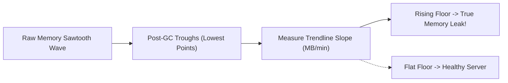

# OS Internals: Virtual Memory, Post-GC RSS Slope & File Descriptor Leaks

```json continuity
{
  "previously": "Welcome to Day 1 of Core CS Internals! Zero prior operating-system or hardware background is needed. Throughout this course, we will trace a single live command—python3 apps/aerocart/server.py—all the way down into the Linux kernel, network card, SSD, and CPU cache lines.",
  "painPoint": "We launch python3 apps/aerocart/server.py in production. For 5 hours its memory looks fine, but at hour 6 the Linux kernel suddenly murders the server with Exit Code 137 (OOMKilled) and Errno 24 (Too many open files)!",
  "unlock": "We will learn how Virtual Memory vs. Physical RSS works, how to spot a rising Post-GC sawtooth trough slope before a crash, and how to catch leaked File Descriptors."
}
```

```json walkthrough
[
  {
    "time": "0:00",
    "badge": "1. VIRT vs. RSS",
    "caption": "When python3 apps/aerocart/server.py starts, Linux gives it a giant imaginary notebook of Virtual Memory (VIRT), but only hands out real physical RAM pages (RSS) when our code actually writes data.",
    "code": "VIRT (promised address space) != RSS (real RAM pages used)"
  },
  {
    "time": "0:25",
    "badge": "2. Sawtooth GC",
    "caption": "Healthy servers allocate temporary objects and clean them up during Garbage Collection, creating a flat sawtooth wave. A memory leak makes the bottom troughs climb steadily upward.",
    "code": "troughs_mb = [310, 325, 340, 355] -> positive leak slope!"
  },
  {
    "time": "0:50",
    "badge": "3. Off-Heap Gap",
    "caption": "Even if your Python or Java heap stays flat, leaked C buffers or thread stacks push total physical RSS past the container limit and trigger Exit Code 137.",
    "code": "RSS_total = Managed_Heap + Off_Heap_Native + Thread_Stacks"
  },
  {
    "time": "1:15",
    "badge": "4. File Descriptors",
    "caption": "Every open file or network socket takes a numbered ticket in /proc/<pid>/fd. Forgetting to close sockets leaves them stuck in CLOSE_WAIT until the server runs out of tickets.",
    "code": "len(os.listdir('/proc/self/fd')) >= ulimit -> EMFILE (Errno 24)"
  }
]
```

```json pretraining
[
  {
    "term": "Virtual Memory (VIRT) vs. Resident Set Size (RSS)",
    "formula": "Promised Address Space vs. Physical 4KB RAM Pages",
    "meaning": "VIRT is how much memory address space a program has asked to reserve on paper; RSS is how many actual physical RAM pages the program is actively holding right now."
  },
  {
    "term": "Post-GC Trough Slope",
    "formula": "Trendline Across Lowest Memory Points After Cleanup",
    "meaning": "Measuring memory right after each Garbage Collection cleanup removes temporary noise so you can see if permanently stuck objects are slowly filling up RAM."
  },
  {
    "term": "Off-Heap / Native Memory Gap",
    "formula": "Total Physical RSS Minus Managed Language Heap",
    "meaning": "Memory used outside Python or Java's normal object heap—such as C libraries, compression buffers, and thread stacks—that the Linux kernel still counts against your container limit."
  },
  {
    "term": "Kernel File Descriptor (FD)",
    "formula": "Integer Ticket for Every Open File or Socket",
    "meaning": "A small ID number the operating system hands your process whenever it opens a file or network connection; if you forget to close them, the OS refuses to open any new connections."
  }
]
```

## 🌱 Step 1: Plain-English Story — The Hotel Reservation vs. Occupied Rooms

When you type `python3 apps/aerocart/server.py`, what is the very first thing the operating system does? It gives your process an isolated memory sandbox and a coat-check ticket counter.

Think of the Linux kernel as a massive hotel manager:
1. **Virtual Memory (`VIRT`) is a group reservation on paper**: Your program says, *"I might need space for 10,000 rooms today."* The hotel manager smiles and says *"Sure!"* without unlocking a single physical room yet.
2. **Resident Set Size (`RSS`) is actual occupied rooms**: Only when `AeroCart` writes a flight object into memory does the CPU trigger a brief pause (a **Minor Page Fault**) so the kernel can wire up a real 4-kilobyte slice of physical RAM.
3. **Garbage Collection (`GC`) is the housekeeping crew**: Every few seconds, Python or Java sweeps through memory and frees temporary checkout carts. On a graph, healthy memory goes up and down like the teeth of a saw (**a Sawtooth Wave**), always dropping back to the same flat floor.
4. **File Descriptors (`FD`) are coat-check tickets**: Every open log file or browser connection takes one numbered ticket (`0, 1, 2, 3...`). If your code forgets to return tickets when flyers disconnect, the counter hits its limit (`ulimit -n`) and crashes with `Too many open files`!



---

## 🔨 Step 2: First Lines of Code — Inspecting Our Server's Handles & Leak Slope

Let's write a 16-line diagnostic helper for `apps/aerocart/server.py` in Python 3 and Java 17 that counts our process's open File Descriptors and checks whether Post-GC memory troughs are climbing.

```python
import os

def inspect_aerocart_health(post_gc_troughs_mb: list[float]) -> dict:
    fd_dir = "/proc/self/fd" if os.path.isdir("/proc/self/fd") else "/dev/fd"
    open_fds = len(os.listdir(fd_dir)) if os.path.isdir(fd_dir) else -1
    # Compare first and last Post-GC memory floor
    net_growth_mb = post_gc_troughs_mb[-1] - post_gc_troughs_mb[0]
    avg_step_mb = net_growth_mb / max(1, len(post_gc_troughs_mb) - 1)
    return {
        "openFds": open_fds,
        "slopeMbPerCycle": round(avg_step_mb, 2),
        "isLeaking": avg_step_mb > 1.0,
    }
```

### Java 17 Equivalent
```java
import com.sun.management.UnixOperatingSystemMXBean;
import java.lang.management.ManagementFactory;

public class AeroCartHealthProbe {
    public static boolean isLeakingMemoryOrFds(double[] postGcTroughsMb) {
        var os = ManagementFactory.getOperatingSystemMXBean();
        long openFds = (os instanceof UnixOperatingSystemMXBean u)
                ? u.getOpenFileDescriptorCount() : -1;
        double growth = postGcTroughsMb[postGcTroughsMb.length - 1] - postGcTroughsMb[0];
        double slope = growth / Math.max(1, postGcTroughsMb.length - 1);
        return slope > 1.0 || openFds > 8000;
    }
}
```

---

## ⚡ Step 3: Where It Breaks in Real Life — Off-Heap OOMKills & `CLOSE_WAIT` Exhaustion

Why do teams get paged at 3:00 AM even when their dashboard says *"Heap usage is under 60%"*? Two hidden traps catch engineers off guard:

1. **The Off-Heap RSS Blindspot (`Exit Code 137`)**: Suppose you run a Java or Python container with a `2,048 MiB` Docker memory limit and cap the managed heap at `1,024 MiB`. Your language heap stays calm at `700 MiB`—yet Linux still kills the container with `SIGKILL (Exit 137)`! Why? Because the Linux kernel's cgroup limit (`memory.current`) polices **total physical `RSS`**, which includes off-heap C libraries (`zlib` compression streams, `DirectByteBuffers`, OpenSSL buffers) plus `1 MB` per OS thread stack.
2. **The `CLOSE_WAIT` Socket Leak (`Errno 24: EMFILE`)**: When a client closes an HTTP connection, your OS kernel receives the close packet and puts the socket into `CLOSE_WAIT`, waiting for `AeroCart`'s code to call `.close()`. If an exception skips `.close()`, that File Descriptor stays occupied forever until no new user can connect.

```json contrast
{
  "title": "AeroCart Soak-Test Memory & Handle Leak Detection",
  "naiveTitle": "Point-in-Time Threshold Check (<80% RAM)",
  "naiveMetric": "Misses 3 MB/min Leak Until Prod OOM",
  "naivePoints": [
    "Checks only whether RAM < 80% at the end of a 3-minute smoke test",
    "Triggers false alarms on normal young-generation allocation spikes before GC runs",
    "Monitors only managed Python/JVM heap while ignoring physical VmRSS and open FDs",
    "Sets JVM -Xmx equal to 100% of container memory limit, guaranteeing Exit 137 under load"
  ],
  "staffTitle": "Post-GC Trough OLS Regression + RSS & FD Slope Gate",
  "staffMetric": "Catches 0.5 MB/min Leaks in 10m Soak",
  "staffPoints": [
    "Extracts strictly Post-Major-GC local minima and fits linear slope m + R^2 >= 0.80",
    "Tracks both Managed Heap AND kernel cgroup RSS gap (detecting C-extension and buffer leaks)",
    "Asserts zero net File Descriptor growth across /proc/<pid>/fd after warmup",
    "Reserves 25-30% container headroom (-XX:MaxRAMPercentage=70.0) for stacks and off-heap I/O"
  ]
}
```

```json poe
{
  "question": "A Java microservice runs inside a 2,048 MiB Kubernetes memory limit with `-Xmx1024m`. Grafana shows JVM Heap steadily oscillating between 300 MiB and 750 MiB (never exceeding 750 MiB!), yet every 9 hours the Linux kernel kills the pod with `OOMKilled (Exit Code 137)`. What is happening?",
  "options": [
    "Kubernetes OOMKiller triggers whenever JVM Young GC runs more than 100 times",
    "Linux cgroups enforce total physical Resident Set Size (RSS), NOT JVM Heap; an off-heap leak (unclosed java.util.zip.Inflater native zlib streams, Netty DirectByteBuffers, JNI C++ buffers, or spawning 1,200 OS threads * 1MB stack) pushed total RSS past 2,048 MiB!",
    "Garbage collection increases virtual memory (VIRT), which directly triggers OOMKiller",
    "Setting `-Xmx2048m` equal to the container limit prevents Exit 137"
  ],
  "answerIndex": 1,
  "explanation": "The kernel OOMKiller knows nothing about JVM heap regions—it tracks anonymous RSS + page cache charged to the container's cgroup (`memory.current`). Setting `-Xmx` equal to the container limit actually makes Exit 137 happen *immediately* because Metaspace, CodeCache, thread stacks, and DirectByteBuffers need 25–30% headroom!"
}
```

---

## 🚀 Step 4: Staff Engineer Deep-Dive — OLS Leak Math, Kernel Page Tables & Blueprints

### 1. Mathematical Laws of Post-GC Trough Regression & Time-to-OOM

Given $n$ Post-Major-GC memory trough observations $(t_i, y_i)$ where $t_i$ is elapsed minutes and $y_i$ is physical RSS (or post-GC heap in MiB), Ordinary Least Squares (OLS) computes the true retention leak rate $m$ (in $\text{MiB/min}$) and coefficient of determination $R^2$:

$$m = \frac{\sum_{i=1}^{n} (t_i - \bar{t})(y_i - \bar{y})}{\sum_{i=1}^{n} (t_i - \bar{t})^2}, \quad R^2 = \frac{\left[\sum_{i=1}^{n} (t_i - \bar{t})(y_i - \bar{y})\right]^2}{\sum_{i=1}^{n} (t_i - \bar{t})^2 \sum_{i=1}^{n} (y_i - \bar{y})^2}$$

When $m > 0$ and $R^2 \ge 0.80$, we flag a deterministic leak and predict **Time-to-OOM ($T_{\text{OOM}}$)** against the container cgroup ceiling $M_{\text{limit}}$:

$$T_{\text{OOM}} = \frac{M_{\text{limit}} - y_n}{m}$$

### 2. Architectural Trade-Off Table: Linux Kernel Memory & Handle Telemetry

| Kernel Metric (`/proc/<pid>/`) | What It Actually Measures | Triggers `OOMKiller`? | Classic Diagnostic Signature |
| :--- | :--- | :--- | :--- |
| **`VmSize` (`VIRT`)** | Total virtual address space mapped (`mmap`, `malloc` arenas, shared `.so` libs) | **No!** (Pure address reservation) | Processes routinely show `20 GB+ VIRT` while using only `300 MB` of physical RAM |
| **`VmRSS` (`RSS` / `memory.current`)** | Physical `4KB` RAM pages actively wired in hardware page tables | **YES (`SIGKILL 137`)** | Rising `RSS - HeapUsed` delta pinpoints off-heap native/JNI/DirectBuffer leaks |
| **`/proc/<pid>/fd` Count** | Open file descriptors (TCP `socket:[inode]`, `eventpoll`, pipes, files) | Fails syscalls with **`EMFILE (Errno 24)`** | Thousands of `CLOSE_WAIT` sockets prove code forgot `close()` / `try-with-resources`! |

### 3. Production Blueprints (Python 3 & Java 17)

```python
import os


def analyze_post_gc_troughs(troughs_mb: list[tuple[float, float]], oom_limit_mb: float = 2048.0) -> dict:
    """Fits OLS regression across (minute, post_gc_mb) minima to compute leak slope & Time-to-OOM."""
    n = len(troughs_mb)
    if n < 3:
        return {"leakDetected": False, "slopeMbPerMin": 0.0, "rSquared": 0.0}
    xs = [p[0] for p in troughs_mb]
    ys = [p[1] for p in troughs_mb]
    mean_x = sum(xs) / n
    mean_y = sum(ys) / n
    cov_xy = sum((x - mean_x) * (y - mean_y) for x, y in zip(xs, ys))
    var_x = sum((x - mean_x) ** 2 for x in xs)
    var_y = sum((y - mean_y) ** 2 for y in ys)
    slope = cov_xy / var_x if var_x > 0 else 0.0
    r_squared = (cov_xy ** 2) / (var_x * var_y) if (var_x > 0 and var_y > 0) else 0.0
    leak = slope > 1.0 and r_squared >= 0.80
    remaining_mb = max(0.0, oom_limit_mb - ys[-1])
    tto_min = round(remaining_mb / slope, 1) if leak and slope > 0 else None
    return {
        "leakDetected": leak,
        "slopeMbPerMin": round(slope, 3),
        "rSquared": round(r_squared, 3),
        "estimatedMinutesToOom": tto_min,
    }


def current_open_fd_count() -> int:
    """Cross-platform Linux /proc/self/fd or POSIX /dev/fd handle counter for leak assertions."""
    for fd_dir in ("/proc/self/fd", "/dev/fd"):
        if os.path.isdir(fd_dir):
            return len(os.listdir(fd_dir))
    return -1
```

### Java 17 Equivalent
```java
import com.sun.management.UnixOperatingSystemMXBean;
import java.lang.management.ManagementFactory;
import java.lang.management.MemoryUsage;
import java.lang.management.OperatingSystemMXBean;

public final class HeapAndFdTroughMonitor {
    public record ProcessResourceSnapshot(long heapUsedMb, long openFdCount, long maxFdCount) {}

    public static ProcessResourceSnapshot captureSnapshot() {
        MemoryUsage heap = ManagementFactory.getMemoryMXBean().getHeapMemoryUsage();
        long heapMb = heap.getUsed() / (1024 * 1024);

        long openFds = -1;
        long maxFds = -1;
        OperatingSystemMXBean os = ManagementFactory.getOperatingSystemMXBean();
        if (os instanceof UnixOperatingSystemMXBean unixOs) {
            openFds = unixOs.getOpenFileDescriptorCount();
            maxFds = unixOs.getMaxFileDescriptorCount();
        }
        return new ProcessResourceSnapshot(heapMb, openFds, maxFds);
    }
}
```

> [!WARNING]
> **Staff Interview Gotcha — `TIME_WAIT` vs. `CLOSE_WAIT` Socket Diagnosis**:
> Interviewers love asking: *"`ss -tan` shows 15,000 sockets stuck in `CLOSE_WAIT` and `accept()` is throwing `EMFILE`. Should we tune `net.ipv4.tcp_tw_reuse`?"* **NO!** `TIME_WAIT` happens on the side that **actively closed** the connection (`2 * MSL` kernel timer), whereas **`CLOSE_WAIT` is 100% an application code bug**: the remote peer sent `FIN`, your kernel ACKed it, and your Java/Python code **never called `close()` on the socket/HTTP response stream**! Fix the missing `try-with-resources` / `with` block!

**Up Next in Chapter 02**: Now that `python3 apps/aerocart/server.py` has clean memory pages and healthy file descriptors, what actually happens on the network wire when a flyer's browser connects to port `8090`? In Chapter 02, we will trace the **TCP 3-Way Handshake, TLS 1.3 Encryption, HTTP/2 Stream Multiplexing, and WebSocket Binary Framing**.

```json quiz
[
  {
    "id": "cs-01-q1",
    "question": "Why should automated memory-leak gates fit linear regression ONLY to Post-Major-GC troughs rather than raw 1-second memory samples?",
    "options": [
      "Because GC pauses stop the system clock",
      "Because normal Eden/Young-generation allocations create large sawtooth spikes between GC cycles; only rising post-GC troughs prove objects are surviving collection permanently",
      "Because virtual memory is always equal to physical RAM",
      "Because Linux caches disk blocks in swap"
    ],
    "answerIndex": 1,
    "explanation": "Short-lived allocations legitimately increase memory between GC cycles. A true leak is defined by a positive slope across post-Major-GC minima."
  },
  {
    "id": "cs-01-q2",
    "question": "If JVM Heap usage stays flat at 512 MB after every Full GC, but container Resident Set Size (RSS) climbs linearly until Linux kills the container with SIGKILL (137), what is leaking?",
    "options": [
      "Java String literals in the String Pool",
      "Off-heap / Native memory (e.g., DirectByteBuffers, JNI/C++ allocations, unclosed native decompression streams, or thread stacks)",
      "CPU L1 instruction cache",
      "The garbage collector logs"
    ],
    "answerIndex": 1,
    "explanation": "Container OOM kills are governed by kernel cgroup RSS (Heap + Off-Heap Native + DirectByteBuffers + Thread Stacks), not just the managed JVM heap."
  },
  {
    "id": "cs-01-q3",
    "question": "During an outage, `ss -tan` on your AeroCart gateway shows 32,000 sockets stuck indefinitely in `CLOSE_WAIT`, and `/proc/<pid>/fd` hits `ulimit -n` (Errno 24: Too many open files). What is the exact root cause?",
    "options": [
      "The Linux kernel `tcp_tw_reuse` sysctl is disabled",
      "Remote peers closed their half of the TCP connection (sent FIN), and your application code leaked the socket handles without calling `.close()` on HTTP response streams or error paths",
      "DNS servers switched from UDP to TCP",
      "Virtual memory `VmSize` exceeded 64 GB"
    ],
    "answerIndex": 1,
    "explanation": "CLOSE_WAIT means the local OS kernel received the peer's FIN and is waiting for the local user-space process to call close(fd). Only leaking application handles accumulate unboundedly in CLOSE_WAIT."
  }
]
```
