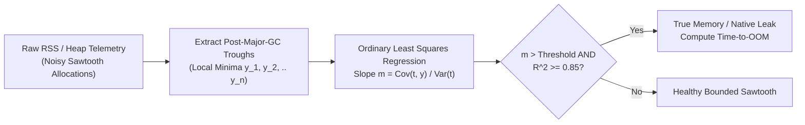

# OS Internals: Virtual Memory, Post-GC RSS Slope & File Descriptor Leaks

## Part I — First-Principles Mental Model & Visual Cue

Why does a service crash with `exit code 137 (SIGKILL — OOMKilled)` or `Errno 24 (Too many open files)` after 6 hours in production even when instantaneous RAM usage looked "under $60\%$" during a 5-minute smoke test?

Because **instantaneous memory snapshots hide monotonic leak slopes**:
- A healthy garbage-collected runtime (JVM G1GC/ZGC, V8, CPython) exhibits a **Sawtooth Pattern**: memory rises as young-generation objects allocate, then drops back to a **flat baseline** after each Major GC cycle.
- A leaking process also exhibits a sawtooth—except **the troughs (Post-GC Minima) climb monotonically** at slope $m > 0\text{ MB/min}$ until the kernel cgroup limit triggers the OOM Killer!



---

## Part II — Virtual Memory (`VIRT`) vs. Resident Set Size (`RSS`) vs. `/proc/<pid>/fd`

1. **`VIRT` (`VmSize`)**: Total virtual address space reserved via `mmap()`/`brk()`. Can be десятки of gigabytes without consuming physical RAM because pages are allocated lazily on **Page Fault**.
2. **`RSS` (`VmRSS`)**: Physical 4KB RAM pages currently resident in hardware memory (includes off-heap native buffers, JNI/C-extensions, and `mmap` pages that JVM Heap profilers miss!).
3. **File Descriptor Table (`/proc/<pid>/fd`)**: Every unclosed HTTP socket, pipe, or temp file consumes an integer slot in the kernel per-process FD table (`ulimit -n`).

---

## Part III — Production Implementation Blueprints (Java 17 & Python 3)

### Python 3 Blueprint: Post-GC Trough Linear Regression (`OLS Slope + R²`)
```python
def analyze_post_gc_troughs(troughs_mb: list[tuple[float, float]], oom_limit_mb: float = 2048.0) -> dict:
    n = len(troughs_mb)
    if n < 3:
        return {"leakDetected": False, "slopeMbPerMin": 0.0}
    xs = [p[0] for p in troughs_mb]
    ys = [p[1] for p in troughs_mb]
    mean_x = sum(xs) / n
    mean_y = sum(ys) / n
    cov_xy = sum((x - mean_x) * (y - mean_y) for x, y in zip(xs, ys))
    var_x = sum((x - mean_x) ** 2 for x in xs)
    var_y = sum((y - mean_y) ** 2 for y in ys)
    slope = cov_xy / var_x if var_x > 0 else 0.0
    r_squared = (cov_xy ** 2) / (var_x * var_y) if (var_x > 0 and var_y > 0) else 0.0
    leak = slope > 1.0 and r_squared >= 0.80
    remaining_mb = max(0.0, oom_limit_mb - ys[-1])
    tto_min = round(remaining_mb / slope, 1) if leak and slope > 0 else None
    return {
        "leakDetected": leak,
        "slopeMbPerMin": round(slope, 3),
        "rSquared": round(r_squared, 3),
        "estimatedMinutesToOom": tto_min,
    }
```

### Java 17 Blueprint: JVM Post-GC Memory Pool Listener
```java
import java.lang.management.ManagementFactory;
import java.lang.management.MemoryUsage;

public final class HeapTroughMonitor {
    public static long currentHeapUsedMb() {
        MemoryUsage usage = ManagementFactory.getMemoryMXBean().getHeapMemoryUsage();
        return usage.getUsed() / (1024 * 1024);
    }
}
```

---

## Part IV — End-of-Chapter Mastery Check

```json quiz
[
  {
    "id": "cs-01-q1",
    "question": "Why should automated memory-leak gates fit linear regression ONLY to Post-Major-GC troughs rather than raw 1-second memory samples?",
    "options": [
      "Because GC pauses stop the system clock",
      "Because normal Eden/Young-generation allocations create large sawtooth spikes between GC cycles; only rising post-GC troughs prove objects are surviving collection permanently",
      "Because virtual memory is always equal to physical RAM",
      "Because Linux caches disk blocks in swap"
    ],
    "answerIndex": 1,
    "explanation": "Short-lived allocations legitimately increase memory between GC cycles. A true leak is defined by a positive slope across post-Major-GC minima."
  },
  {
    "id": "cs-01-q2",
    "question": "If JVM Heap usage stays flat at 512 MB after every Full GC, but container Resident Set Size (RSS) climbs linearly until Linux kills the container with SIGKILL (137), what is leaking?",
    "options": [
      "Java String literals in the String Pool",
      "Off-heap / Native memory (e.g., DirectByteBuffers, JNI/C++ allocations, unclosed native decompression streams, or thread stacks)",
      "CPU L1 instruction cache",
      "The garbage collector logs"
    ],
    "answerIndex": 1,
    "explanation": "Container OOM kills are governed by kernel cgroup RSS (Heap + Off-Heap Native + DirectByteBuffers + Thread Stacks), not just the managed JVM heap."
  }
]
```
