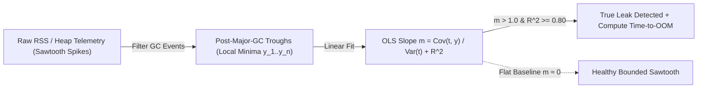

# OS Internals: Virtual Memory, Post-GC RSS Slope & File Descriptor Leaks

```json pretraining
[
  {
    "term": "VIRT vs. RSS Page Faults",
    "formula": "mmap() → Demand-Zero Minor Fault → 4KB RSS",
    "meaning": "Linux reserves virtual address ranges lazily; physical 4KB RAM frames (RSS) are wired into page tables only when written to."
  },
  {
    "term": "Post-Major-GC Trough Slope (m)",
    "formula": "m = Cov(t, RSS_min) / Var(t)",
    "meaning": "Fitting Ordinary Least Squares across post-Major-GC local minima filters out noisy Eden/young-gen sawtooth spikes to expose true retention leaks."
  },
  {
    "term": "Off-Heap / Native RSS Gap",
    "formula": "RSS_total = Heap + DirectBuffers + Stacks + JNI",
    "meaning": "Why a JVM container with -Xmx1024m still gets SIGKILL (Exit 137) at 2GiB cgroup limit due to Netty DirectByteBuffers, glibc arenas, or 1MB thread stacks."
  },
  {
    "term": "Kernel FD Table (/proc/<pid>/fd)",
    "formula": "count(open FDs) ≥ ulimit -n ⇒ EMFILE (Errno 24)",
    "meaning": "Every unclosed socket, pipe, or file consumes an integer descriptor pointing to a kernel struct file; leaking FDs halts all new accept() and DNS calls."
  }
]
```

```json poe
{
  "question": "A Java microservice runs inside a 2,048 MiB Kubernetes memory limit with `-Xmx1024m`. Grafana shows JVM Heap steadily oscillating between 300 MiB and 750 MiB (never exceeding 750 MiB!), yet every 9 hours the Linux kernel kills the pod with `OOMKilled (Exit Code 137)`. What is happening?",
  "options": [
    "Kubernetes OOMKiller triggers whenever JVM Young GC runs more than 100 times",
    "Linux cgroups enforce total physical Resident Set Size (RSS), NOT JVM Heap; an off-heap leak (unclosed java.util.zip.Inflater native zlib streams, Netty DirectByteBuffers, JNI C++ buffers, or spawning 1,200 OS threads * 1MB stack) pushed total RSS past 2,048 MiB!",
    "Garbage collection increases virtual memory (VIRT), which directly triggers OOMKiller",
    "Setting `-Xmx2048m` equal to the container limit prevents Exit 137"
  ],
  "answerIndex": 1,
  "explanation": "The kernel OOMKiller knows nothing about JVM heap regions—it tracks anonymous RSS + page cache charged to the container's cgroup (`memory.current`). Setting `-Xmx` equal to the container limit actually makes Exit 137 happen *immediately* because Metaspace, CodeCache, thread stacks, and DirectByteBuffers need 25–30% headroom!"
}
```

## Part I — First-Principles Mental Model & Visual Cue

Why does a service crash with `exit code 137 (SIGKILL — OOMKilled)` or `Errno 24 (Too many open files — EMFILE)` after 6 hours in production even when instantaneous RAM usage looked "under $60\%$" during a 5-minute smoke test?

Because **instantaneous memory snapshots hide monotonic leak slopes**:
- A healthy garbage-collected runtime (JVM G1GC/ZGC, V8, CPython reference counting + cyclic GC) exhibits a **Sawtooth Pattern**: memory rises as young-generation objects allocate, then drops back to a **flat baseline** after each Major GC cycle.
- A leaking process also exhibits a sawtooth—except **the troughs (Post-GC Minima) climb monotonically** at slope $m > 0\text{ MB/min}$ (`R² >= 0.80`) until the kernel cgroup limit triggers the OOM Killer!



```json contrast
{
  "title": "Soak-Test Memory & Handle Leak Detection",
  "naiveTitle": "Point-in-Time Threshold Check (<80% RAM)",
  "naiveMetric": "Misses 3 MB/min Leak Until Prod OOM",
  "naivePoints": [
    "Checks only whether RAM < 80% at the end of a 3-minute CI test",
    "Triggers false alarms on normal G1GC Eden allocation spikes before GC runs",
    "Monitors only managed JVM/Python heap while ignoring /proc/<pid>/status VmRSS and /proc/<pid>/fd",
    "Sets JVM -Xmx equal to 100% of container memory limit, guaranteeing Exit 137 under thread/off-heap load"
  ],
  "staffTitle": "Post-GC Trough OLS Regression + RSS & FD Slope Gate",
  "staffMetric": "Catches 0.5 MB/min Leaks in 10m Soak",
  "staffPoints": [
    "Extracts strictly Post-Major-GC local minima and fits OLS slope m + goodness-of-fit R^2 >= 0.80",
    "Tracks both Managed Heap AND kernel cgroup RSS gap (detecting JNI, zlib, and DirectByteBuffer leaks)",
    "Asserts zero net File Descriptor growth across /proc/<pid>/fd after connection-pool warmup",
    "Reserves 25–30% container headroom (-XX:MaxRAMPercentage=70.0) for stacks, Metaspace, and off-heap I/O"
  ]
}
```

---

## Part II — Linux Memory Hierarchy (`VIRT` vs. `RSS` vs. Page Tables) & FD Exhaustion

Inside the Linux kernel (`mm_struct`), every process sees a private $48$-bit virtual address space translated by hardware **MMU + TLB** caches across 4-level page tables (`PGD -> PUD -> PMD -> PTE`):

| Kernel Metric (`/proc/<pid>/`) | What It Actually Measures | Triggers `OOMKiller`? | Classic Diagnostic Signature |
| :--- | :--- | :--- | :--- |
| **`VmSize` (`VIRT`)** | Total virtual address space mapped (`mmap`, `malloc` arenas, shared `.so` libs) | **No!** (Pure address reservation) | Java/Go processes routinely show `20 GB+ VIRT` while using only `300 MB` of physical RAM |
| **`VmRSS` (`RSS` / `memory.current`)** | Physical `4KB` RAM pages actively resident in hardware memory | **YES (`SIGKILL 137`)** | Rising `RSS - HeapUsed` delta pinpoints off-heap native/JNI/DirectBuffer leaks |
| **`/proc/<pid>/fd` Count** | Open file descriptors (TCP `socket:[inode]`, `anon_inode:[eventpoll]`, pipes, files) | Fails syscalls with **`EMFILE (Errno 24)`** | Thousands of `CLOSE_WAIT` sockets prove application code forgot `response.close()` / `try-with-resources`! |

---

## Part III — Production Implementation Blueprints (Python 3 & Java 17)

### Python 3 Blueprint: Post-GC Trough Linear Regression (`OLS Slope + R²`) & FD Inspector
```python
import os


def analyze_post_gc_troughs(troughs_mb: list[tuple[float, float]], oom_limit_mb: float = 2048.0) -> dict:
    """Fits OLS regression across (minute, post_gc_mb) minima to compute leak slope & Time-to-OOM."""
    n = len(troughs_mb)
    if n < 3:
        return {"leakDetected": False, "slopeMbPerMin": 0.0, "rSquared": 0.0}
    xs = [p[0] for p in troughs_mb]
    ys = [p[1] for p in troughs_mb]
    mean_x = sum(xs) / n
    mean_y = sum(ys) / n
    cov_xy = sum((x - mean_x) * (y - mean_y) for x, y in zip(xs, ys))
    var_x = sum((x - mean_x) ** 2 for x in xs)
    var_y = sum((y - mean_y) ** 2 for y in ys)
    slope = cov_xy / var_x if var_x > 0 else 0.0
    r_squared = (cov_xy ** 2) / (var_x * var_y) if (var_x > 0 and var_y > 0) else 0.0
    leak = slope > 1.0 and r_squared >= 0.80
    remaining_mb = max(0.0, oom_limit_mb - ys[-1])
    tto_min = round(remaining_mb / slope, 1) if leak and slope > 0 else None
    return {
        "leakDetected": leak,
        "slopeMbPerMin": round(slope, 3),
        "rSquared": round(r_squared, 3),
        "estimatedMinutesToOom": tto_min,
    }


def current_open_fd_count() -> int:
    """Cross-platform Linux /proc/self/fd or POSIX /dev/fd handle counter for leak assertions."""
    for fd_dir in ("/proc/self/fd", "/dev/fd"):
        if os.path.isdir(fd_dir):
            return len(os.listdir(fd_dir))
    return -1
```

### Java 17 Blueprint: JVM Post-GC Memory Pool + Unix File Descriptor Leak Monitor
```java
import com.sun.management.UnixOperatingSystemMXBean;
import java.lang.management.ManagementFactory;
import java.lang.management.MemoryUsage;
import java.lang.management.OperatingSystemMXBean;

public final class HeapAndFdTroughMonitor {
    public record ProcessResourceSnapshot(long heapUsedMb, long openFdCount, long maxFdCount) {}

    public static ProcessResourceSnapshot captureSnapshot() {
        MemoryUsage heap = ManagementFactory.getMemoryMXBean().getHeapMemoryUsage();
        long heapMb = heap.getUsed() / (1024 * 1024);

        long openFds = -1;
        long maxFds = -1;
        OperatingSystemMXBean os = ManagementFactory.getOperatingSystemMXBean();
        if (os instanceof UnixOperatingSystemMXBean unixOs) {
            openFds = unixOs.getOpenFileDescriptorCount();
            maxFds = unixOs.getMaxFileDescriptorCount();
        }
        return new ProcessResourceSnapshot(heapMb, openFds, maxFds);
    }
}
```

> [!WARNING]
> **Staff Interview Gotcha — `TIME_WAIT` vs. `CLOSE_WAIT` Socket Diagnosis**:
> Interviewers love asking: *"`netstat`/`ss -tan` shows 15,000 sockets stuck in `CLOSE_WAIT` and `accept()` is throwing `EMFILE`. Should we tune `net.ipv4.tcp_tw_reuse`?"* **NO!** `TIME_WAIT` happens on the side that **actively closed** the connection (`2 * MSL` kernel timer), whereas **`CLOSE_WAIT` is 100% an application code bug**: the remote peer sent `FIN`, your kernel ACKed it, and your Java/Python code **never called `close()` on the socket/HTTP response body stream**! No sysctl tuning can fix `CLOSE_WAIT`—fix the missing `try-with-resources` / `contextlib.closing`!

---

## Part IV — End-of-Chapter Mastery Check

```json quiz
[
  {
    "id": "cs-01-q1",
    "question": "Why should automated memory-leak gates fit linear regression ONLY to Post-Major-GC troughs rather than raw 1-second memory samples?",
    "options": [
      "Because GC pauses stop the system clock",
      "Because normal Eden/Young-generation allocations create large sawtooth spikes between GC cycles; only rising post-GC troughs prove objects are surviving collection permanently",
      "Because virtual memory is always equal to physical RAM",
      "Because Linux caches disk blocks in swap"
    ],
    "answerIndex": 1,
    "explanation": "Short-lived allocations legitimately increase memory between GC cycles. A true leak is defined by a positive slope across post-Major-GC minima."
  },
  {
    "id": "cs-01-q2",
    "question": "If JVM Heap usage stays flat at 512 MB after every Full GC, but container Resident Set Size (RSS) climbs linearly until Linux kills the container with SIGKILL (137), what is leaking?",
    "options": [
      "Java String literals in the String Pool",
      "Off-heap / Native memory (e.g., DirectByteBuffers, JNI/C++ allocations, unclosed native decompression streams, or thread stacks)",
      "CPU L1 instruction cache",
      "The garbage collector logs"
    ],
    "answerIndex": 1,
    "explanation": "Container OOM kills are governed by kernel cgroup RSS (Heap + Off-Heap Native + DirectByteBuffers + Thread Stacks), not just the managed JVM heap."
  },
  {
    "id": "cs-01-q3",
    "question": "During an outage, `ss -tan` on your API gateway shows 32,000 sockets stuck indefinitely in `CLOSE_WAIT`, and `/proc/<pid>/fd` hits `ulimit -n` (Errno 24: Too many open files). What is the exact root cause?",
    "options": [
      "The Linux kernel `tcp_tw_reuse` sysctl is disabled",
      "Remote peers closed their half of the TCP connection (sent FIN), and your application code leaked the socket handles without calling `.close()` on HTTP response streams or error paths",
      "DNS servers switched from UDP to TCP",
      "Virtual memory `VmSize` exceeded 64 GB"
    ],
    "answerIndex": 1,
    "explanation": "CLOSE_WAIT means the local OS kernel received the peer's FIN and is waiting for the local user-space process to call close(fd). Only leaking application handles accumulate unboundedly in CLOSE_WAIT."
  }
]
```
