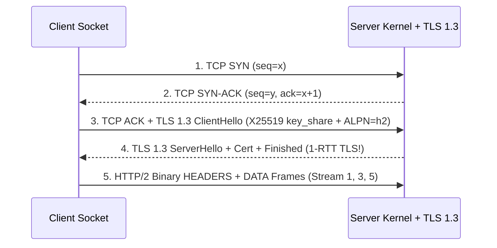

# Computer Networks: TCP SYN Backlogs, TLS 1.3, HTTP/2 & CDP WebSockets

```json pretraining
[
  {
    "term": "TCP Dual Listen Queues",
    "formula": "SYN Queue (SYN_RCVD) → Accept Queue (ESTABLISHED)",
    "meaning": "Linux splits incoming handshakes into half-open SYN slots and completed-handshake slots awaiting user-space accept(); overflowing somaxconn drops packets silently."
  },
  {
    "term": "TLS 1.3 1-RTT Handshake",
    "formula": "ClientHello + X25519 key_share ⇒ 1 RTT Saved",
    "meaning": "Embedding ephemeral ECDHE key shares in the very first ClientHello cuts TLS negotiation from 2 RTTs (TLS 1.2) to 1 RTT with mandatory Forward Secrecy."
  },
  {
    "term": "HTTP/2 TCP HoL Paradox",
    "formula": "1 Dropped TCP Segment ⇒ Stalls All M Streams",
    "meaning": "HTTP/2 solves application-layer Head-of-Line blocking via binary stream frames, but a single lost packet still stalls the entire underlying kernel TCP receive buffer."
  },
  {
    "term": "WebSocket Upgrade (RFC 6455)",
    "formula": "HTTP 101 Switching Protocols → Full-Duplex Frames",
    "meaning": "Eliminates per-command HTTP request/header overhead so Playwright CDP can stream hundreds of bidirectional DOM/network events over 1 persistent socket."
  }
]
```

```json poe
{
  "question": "An API client benchmark creates a brand-new `HttpClient` on every request (`Connection: close`) at 2,000 RPS against a single backend IP:port (`10.0.1.5:443`). CPU and RAM on both machines are at 15%, yet after exactly 14 seconds every new request fails locally with `EADDRNOTAVAIL (Cannot assign requested address)`! What kernel limit just saturated?",
  "options": [
    "The backend server ran out of disk inodes",
    "Ephemeral Source Port Exhaustion in `TIME_WAIT`: Linux `ip_local_port_range` defaults to ~28,232 ports (32768–60999) per `(srcIP, dstIP, dstPort)` 4-tuple; at 2,000 closed sockets/sec held in `TIME_WAIT` for 60s (`120,000` needed!), all 28,232 ports were exhausted in 14.1 seconds!",
    "TLS 1.3 certificates expire after 28,000 handshakes",
    "BGP routing tables flushed the subnet"
  ],
  "answerIndex": 1,
  "explanation": "Creating a fresh connection per call burns 3 RTTs (TCP + TLS) AND traps the 4-tuple in `TIME_WAIT` for 60 seconds! Reusing pooled persistent connections (`Keep-Alive` / `HTTP/2` multiplexing) executes 2,000 RPS over just a handful of sockets."
}
```

## Part I — Packet-Level Handshake Math & Kernel Listen Queues

Every time an unpooled API client or browser opens a new `https://` connection, the OS kernel and cryptographic stack must negotiate transport state and forward-secret session keys before a single byte of JSON travels:

- **TCP 3-Way Handshake ($1\text{ RTT}$)**: Client sends `SYN` $\to$ Server places entry in **SYN Queue** and replies `SYN-ACK` $\to$ Client sends `ACK` $\to$ Kernel moves connection to **Accept Queue (`net.core.somaxconn`)** until the app thread calls `accept()`. If a GC pause stalls `accept()`, the Accept Queue overflows (`ListenOverflows` in `nstat`) and clients suffer `1,000ms` TCP `SYN` retransmission stalls!
- **TLS 1.2 ($+2\text{ RTT}$) vs. TLS 1.3 ($+1\text{ RTT}$)**: TLS 1.3 removes legacy RSA key transport and embeds the client's `X25519` ephemeral Diffie-Hellman `key_share` + `ALPN (h2)` **inside the very first `ClientHello`**, cutting cryptographic setup latency in half!



---

## Part II — HTTP/1.1 vs. HTTP/2 vs. HTTP/3 (`QUIC`) & CDP WebSockets

- **HTTP/1.1 Application HoL Blocking**: Only 1 request can be in-flight per TCP socket without fragile pipelining, forcing browsers to open 6 parallel sockets per origin.
- **HTTP/2 Binary Framing & HPACK**: Multiplexes hundreds of concurrent logical **Streams** (`Stream IDs 1, 3, 5...`) over **a single TCP connection** with HPACK header compression.
- **The Hidden Catch — Kernel TCP Head-of-Line Blocking**: Because the OS kernel TCP stack treats the connection as **one strictly ordered byte stream**, if packet `#42` carrying 10 bytes of `Stream 1` drops on a lossy $2\%$ cellular link, the kernel withholds already-arrived packets `#43..#90` belonging to `Streams 3..99` until `#42` retransmits! **HTTP/3 (`QUIC` over UDP)** eliminates this by moving stream framing and TLS 1.3 into user-space UDP so packet loss on Stream 1 never stalls Stream 3.
- **WebSockets (`ws://` / `wss://`)**: Upgraded via `HTTP/1.1 101 Switching Protocols`, stripping HTTP request-response framing down to a $2\text{–}14\text{ byte}$ binary frame header (`FIN`, `opcode`, `mask`, `payload_len`)—the exact wire transport powering **Playwright's Chrome DevTools Protocol (`CDP`)**.

```json contrast
{
  "title": "High-Concurrency RPC & Automation Wire Transport",
  "naiveTitle": "Unpooled HTTP/1.1 over TLS 1.2",
  "naiveMetric": "3 RTT Setup per Call · Ephemeral Port Exhaustion",
  "naivePoints": [
    "Pays 1 TCP RTT + 2 TLS 1.2 RTTs (180ms+ on cross-region links) before sending a single payload byte",
    "Exhausts 28,232 ephemeral client ports in TIME_WAIT under bursty load tests",
    "Sends uncompressed repetitive Authorization & Cookie ASCII headers on every single request",
    "Selenium WebDriver Classic pays full HTTP request/response serialization on every click/find call"
  ],
  "staffTitle": "Pooled HTTP/2 + TLS 1.3 / Persistent BiDi WebSockets",
  "staffMetric": "0 RTT Warm Reuse · Multiplexed Binary Framing",
  "staffPoints": [
    "Negotiates TLS 1.3 + ALPN h2 in 2 total RTTs once, then amortizes 0-RTT warm streams across thousands of RPCs",
    "Compresses repetitive headers via stateful HPACK/QPACK tables",
    "Switches to HTTP/3 (QUIC) or multi-connection HTTP/2 pools when WAN packet loss exceeds ~1.5%",
    "Streams Playwright CDP commands & real-time network interception events over 1 persistent full-duplex WebSocket"
  ]
}
```

### Protocol Trade-Off Matrix

| Protocol | Cold Setup (`TCP+TLS`) | Multiplexing | Lossy-Link (`2%` Loss) Behavior | Ideal Production Workload |
| :--- | :--- | :--- | :--- | :--- |
| **HTTP/1.1 (`Keep-Alive`)** | $2\text{ RTT}$ (w/ TLS 1.3) | None ($1$ active req/socket) | Independent across 6 sockets | Legacy REST proxies, simple low-concurrency webhooks |
| **HTTP/2 (`h2` / `gRPC`)** | $2\text{ RTT}$ (ALPN inside TLS 1.3) | $100+$ streams / 1 TCP socket | **Degrades** due to TCP-layer HoL blocking | Internal datacenter `gRPC` & microservice meshes (`<0.01%` loss) |
| **HTTP/3 (`QUIC` / UDP)** | **$1\text{ RTT}$** ($0\text{-RTT}$ resumption) | Independent per-stream QUIC frames | **Excels** (Loss isolated to 1 stream + connection migration across Wi-Fi $\to$ 5G) | Mobile apps, global CDN edges, lossy last-mile networks |
| **WebSockets (`RFC 6455`)** | $2\text{ RTT}$ + `101 Upgrade` | App-level correlation IDs (`id: 42`) | Subject to TCP HoL on single socket | Playwright CDP/BiDi, live collaborative editors, market tickers |

---

## Part III — Production Implementation Blueprints (Python 3 & Java 17)

### Python 3 Blueprint: Handshake Latency & Ephemeral `TIME_WAIT` Saturation Calculator
```python
def calculate_request_latency_ms(
    rtt_ms: float,
    tls_version: str = "1.3",
    connection_reused: bool = False,
    server_processing_ms: float = 15.0,
) -> dict:
    if connection_reused:
        handshake_rtts = 0
    elif tls_version == "1.3":
        handshake_rtts = 2  # 1 RTT TCP + 1 RTT TLS 1.3 (with ALPN h2)
    elif tls_version == "QUIC":
        handshake_rtts = 1  # Combined transport + TLS 1.3 in QUIC!
    else:
        handshake_rtts = 3  # 1 RTT TCP + 2 RTT TLS 1.2

    handshake_ms = handshake_rtts * rtt_ms
    request_response_ms = 1 * rtt_ms
    total_ms = handshake_ms + request_response_ms + server_processing_ms
    return {
        "handshakeRtts": handshake_rtts,
        "handshakeMs": round(handshake_ms, 2),
        "totalLatencyMs": round(total_ms, 2),
    }


def evaluate_ephemeral_port_budget(
    unpooled_rps: float,
    time_wait_sec: float = 60.0,
    port_range_size: int = 28_232,
) -> dict:
    """Computes steady-state TIME_WAIT socket occupancy against ip_local_port_range."""
    steady_state_sockets = unpooled_rps * time_wait_sec
    utilization = steady_state_sockets / max(1, port_range_size)
    return {
        "steadyStateTimeWaitSockets": int(steady_state_sockets),
        "portUtilizationRatio": round(utilization, 3),
        "exhaustionImminent": utilization >= 0.85,
    }
```

### Java 17 Blueprint: Ephemeral Port & `TCP_NODELAY` Wire Budget Analyzer
```java
public final class EphemeralPortAnalyzer {
    public static boolean isPortExhaustionRisk(int rps, int timeWaitSeconds, int ephemeralRangeSize) {
        long socketsInTimeWait = (long) rps * timeWaitSeconds;
        return socketsInTimeWait >= (long) (ephemeralRangeSize * 0.85);
    }

    /** Estimates effective throughput ceiling under Bandwidth-Delay Product (BDP = WindowBytes / RTT). */
    public static double maxSingleSocketThroughputMbps(long tcpReceiveWindowBytes, double rttMillis) {
        if (rttMillis <= 0) throw new IllegalArgumentException("rttMillis must be > 0");
        double bitsPerWindow = tcpReceiveWindowBytes * 8.0;
        double rttSeconds = rttMillis / 1000.0;
        return Math.round((bitsPerWindow / rttSeconds / 1_000_000.0) * 100.0) / 100.0;
    }
}
```

> [!WARNING]
> **Staff Interview Gotcha — Nagle's Algorithm + Delayed ACK `40ms` Latency Cliff & TLS 1.3 `0-RTT` Replay Attacks**:
> 1. If a microservice sees mysterious **`40ms` ($200\text{ms}$ on older BSDs) latency floors** on tiny RPC payloads despite `<0.2ms` ping, **Nagle's Algorithm** (`waiting for unACKed bytes before sending small segments`) is deadlocking with the peer kernel's **Delayed ACK** (`waiting up to 40ms to piggyback ACK on a response`)! Always verify **`TCP_NODELAY = true`** on RPC/HTTP/CDP sockets.
> 2. Never enable **TLS 1.3 `0-RTT` Early Data** on non-idempotent `POST /transfer` endpoints: if a middlebox or attacker replays the captured `ClientHello + EarlyData` packet, the server has no fresh server-nonce freshness guarantee yet and will execute the mutation twice!

---

## Part IV — End-of-Chapter Mastery Check

```json quiz
[
  {
    "id": "cs-02-q1",
    "question": "How does TLS 1.3 reduce the cryptographic handshake from 2 RTTs (in TLS 1.2) down to 1 RTT?",
    "options": [
      "By disabling server certificate verification",
      "By embedding the client's ephemeral Diffie-Hellman key share inside the initial ClientHello message so the server can compute the session keys immediately",
      "By replacing TCP with ICMP",
      "By compressing HTTP headers with HPACK"
    ],
    "answerIndex": 1,
    "explanation": "In TLS 1.3, the client guesses the key agreement group (e.g., X25519) and sends its key share in ClientHello, eliminating an entire round trip."
  },
  {
    "id": "cs-02-q2",
    "question": "Why does HTTP/2 over a single TCP connection perform WORSE than 6 HTTP/1.1 connections on a high-packet-loss (2%+) cellular network?",
    "options": [
      "Because HTTP/2 uses XML instead of binary frames",
      "Because TCP enforces strict in-order byte delivery across the entire connection—so a single lost TCP segment stalls ALL multiplexed HTTP/2 streams at the OS kernel level (TCP Head-of-Line blocking)",
      "Because HTTP/2 disables TLS",
      "Because DNS lookups take longer on HTTP/2"
    ],
    "answerIndex": 1,
    "explanation": "The OS kernel TCP stack does not know about HTTP/2 stream boundaries; one dropped packet freezes the entire TCP receive window."
  },
  {
    "id": "cs-02-q3",
    "question": "Why must TLS 1.3 `0-RTT` Resumption (`Early Data`) NEVER be enabled unconditionally for state-mutating `POST /payments` API endpoints?",
    "options": [
      "Because 0-RTT disables AES-GCM encryption",
      "Because 0-RTT Early Data is encrypted only under a pre-shared resumption ticket without a fresh server-generated nonce yet, making the initial packet vulnerable to network Replay Attacks if an attacker or middlebox retransmits the captured TCP payload",
      "Because HTTP/2 forbids POST requests on Stream 1",
      "Because 0-RTT requires client hardware USB tokens"
    ],
    "answerIndex": 1,
    "explanation": "RFC 8446 §8 explicitly warns that TLS 1.3 0-RTT lacks forward anti-replay protection across server instances unless backed by strict single-use ticket caches or restricted exclusively to idempotent GETs."
  }
]
```
