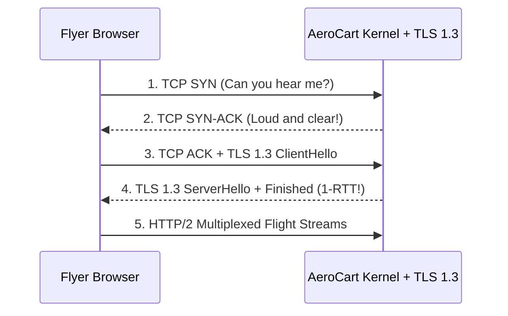

# Computer Networks: TCP SYN Backlogs, TLS 1.3, HTTP/2 & CDP WebSockets

```json continuity
{
  "previously": "In Chapter 01, we launched python3 apps/aerocart/server.py and learned how the Linux kernel manages its Virtual Memory, Physical RSS pages, and File Descriptor table.",
  "painPoint": "Now flyers open their browsers to connect to python3 apps/aerocart/server.py over HTTPS. Under a 2,000-RPS load test that opens a fresh connection per request, latencies spike by 180 milliseconds and after 14 seconds our client crashes with Cannot assign requested address!",
  "unlock": "We will trace the packet-by-packet TCP 3-Way Handshake, TLS 1.3 1-RTT encryption, HTTP/2 stream multiplexing, and persistent WebSockets so AeroCart handles thousands of flyers over a handful of warm sockets."
}
```

```json walkthrough
[
  {
    "time": "0:00",
    "badge": "1. TCP Handshake",
    "caption": "Before a single byte of flight data travels to python3 apps/aerocart/server.py, the browser and OS kernel exchange a 3-step greeting: SYN, SYN-ACK, and ACK.",
    "code": "Client --SYN--> Server --SYN-ACK--> Client --ACK--> Established"
  },
  {
    "time": "0:25",
    "badge": "2. TLS 1.3 (1-RTT)",
    "caption": "Next, TLS 1.3 locks the pipe in just 1 extra round trip by sending the client's public key share inside the very first hello message.",
    "code": "ClientHello + key_share -> ServerHello + Finished (1 RTT!)"
  },
  {
    "time": "0:50",
    "badge": "3. HTTP/2 Streams",
    "caption": "Instead of opening 6 separate pipes per browser tab, HTTP/2 interleaves dozens of numbered streams over one shared connection—unless a lost TCP packet stalls the whole pipe.",
    "code": "Stream 1 + Stream 3 + Stream 5 -> 1 Shared TCP Socket"
  },
  {
    "time": "1:15",
    "badge": "4. Port Exhaustion",
    "caption": "If a client closes connections after every call, sockets sit in TIME_WAIT for 60 seconds and exhaust all 28,232 local ports in 14 seconds. Connection pooling fixes it instantly!",
    "code": "2000 RPS * 60s TIME_WAIT = 120,000 sockets > 28,232 ports!"
  }
]
```

```json pretraining
[
  {
    "term": "TCP Dual Listen Queues",
    "formula": "Half-Open Waiting Room -> Ready-to-Accept Line",
    "meaning": "The Linux kernel keeps two waiting lines for incoming connections: one for callers still finishing their initial greeting (SYN Queue) and one for finished callers waiting for Python or Java to pick up the phone (Accept Queue)."
  },
  {
    "term": "TLS 1.3 1-RTT Handshake",
    "formula": "Key Share Sent in First Hello -> 1 Round Trip Saved",
    "meaning": "Modern HTTPS encryption where the browser sends its lock key right inside its very first greeting, cutting security setup time in half compared to older TLS 1.2."
  },
  {
    "term": "HTTP/2 TCP Head-of-Line Paradox",
    "formula": "1 Lost Packet -> Freezes All Shared Streams",
    "meaning": "HTTP/2 lets many requests share one TCP pipe, but because the operating system delivers TCP bytes in strict order, a single lost packet pauses every request in that pipe until it is resent."
  },
  {
    "term": "WebSocket Upgrade (RFC 6455)",
    "formula": "HTTP 101 Handshake -> Persistent Two-Way Pipe",
    "meaning": "Upgrading a normal HTTP connection into a lightweight, always-open two-way channel so tools like Playwright and live flight boards can stream instant messages without header overhead."
  }
]
```

## 🌱 Step 1: Plain-English Story — The Certified Mail & Armored Truck Ritual

What actually happens on the wire when a flyer clicks `"Book Flight"` and their browser talks to `python3 apps/aerocart/server.py`?

Before a single character of JSON can leave the browser, two rituals must happen across the internet:
1. **The TCP 3-Way Handshake (1 Round Trip)**: Think of TCP like two air-traffic controllers verifying their headsets work. The browser says *"Can you hear me?"* (`SYN`), the `AeroCart` kernel replies *"Loud and clear, can you hear me?"* (`SYN-ACK`), and the browser replies *"Yes, let's talk!"* (`ACK`). Only after step 3 does the Linux kernel place the connection into `AeroCart`'s **Accept Queue** so our Python server can read it.
2. **The TLS 1.3 Security Handshake (1 Round Trip)**: To keep credit cards private, both sides agree on a secret encryption key. Older TLS 1.2 took **2 full round trips** to chat back and forth before agreeing on a key. **TLS 1.3** cuts that in half (to **1 round trip**) by packing the browser's key material right inside its first hello message!
3. **Why Connection Reuse Matters**: If Jakarta and New York are 80 milliseconds apart (`1 RTT = 80ms`), opening a brand-new connection costs `2 RTTs = 160ms` of pure waiting before your request even starts! Keeping a warm **Connection Pool** (or multiplexing streams with **HTTP/2** and **WebSockets**) drops setup latency to **0 milliseconds**.



---

## 🔨 Step 2: First Lines of Code — Handshake Latency & Port Exhaustion Calculator

Let's write an 18-line network budget calculator for `apps/aerocart/server.py` in Python 3 and Java 17 that measures how much latency TLS 1.3 and connection pooling save, and checks if unpooled traffic will exhaust local OS ports.

```python
def aerocart_wire_budget(rtt_ms: float, reused: bool, unpooled_rps: int) -> dict:
    # Cold TCP (1 RTT) + TLS 1.3 (1 RTT) = 2 RTTs; warm pool = 0 RTTs!
    handshake_rtts = 0 if reused else 2
    total_rpc_ms = (handshake_rtts + 1) * rtt_ms
    # Linux holds closed client sockets in TIME_WAIT for 60s across ~28,232 ports
    time_wait_sockets = 0 if reused else unpooled_rps * 60
    return {
        "totalRpcMs": round(total_rpc_ms, 1),
        "timeWaitSockets": time_wait_sockets,
        "portExhausted": time_wait_sockets > 28232,
    }
```

### Java 17 Equivalent
```java
public class AeroCartWireBudget {
    public record BudgetResult(double totalRpcMs, int timeWaitSockets, boolean portExhausted) {}

    public static BudgetResult evaluate(double rttMs, boolean reused, int unpooledRps) {
        int handshakeRtts = reused ? 0 : 2; // 1 TCP + 1 TLS 1.3
        double totalRpcMs = (handshakeRtts + 1) * rttMs;
        int timeWaitSockets = reused ? 0 : unpooledRps * 60;
        return new BudgetResult(totalRpcMs, timeWaitSockets, timeWaitSockets > 28232);
    }
}
```

---

## ⚡ Step 3: Where It Breaks in Real Life — Ephemeral Port Exhaustion & TCP Head-of-Line Blocking

When `AeroCart` scales to thousands of requests per second, two subtle networking bugs break production:

1. **Ephemeral Port Exhaustion (`Cannot assign requested address`)**: If an internal service calls `AeroCart` at `2,000 RPS` without connection pooling (`Connection: close`), every closed socket sits in the kernel's `TIME_WAIT` table for `60 seconds` to catch stray packets. At `2,000 sockets/sec * 60s = 120,000 sockets`, the client blows past Linux's `28,232` ephemeral port limit (`ip_local_port_range`) in **14.1 seconds**!
2. **The HTTP/2 TCP Head-of-Line (HoL) Paradox**: HTTP/2 multiplexes 100 streams over 1 TCP connection. That works great inside a clean datacenter—but on a spotty `2%` packet-loss mobile connection, if packet `#42` (belonging to `Stream 1`) drops, the OS kernel freezes packets `#43..#90` (belonging to `Streams 3..99`) until `#42` is retransmitted! **HTTP/3 (`QUIC` over UDP)** solves this by isolating packet loss to a single stream.

```json contrast
{
  "title": "AeroCart High-Concurrency RPC & Browser Automation Transport",
  "naiveTitle": "Unpooled HTTP/1.1 over TLS 1.2",
  "naiveMetric": "3 RTT Setup per Call · Port Exhaustion in 14s",
  "naivePoints": [
    "Pays 1 TCP RTT + 2 TLS 1.2 RTTs (180ms+ cross-region) before sending a single payload byte",
    "Exhausts all 28,232 ephemeral client ports in TIME_WAIT under bursty load tests",
    "Sends uncompressed repetitive Authorization & Cookie ASCII headers on every request",
    "Legacy WebDriver pays full HTTP request/response overhead on every browser click"
  ],
  "staffTitle": "Pooled HTTP/2 + TLS 1.3 / Persistent BiDi WebSockets",
  "staffMetric": "0 RTT Warm Reuse · Multiplexed Binary Framing",
  "staffPoints": [
    "Negotiates TLS 1.3 + ALPN h2 in 2 total RTTs once, then runs 0-RTT warm streams across thousands of calls",
    "Compresses repetitive HTTP headers via stateful HPACK/QPACK tables",
    "Uses HTTP/3 (QUIC) or multi-socket HTTP/2 pools when WAN packet loss exceeds 1.5%",
    "Streams Playwright CDP commands and live flight events over 1 persistent full-duplex WebSocket"
  ]
}
```

```json poe
{
  "question": "An API client benchmark creates a brand-new `HttpClient` on every request (`Connection: close`) at 2,000 RPS against a single backend IP:port (`10.0.1.5:443`). CPU and RAM on both machines are at 15%, yet after exactly 14 seconds every new request fails locally with `EADDRNOTAVAIL (Cannot assign requested address)`! What kernel limit just saturated?",
  "options": [
    "The backend server ran out of disk inodes",
    "Ephemeral Source Port Exhaustion in `TIME_WAIT`: Linux `ip_local_port_range` defaults to ~28,232 ports (32768–60999) per `(srcIP, dstIP, dstPort)` 4-tuple; at 2,000 closed sockets/sec held in `TIME_WAIT` for 60s (`120,000` needed!), all 28,232 ports were exhausted in 14.1 seconds!",
    "TLS 1.3 certificates expire after 28,000 handshakes",
    "BGP routing tables flushed the subnet"
  ],
  "answerIndex": 1,
  "explanation": "Creating a fresh connection per call burns 3 RTTs (TCP + TLS) AND traps the 4-tuple in `TIME_WAIT` for 60 seconds! Reusing pooled persistent connections (`Keep-Alive` / `HTTP/2` multiplexing) executes 2,000 RPS over just a handful of sockets."
}
```

---

## 🚀 Step 4: Staff Engineer Deep-Dive — BDP Throughput Math, Protocol Matrix & Blueprints

### 1. Mathematical Laws of Bandwidth-Delay Product (BDP) & `TIME_WAIT` Occupancy

By Little's Law, the number of client sockets trapped in `TIME_WAIT` under unpooled rate $\lambda_{\text{unpooled}}$ and kernel timer $T_{\text{tw}} = 2 \cdot \text{MSL} \approx 60\text{ s}$ is:

$$N_{\text{TIME\_WAIT}} = \lambda_{\text{unpooled}} \times T_{\text{tw}} \le P_{\text{ephemeral}} \approx 28,232 \implies \lambda_{\max} \approx 470\text{ unpooled RPS}$$

Furthermore, the maximum throughput $B_{\max}$ achievable on a single TCP connection with receive window $W_{\text{rcv}}$ across round-trip time $\text{RTT}$ is governed by the **Bandwidth-Delay Product (BDP)** and the **Mathis Equation** under packet loss rate $p$:

$$B_{\max} = \min\left(\frac{W_{\text{rcv}}}{\text{RTT}}, \; \frac{\text{MSS}}{\text{RTT} \cdot \sqrt{p}}\right)$$

### 2. Architectural Trade-Off Matrix: Wire Protocols

| Protocol | Cold Setup (`TCP+TLS`) | Multiplexing | Lossy-Link (`2%` Loss) Behavior | Ideal Production Workload |
| :--- | :--- | :--- | :--- | :--- |
| **HTTP/1.1 (`Keep-Alive`)** | $2\text{ RTT}$ (w/ TLS 1.3) | None ($1$ active req/socket) | Independent across 6 sockets | Simple REST webhooks, low-concurrency proxies |
| **HTTP/2 (`h2` / `gRPC`)** | $2\text{ RTT}$ (ALPN inside TLS 1.3) | $100+$ streams / 1 TCP socket | **Degrades** due to kernel TCP HoL blocking | Internal datacenter `gRPC` & microservice meshes (`<0.01%` loss) |
| **HTTP/3 (`QUIC` / UDP)** | **$1\text{ RTT}$** ($0\text{-RTT}$ resumption) | Independent per-stream QUIC frames | **Excels** (Loss isolated to 1 stream + Wi-Fi $\to$ 5G migration) | Mobile apps, global CDN edges, lossy cellular networks |
| **WebSockets (`RFC 6455`)** | $2\text{ RTT}$ + `101 Upgrade` | App correlation IDs (`id: 42`) | Subject to TCP HoL on single socket | Playwright CDP/BiDi, live seat maps, real-time tickers |

### 3. Production Blueprints (Python 3 & Java 17)

```python
def calculate_request_latency_ms(
    rtt_ms: float,
    tls_version: str = "1.3",
    connection_reused: bool = False,
    server_processing_ms: float = 15.0,
) -> dict:
    if connection_reused:
        handshake_rtts = 0
    elif tls_version == "1.3":
        handshake_rtts = 2  # 1 RTT TCP + 1 RTT TLS 1.3 (with ALPN h2)
    elif tls_version == "QUIC":
        handshake_rtts = 1  # Combined transport + TLS 1.3 in QUIC!
    else:
        handshake_rtts = 3  # 1 RTT TCP + 2 RTT TLS 1.2

    handshake_ms = handshake_rtts * rtt_ms
    request_response_ms = 1 * rtt_ms
    total_ms = handshake_ms + request_response_ms + server_processing_ms
    return {
        "handshakeRtts": handshake_rtts,
        "handshakeMs": round(handshake_ms, 2),
        "totalLatencyMs": round(total_ms, 2),
    }


def evaluate_ephemeral_port_budget(
    unpooled_rps: float,
    time_wait_sec: float = 60.0,
    port_range_size: int = 28_232,
) -> dict:
    """Computes steady-state TIME_WAIT socket occupancy against ip_local_port_range."""
    steady_state_sockets = unpooled_rps * time_wait_sec
    utilization = steady_state_sockets / max(1, port_range_size)
    return {
        "steadyStateTimeWaitSockets": int(steady_state_sockets),
        "portUtilizationRatio": round(utilization, 3),
        "exhaustionImminent": utilization >= 0.85,
    }
```

### Java 17 Equivalent
```java
public final class EphemeralPortAnalyzer {
    public static boolean isPortExhaustionRisk(int rps, int timeWaitSeconds, int ephemeralRangeSize) {
        long socketsInTimeWait = (long) rps * timeWaitSeconds;
        return socketsInTimeWait >= (long) (ephemeralRangeSize * 0.85);
    }

    /** Estimates effective throughput ceiling under Bandwidth-Delay Product (BDP = WindowBytes / RTT). */
    public static double maxSingleSocketThroughputMbps(long tcpReceiveWindowBytes, double rttMillis) {
        if (rttMillis <= 0) throw new IllegalArgumentException("rttMillis must be > 0");
        double bitsPerWindow = tcpReceiveWindowBytes * 8.0;
        double rttSeconds = rttMillis / 1000.0;
        return Math.round((bitsPerWindow / rttSeconds / 1_000_000.0) * 100.0) / 100.0;
    }
}
```

> [!WARNING]
> **Staff Interview Gotcha — Nagle's Algorithm + Delayed ACK `40ms` Latency Cliff & TLS 1.3 `0-RTT` Replay Attacks**:
> 1. If `AeroCart` sees mysterious **`40ms` latency floors** on tiny RPC payloads despite `<0.2ms` ping, **Nagle's Algorithm** (`waiting for unACKed bytes before sending small segments`) is deadlocking with the peer kernel's **Delayed ACK** (`waiting up to 40ms to piggyback ACK on a response`)! Always set **`TCP_NODELAY = true`** on RPC/HTTP/CDP sockets.
> 2. Never enable **TLS 1.3 `0-RTT` Early Data** on non-idempotent `POST /checkout` endpoints: if a middlebox or attacker replays the captured `ClientHello + EarlyData` packet, the server has no fresh server-nonce guarantee yet and will execute the payment twice!

**Up Next in Chapter 03**: Once a flyer's HTTP/2 request arrives inside `python3 apps/aerocart/server.py` and hits our database, how do the bytes actually land on disk without slowing down or corrupting on power loss? In Chapter 03, we will compare **B+Trees vs. LSM-Trees, Write-Ahead Logs (`WAL`), `fsync` Durability, and Bloom-Backed Compaction**.

```json quiz
[
  {
    "id": "cs-02-q1",
    "question": "How does TLS 1.3 reduce the cryptographic handshake from 2 RTTs (in TLS 1.2) down to 1 RTT?",
    "options": [
      "By disabling server certificate verification",
      "By embedding the client's ephemeral Diffie-Hellman key share inside the initial ClientHello message so the server can compute the session keys immediately",
      "By replacing TCP with ICMP",
      "By compressing HTTP headers with HPACK"
    ],
    "answerIndex": 1,
    "explanation": "In TLS 1.3, the client guesses the key agreement group (e.g., X25519) and sends its key share in ClientHello, eliminating an entire round trip."
  },
  {
    "id": "cs-02-q2",
    "question": "Why does HTTP/2 over a single TCP connection perform WORSE than 6 HTTP/1.1 connections on a high-packet-loss (2%+) cellular network?",
    "options": [
      "Because HTTP/2 uses XML instead of binary frames",
      "Because TCP enforces strict in-order byte delivery across the entire connection—so a single lost TCP segment stalls ALL multiplexed HTTP/2 streams at the OS kernel level (TCP Head-of-Line blocking)",
      "Because HTTP/2 disables TLS",
      "Because DNS lookups take longer on HTTP/2"
    ],
    "answerIndex": 1,
    "explanation": "The OS kernel TCP stack does not know about HTTP/2 stream boundaries; one dropped packet freezes the entire TCP receive window."
  },
  {
    "id": "cs-02-q3",
    "question": "Why must TLS 1.3 `0-RTT` Resumption (`Early Data`) NEVER be enabled unconditionally for state-mutating `POST /payments` API endpoints?",
    "options": [
      "Because 0-RTT disables AES-GCM encryption",
      "Because 0-RTT Early Data is encrypted only under a pre-shared resumption ticket without a fresh server-generated nonce yet, making the initial packet vulnerable to network Replay Attacks if an attacker or middlebox retransmits the captured TCP payload",
      "Because HTTP/2 forbids POST requests on Stream 1",
      "Because 0-RTT requires client hardware USB tokens"
    ],
    "answerIndex": 1,
    "explanation": "RFC 8446 §8 explicitly warns that TLS 1.3 0-RTT lacks forward anti-replay protection across server instances unless backed by strict single-use ticket caches or restricted exclusively to idempotent GETs."
  }
]
```
