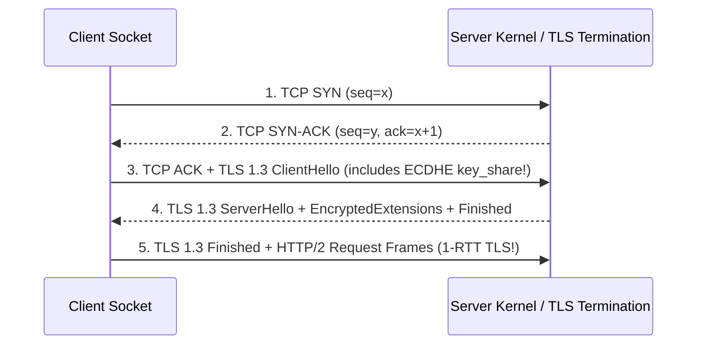

# Computer Networks: TCP Handshakes, TLS 1.3, HTTP/2 & CDP WebSockets

## Part I — First-Principles Mental Model & Visual Cue

Every time an API client or browser opens a new `https://` connection, the underlying OS kernel and cryptographic stack must negotiate transport reliability and encryption before a single byte of JSON can travel.

### TLS 1.2 (3 RTT Total) vs. TLS 1.3 (2 RTT Total / 0-RTT Resumption)
- **TCP 3-Way Handshake ($1\text{ RTT}$)**: Client sends `SYN` $\to$ Server replies `SYN-ACK` $\to$ Client sends `ACK`.
- **TLS 1.2 Handshake ($+2\text{ RTT}$)**: Requires two full additional round trips before `Application Data` can be sent.
- **TLS 1.3 Handshake ($+1\text{ RTT}$)**: The client sends its ephemeral Diffie-Hellman key share (`key_share` extension) **inside the very first `ClientHello` packet**, cutting handshake latency in half!



---

## Part II — HTTP/2 Multiplexing vs. TCP Head-of-Line (HoL) Blocking

- **HTTP/1.1 HoL Blocking**: Only one request can be in-flight per TCP connection at a time, forcing browsers to open 6 parallel TCP sockets per origin.
- **HTTP/2 Binary Framing**: Multiplexes hundreds of logical **Streams** over a **single TCP connection** using interleaved `HEADERS` and `DATA` frames.
- **The Hidden Catch (TCP-Layer HoL Blocking)**: If a **single TCP packet is lost** on the wire, the Linux kernel's TCP stack holds back delivery of all subsequent packets in the receive buffer—stalling **all 100 multiplexed HTTP/2 streams** until that one lost packet is retransmitted! (This is why **HTTP/3 (QUIC over UDP)** moves stream multiplexing into the transport layer.)

---

## Part III — Production Implementation Blueprints (Java 17 & Python 3)

### Python 3 Blueprint: Handshake Latency & Connection Reuse Budget Analyzer
```python
def calculate_request_latency_ms(
    rtt_ms: float,
    tls_version: str = "1.3",
    connection_reused: bool = False,
    server_processing_ms: float = 15.0,
) -> dict:
    if connection_reused:
        handshake_rtts = 0
    elif tls_version == "1.3":
        handshake_rtts = 2  # 1 RTT TCP + 1 RTT TLS 1.3
    else:
        handshake_rtts = 3  # 1 RTT TCP + 2 RTT TLS 1.2

    handshake_ms = handshake_rtts * rtt_ms
    request_response_ms = 1 * rtt_ms
    total_ms = handshake_ms + request_response_ms + server_processing_ms
    return {
        "handshakeRtts": handshake_rtts,
        "handshakeMs": round(handshake_ms, 2),
        "totalLatencyMs": round(total_ms, 2),
    }
```

### Java 17 Blueprint: Ephemeral Port Exhaustion Calculator
```java
public final class EphemeralPortAnalyzer {
    public static boolean isPortExhaustionRisk(int rps, int timeWaitSeconds, int ephemeralRangeSize) {
        long socketsInTimeWait = (long) rps * timeWaitSeconds;
        return socketsInTimeWait >= (long) (ephemeralRangeSize * 0.85);
    }
}
```

---

## Part IV — End-of-Chapter Mastery Check

```json quiz
[
  {
    "id": "cs-02-q1",
    "question": "How does TLS 1.3 reduce the cryptographic handshake from 2 RTTs (in TLS 1.2) down to 1 RTT?",
    "options": [
      "By disabling server certificate verification",
      "By embedding the client's ephemeral Diffie-Hellman key share inside the initial ClientHello message so the server can compute the session keys immediately",
      "By replacing TCP with ICMP",
      "By compressing HTTP headers with HPACK"
    ],
    "answerIndex": 1,
    "explanation": "In TLS 1.3, the client guesses the key agreement group (e.g., X25519) and sends its key share in ClientHello, eliminating an entire round trip."
  },
  {
    "id": "cs-02-q2",
    "question": "Why does HTTP/2 over a single TCP connection perform WORSE than 6 HTTP/1.1 connections on a high-packet-loss (2%+) cellular network?",
    "options": [
      "Because HTTP/2 uses XML instead of binary frames",
      "Because TCP enforces strict in-order byte delivery across the entire connection—so a single lost TCP segment stalls ALL multiplexed HTTP/2 streams at the OS kernel level (TCP Head-of-Line blocking)",
      "Because HTTP/2 disables TLS",
      "Because DNS lookups take longer on HTTP/2"
    ],
    "answerIndex": 1,
    "explanation": "The OS kernel TCP stack does not know about HTTP/2 stream boundaries; one dropped packet freezes the entire TCP receive window."
  }
]
```
