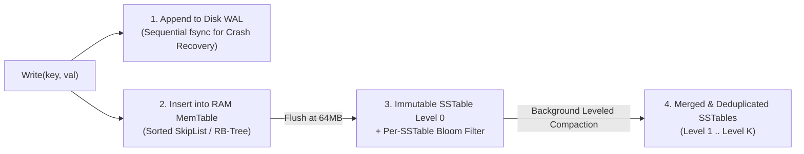

# Database Storage Engines: B+Trees vs. LSM-Trees, WAL & MVCC Isolation

## Part I — First-Principles Mental Model & Visual Cue

Every database storage engine on Earth is built around a fundamental hardware trade-off between **Read-Optimized In-Place Page Updates (`B+Trees`)** and **Write-Optimized Append-Only Log Structures (`LSM-Trees`)**:

| Dimension | **B+Tree Engines** *(PostgreSQL, MySQL InnoDB, SQLite)* | **LSM-Tree Engines** *(RocksDB, Cassandra, ScyllaDB)* |
| :--- | :--- | :--- |
| **Disk Structure** | Fixed-size mutable $4\text{KB}–16\text{KB}$ pages organized in a balanced $O(\log_B N)$ tree. | Append-only **WAL** + in-memory sorted **MemTable** (SkipList/Red-Black Tree) flushed to immutable **SSTables** on disk. |
| **Write Path** | Random I/O page modification + WAL write (higher Write Amplification on random keys). | Sequential append to WAL + RAM MemTable insert ($\mathcal{O}(1)$ sequential disk I/O — ultra-fast writes!). |
| **Read Path** | Fast predictable point & range lookups ($3–4$ page hops, mostly cached in buffer pool). | Must check MemTable + multiple SSTable levels (mitigated by **Bloom Filters** in RAM). |



---

## Part II — How Bloom Filters Save LSM-Tree Point Reads

Without an index optimization, checking if a non-existent `user_id` exists in an LSM-Tree would require binary-searching $L$ separate SSTable files on disk.
By attaching an in-memory **Bloom Filter** (a bit-array of size $m$ with $k$ independent hash functions) to every SSTable:
- If **any** of the $k$ bits for `key` is `0`, the key is **100% guaranteed NOT to be in that SSTable**—skipping the disk read completely!
- Only a tiny false-positive fraction ($\approx 1\%$ with $10$ bits per key) triggers an unnecessary SSTable block read.

---

## Part III — Production Implementation Blueprints (Java 17 & Python 3)

### Python 3 Blueprint: Mini LSM-Tree (`WAL + MemTable + Bloom-Filtered SSTables`)
```python
import bisect

class MiniLSMStore:
    def __init__(self, flush_threshold: int = 4):
        self.flush_threshold = flush_threshold
        self.memtable: dict[str, str | None] = {}
        self.sstables: list[tuple[set[str], list[tuple[str, str | None]]]] = []

    def put(self, key: str, value: str) -> None:
        self.memtable[key] = value
        if len(self.memtable) >= self.flush_threshold:
            self.flush()

    def delete(self, key: str) -> None:
        # Deletions in an LSM-Tree write a Tombstone marker (None)!
        self.memtable[key] = None
        if len(self.memtable) >= self.flush_threshold:
            self.flush()

    def flush(self) -> None:
        if not self.memtable:
            return
        sorted_pairs = sorted(self.memtable.items(), key=lambda kv: kv[0])
        bloom_filter = {k for k, _ in sorted_pairs}
        self.sstables.append((bloom_filter, sorted_pairs))
        self.memtable.clear()

    def get(self, key: str) -> str | None:
        if key in self.memtable:
            return self.memtable[key]
        # Search SSTables from newest to oldest
        for bloom, pairs in reversed(self.sstables):
            if key not in bloom:
                continue  # Bloom filter skipped SSTable disk read!
            keys = [p[0] for p in pairs]
            idx = bisect.bisect_left(keys, key)
            if idx < len(pairs) and pairs[idx][0] == key:
                return pairs[idx][1]
        return None
```

### Java 17 Blueprint: Tombstone-Aware SSTable Lookup
```java
import java.util.Optional;

public record SstableEntry(String key, String value, boolean tombstone) {
    public Optional<String> resolve() {
        return tombstone ? Optional.empty() : Optional.ofNullable(value);
    }
}
```

---

## Part IV — End-of-Chapter Mastery Check

```json quiz
[
  {
    "id": "cs-03-q1",
    "question": "How does an LSM-Tree delete a key whose value is already stored inside an immutable SSTable on disk?",
    "options": [
      "It seeks into the middle of the SSTable file and zeros out the bytes in-place",
      "It appends a special 'Tombstone' marker for that key into the WAL and MemTable; the old value is physically reclaimed later during background SSTable compaction",
      "It drops the entire SSTable file",
      "It blocks all reads until the file is rewritten"
    ],
    "answerIndex": 1,
    "explanation": "Because SSTables are strictly immutable, deletes are append-only Tombstone records that shadow older versions until compaction merges the levels."
  },
  {
    "id": "cs-03-q2",
    "question": "In SQLite WAL (Write-Ahead Logging) mode, why can multiple readers execute concurrently alongside an active writer without blocking?",
    "options": [
      "Because SQLite disables ACID transactions in WAL mode",
      "Because the writer appends new page versions to the -wal file while readers read consistent historical snapshots up to their transaction's end-mark (MVCC Snapshot Isolation)",
      "Because SQLite loads the entire database into CPU L2 cache",
      "Because readers ignore committed rows"
    ],
    "answerIndex": 1,
    "explanation": "In WAL mode, changes are appended to the WAL file rather than overwriting the main database pages in-place, allowing readers to view a consistent snapshot while a writer appends new frames."
  },
  {
    "id": "cs-03-q3",
    "question": "What can a Bloom Filter tell an LSM-Tree storage engine during a point lookup?",
    "options": [
      "The exact byte offset of the key inside the SSTable",
      "Either 'the key is DEFINITELY NOT in this SSTable' (0% false negatives) or 'the key MIGHT be in this SSTable' (small false-positive rate)",
      "The sorted order of all keys in the database",
      "Whether the transaction is serializable"
    ],
    "answerIndex": 1,
    "explanation": "Bloom filters never produce false negatives, allowing the engine to skip reading SSTables that do not contain the target key."
  }
]
```
