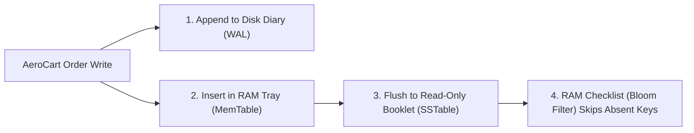

# Database Storage Engines: B+Trees vs. LSM-Tree Internals, WAL & MVCC Isolation

```json continuity
{
  "previously": "In Chapter 02, we tuned TCP sockets and TLS 1.3 session resumption so checkout requests reach python3 apps/aerocart/server.py in a single network round-trip.",
  "painPoint": "Once the request lands inside server.py and writes an order to SQLite, concurrent readers start failing with database locked errors, and two simultaneous checkouts for the last seat both succeed!",
  "unlock": "We will open up the disk storage engine behind AeroCart to enable Write-Ahead Logging (WAL), compare B+Trees against append-only LSM-Trees, and stop multi-row race conditions under Snapshot Isolation."
}
```

```json walkthrough
[
  {
    "time": "0:00",
    "badge": "1. The Notebook Problem",
    "caption": "When AeroCart saves a flight order to disk, rewriting a giant encyclopedia page in place is slow and risky if power fails mid-write. Instead, databases jot the change at the end of a sequential diary called a Write-Ahead Log first.",
    "code": "append_wal(order) -> fsync() -> update_memory_page()"
  },
  {
    "time": "0:22",
    "badge": "2. First WAL & Log Store",
    "caption": "With a 15-line append-only log and an in-memory dictionary, we can persist every AeroCart ticket order sequentially in microseconds while letting concurrent shoppers read without waiting.",
    "code": "conn.execute('PRAGMA journal_mode=WAL;')"
  },
  {
    "time": "0:48",
    "badge": "3. Where Snapshots Break",
    "caption": "Even with fast WAL snapshots, two pilots checking whether at least one pilot remains on duty can read the same snapshot and both sign off at once—a classic bug called Write Skew.",
    "code": "Tx1 reads 2 -> drops Alice | Tx2 reads 2 -> drops Bob => 0 left!"
  },
  {
    "time": "1:12",
    "badge": "4. Staff Storage Blueprint",
    "caption": "At Staff scale, we pair B+Tree time-ordered keys with LSM-Tree Bloom filters and Serializable Snapshot Isolation so AeroCart handles high write throughput with zero data anomalies.",
    "code": "BloomFilter.mightContain(key) + SERIALIZABLE / FOR UPDATE"
  }
]
```

```json pretraining
[
  {
    "term": "Write-Ahead Log (WAL)",
    "formula": "Append to sequential log on disk -> then update memory",
    "meaning": "A sequential diary on disk where a database writes every change before touching its main storage pages, ensuring zero data loss if the server loses power."
  },
  {
    "term": "B+Tree vs. LSM-Tree",
    "formula": "B+Tree = sorted 16KB disk pages | LSM-Tree = memory buffer + immutable sorted files",
    "meaning": "The two main ways databases organize disk files: B+Trees update fixed-size pages in place for fast reads, while LSM-Trees only append new files for ultra-fast writes."
  },
  {
    "term": "Bloom Filter",
    "formula": "Compact bit array in RAM -> 'Definitely Not Here' or 'Might Be Here'",
    "meaning": "A tiny memory checklist placed in front of each disk file so the database never wastes time opening a file that definitely does not contain the customer ID you asked for."
  },
  {
    "term": "Write Skew Anomaly",
    "formula": "Two transactions read the same rule, edit different rows, and break the rule",
    "meaning": "A subtle concurrency bug where two simultaneous checkouts both see a valid state in their private snapshot, update two separate rows, and together violate a business rule."
  }
]
```

---

## 🌱 Step 1: Plain-English Story — The Encyclopedia vs. The Cashier's Diary

Imagine running the reservation desk for **`AeroCart`** (`python3 apps/aerocart/server.py`) using a massive, 10,000-page leather-bound encyclopedia sorted alphabetically by passenger name.
- **The Encyclopedia (`B+Tree`, used by PostgreSQL, MySQL, and SQLite)**: Finding a passenger is super fast because tabs on the side jump straight to the right page in 3 flips. But what happens when 500 travelers book flights at the exact same second? You have to flip to random pages across the book, erase lines, and squeeze in new names. Worse, if the lights go out while you are erasing half a page, the page is corrupted!
- **The Cashier's Sequential Diary (`Write-Ahead Log` & `LSM-Tree`, used by RocksDB and Cassandra)**: Instead of flipping to page 4,812 while the customer waits, you simply jot `"Seat 12A -> Alice"` at the bottom of a sequential notepad (**Write-Ahead Log**) and also drop it into a sorted index card tray on your desk (**MemTable**). When the tray fills up, you staple those sorted cards into a read-only booklet (**SSTable**) and start a fresh tray.



By never overwriting files in place, sequential diary writes fly at full disk speed, and readers can browse finished booklets without ever blocking behind an active writer.

---

## 🔨 Step 2: First Lines of Code — Enabling WAL & Building an Append-Only Store

When `python3 apps/aerocart/server.py` opens a default SQLite file, a single writer locks the entire database file and blocks every reader. Switching to `WAL` mode and using an append-first memory buffer fixes reader-writer blocking in 16 lines:

```python
from __future__ import annotations
import sqlite3

def init_aerocart_wal_db(db_path: str = ":memory:") -> sqlite3.Connection:
    conn = sqlite3.connect(db_path, isolation_level=None)
    # Switch from full-file locking to append-only Write-Ahead Logging
    conn.execute("PRAGMA journal_mode=WAL;")
    conn.execute("PRAGMA synchronous=NORMAL;")
    conn.execute("CREATE TABLE IF NOT EXISTS on_call (pilot TEXT PRIMARY KEY, active INT);")
    return conn

class TinyAppendLogStore:
    def __init__(self) -> None:
        self.wal: list[tuple[str, str | None]] = []
        self.memtable: dict[str, str | None] = {}

    def put(self, key: str, value: str | None) -> None:
        self.wal.append((key, value))  # 1. Sequential log append
        self.memtable[key] = value     # 2. Fast in-memory lookup
```

### Java 17 Equivalent

```java
import java.sql.Connection;
import java.sql.Statement;
import java.util.ArrayList;
import java.util.List;
import java.util.concurrent.ConcurrentSkipListMap;

public final class TinyAppendLogStore {
    private final List<String> wal = new ArrayList<>();
    private final ConcurrentSkipListMap<String, String> memtable = new ConcurrentSkipListMap<>();

    public static void enableSqliteWal(Connection conn) throws Exception {
        try (Statement stmt = conn.createStatement()) {
            stmt.execute("PRAGMA journal_mode=WAL;");
            stmt.execute("PRAGMA synchronous=NORMAL;");
        }
    }

    public synchronized void put(String key, String value) {
        wal.add(key + "=" + value); // 1. Sequential WAL append
        memtable.put(key, value);   // 2. Sorted SkipList MemTable update
    }
}
```

---

## ⚡ Step 3: Where It Breaks in Real Life — Tombstone Floods & Snapshot Write Skew

As `AeroCart` scales up, two real-world storage surprises hit production:
1. **LSM-Tree Tombstone Floods**: Because SSTable booklets on disk are read-only, deleting a canceled flight does not erase old lines—it appends a `"DELETED"` marker called a **Tombstone**. If a batch job deletes 5 million expired promo codes right at the start of a range scan, the next query must wade through 5 million dead tombstones before finding a single live row!
2. **MVCC Snapshot Write Skew**: Even when readers and writers use clean historical snapshots (**Multi-Version Concurrency Control**, or `REPEATABLE READ`), two transactions that read the *same* safety rule (`"at least 1 pilot must stay on call"`) but update *different* rows (`Alice` vs. `Bob`) will both commit without noticing each other!

```json contrast
{
  "title": "Storage Engine Architecture & Concurrency Control",
  "naiveTitle": "Rollback Journal + Unindexed Scans + Blind Snapshots",
  "naiveMetric": "Writers Block Readers · Write Skew Bugs",
  "naivePoints": [
    "Default SQLite DELETE journal mode locks the entire database on write, failing concurrent readers with SQLITE_BUSY",
    "Random UUIDv4 primary keys on B+Trees scatter inserts across cold 16KB pages, causing 50% page-split fragmentation",
    "Mass deleting rows in an LSM-Tree immediately followed by a range scan reads millions of Tombstones and times out",
    "Assumes MVCC REPEATABLE READ prevents multi-row business-rule race conditions (Write Skew)"
  ],
  "staffTitle": "WAL MVCC + UUIDv7 Locality + SSI / Row Locking",
  "staffMetric": "Zero Reader-Writer Blocking · Predictable P99 I/O",
  "staffPoints": [
    "Enables PRAGMA journal_mode=WAL so writers append frames to -wal while concurrent readers view consistent snapshots",
    "Uses time-ordered UUIDv7 keys on B+Trees so new orders append sequentially to the hot rightmost leaf page",
    "Attaches 10-bit/key Bloom Filters to LSM-Tree SSTables and compacts Tombstones asynchronously",
    "Prevents Write Skew via SERIALIZABLE (SSI) or explicit row locks (SELECT ... FOR UPDATE)"
  ]
}
```

```json poe
{
  "question": "An AeroCart crew table requires at least 1 pilot on call. Currently Alice and Bob are BOTH on_call = true. Under PostgreSQL REPEATABLE READ (MVCC Snapshot Isolation), Tx1 checks COUNT(*) WHERE on_call = true (sees 2) and updates Alice -> false. Concurrently, Tx2 checks COUNT(*) WHERE on_call = true (sees 2) and updates Bob -> false. Both transactions COMMIT! What is the final database state?",
  "options": [
    "PostgreSQL automatically rolls back Tx2 with a Lost Update error",
    "BOTH commits succeed and ZERO pilots remain on call! Snapshot Isolation only blocks write-write conflicts on the SAME row; because Tx1 mutated Alice and Tx2 mutated Bob (disjoint rows!), this classic Write Skew anomaly slips right through unless guarded by SERIALIZABLE (SSI) or SELECT ... FOR UPDATE!",
    "The B+Tree leaf page deadlocks and restarts Postgres",
    "WAL mode converts REPEATABLE READ into single-threaded execution"
  ],
  "answerIndex": 1,
  "explanation": "Write Skew (DDIA Ch. 7) is the #1 Staff database interview trap: MVCC Snapshot Isolation prevents Dirty Reads, Non-Repeatable Reads, and Lost Updates on the same row, but allows invariant-breaking disjoint writes unless promoted to Serializable Snapshot Isolation (SSI) or explicit row-level FOR UPDATE locks."
}
```

---

## 🚀 Step 4: Staff Engineer Deep-Dive — RUM Conjecture Math, Bloom Filters & LSM Compaction

### 1. Bloom Filter False-Positive Rate & Optimal Hash Functions

Every Storage Engine balances the **RUM Conjecture**: optimizing any two of **Read Overhead**, **Update (Write) Overhead**, and **Memory/Space Overhead** inevitably penalizes the third. To keep LSM-Tree point-read amplification near $1.0$ without reading every SSTable level on disk, we allocate $m$ bits for $n$ keys ($b = m/n$ bits per key) using $k$ independent hash functions:

$$\text{Optimal Hashes } k^* = \frac{m}{n} \ln 2 \approx 0.693 \cdot b, \qquad P_{\text{false positive}} \approx \left(1 - e^{-k n / m}\right)^k = 2^{-b \ln 2}$$

At $b = 10$ bits per key ($1.25\text{ bytes/key}$) and $k = 7$ hashes, $P_{\text{false positive}} \approx 0.82\%$, eliminating over $99\%$ of unnecessary disk reads for absent keys while guaranteeing **$0\%$ false negatives**.

### 2. B+Tree vs. LSM-Tree & Isolation Level Matrices

| Dimension | **B+Tree Engines** *(PostgreSQL, MySQL InnoDB, SQLite)* | **LSM-Tree Engines** *(RocksDB, Cassandra, ScyllaDB, Pebble)* |
| :--- | :--- | :--- |
| **Disk Layout** | Fixed-size mutable $4\text{KB}–16\text{KB}$ pages in a shallow $3–4$ level balanced tree | Append-only **WAL** + RAM **MemTable** flushed to immutable sorted **SSTables** |
| **Write Amplification** | Higher on random keys (WAL write + dirty $16\text{KB}$ page flush + page splits) | Low on ingest ($\mathcal{O}(1)$ sequential append); paid asynchronously during background **Compaction** |
| **Read Amplification** | **Lowest**: deterministic $3–4$ page hops (inner nodes pinned in RAM) | Higher on range scans; point reads mitigated by per-SSTable **Bloom Filters** ($0\%$ false negatives) |
| **Space Amplification** | Moderate ($\sim 25\%–35\%$ internal page fragmentation) | **Lowest under Leveled Compaction** ($\sim 10\%$ dead space after merging SSTable levels) |

| Isolation Level | Dirty Read | Non-Repeatable Read | Lost Update *(Same Row)* | Write Skew / Phantom |
| :--- | :--- | :--- | :--- | :--- |
| **`READ COMMITTED`** *(Postgres Default!)* | Prevented | **Possible!** | **Possible!** (`x = x + 1` in app code loses increments!) | **Possible!** |
| **`REPEATABLE READ` / Snapshot (`MVCC`)** | Prevented | Prevented | Prevented in Postgres (`could not serialize`); **Possible in MySQL InnoDB** without `FOR UPDATE`! | **Possible (`Write Skew`)!** |
| **`SERIALIZABLE` (`SSI` / `2PL`)** | Prevented | Prevented | Prevented | **100% Prevented** (Retry on `40001` conflict) |

### 3. Production Blueprints: Mini LSM-Tree + K-Hash Bloom Filter (Python 3 & Java 17)

```python
from __future__ import annotations
import bisect


class MiniLSMStore:
    def __init__(self, flush_threshold: int = 4):
        self.flush_threshold = flush_threshold
        self.memtable: dict[str, str | None] = {}
        self.sstables: list[tuple[set[str], list[tuple[str, str | None]]]] = []

    def put(self, key: str, value: str) -> None:
        self.memtable[key] = value
        if len(self.memtable) >= self.flush_threshold:
            self.flush()

    def delete(self, key: str) -> None:
        # Deletions in an LSM-Tree append a Tombstone marker (None)!
        self.memtable[key] = None
        if len(self.memtable) >= self.flush_threshold:
            self.flush()

    def flush(self) -> None:
        if not self.memtable:
            return
        sorted_pairs = sorted(self.memtable.items(), key=lambda kv: kv[0])
        bloom_filter = {k for k, _ in sorted_pairs}
        self.sstables.append((bloom_filter, sorted_pairs))
        self.memtable.clear()

    def get(self, key: str) -> str | None:
        if key in self.memtable:
            return self.memtable[key]
        # Search SSTables from newest to oldest so newer values/tombstones shadow older levels
        for bloom, pairs in reversed(self.sstables):
            if key not in bloom:
                continue  # Bloom filter skipped SSTable disk read!
            keys = [p[0] for p in pairs]
            idx = bisect.bisect_left(keys, key)
            if idx < len(pairs) and pairs[idx][0] == key:
                return pairs[idx][1]
        return None

    def compact_all_major(self) -> int:
        """Major compaction merges SSTables oldest->newest and physically purges Tombstones!"""
        merged: dict[str, str | None] = {}
        for _, pairs in self.sstables:
            for k, v in pairs:
                merged[k] = v
        live_pairs = sorted((k, v) for k, v in merged.items() if v is not None)
        purged_tombstones = sum(1 for v in merged.values() if v is None)
        self.sstables = [({k for k, _ in live_pairs}, live_pairs)] if live_pairs else []
        return purged_tombstones
```

### Java 17 Equivalent

```java
import java.util.BitSet;
import java.util.Optional;

public final class SstableStoragePrimitives {
    public record SstableEntry(String key, String value, boolean tombstone) {
        public Optional<String> resolve() {
            return tombstone ? Optional.empty() : Optional.ofNullable(value);
        }
    }

    /** Compact k-hash Kirsch-Mitzenmacher Bloom Filter guaranteeing 0% False Negatives. */
    public static final class SstableBloomFilter {
        private final BitSet bits;
        private final int bitCount;
        private final int numHashes;

        public SstableBloomFilter(int expectedKeys, int bitsPerKey) {
            this.bitCount = Math.max(64, expectedKeys * bitsPerKey);
            this.bits = new BitSet(this.bitCount);
            this.numHashes = Math.max(1, (int) Math.round(bitsPerKey * Math.log(2.0)));
        }

        public void add(String key) {
            long h1 = key.hashCode() & 0xFFFFFFFFL;
            long h2 = Long.rotateLeft(h1 * 0x9E3779B97F4A7C15L, 17) | 1L;
            for (int i = 0; i < numHashes; i++) {
                int bitIdx = (int) (Long.remainderUnsigned(h1 + i * h2, bitCount));
                bits.set(bitIdx);
            }
        }

        public boolean mightContain(String key) {
            long h1 = key.hashCode() & 0xFFFFFFFFL;
            long h2 = Long.rotateLeft(h1 * 0x9E3779B97F4A7C15L, 17) | 1L;
            for (int i = 0; i < numHashes; i++) {
                int bitIdx = (int) (Long.remainderUnsigned(h1 + i * h2, bitCount));
                if (!bits.get(bitIdx)) {
                    return false; // 100% guaranteed NOT in SSTable!
                }
            }
            return true;
        }
    }
}
```

> [!WARNING]
> **Staff Interview Gotcha — Why Random `UUIDv4` Primary Keys Destroy B+Tree Write Throughput by $5\times–10\times$**:
> In MySQL InnoDB (where the Primary Key **is** the clustered B+Tree leaf order) and PostgreSQL B+Tree indexes, time-ordered `UUIDv7` keys always append cleanly to the single hot rightmost `16KB` leaf page in RAM. Random `UUIDv4` keys scatter every single `INSERT` into a random cold `16KB` leaf page across a `500 GB` table—forcing constant buffer-pool evictions, random disk reads, and $50\%$-empty page splits! Always use **`UUIDv7` (RFC 9562)** for distributed B+Tree primary keys.

**Up Next in Chapter 04**: Our disk storage engine is now durable and isolated, but what happens inside RAM when 64 CPU threads inside `AeroCart` try to update an in-memory seat counter at the same nanosecond? Next, we trace CPU cache lines (`MESI`), false sharing, mutexes, and lock-free `CAS` atomics.

```json quiz
[
  {
    "id": "cs-03-q1",
    "question": "How does an LSM-Tree delete a key whose value is already stored inside an immutable SSTable on disk?",
    "options": [
      "It seeks into the middle of the SSTable file and zeros out the bytes in-place",
      "It appends a special Tombstone marker for that key into the WAL and MemTable; the old value is physically reclaimed later during background SSTable compaction",
      "It drops the entire SSTable file",
      "It blocks all reads until the file is rewritten"
    ],
    "answerIndex": 1,
    "explanation": "Because SSTables are strictly immutable, deletes are append-only Tombstone records that shadow older versions until compaction merges the levels."
  },
  {
    "id": "cs-03-q2",
    "question": "In SQLite WAL (Write-Ahead Logging) mode, why can multiple readers execute concurrently alongside an active writer without blocking?",
    "options": [
      "Because SQLite disables ACID transactions in WAL mode",
      "Because the writer appends new page versions to the -wal file while readers read consistent historical snapshots up to their transaction's end-mark (MVCC Snapshot Isolation)",
      "Because SQLite loads the entire database into CPU L2 cache",
      "Because readers ignore committed rows"
    ],
    "answerIndex": 1,
    "explanation": "In WAL mode, changes are appended to the WAL file rather than overwriting the main database pages in-place, allowing readers to view a consistent snapshot while a writer appends new frames."
  },
  {
    "id": "cs-03-q3",
    "question": "What can a Bloom Filter tell an LSM-Tree storage engine during a point lookup?",
    "options": [
      "The exact byte offset of the key inside the SSTable",
      "Either 'the key is DEFINITELY NOT in this SSTable' (0% false negatives) or 'the key MIGHT be in this SSTable' (small false-positive rate)",
      "The sorted order of all keys in the database",
      "Whether the transaction is serializable"
    ],
    "answerIndex": 1,
    "explanation": "Bloom filters never produce false negatives, allowing the engine to skip reading SSTables that do not contain the target key."
  }
]
```
