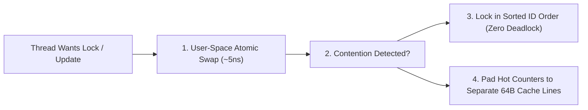

# Hardware Concurrency: MESI Cache Coherency, Memory Barriers, Deadlocks & Lock-Free CAS

```json continuity
{
  "previously": "In Chapter 03, we upgraded python3 apps/aerocart/server.py to use Write-Ahead Logging (WAL), LSM-Tree Bloom filters, and Snapshot Isolation so disk writes never block readers.",
  "painPoint": "Now inside RAM, when 32 worker threads in AeroCart transfer loyalty miles between flyers or increment adjacent request counters, threads freeze in deadlocks and multi-core throughput mysteriously drops 10x!",
  "unlock": "We will trace how physical CPU cores share 64-byte cache lines, eliminate multi-lock deadlocks mathematically by lock ordering, and build lock-free Compare-And-Swap (CAS) primitives immune to the ABA bug."
}
```

```json walkthrough
[
  {
    "time": "0:00",
    "badge": "1. Shared Clipboard Trap",
    "caption": "CPU cores do not read single variables from RAM—they grab 64-byte chunks called cache lines. If two AeroCart workers update neighbor counters on the same 64-byte clipboard, they yank it back and forth across cores.",
    "code": "Core 0 writes slot[0] -> invalidates Core 1's 64B cache line!"
  },
  {
    "time": "0:24",
    "badge": "2. Deadlock-Free Locks",
    "caption": "When Alice transfers miles to Bob at the exact moment Bob transfers miles to Alice, locking source then destination freezes both threads forever unless we sort lock IDs alphabetically first.",
    "code": "first, second = sorted([acct_a, acct_b], key=lambda a: a.id)"
  },
  {
    "time": "0:50",
    "badge": "3. Where Lock-Free Breaks",
    "caption": "Skipping locks with hardware Compare-And-Swap (CAS) seems foolproof until a memory address changes from A to B and back to A, tricking CAS into corrupting our lock-free stack.",
    "code": "CAS(top, expected=A, new=B) -> fooled by recycled A!"
  },
  {
    "time": "1:15",
    "badge": "4. Stamped CAS & Striped Cells",
    "caption": "By pairing every pointer with an incrementing version stamp and spreading hot counters across 64-byte padded cells, AeroCart scales linearly across 64 CPU cores.",
    "code": "AtomicStampedReference.compareAndSet(oldRef, newRef, v, v + 1)"
  }
]
```

```json pretraining
[
  {
    "term": "64-Byte Cache Line & False Sharing",
    "formula": "CPU caches lock 64-byte blocks, not single 8-byte numbers",
    "meaning": "When two CPU cores update two completely separate variables that happen to sit next to each other inside the same 64-byte memory block, they constantly invalidate each other's fast cache."
  },
  {
    "term": "Memory Barrier (volatile)",
    "formula": "Flush local CPU write buffer before reading or publishing",
    "meaning": "A strict hardware and compiler rule ensuring that when Thread 1 finishes preparing an object and flips a ready flag, Thread 2 never sees the flag flipped before the object is actually ready."
  },
  {
    "term": "Coffman's Circular Wait",
    "formula": "Thread 1 holds A waiting for B | Thread 2 holds B waiting for A",
    "meaning": "The classic deadlock ring where two threads each grab one lock and wait forever for the other; broken 100% of the time by always locking resources in alphabetical or numeric ID order."
  },
  {
    "term": "Compare-And-Swap (CAS) & ABA",
    "formula": "Update value only if current == expected (plus version stamp)",
    "meaning": "A single-instruction hardware swap that avoids slow OS locks, paired with a version counter so it is never fooled if a value changes from A to B and back to A."
  }
]
```

---

## 🌱 Step 1: Plain-English Story — Two Chefs Sharing One 64-Byte Clipboard

We often picture a 32-core server running **`AeroCart`** (`python3 apps/aerocart/server.py`) as 32 chefs smoothly reading and writing variables on a giant central wall whiteboard (**RAM**). In physical reality, walking to the central RAM whiteboard takes ~80 nanoseconds (~250 CPU clock cycles), whereas glancing at a personal notepad right on the chef's counter (**L1 Cache**) takes just ~1 nanosecond!

To keep every chef's private L1 notepad in sync, the CPU hardware enforces a strict rule: **you cannot borrow a single number—you must check out an entire 64-byte strip of paper (a Cache Line)**.
1. **False Sharing (The Shared Clipboard Fight)**: Suppose Chef 0 tracks `domestic_orders` and Chef 1 tracks `international_orders`. Because two 8-byte numbers take only 16 bytes, both counters land on the **exact same 64-byte cache line**. Every time Chef 0 adds 1 to `domestic_orders`, the CPU yanks the entire 64-byte clipboard out of Chef 1's hands! Neither thread shares a logical variable, yet throughput collapses by 10x.
2. **The Two-Door Deadlock**: When transferring AeroCart gift cards from `Alice` to `Bob` while another thread transfers from `Bob` to `Alice`, grabbing `source.lock` then `dest.lock` traps both threads holding one lock and waiting forever for the second.



---

## 🔨 Step 2: First Lines of Code — Deadlock-Free Multi-Lock Transfers

Let's fix `AeroCart`'s loyalty-points transfer first. Instead of locking `(source, dest)` in the order the caller passed them, we sort the two accounts by `account_id` before locking. Now `transfer(Alice, Bob)` and `transfer(Bob, Alice)` both lock `Alice` first and `Bob` second—making circular wait mathematically impossible:

```python
import threading

class LoyaltyAccount:
    def __init__(self, account_id: str, points: int) -> None:
        self.account_id = account_id
        self.points = points
        self.lock = threading.Lock()

def transfer_points_safe(src: LoyaltyAccount, dst: LoyaltyAccount, amount: int) -> bool:
    if src.account_id == dst.account_id:
        return True
    # Always acquire locks in strict alphabetical ID order to prevent Circular Wait!
    first, second = (src, dst) if src.account_id < dst.account_id else (dst, src)
    with first.lock, second.lock:
        if src.points < amount:
            return False
        src.points -= amount
        dst.points += amount
        return True
```

### Java 17 Equivalent

```java
import java.util.concurrent.locks.ReentrantLock;

public final class LoyaltyAccount {
    public final String id;
    public int points;
    public final ReentrantLock lock = new ReentrantLock();

    public LoyaltyAccount(String id, int points) {
        this.id = id;
        this.points = points;
    }

    public static boolean transferSafe(LoyaltyAccount src, LoyaltyAccount dst, int amount) {
        LoyaltyAccount first = src.id.compareTo(dst.id) < 0 ? src : dst;
        LoyaltyAccount second = first == src ? dst : src;
        first.lock.lock();
        try {
            second.lock.lock();
            try {
                if (src.points < amount) return false;
                src.points -= amount;
                dst.points += amount;
                return true;
            } finally { second.lock.unlock(); }
        } finally { first.lock.unlock(); }
    }
}
```

---

## ⚡ Step 3: Where It Breaks in Real Life — Reordered Reads, False Sharing & The ABA Trap

Even when our locks never deadlock, three subtle hardware behaviors break high-throughput services:
1. **Store Buffers & Missing `volatile` Fences**: When Thread 1 runs `config = load(); ready = true;`, either the compiler or the CPU's local **Store Buffer** can make `ready = true` visible to Thread 2 *before* `config`'s fields finish writing, or hoist `!ready` into a CPU register so `while (!ready) {}` spins forever!
2. **64-Core CAS Contention & False Sharing**: If 64 threads hammer a single `AtomicLong` (or adjacent array slots `long[64]`), 95% of CPU cycles are wasted retrying failed `CAS` loops as the 64-byte cache line ping-pongs across CPU sockets.
3. **The Lock-Free `ABA` Trap**: If Thread 1 reads top-of-stack `A` (pointing to `B`) and pauses while Thread 2 pops `A`, pops `B`, and pushes a recycled object at address `A`, Thread 1's raw `CAS(expected=A, new=B)` succeeds—corrupting the stack!

```json contrast
{
  "title": "High-Concurrency Shared State Engineering (32 Cores)",
  "naiveTitle": "Ad-Hoc Dual Locks + Adjacent Counters + Raw CAS",
  "naiveMetric": "Bi-Directional Deadlocks · 10x Cache Stall",
  "naivePoints": [
    "Acquires locks in caller-argument order lock(from) -> lock(to), deadlocking under A<->B transfers",
    "Packs 32 worker progress counters into a contiguous long[32] array (severe 64B False Sharing!)",
    "Spins on a plain non-volatile boolean flag or uses broken Double-Checked Locking",
    "Shares a single AtomicLong under 64-core contention or uses un-stamped pointer CAS vulnerable to ABA"
  ],
  "staffTitle": "Canonical Lock Ordering + Striped LongAdder + Stamped CAS",
  "staffMetric": "Zero Deadlocks · Linear 32-Core Scaling",
  "staffPoints": [
    "Enforces global total order on multi-lock acquisition (accountA.id < accountB.id)",
    "Uses JVM LongAdder (striped @Contended 64B-padded cells) instead of a single-hotspot AtomicLong",
    "Enforces strict Happens-Before visibility via final immutable records or volatile Acquire-Release fences",
    "Pairs lock-free pointer CAS structures with monotonic version stamps (AtomicStampedReference)"
  ]
}
```

```json poe
{
  "question": "In Java (or C++ without std::atomic), Thread 1 executes config = loadConfig(); ready = true; where ready is a plain non-volatile boolean, while Thread 2 spins on while (!ready) {} and then calls config.port(). How can Thread 2 crash with a NullPointerException or infinite loop in production even on x86_64?",
  "options": [
    "Booleans occupy 9 bytes on 64-bit CPUs, causing torn reads",
    "Without a volatile / Acquire-Release happens-before memory barrier, the JIT compiler legally hoists !ready out of the while loop (if (!ready) while(true){} -> infinite spin!) AND may reorder writes/reads so ready = true becomes visible before config's fields finish initializing!",
    "Only ARM CPUs ever reorder instructions; JIT compilers never hoist reads",
    "Adding Thread.yield() inside the loop establishes a full happens-before edge"
  ],
  "answerIndex": 1,
  "explanation": "Even on x86's strong Total Store Order (TSO) hardware, the JVM C2 JIT compiler legally hoists plain non-volatile loop-invariant reads into a CPU register forever and reorders non-volatile stores! Declaring volatile boolean ready emits both compiler barriers and hardware store-load fences."
}
```

---

## 🚀 Step 4: Staff Engineer Deep-Dive — Universal Scalability Law, `MESI` & Stamped `CAS`

### 1. Universal Scalability Law (USL) Under Cache Coherency Contention

While Amdahl's Law models only serial lock fraction $\sigma$, Neil Gunther's **Universal Scalability Law (USL)** adds the hardware **coherency / false-sharing penalty $\kappa$** caused by `MESI` (`Modified`, `Exclusive`, `Shared`, `Invalid`) point-to-point cache invalidations across $N$ CPU cores:

$$C(N) = \frac{N}{1 + \sigma (N - 1) + \kappa N (N - 1)}$$

Because $\kappa N(N-1)$ grows **quadratically** with core count $N$, unpadded false sharing or a single-hotspot `CAS` variable ($\kappa > 0$) causes throughput $C(N)$ to **retrograde (drop below 4-core speed!)** at $N = 32$ or $64$ cores. Striping counters across 64-byte padded cells (`LongAdder`) drives $\kappa \to 0$.

### 2. Concurrency Primitive Trade-Off Matrix

| Primitive | Uncontended Cost | High-Contention (32-Core) Behavior | Starvation / Liveness | Ideal Use Case |
| :--- | :--- | :--- | :--- | :--- |
| **Mutex / `ReentrantLock`** | $\sim 5–15\text{ ns}$ (Userspace `futex` CAS) | Kernel context-switch queueing ($\sim 1.5–3\ \mu\text{s}$) | Blocking (convoying if lock-holder hits GC/page fault) | Multi-variable invariant updates, I/O guards |
| **Single `AtomicLong` (`CAS` loop)** | $\sim 5\text{ ns}$ | **Degrades** due to MESI cache-line ping-pong + retry spins | Lock-free (at least 1 thread advances per cycle) | Low-to-moderate contention sequence generators, flags |
| **Striped `LongAdder`** | $\sim 5\text{ ns}$ | **Scales linearly** across 64+ cores (hashes threads to padded cells) | Wait-free / Lock-free | High-throughput telemetry counters, request metrics (`sum()` sums cells) |
| **Read-Write / `StampedLock`** | $\sim 10\text{ ns}$ (Optimistic read: $1\text{ ns}$!) | Zero cache invalidation across concurrent readers | Optimistic read requires `validate(stamp)` | Read-dominated (`99%` read) routing tables & config caches |

### 3. Production Blueprints: Canonical Multi-Lock Transfer & ABA-Safe Stamped Stack (Python 3 & Java 17)

```python
from dataclasses import dataclass, field
import threading


@dataclass
class BankAccount:
    account_id: str
    balance_cents: int
    lock: threading.Lock = field(default_factory=threading.Lock, repr=False)


def transfer_deadlock_free(source: BankAccount, dest: BankAccount, amount_cents: int) -> bool:
    """
    Breaks Coffman's Circular-Wait condition by acquiring locks in strict lexicographical account_id order.
    Concurrent transfer(A, B) and transfer(B, A) BOTH lock min(A,B) first, then max(A,B) — 0% deadlock!
    """
    if source.account_id == dest.account_id:
        return amount_cents >= 0

    first, second = (
        (source, dest) if source.account_id < dest.account_id else (dest, source)
    )
    with first.lock:
        with second.lock:
            if source.balance_cents < amount_cents:
                return False
            source.balance_cents -= amount_cents
            dest.balance_cents += amount_cents
            return True
```

### Java 17 Equivalent

```java
import java.util.concurrent.atomic.AtomicStampedReference;

public final class LockFreeStampedStack<E> {
    private record Node<E>(E item, Node<E> next) {}

    // Pairs top pointer with a monotonically increasing integer stamp to defeat ABA!
    private final AtomicStampedReference<Node<E>> top = new AtomicStampedReference<>(null, 0);

    public void push(E item) {
        int[] stampHolder = new int[1];
        while (true) {
            Node<E> oldHead = top.get(stampHolder);
            int oldStamp = stampHolder[0];
            Node<E> newHead = new Node<>(item, oldHead);
            if (top.compareAndSet(oldHead, newHead, oldStamp, oldStamp + 1)) {
                return;
            }
        }
    }

    public E pop() {
        int[] stampHolder = new int[1];
        while (true) {
            Node<E> oldHead = top.get(stampHolder);
            int oldStamp = stampHolder[0];
            if (oldHead == null) {
                return null;
            }
            if (top.compareAndSet(oldHead, oldHead.next(), oldStamp, oldStamp + 1)) {
                return oldHead.item();
            }
        }
    }
}
```

> [!WARNING]
> **Staff Interview Gotcha — Why Broken Double-Checked Locking (`Singleton`) Fails Without `volatile` AND What CPython's `GIL` Does NOT Protect**:
> 1. In Java, `instance = new Helper()` compiles into `(a) alloc memory`, `(b) run constructor`, `(c) assign pointer to instance`. Without `private static volatile Helper instance`, `(b)` and `(c)` can reorder—so Thread 2 sees `instance != null` and reads half-initialized zeroed fields!
> 2. In CPython, developers falsely assume *"The GIL makes Python dictionaries/counters thread-safe."* The GIL only protects internal C reference counts between bytecodes—`counter += 1` (`LOAD_FAST`, `BINARY_ADD`, `STORE_FAST`) can be preempted mid-bytecode, losing increments without `threading.Lock`!

**Up Next in Chapter 05**: Now that our CPU threads and memory barriers are rock-solid, why does spawning 10,000 OS threads for 10,000 idle flight-status WebSockets crash `AeroCart`? In our final chapter, we dive into Linux `epoll` I/O multiplexing, `cgroups v2` CPU/OOM throttling, and container namespaces.

```json quiz
[
  {
    "id": "cs-04-q1",
    "question": "Two threads run on separate CPU cores: Thread 0 increments stats.slot0 in a tight loop while Thread 1 increments stats.slot1. Neither thread ever touches the other's variable, yet throughput drops 9x compared to local stack variables! What hardware mechanism caused this, and how do you fix it?",
    "options": [
      "TLB page-table exhaustion; solved by enabling swap",
      "False Sharing across a single 64-byte L1 MESI cache line: because slot0 and slot1 sit within the same 64B cache line, every store by Core 0 invalidates Core 1's L1 cache line; solved by 64B/128B cache-line padding (@Contended or LongAdder)",
      "Coffman Circular Wait deadlock",
      "Branch prediction flush caused by UTF-8 encoding"
    ],
    "answerIndex": 1,
    "explanation": "MESI cache coherence operates on 64-byte (or 128-byte) cache lines, not individual 8-byte longs. Co-locating independent hot-write counters forces continuous cross-core L1 invalidation traffic."
  },
  {
    "id": "cs-04-q2",
    "question": "Which of Coffman's 4 necessary Deadlock conditions is broken when you enforce a strict global ordering (lock(minId) before lock(maxId)) across all multi-resource transactions?",
    "options": [
      "Mutual Exclusion",
      "Circular Wait — because a directed dependency cycle T1 -> T2 -> ... -> T1 cannot exist on a strict total order (id_1 < id_2 < ... < id_1 is impossible!)",
      "No Preemption",
      "Memory Alignment"
    ],
    "answerIndex": 1,
    "explanation": "A cycle in a wait-for graph would imply an entity ID is strictly less than itself—a mathematical contradiction—making deadlocks impossible without giving up mutual exclusion."
  },
  {
    "id": "cs-04-q3",
    "question": "What is the 'ABA Problem' in lock-free Compare-And-Swap (CAS) algorithms, and how does AtomicStampedReference prevent it?",
    "options": [
      "Two threads have names starting with 'A' and 'B'",
      "Memory at a target address changes from A to B and back to A (e.g., a popped node's address is recycled while another thread's interior next pointer is stale), tricking a plain value-only CAS(expected=A) into succeeding; pairing the pointer with a monotonic version stamp (A, v1) != (A, v3) causes the stale CAS to fail safely",
      "CAS instructions fail whenever integers are negative",
      "Lock-free queues reverse FIFO order into LIFO"
    ],
    "answerIndex": 1,
    "explanation": "Monotonic version/epoch tagging ensures that even if the exact same pointer/value A reappears, the incremented stamp exposes the intermediate state mutations."
  }
]
```
