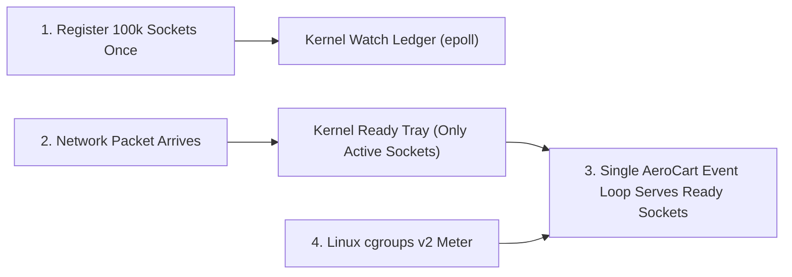

# Linux I/O Multiplexing & Container Internals: epoll, Namespaces, cgroups v2 & CFS Throttling

```json continuity
{
  "previously": "In Chapter 04, we eliminated multi-lock deadlocks and 64-byte cache-line false sharing across CPU threads inside python3 apps/aerocart/server.py.",
  "painPoint": "When 100,000 flyers open live gate-status connections to AeroCart inside a 2-CPU Kubernetes pod, spawning one thread per connection eats 100 GB of RAM, and sizing our worker pool with os.cpu_count() freezes the pod for 94ms out of every 100ms!",
  "unlock": "We will replace blocking threads with Linux epoll O(1) readiness queues and inspect how Linux namespaces and cgroups v2 actually run containers without CPU throttling or Exit 137 crashes."
}
```

```json walkthrough
[
  {
    "time": "0:00",
    "badge": "1. The 100,000 Waiters Trap",
    "caption": "Hiring one dedicated waiter to stand beside every restaurant table wastes 100 GB of thread memory when 99% of flyers are just quietly staring at the menu. Instead, Linux epoll uses a single bell that rings only when a table actually speaks.",
    "code": "epoll_ctl(ADD) -> NIC interrupt -> epoll_wait() returns ready sockets"
  },
  {
    "time": "0:24",
    "badge": "2. First Non-Blocking Loop",
    "caption": "With Python's selectors and Java's NIO Selector, a single AeroCart thread registers thousands of non-blocking sockets with the kernel and wakes up only for sockets that have data ready to read.",
    "code": "sel.register(sock, selectors.EVENT_READ)"
  },
  {
    "time": "0:50",
    "badge": "3. The Container Quota Illusion",
    "caption": "A Docker container is just a normal Linux process wearing blinders (namespaces) and a budget meter (cgroups). If AeroCart sees 64 host cores and spawns 64 threads inside a 2-CPU container, it burns its 100ms CPU allowance in 3 milliseconds!",
    "code": "64 threads * 3.1ms = 200ms quota gone -> throttled for 96.9ms!"
  },
  {
    "time": "1:15",
    "badge": "4. cgroup-Aware Engineering",
    "caption": "By reading /sys/fs/cgroup/cpu.max to size worker pools and looping reads until EAGAIN on edge-triggered sockets, AeroCart runs 100,000 live connections smoothly inside Kubernetes.",
    "code": "math.ceil(quota / period) + non-blocking epoll selector"
  }
]
```

```json pretraining
[
  {
    "term": "epoll Readiness Queue",
    "formula": "Register sockets once -> kernel wakes you only for active sockets",
    "meaning": "A Linux kernel notification system that lets one thread watch 100,000 network connections without polling idle sockets one by one."
  },
  {
    "term": "Linux Namespaces",
    "formula": "Isolates what a process can SEE (PIDs, network, folders)",
    "meaning": "Kernel blinders that make a regular process believe it has its own private server, filesystem, and Process ID 1."
  },
  {
    "term": "Control Groups (cgroups v2)",
    "formula": "Limits how much hardware a process can USE (CPU, RAM)",
    "meaning": "The Linux kernel budget meter (`cpu.max`, `memory.max`) that throttles a container's CPU or kills it with Exit 137 if it exceeds its RAM allowance."
  },
  {
    "term": "CFS CPU Throttling",
    "formula": "2-CPU limit = 200ms of CPU time allowed per 100ms window",
    "meaning": "When too many threads run at once inside a container, they spend the entire 100ms CPU budget in the first few milliseconds and get frozen for the rest of the window."
  }
]
```

---

## 🌱 Step 1: Plain-English Story — The Bell System vs. 100,000 Idle Waiters

Imagine **`AeroCart`** (`python3 apps/aerocart/server.py`) launches live flight-boarding alerts for 100,000 passengers waiting at airport gates. For 99.9% of the time, those 100,000 phone connections are completely silent.
- **The 100,000 Waiters Approach (Thread-Per-Connection)**: If `AeroCart` spawns one OS thread per connection, 100,000 threads × 1 MB of stack memory instantly consumes **100 GB of RAM** before sending a single byte!
- **The Clipboard Poll Approach (`select` / `poll`)**: Instead of 100,000 waiters, one waiter walks around the airport every millisecond asking all 100,000 passengers, *"Do you have a message? No? How about you?"* Asking 99,995 silent passengers burns 100% CPU.
- **The Call-Bell Queue (`Linux epoll`, used by NGINX, Node.js, Netty, and `asyncio`)**: You register all 100,000 seats in a kernel ledger once. Whenever a passenger's phone actually sends a packet, the network card rings their call bell and drops only their seat number into a small **Ready Tray**. One waiter checks the Ready Tray, serves the 5 active passengers immediately, and never wastes time checking the 99,995 quiet seats!



And when we deploy `AeroCart` inside a **Docker / Kubernetes container**, Linux does not boot a miniature virtual machine—it simply runs `python3 apps/aerocart/server.py` as a normal host process wearing **Namespaces** (blinders controlling what it can *see*) and **cgroups v2** (a meter controlling how much CPU and RAM it can *use*).

---

## 🔨 Step 2: First Lines of Code — Non-Blocking Event Multiplexer & Container CPU Check

Let's write a 16-line helper for `AeroCart` that reads the container's true CPU quota from `/sys/fs/cgroup/cpu.max` (instead of blindly trusting host core count) and registers a non-blocking socket with the OS `epoll` / `kqueue` multiplexer:

```python
import math, os, selectors, socket
from pathlib import Path

def get_container_cpu_limit(cgroup_file: str = "/sys/fs/cgroup/cpu.max") -> int:
    if Path(cgroup_file).is_file():
        quota, period = Path(cgroup_file).read_text().strip().split()
        if quota != "max":
            return max(1, math.ceil(int(quota) / int(period)))
    return os.cpu_count() or 1

def watch_nonblocking_socket(host: str = "127.0.0.1", port: int = 0) -> selectors.BaseSelector:
    sel = selectors.DefaultSelector()  # Uses epoll on Linux, kqueue on macOS
    srv = socket.socket(socket.AF_INET, socket.SOCK_STREAM)
    srv.setblocking(False)
    srv.bind((host, port))
    srv.listen(128)
    sel.register(srv, selectors.EVENT_READ)
    return sel
```

### Java 17 Equivalent

```java
import java.io.IOException;
import java.net.InetSocketAddress;
import java.nio.channels.*;

public final class AeroCartEpollBootstrap {
    public static int detectContainerProcessors() {
        // Java 17+ (-XX:+UseContainerSupport) reads cgroup v2 cpu.max automatically!
        return Runtime.getRuntime().availableProcessors();
    }

    public static Selector openNonBlockingServer(int port) throws IOException {
        Selector selector = Selector.open(); // EPollSelectorImpl on Linux
        ServerSocketChannel server = ServerSocketChannel.open();
        server.configureBlocking(false);
        server.bind(new InetSocketAddress("127.0.0.1", port), 128);
        server.register(selector, SelectionKey.OP_ACCEPT);
        return selector;
    }
}
```

---

## ⚡ Step 3: Where It Breaks in Real Life — The 64-Core CFS Throttling Trap & `/dev/shm` Crashes

When teams move `AeroCart` and its Playwright test runners onto a 64-core Kubernetes node with a `2 CPU` container limit, two puzzling outages strike:
1. **CFS Bandwidth Throttling (`195ms` P99 Spikes at 45% CPU Usage!)**: Linux meters container CPU in `100ms` windows. A `2 CPU` limit gives your pod `200ms` of CPU time per `100ms` window. If your app sees the 64-core host and spawns **32 worker threads** at once, all 32 threads run simultaneously and burn the entire `200ms` allowance in just **`6.25ms`** (`32 × 6.25ms = 200ms`)! The kernel then **freezes your entire pod for the remaining `93.75ms`** of the window!
2. **`/dev/shm` (`64 MB`) & OverlayFS Bottlenecks**: Docker limits shared memory (`/dev/shm`) to `64 MB` by default, crashing headless Chromium browsers even when the container has `8 GB` of RAM, while writing SQLite databases onto container `OverlayFS` triggers slow copy-on-write file copies.

```json contrast
{
  "title": "High-Scale I/O & Kubernetes Container Tuning",
  "naiveTitle": "Host-Blind Thread Pools Inside Hard CPU Limits",
  "naiveMetric": "195ms P99 CFS Stalls · Exit 137 OOMs",
  "naivePoints": [
    "Reads host core count (64) inside a 2-CPU container, spawning 64 workers that burn the 100ms CFS quota in 3.1ms",
    "Blocks the single epoll / asyncio event loop thread with synchronous CPU work or blocking HTTP calls",
    "Writes heavy SQLite databases or Playwright video artifacts onto copy-on-write OverlayFS upperdir",
    "Leaves /dev/shm at Docker's 64MB default, crashing headless browser workers mid-test"
  ],
  "staffTitle": "cgroup-Aware Concurrency + Non-Blocking epoll + tmpfs",
  "staffMetric": "<8ms P99 · Zero CFS Throttling · Zero Exit 137",
  "staffPoints": [
    "Reads /sys/fs/cgroup/cpu.max (or -XX:ActiveProcessorCount) to size worker and GC threads strictly to container quota",
    "Keeps socket I/O 100% non-blocking on epoll while offloading CPU work to bounded pools",
    "Mounts dedicated volumes for database I/O and 2Gi memory-backed /dev/shm for browser automation",
    "Loops read() until EAGAIN when using Edge-Triggered (EPOLLET) sockets so unread bytes never stall"
  ]
}
```

```json poe
{
  "question": "Your AeroCart service runs on a 64-core Kubernetes worker node with resources.limits.cpu: '2'. Grafana shows average pod CPU usage is only 0.9 cores (45% of its 2-core limit!), yet P99 latency spiked from 12ms to 195ms and container_cpu_cfs_throttled_periods_total is skyrocketing! How can a pod get heavily CPU-throttled while using LESS than 50% of its CPU limit?",
  "options": [
    "Kubernetes throttles pods randomly to save electricity",
    "Linux Completely Fair Scheduler (CFS) enforces CPU limits across all threads in 100ms epochs (cfs_quota_us = 200ms per 100ms period): when a burst spawns 32 threads simultaneously (e.g., GC threads or unpinned worker pools sized to the 64-core host!), 32 threads * 6.25ms = 200ms of quota burned in the first 6.25ms—freezing ALL pod threads for the remaining 93.75ms of the window!",
    "OverlayFS encrypts every syscall above 0.5 CPU",
    "epoll_wait consumes 100% CPU when idle"
  ],
  "answerIndex": 1,
  "explanation": "One of the most infamous production Kubernetes/CI incidents (documented by Zalando, Uber, and Netflix): 1-minute average CPU graphs smooth over 100ms CFS sub-windows! Sizing thread pools and GC threads (-XX:ActiveProcessorCount=2) strictly to the cgroup CPU quota eliminates multi-thread quota exhaustion."
}
```

---

## 🚀 Step 4: Staff Engineer Deep-Dive — CFS Quota Math, `epoll` Internals (`LT` vs `ET`) & Blueprints

### 1. CFS Bandwidth Quota Exhaustion & `epoll` Complexity Laws

In Linux `cgroups v2`, `/sys/fs/cgroup/cpu.max` defines a quota $Q$ (microseconds of CPU time) replenished every period $P$ (default $100\text{ ms} = 100,000\ \mu\text{s}$). When $T$ runnable threads execute concurrently inside the container, the wall-clock time $t_{\text{exhaust}}$ before the kernel throttles the entire control group is:

$$t_{\text{exhaust}} = \frac{Q}{T}, \qquad t_{\text{stall}} = \max\!\left(0,\; P - \frac{Q}{T}\right)$$

For a $2\text{-vCPU}$ pod ($Q = 200\text{ ms}, P = 100\text{ ms}$) running $T = 64$ host-sized threads, $t_{\text{exhaust}} = \frac{200\text{ ms}}{64} = 3.125\text{ ms}$, causing a **$96.875\text{ ms}$ freeze** every $100\text{ ms}$! Right-sizing $T = 2$ ensures $t_{\text{exhaust}} = 100\text{ ms} \implies t_{\text{stall}} = 0$.

Meanwhile, inside the kernel network stack, `epoll` separates registration (`epoll_ctl` on a Red-Black Tree in $\mathcal{O}(\log N)$) from readiness harvesting (`epoll_wait` draining an interrupt-populated doubly-linked Ready List in $\mathcal{O}(k)$ for $k$ active sockets out of $N$ total).

### 2. Linux Multiplexing & Container Primitive Comparison

| Kernel Mechanism | Time Complexity / Overhead | Core Data Structure | Critical Production Gotcha |
| :--- | :--- | :--- | :--- |
| **`select` / `poll`** | $\mathcal{O}(N)$ scan per call | Linear FD bitmask (`FD_SETSIZE=1024` in `select`!) / `pollfd[]` | CPU melts above $\sim 2,000$ concurrent sockets |
| **`epoll` (`LT` vs `ET`)** | $\mathcal{O}(\log N)$ add, **$\mathcal{O}(k)$ wait** | Kernel Red-Black Tree + Doubly-Linked Ready List | **Edge-Triggered (`EPOLLET`)** notifies only on state transition—you **must** loop `read()` until `EAGAIN` or remaining bytes stall forever! |
| **`io_uring`** *(Linux 5.1+)* | **Zero-Syscall** shared ring buffers | Submission Queue (`SQ`) + Completion Queue (`CQ`) in `mmap` RAM | Unifies true async disk + network I/O without thread-pool emulation |
| **`cgroups v2` (`memory.max` / `/dev/shm`)** | Per-page / per-schedule tick | Unified hierarchy `/sys/fs/cgroup` | Docker defaults `/dev/shm` to **`64 MB`**, crashing headless Chromium/Playwright tabs until `--shm-size=2g` is mounted! |

### 3. Production Blueprints: `cgroups v2` Quota Reader & Non-Blocking `epoll` Multiplexer (Python 3 & Java 17)

```python
import math
import os
from pathlib import Path
import selectors
import socket


def detect_effective_container_cpus(cgroup_root: str = "/sys/fs/cgroup") -> int:
    """
    Reads Linux cgroups v2 cpu.max (or v1 cpu.cfs_quota_us / cpu.cfs_period_us)
    so CI & production worker pools never spawn 64 workers inside a 2-vCPU container!
    """
    v2_max = Path(cgroup_root) / "cpu.max"
    if v2_max.is_file():
        parts = v2_max.read_text(encoding="utf-8").strip().split()
        if len(parts) == 2 and parts[0] != "max":
            quota, period = int(parts[0]), int(parts[1])
            if quota > 0 and period > 0:
                return max(1, math.ceil(quota / period))

    v1_quota = Path(cgroup_root) / "cpu" / "cpu.cfs_quota_us"
    v1_period = Path(cgroup_root) / "cpu" / "cpu.cfs_period_us"
    if v1_quota.is_file() and v1_period.is_file():
        q = int(v1_quota.read_text(encoding="utf-8").strip())
        p = int(v1_period.read_text(encoding="utf-8").strip())
        if q > 0 and p > 0:
            return max(1, math.ceil(q / p))

    return max(1, os.cpu_count() or 1)


def create_nonblocking_multiplexer() -> selectors.BaseSelector:
    """Uses kernel epoll on Linux and kqueue on macOS/BSD automatically."""
    return selectors.DefaultSelector()


def register_nonblocking_listener(sel: selectors.BaseSelector, host: str = "127.0.0.1", port: int = 0) -> socket.socket:
    srv = socket.socket(socket.AF_INET, socket.SOCK_STREAM)
    srv.setsockopt(socket.SOL_SOCKET, socket.SO_REUSEADDR, 1)
    srv.setblocking(False)
    srv.bind((host, port))
    srv.listen(1024)
    sel.register(srv, selectors.EVENT_READ, data="ACCEPTOR")
    return srv
```

### Java 17 Equivalent

```java
import java.io.IOException;
import java.net.InetSocketAddress;
import java.nio.channels.SelectionKey;
import java.nio.channels.Selector;
import java.nio.channels.ServerSocketChannel;

public final class ContainerAndEpollRuntime {
    public record ContainerQuotaSummary(int jvmAvailableProcessors, long maxHeapBytes) {}

    /**
     * Modern Java 17+ (-XX:+UseContainerSupport, on by default) inspects cgroup v1/v2 quotas
     * so Runtime.getRuntime().availableProcessors() returns the container's CPU limit (e.g., 2), NOT 64!
     */
    public static ContainerQuotaSummary inspectContainerAwareness() {
        Runtime rt = Runtime.getRuntime();
        return new ContainerQuotaSummary(rt.availableProcessors(), rt.maxMemory());
    }

    public static Selector openNonBlockingEpollServer(int port) throws IOException {
        Selector selector = Selector.open(); // Backed by EPollSelectorImpl on Linux!
        ServerSocketChannel server = ServerSocketChannel.open();
        server.configureBlocking(false);
        server.bind(new InetSocketAddress("127.0.0.1", port), 1024);
        server.register(selector, SelectionKey.OP_ACCEPT);
        return selector;
    }
}
```

> [!WARNING]
> **Staff Interview Gotcha — Why Chromium / Playwright Crashes Inside Docker With `"Target page, context or browser has been closed"` Despite 8 GiB Pod RAM**:
> Chromium uses POSIX shared memory (`/dev/shm`) intensively to pass rasterized GPU/compositor tiles between Renderer and Browser processes. Docker and Kubernetes mount `/dev/shm` as **`64 MiB` by default** regardless of whether your pod has `8 GiB` of `memory.limits`! Always mount an in-memory `emptyDir: { medium: Memory, sizeLimit: 2Gi }` at `/dev/shm` (or pass `--shm-size=2g`) on containerized Playwright runners!

**Course 08 Complete — From User-Space Code to Silicon & Kernel Mastery**: Congratulations! You have traced `python3 apps/aerocart/server.py` all the way from Virtual Memory Page Tables and RSS Leaks (`Ch 01`), TCP/TLS 1.3 Wire Handshakes (`Ch 02`), B+Tree/LSM-Tree WAL Storage (`Ch 03`), and `MESI` Cache-Line Concurrency (`Ch 04`) to Linux `epoll` and `cgroups v2` Containers (`Ch 05`). Switch to **Single-Page Master Compendium Mode** anytime for rapid Staff interview revision!

```json quiz
[
  {
    "id": "cs-05-q1",
    "question": "Why does Linux epoll achieve O(k) readiness notification across 100,000 mostly idle sockets (where k=5 are active), whereas select() and poll() degrade at O(N)?",
    "options": [
      "Because epoll disables TCP checksum verification",
      "Because epoll_ctl persists the interest set inside an in-kernel Red-Black Tree once, and NIC arrival callbacks append only active sockets to an O(1) Ready List—eliminating the O(N) user-to-kernel descriptor array copy and linear scan on every wait",
      "Because epoll spawns 1 kernel thread per socket",
      "Because select() only supports UDP sockets"
    ],
    "answerIndex": 1,
    "explanation": "Separating stateful registration (epoll_ctl Red-Black Tree) from interrupt-driven readiness collection (epoll_wait Ready List) decouples wait cost from total idle connection count N."
  },
  {
    "id": "cs-05-q2",
    "question": "In Python (<3.13) running pytest -n auto inside a Kubernetes CI pod with limits.cpu: '2' on a 64-core EC2 host, os.cpu_count() returns 64 and spawns 64 test workers! What happens at the Linux kernel level?",
    "options": [
      "Kubernetes automatically upgrades the pod to 64 vCPUs for free",
      "All 64 workers contend for cpu.max (200ms per 100ms CFS period), exhausting the entire 200ms CPU quota in ~3.1ms and getting hard-throttled by the kernel CFS bandwidth controller for ~96.9ms of every 100ms—causing flaky timeouts and massive context-switch overhead!",
      "Linux namespaces block more than 2 processes from calling fork()",
      "OverlayFS converts 62 workers into zombie processes"
    ],
    "answerIndex": 1,
    "explanation": "os.cpu_count() historically queried host /proc/cpuinfo rather than /sys/fs/cgroup/cpu.max. Spawning 64 active workers inside a 2-core CFS quota causes severe 95%+ period throttling and artificial CI timeouts."
  },
  {
    "id": "cs-05-q3",
    "question": "In epoll Edge-Triggered mode (EPOLLET), 8 KB arrives on a non-blocking socket, and your handler reads only 4 KB and returns to epoll_wait() without looping until EAGAIN / EWOULDBLOCK. What happens to the remaining 4 KB if the client sends no further packets?",
    "options": [
      "epoll_wait immediately fires again on the next microsecond",
      "The remaining 4 KB sits unread in the kernel socket buffer indefinitely (stalling the request!), because Edge-Triggered mode only emits an event when new data transitions the buffer state, NOT while unread bytes merely remain present",
      "The kernel automatically closes the socket with RST",
      "The remaining 4 KB overflows into adjacent file descriptors"
    ],
    "answerIndex": 1,
    "explanation": "Level-Triggered (default) re-notifies as long as unread bytes remain; Edge-Triggered (EPOLLET) notifies strictly on arrival transitions, requiring non-blocking read() loops until EAGAIN."
  }
]
```
