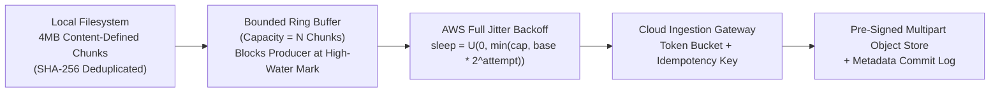

# Endpoint-to-Cloud Continuous Sync, Ring Buffers & Full Jitter

## Part I — First-Principles Mental Model & Visual Cue

Imagine **100,000 enterprise laptops** backing up changed filesystem blocks immediately after a corporate VPN reconnects at 9:00 AM Monday morning.

If every endpoint agent uses a naive fixed retry interval (or even unjittered exponential backoff $2^k$ seconds) when the cloud ingestion gateway returns `HTTP 429 Too Many Requests` or `503 Service Unavailable`, all 100,000 clients wake up at **the exact same millisecond** ($t = 2\text{s}, 4\text{s}, 8\text{s}$), creating a **Synchronized Retry Storm (Thundering Herd)** that repeatedly knocks down the load balancer.



### The Three Non-Negotiable Invariants
1. **Bounded Memory via Ring Buffer Backpressure**: An endpoint sync daemon must never read unboundedly from disk into RAM when the network is slow. A bounded circular buffer pauses the file-scanner producer the instant `in_flight_chunks == capacity`.
2. **Desynchronization via AWS Full Jitter**: Instead of sleeping $T = \min(T_{\max}, T_0 \cdot 2^a)$, each client samples uniformly from $[0, \min(T_{\max}, T_0 \cdot 2^a)]$, flattening spikes into a smooth, constant arrival rate.
3. **Content-Addressable Idempotency**: Every chunk is addressed by its `SHA-256` digest so retried uploads are strictly idempotent.

---

## Part II — Internal Engine Mechanics & Interactive Simulation

Use the inline **`arch-backpressure-jitter`** simulator to step through how a bounded ring buffer absorbs bursts and how Full Jitter desynchronizes concurrent retry waves compared to naive backoff.

- **High-Water Mark ($80\%$ capacity)**: Transitions the local file watcher from `STREAMING` to `THROTTLED`.
- **Idempotent Resume Cursor**: When a 1 GB file upload is interrupted at chunk 142/256, the client queries `HEAD /sync/sessions/{session_id}` to resume from byte offset `142 * 4MB`.

---

## Part III — Production Implementation Blueprints (Java 17 & Python 3)

### Python 3 Blueprint: Full Jitter + Bounded Ring Buffer Sync Engine
```python
import hashlib
import random
from collections import deque

class BoundedSyncEngine:
    def __init__(self, capacity: int = 64, base_ms: float = 100.0, cap_ms: float = 10_000.0):
        self.capacity = capacity
        self.ring = deque()
        self.uploaded_hashes = set()
        self.base_ms = base_ms
        self.cap_ms = cap_ms

    def full_jitter_delay_ms(self, attempt: int, rng: random.Random) -> float:
        ceiling = min(self.cap_ms, self.base_ms * (2 ** attempt))
        return rng.uniform(0.0, ceiling)

    def enqueue_chunk(self, payload: bytes) -> dict:
        if len(self.ring) >= self.capacity:
            return {"accepted": False, "status": "BACKPRESSURE_ENGAGED"}
        digest = hashlib.sha256(payload).hexdigest()
        if digest in self.uploaded_hashes:
            return {"accepted": True, "status": "DEDUPLICATED_SKIP", "sha256": digest}
        self.ring.append((digest, payload))
        return {"accepted": True, "status": "QUEUED", "sha256": digest}
```

### Java 17 Blueprint: Thread-Safe Full Jitter Calculator
```java
import java.util.concurrent.ThreadLocalRandom;

public final class FullJitterBackoff {
    public static long computeDelayMs(int attempt, long baseMs, long capMs) {
        long exp = baseMs * (1L << Math.min(attempt, 20));
        long ceiling = Math.min(capMs, exp);
        return ThreadLocalRandom.current().nextLong(0, ceiling + 1);
    }
}
```

> [!WARNING]
> **Staff Interview Gotcha — Why "Equal Jitter" vs "Full Jitter" Matters**:
> AWS architecture benchmarks proved that **Full Jitter** (`random(0, min(cap, base * 2^attempt))`) reduces total server work by **>40%** compared to Equal Jitter while maintaining comparable $P_{99}$ completion time.

---

## Part IV — End-of-Chapter Mastery Check

```json quiz
[
  {
    "id": "sd-01-q1",
    "question": "Why does standard exponential backoff (T = base * 2^attempt) WITHOUT jitter still cause cascading outages after a brief network partition?",
    "options": [
      "Because powers of 2 grow too slowly for TCP sockets",
      "Because all clients that failed during the partition remain phase-locked and retry in synchronized waves at t=1s, 2s, 4s, 8s",
      "Because HTTP/2 multiplexes all retries onto a single TCP window",
      "Because SHA-256 chunking invalidates TLS session tickets"
    ],
    "answerIndex": 1,
    "explanation": "Without random jitter, clients that fail together stay synchronized in phase, hammering the recovering service in lockstep at every power-of-two boundary."
  },
  {
    "id": "sd-01-q2",
    "question": "What is the primary purpose of a bounded Ring Buffer between the local filesystem scanner and the network uploader?",
    "options": [
      "To compress chunks using LZ4 before encryption",
      "To enforce local memory backpressure so a slow network cannot cause disk reads to exhaust process RAM (OOM)",
      "To bypass OS page cache flushes",
      "To replace TLS 1.3 record framing"
    ],
    "answerIndex": 1,
    "explanation": "Disk I/O is orders of magnitude faster than WAN upload speeds. A bounded ring buffer blocks the disk reader when full, capping resident memory."
  },
  {
    "id": "sd-01-q3",
    "question": "Under AWS Full Jitter with base=100ms, cap=10,000ms, and attempt=4, from what interval is the sleep duration sampled?",
    "options": [
      "Exactly 1,600ms",
      "Uniformly from [800ms, 1,600ms]",
      "Uniformly from [0ms, 1,600ms]",
      "Uniformly from [0ms, 10,000ms]"
    ],
    "answerIndex": 2,
    "explanation": "At attempt=4, min(10000, 100 * 2^4) = 1600ms. Full Jitter samples uniformly between 0 and that ceiling: [0ms, 1,600ms]."
  }
]
```
