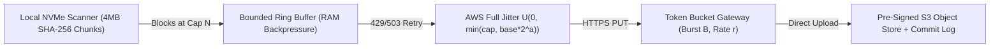

# Endpoint-to-Cloud Continuous Sync, Token Bucket Rate Limiting, Ring Buffers & Full Jitter

```json pretraining
[
  {
    "term": "Bounded Ring Buffer Backpressure",
    "formula": "InFlight == Capacity ⇒ Block Producer",
    "meaning": "Capping resident chunk memory between fast NVMe disk scanners (3 GB/s) and slow WAN uplinks (20 Mbps) so endpoints never OOM."
  },
  {
    "term": "Token Bucket Admission",
    "formula": "Tokens(t) = min(B, T_0 + r · Δt)",
    "meaning": "Gateway rate limiter refilling at steady rate r tokens/sec up to burst capacity B, rejecting excess load early with HTTP 429 + Retry-After."
  },
  {
    "term": "AWS Full Jitter Backoff",
    "formula": "sleep ~ Uniform(0, min(cap, base · 2^a))",
    "meaning": "Breaks phase-locked retry storms after network partitions by spreading client wakeups across the entire exponential interval."
  },
  {
    "term": "Content-Defined Deduplication",
    "formula": "ChunkID = SHA-256(Payload)",
    "meaning": "Addressing 4MB blocks by cryptographic digest makes multipart retries strictly idempotent and skips unchanged blocks across edits."
  }
]
```

```json poe
{
  "question": "100,000 laptop sync clients simultaneously fail at 09:00:00.000 during a 500ms load-balancer blip. Every client implements standard exponential backoff `sleep = 100ms * 2^attempt` WITHOUT jitter. What traffic pattern hits your Token Bucket gateway over the next 10 seconds?",
  "options": [
    "Traffic smoothly spreads out to 10,000 RPS across the 10-second window",
    "All 100,000 clients remain phase-locked in lockstep, firing synchronized 100,000-request spikes at t = 0.1s, 0.3s, 0.7s, 1.5s, 3.1s, and 6.3s—repeatedly exhausting the Token Bucket and perpetuating the outage!",
    "TCP slow start prevents clients from sending retry requests",
    "Only 1 client retries while 99,999 clients shut down permanently"
  ],
  "answerIndex": 1,
  "explanation": "Deterministic powers of two scale the pause between spikes, NOT the width of the spike! Without random uniform dispersion (AWS Full Jitter), synchronized clients stay phase-locked indefinitely."
}
```

## Part I — First-Principles Mental Model & Visual Cue

Imagine **100,000 enterprise laptops** (Dropbox, iCloud Drive, or endpoint telemetry agents) backing up changed filesystem blocks immediately after a corporate VPN reconnects at 9:00 AM Monday morning.

If every endpoint agent uses a naive fixed retry interval (or unjittered exponential backoff $2^k$ seconds) when the cloud ingestion gateway's **Token Bucket** returns `HTTP 429 Too Many Requests` or `503 Service Unavailable`, all 100,000 clients wake up at **the exact same millisecond** ($t = 2\text{s}, 4\text{s}, 8\text{s}$), creating a **Synchronized Retry Storm (Thundering Herd)** that repeatedly knocks down the load balancer.



### The Four Non-Negotiable Architecture Invariants
1. **Bounded Memory via Ring Buffer Backpressure**: Local NVMe reads run at $>3,000\text{ MB/s}$ while WAN uploads may run at $2\text{ MB/s}$. A bounded circular buffer (`capacity = 64` chunks) blocks the file-scanner producer the instant `in_flight_chunks == capacity`, capping resident RAM deterministically.
2. **Gateway Protection via Token Bucket Admission Control**: The cloud control plane enforces a per-tenant and global **Token Bucket** (`burst B`, `refill rate r`), shedding excess metadata traffic cheaply at the edge (`HTTP 429` + `Retry-After`) while offloading heavy binary bytes directly to **Pre-Signed Object Storage (`S3`/`GCS`)** out-of-band.
3. **Desynchronization via AWS Full Jitter**: Instead of sleeping $T = \min(T_{\max}, T_0 \cdot 2^a)$, each client samples uniformly from $[0, \min(T_{\max}, T_0 \cdot 2^a)]$, flattening spikes into a smooth arrival rate.
4. **Content-Addressable Idempotency**: Every chunk is addressed by its `SHA-256` digest so retried uploads and cross-user identical blocks are strictly idempotent.

```json contrast
{
  "title": "100k-Client Sync & Rate-Limit Resilience",
  "naiveTitle": "Unbounded Queue + Fixed/Unjittered Retry",
  "naiveMetric": "Client OOM · Phase-Locked 429 Storms",
  "naivePoints": [
    "Reads entire 20 GB video file into an unbounded in-memory queue, crashing laptop daemon with OOM",
    "Proxies raw 4MB binary chunks through stateful API app servers instead of pre-signed object URLs",
    "Uses unjittered base * 2^attempt retries, keeping all 100k clients synchronized in destructive waves",
    "Re-uploads entire 1 GB file from byte 0 whenever Wi-Fi drops at 98%"
  ],
  "staffTitle": "Bounded Ring Buffer + Token Bucket + Full Jitter",
  "staffMetric": "Constant 256MB RAM · >40% Less Server Load",
  "staffPoints": [
    "Engages local producer backpressure at High-Water Mark (80% of N-slot Ring Buffer)",
    "Separates Control Plane (Token Bucket metadata + SHA-256 dedup check) from Data Plane (Pre-Signed S3 PUT)",
    "Applies AWS Full Jitter U(0, min(cap, base * 2^a)) + honors server Retry-After headers",
    "Resumes interrupted multipart sessions from exact last committed chunk cursor"
  ]
}
```

---

## Part II — Rate-Limiting & Backoff Trade-Off Matrix

Use the inline **`arch-endpoint-cloud-sync`** simulator to step through how a bounded ring buffer absorbs bursts and how Full Jitter desynchronizes concurrent retry waves compared to naive backoff.

| Algorithm / Mechanism | Burst Handling | Memory Footprint | Primary Production Role | Key Trade-Off |
| :--- | :--- | :--- | :--- | :--- |
| **Token Bucket** | Allows bursts up to $B$ tokens, sustained rate $r$ | $\mathcal{O}(1)$ per key (`2` floats: `tokens`, `last_ts`) | API Gateway admission (`HTTP 429`) | Requires atomic Redis Lua script in multi-node gateways to avoid race conditions |
| **Leaky Bucket (FIFO Queue)** | Smooths output into rigid constant rate $r$ | $\mathcal{O}(\text{QueueSize})$ | Traffic shaping to fragile legacy DBs | Penalizes legitimate short bursts with queueing latency |
| **Sliding Window Counter** | Weighted blend of previous + current window | $\mathcal{O}(1)$ (`2` counters) | Accurate quota billing (`1000 req/min`) | Approximates sub-window distribution (~99.9% accuracy at tiny RAM cost) |
| **AWS Full Jitter** | Uniform $[0, \min(\text{cap}, b \cdot 2^a)]$ | Stateless | Client-side `429`/`503` retry dispersion | Can sample very short sleeps near $0\text{ms}$ (still wins total server work by $>40\%$!) |

---

## Part III — Production Implementation Blueprints (Python 3 & Java 17)

### Python 3 Blueprint: Token Bucket Limiter + Full Jitter Bounded Ring Buffer Engine
```python
from collections import deque
import hashlib
import random
import time


class TokenBucketRateLimiter:
    """Deterministic monotonic Token Bucket enforcing burst B and refill rate r tokens/sec."""

    def __init__(self, capacity: float, refill_per_sec: float):
        self.capacity = capacity
        self.refill_per_sec = refill_per_sec
        self.tokens = capacity
        self.last_refill = time.monotonic()

    def try_acquire(self, cost: float = 1.0, now: float | None = None) -> tuple[bool, float]:
        ts = time.monotonic() if now is None else now
        elapsed = max(0.0, ts - self.last_refill)
        self.tokens = min(self.capacity, self.tokens + elapsed * self.refill_per_sec)
        self.last_refill = ts
        if self.tokens >= cost:
            self.tokens -= cost
            return True, 0.0
        retry_after_sec = (cost - self.tokens) / self.refill_per_sec
        return False, round(retry_after_sec, 3)


class BoundedSyncEngine:
    def __init__(self, capacity: int = 64, base_ms: float = 100.0, cap_ms: float = 10_000.0):
        self.capacity = capacity
        self.ring = deque()
        self.uploaded_hashes: set[str] = set()
        self.base_ms = base_ms
        self.cap_ms = cap_ms

    def full_jitter_delay_ms(self, attempt: int, rng: random.Random) -> float:
        ceiling = min(self.cap_ms, self.base_ms * (2 ** attempt))
        return rng.uniform(0.0, ceiling)

    def enqueue_chunk(self, payload: bytes) -> dict:
        if len(self.ring) >= self.capacity:
            return {"accepted": False, "status": "BACKPRESSURE_ENGAGED"}
        digest = hashlib.sha256(payload).hexdigest()
        if digest in self.uploaded_hashes:
            return {"accepted": True, "status": "DEDUPLICATED_SKIP", "sha256": digest}
        self.ring.append((digest, payload))
        return {"accepted": True, "status": "QUEUED", "sha256": digest}
```

### Java 17 Blueprint: Lock-Free CAS Token Bucket & Thread-Safe Full Jitter
```java
import java.util.concurrent.ThreadLocalRandom;
import java.util.concurrent.atomic.AtomicReference;

public final class SyncFlowControl {
    private record BucketState(double tokens, long lastNanos) {}

    private final double capacity;
    private final double refillTokensPerNano;
    private final AtomicReference<BucketState> state;

    public SyncFlowControl(double capacity, double refillPerSecond) {
        this.capacity = capacity;
        this.refillTokensPerNano = refillPerSecond / 1_000_000_000.0;
        this.state = new AtomicReference<>(new BucketState(capacity, System.nanoTime()));
    }

    public boolean tryAcquire(double requested) {
        while (true) {
            BucketState prev = state.get();
            long now = System.nanoTime();
            double refilled = Math.min(capacity,
                    prev.tokens() + Math.max(0L, now - prev.lastNanos()) * refillTokensPerNano);
            if (refilled < requested) {
                return false;
            }
            BucketState next = new BucketState(refilled - requested, now);
            if (state.compareAndSet(prev, next)) {
                return true;
            }
        }
    }

    public static long computeFullJitterDelayMs(int attempt, long baseMs, long capMs) {
        long exp = baseMs * (1L << Math.min(attempt, 20));
        long ceiling = Math.min(capMs, exp);
        return ThreadLocalRandom.current().nextLong(0, ceiling + 1);
    }
}
```

> [!WARNING]
> **Staff Interview Gotcha — Why "Equal Jitter" vs "Full Jitter" + Retry Budgets Matter**:
> AWS Builders' Library benchmarks proved that **Full Jitter** (`random(0, min(cap, base * 2^attempt))`) reduces total server calls by **$>40\%$** compared to Equal Jitter while maintaining comparable $P_{99}$ completion time. Furthermore, always cap client **Retry Amplification** with a client-side **Retry Token Ratio** (max $10\%$ of requests may be retries)—if $>50\%$ of recent requests fail, stop retrying locally and fail fast so retries don't multiply outage load by $4\times$!

---

## Part IV — End-of-Chapter Mastery Check

```json quiz
[
  {
    "id": "sd-01-q1",
    "question": "Why does standard exponential backoff (T = base * 2^attempt) WITHOUT jitter still cause cascading outages after a brief network partition?",
    "options": [
      "Because powers of 2 grow too slowly for TCP sockets",
      "Because all clients that failed during the partition remain phase-locked and retry in synchronized waves at t=1s, 2s, 4s, 8s",
      "Because HTTP/2 multiplexes all retries onto a single TCP window",
      "Because SHA-256 chunking invalidates TLS session tickets"
    ],
    "answerIndex": 1,
    "explanation": "Without random jitter, clients that fail together stay synchronized in phase, hammering the recovering service in lockstep at every power-of-two boundary."
  },
  {
    "id": "sd-01-q2",
    "question": "What is the primary purpose of a bounded Ring Buffer between the local filesystem scanner and the network uploader?",
    "options": [
      "To compress chunks using LZ4 before encryption",
      "To enforce local memory backpressure so a slow network cannot cause disk reads to exhaust process RAM (OOM)",
      "To bypass OS page cache flushes",
      "To replace TLS 1.3 record framing"
    ],
    "answerIndex": 1,
    "explanation": "Disk I/O is orders of magnitude faster than WAN upload speeds. A bounded ring buffer blocks the disk reader when full, capping resident memory."
  },
  {
    "id": "sd-01-q3",
    "question": "Under AWS Full Jitter with base=100ms, cap=10,000ms, and attempt=4, from what interval is the sleep duration sampled?",
    "options": [
      "Exactly 1,600ms",
      "Uniformly from [800ms, 1,600ms]",
      "Uniformly from [0ms, 1,600ms]",
      "Uniformly from [0ms, 10,000ms]"
    ],
    "answerIndex": 2,
    "explanation": "At attempt=4, min(10000, 100 * 2^4) = 1600ms. Full Jitter samples uniformly between 0 and that ceiling: [0ms, 1,600ms]."
  }
]
```
