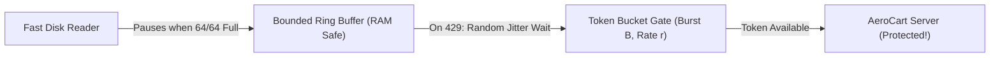

# Endpoint-to-Cloud Continuous Sync, Token Bucket Rate Limiting, Ring Buffers & Full Jitter

```json continuity
{
  "previously": "Welcome to Day 1 of Distributed System Design! Zero prior distributed systems background needed—we begin with `AeroCart` running on a single server.",
  "painPoint": "On Black Friday morning at 09:00:00 AM, 100,000 flyers and airport kiosks reconnect at the exact same second—crashing our unprotected server with Out-Of-Memory (OOM) errors and a synchronized retry stampede!",
  "unlock": "Build a 15-line Token Bucket rate limiter to protect the front door, a Bounded Ring Buffer so fast readers never flood slow networks, and AWS Full Jitter so 100,000 retrying apps spread out peacefully!"
}
```

```json walkthrough
[
  {
    "time": "0:00",
    "badge": "Slide 1 / 4 · Why 100,000 Flyers Crash 1 Server",
    "caption": "Imagine 100,000 AeroCart mobile apps syncing offline boarding passes and baggage photos at 9:00 AM sharp. Without a gatekeeper, our server tries to hold all 100,000 uploads in RAM at once and dies!",
    "code": "# Unprotected AeroCart endpoint:\n# 100,000 apps * 4 MB photo = 400 GB RAM -> CRASH (OOM)!"
  },
  {
    "time": "0:25",
    "badge": "Slide 2 / 4 · The Token Bucket Bouncer",
    "caption": "First, we put a Token Bucket at the front door. Think of a bowl that holds 50 arcade tokens and gets 10 new tokens every second. Each request takes 1 token; if the bowl is empty, we politely say HTTP 429 ('Try again soon')!",
    "code": "tokens = min(capacity, tokens + elapsed * refill_rate)\nif tokens >= 1:\n    tokens -= 1  # Come on in!\nelse:\n    return 429   # Bowl is empty — wait a moment!"
  },
  {
    "time": "0:52",
    "badge": "Slide 3 / 4 · Why Plain Retries Marching in Lockstep Fail",
    "caption": "What if 10,000 rejected apps all wait 2 seconds, then 4 seconds, then 8 seconds? They still wake up at the exact same millisecond—like a marching band slamming into the door together!",
    "code": "# BAD (Synchronized Wave): sleep(2 ** attempt)\n# GOOD (AWS Full Jitter):  sleep(random.uniform(0, 2 ** attempt))"
  },
  {
    "time": "1:18",
    "badge": "Slide 4 / 4 · Bounded Ring Buffer Backpressure",
    "caption": "Finally, on each kiosk/laptop, reading files from a fast SSD is 100x faster than uploading over Wi-Fi. A 64-slot Ring Buffer pauses the SSD reader whenever all 64 slots are full—capping RAM forever!",
    "code": "if len(ring_buffer) == 64:\n    pause_disk_reader()  # Backpressure engaged!"
  }
]
```

```json pretraining
[
  {
    "term": "Token Bucket Rate Limiter",
    "formula": "Bowl of B tokens refilling at r tokens/sec",
    "meaning": "A friendly front-door counter that lets short bursts of traffic through while smoothly rejecting overload with HTTP 429 before your server crashes."
  },
  {
    "term": "Backpressure (Bounded Ring Buffer)",
    "formula": "Buffer Full (64/64) -> Pause Fast Producer",
    "meaning": "When a fast worker (like a disk scanner) feeds a slow worker (like weak airport Wi-Fi), capping the waiting queue forces the fast worker to pause so memory never overflows."
  },
  {
    "term": "Thundering Herd (Retry Storm)",
    "formula": "100,000 Clients Retry at the Exact Same Second",
    "meaning": "When thousands of devices fail during a brief blip and all wait the exact same 2 seconds before retrying together, knocking the recovering server right back down."
  },
  {
    "term": "AWS Full Jitter",
    "formula": "sleep = random(0, min(cap, base * 2^attempt))",
    "meaning": "Picking a random wait time between 0 and the exponential ceiling so 100,000 retrying clients spread out smoothly like raindrops instead of hitting like a tidal wave."
  }
]
```

```json poe
{
  "question": "100,000 AeroCart mobile apps simultaneously fail at 09:00:00.000 during a 500ms Wi-Fi blip. Every app uses standard exponential backoff `sleep = 1s * 2^attempt` WITHOUT randomness (jitter). What traffic pattern hits your AeroCart gateway over the next 15 seconds?",
  "options": [
    "Traffic smoothly spreads out across the 15-second window",
    "All 100,000 apps stay locked in step, firing synchronized 100,000-request spikes at t = 1s, 3s, 7s, and 15s—repeatedly knocking down the gateway!",
    "TCP automatically adds random delays of 10 seconds",
    "Only 1 app retries while 99,999 apps close"
  ],
  "answerIndex": 1,
  "explanation": "Multiplying by powers of 2 only increases the pause between spikes—it never spreads the spike itself! Adding random uniform jitter (`random(0, ceiling)`) breaks the lockstep marching band."
}
```

## 🌱 Step 1: Plain-English Story — The Coffee Shop Bowl & The Marching Band

Welcome to Course 07! Throughout this 5-chapter journey, we are going to take **`AeroCart`** (`apps/aerocart/`) from a tiny flight-booking server running on **one laptop** to a rock-solid distributed platform serving **100,000 Black Friday flyers per second**.

Let's start with the very first crisis every growing app hits on Day 1: **What happens when 100,000 flyers show up at the exact same second?**

Imagine you run a small airport espresso bar with **one barista**:
1. **No Front-Door Limit**: If 500 passengers rush the counter at 9:00 AM and shout their orders at once, the barista drops the cups, runs out of counter space, and the whole shop grinds to a halt.
2. **The Token Bowl Solution**: Imagine putting a wooden bowl at the door that holds **10 plastic tokens**. Every second, a timer drops **2 fresh tokens** into the bowl (up to the max of 10).
   - To place an order, a customer must grab 1 token from the bowl.
   - If 10 people arrive together, all 10 grab tokens immediately (**a short burst is allowed!**).
   - Customer #11 sees an empty bowl and gets a polite sign: *"Bowl is empty—please try again in a moment!"* (`HTTP 429 Too Many Requests`).



That simple wooden bowl is called a **Token Bucket Rate Limiter**, and it protects almost every cloud API on Earth (Stripe, AWS, GitHub, Cloudflare).

Let's code a working Token Bucket for `AeroCart` in **14 lines** right now!

## 🔨 Step 2: First Lines of Code — Your First 14-Line Token Bucket!

Look how clean a real Token Bucket is: instead of running a background timer thread that wakes up every second to add tokens, we just check **how many seconds passed since the last request** (`now - last_time`) and top up the bowl on the spot!

```python
import time


class SimpleTokenBucket:
    def __init__(self, capacity: float, refill_per_sec: float):
        self.capacity = capacity          # Max tokens the bowl can hold (Burst B)
        self.refill_rate = refill_per_sec # New tokens added per second (Rate r)
        self.tokens = capacity            # Start with a full bowl!
        self.last_time = time.monotonic()

    def allow_request(self) -> bool:
        now = time.monotonic()
        # 1. Refill tokens earned since the last check (capped at capacity)
        self.tokens = min(self.capacity, self.tokens + (now - self.last_time) * self.refill_rate)
        self.last_time = now
        # 2. If at least 1 token is in the bowl, take it and allow the request!
        if self.tokens >= 1.0:
            self.tokens -= 1.0
            return True
        return False  # HTTP 429 Too Many Requests!


gate = SimpleTokenBucket(capacity=3, refill_per_sec=1.0)
print([gate.allow_request() for _ in range(5)])  # [True, True, True, False, False]
```

### Java 17 Equivalent

```java
public class SimpleTokenBucket {
    private final double capacity;
    private final double refillPerSec;
    private double tokens;
    private long lastNanos;

    public SimpleTokenBucket(double capacity, double refillPerSec) {
        this.capacity = capacity;
        this.refillPerSec = refillPerSec;
        this.tokens = capacity;
        this.lastNanos = System.nanoTime();
    }

    public synchronized boolean allowRequest() {
        long now = System.nanoTime();
        double elapsedSec = (now - lastNanos) / 1_000_000_000.0;
        this.tokens = Math.min(capacity, tokens + elapsedSec * refillPerSec);
        this.lastNanos = now;
        if (tokens >= 1.0) {
            tokens -= 1.0;
            return true;
        }
        return false; // HTTP 429 Too Many Requests!
    }
}
```

Run that mentally: the first 3 flyers grab the 3 tokens in the bowl (`True, True, True`), and flyers #4 and #5 are cleanly turned away (`False, False`) in nanoseconds without crashing `AeroCart`!

## ⚡ Step 3: Where It Breaks in Real Life — Synchronized Retry Storms & Memory Floods

Our Token Bucket protected the server, but watch **two disasters** that still happen on the client side when 100,000 airport kiosks and phones sync data at 9:00 AM:

1. **Disaster 1: The Synchronized Retry Storm (No Jitter!)**
   Suppose 10,000 phones get `HTTP 429` at `09:00:00`. If every phone runs `sleep(2 ** attempt)` (wait 2s, then 4s, then 8s), **all 10,000 phones wake up at `09:00:02.000` together**, slam the server again, and 9,900 fail again! Without randomness (**Jitter**), retrying clients march in lockstep forever.
2. **Disaster 2: Fast Disk vs. Slow Wi-Fi (`OutOfMemoryError`!)**
   When an airport kiosk uploads a 20 GB flight-telemetry log, its SSD reads data at **3,000 MB/sec**, while airport Wi-Fi uploads at **2 MB/sec**. If the kiosk reads the whole file into an unbounded list while waiting for Wi-Fi, the kiosk app eats 20 GB of RAM and crashes! We need a **Bounded Ring Buffer** (e.g., max 64 chunks of 4 MB) that **pauses the disk reader** whenever all 64 slots are full (**Backpressure**).

```json contrast
{
  "title": "100k-Client Sync & Rate-Limit Resilience",
  "naiveTitle": "Unbounded Queue + Unjittered Retries",
  "naiveMetric": "Client OOM · Phase-Locked 429 Storms",
  "naivePoints": [
    "Reads entire 20 GB file into an unbounded in-memory list, crashing the client with Out-Of-Memory",
    "Streams heavy 4 MB binary chunks through API servers instead of pre-signed S3 object URLs",
    "Uses unjittered base * 2^attempt retries, keeping all 100k clients synchronized in destructive waves",
    "Re-uploads an entire 1 GB file from byte 0 whenever Wi-Fi drops at 98%"
  ],
  "staffTitle": "Bounded Ring Buffer + Token Bucket + Full Jitter",
  "staffMetric": "Constant 256MB RAM · >40% Less Server Load",
  "staffPoints": [
    "Pauses local disk reading the instant the 64-slot Ring Buffer fills up (Backpressure)",
    "Separates Control Plane (Token Bucket + SHA-256 deduplication check) from Data Plane (Pre-Signed S3 PUT)",
    "Applies AWS Full Jitter random(0, min(cap, base * 2^attempt)) + honors server Retry-After headers",
    "Addresses every 4 MB chunk by its SHA-256 hash so retries skip already-uploaded chunks automatically"
  ]
}
```

Use the interactive **`arch-endpoint-cloud-sync`** simulator below to watch how a bounded ring buffer absorbs bursts and how Full Jitter flattens retry waves!

## 🚀 Step 4: Staff Engineer Deep-Dive — Token Bucket Math, AWS Full Jitter & Lock-Free CAS

Now let's formalize the exact mathematical laws and multi-threaded production blueprints expected in Staff Systems interviews:

1. **Monotonic Token Bucket State Equation**:
   Given burst capacity $B$ and refill rate $r\text{ tokens/sec}$, after elapsed monotonic time $\Delta t = t_{\text{now}} - t_{\text{last}}$:

   $$\text{Tokens}(t_{\text{now}}) = \min\bigl(B,\ \text{Tokens}(t_{\text{last}}) + r \cdot \Delta t\bigr)$$

2. **AWS Builders' Library Full Jitter Law**:
   Given base backoff $T_0$ (e.g., $100\text{ ms}$), maximum cap $T_{\max}$ (e.g., $10,000\text{ ms}$), and attempt $a \ge 0$, sample each retry delay uniformly from zero up to the capped exponential ceiling:

   $$T_{\text{sleep}} \sim \text{Uniform}\Bigl(0,\ \min\bigl(T_{\max},\ T_0 \cdot 2^a\bigr)\Bigr)$$

3. **Content-Addressable Idempotency (`SHA-256`)**:
   By splitting large uploads into $4\text{ MB}$ chunks named by $\text{ChunkID} = \text{SHA-256}(\text{payload})$, retrying a timed-out chunk or syncing an unchanged block across 10,000 kiosks becomes a zero-byte metadata check!

| Algorithm / Mechanism | Burst Handling | Memory Footprint | Primary Production Role | Key Trade-Off |
| :--- | :--- | :--- | :--- | :--- |
| **Token Bucket** | Allows bursts up to $B$ tokens, sustained rate $r$ | $\mathcal{O}(1)$ per key (`2` floats: `tokens`, `last_ts`) | API Gateway admission (`HTTP 429`) | Requires atomic Redis Lua script in multi-node gateways to avoid race conditions |
| **Leaky Bucket (FIFO Queue)** | Smooths output into rigid constant rate $r$ | $\mathcal{O}(\text{QueueSize})$ | Traffic shaping to fragile legacy DBs | Penalizes legitimate short bursts with queueing latency |
| **Sliding Window Counter** | Weighted blend of previous + current window | $\mathcal{O}(1)$ (`2` counters) | Accurate quota billing (`1000 req/min`) | Approximates sub-window distribution (~99.9% accuracy at tiny RAM cost) |
| **AWS Full Jitter** | Uniform $[0, \min(\text{cap}, b \cdot 2^a)]$ | Stateless | Client-side `429`/`503` retry dispersion | Can sample very short sleeps near $0\text{ms}$ (still wins total server work by $>40\%$!) |

### Production Blueprint: Token Bucket with `Retry-After` + Bounded Ring Buffer (`SHA-256` Dedup)

```python
from collections import deque
import hashlib
import random
import time


class TokenBucketRateLimiter:
    """Deterministic monotonic Token Bucket enforcing burst B and refill rate r tokens/sec."""

    def __init__(self, capacity: float, refill_per_sec: float):
        self.capacity = capacity
        self.refill_per_sec = refill_per_sec
        self.tokens = capacity
        self.last_refill = time.monotonic()

    def try_acquire(self, cost: float = 1.0, now: float | None = None) -> tuple[bool, float]:
        ts = time.monotonic() if now is None else now
        elapsed = max(0.0, ts - self.last_refill)
        self.tokens = min(self.capacity, self.tokens + elapsed * self.refill_per_sec)
        self.last_refill = ts
        if self.tokens >= cost:
            self.tokens -= cost
            return True, 0.0
        retry_after_sec = (cost - self.tokens) / self.refill_per_sec
        return False, round(retry_after_sec, 3)


class BoundedSyncEngine:
    def __init__(self, capacity: int = 64, base_ms: float = 100.0, cap_ms: float = 10_000.0):
        self.capacity = capacity
        self.ring = deque()
        self.uploaded_hashes: set[str] = set()
        self.base_ms = base_ms
        self.cap_ms = cap_ms

    def full_jitter_delay_ms(self, attempt: int, rng: random.Random) -> float:
        ceiling = min(self.cap_ms, self.base_ms * (2 ** attempt))
        return rng.uniform(0.0, ceiling)

    def enqueue_chunk(self, payload: bytes) -> dict:
        if len(self.ring) >= self.capacity:
            return {"accepted": False, "status": "BACKPRESSURE_ENGAGED"}
        digest = hashlib.sha256(payload).hexdigest()
        if digest in self.uploaded_hashes:
            return {"accepted": True, "status": "DEDUPLICATED_SKIP", "sha256": digest}
        self.ring.append((digest, payload))
        return {"accepted": True, "status": "QUEUED", "sha256": digest}
```

### Java 17 Equivalent

```java
import java.util.concurrent.ThreadLocalRandom;
import java.util.concurrent.atomic.AtomicReference;

public final class SyncFlowControl {
    private record BucketState(double tokens, long lastNanos) {}

    private final double capacity;
    private final double refillTokensPerNano;
    private final AtomicReference<BucketState> state;

    public SyncFlowControl(double capacity, double refillPerSecond) {
        this.capacity = capacity;
        this.refillTokensPerNano = refillPerSecond / 1_000_000_000.0;
        this.state = new AtomicReference<>(new BucketState(capacity, System.nanoTime()));
    }

    public boolean tryAcquire(double requested) {
        while (true) {
            BucketState prev = state.get();
            long now = System.nanoTime();
            double refilled = Math.min(capacity,
                    prev.tokens() + Math.max(0L, now - prev.lastNanos()) * refillTokensPerNano);
            if (refilled < requested) {
                return false;
            }
            BucketState next = new BucketState(refilled - requested, now);
            if (state.compareAndSet(prev, next)) {
                return true;
            }
        }
    }

    public static long computeFullJitterDelayMs(int attempt, long baseMs, long capMs) {
        long exp = baseMs * (1L << Math.min(attempt, 20));
        long ceiling = Math.min(capMs, exp);
        return ThreadLocalRandom.current().nextLong(0, ceiling + 1);
    }
}
```

> [!WARNING]
> **Staff Interview Gotcha — Why "Equal Jitter" vs "Full Jitter" + Client Retry Budgets Matter**:
> AWS Builders' Library benchmarks proved that **Full Jitter** (`random(0, min(cap, base * 2^attempt))`) reduces total server calls by **$>40\%$** compared to Equal Jitter while maintaining comparable $P_{99}$ completion time. Furthermore, always cap client **Retry Amplification** with a client-side **Retry Token Ratio** (max $10\%$ of requests may be retries)—if $>50\%$ of recent requests fail, stop retrying locally and fail fast so retries don't multiply outage load by $4\times$!

**Up Next in Chapter 02**: Our Token Bucket and Full Jitter kept `AeroCart` alive, but 1 single server can still only hold so many shopping carts in memory! What happens when we buy **10 cache servers** and try to split customers across them with `hash(user_id) % 10`—and then Server #7 crashes? In Chapter 02, we'll discover the **Modulo Rehashing Cliff** and build **Consistent Hashing with Virtual Nodes**!

```json quiz
[
  {
    "id": "sd-01-q1",
    "question": "Why does standard exponential backoff (T = base * 2^attempt) WITHOUT jitter still cause cascading outages after a brief network partition?",
    "options": [
      "Because powers of 2 grow too slowly for TCP sockets",
      "Because all clients that failed during the partition remain phase-locked and retry in synchronized waves at t=1s, 2s, 4s, 8s",
      "Because HTTP/2 multiplexes all retries onto a single TCP window",
      "Because SHA-256 chunking invalidates TLS session tickets"
    ],
    "answerIndex": 1,
    "explanation": "Without random jitter, clients that fail together stay synchronized in phase, hammering the recovering service in lockstep at every power-of-two boundary."
  },
  {
    "id": "sd-01-q2",
    "question": "What is the primary purpose of a bounded Ring Buffer between the local filesystem scanner and the network uploader?",
    "options": [
      "To compress chunks using LZ4 before encryption",
      "To enforce local memory backpressure so a slow network cannot cause disk reads to exhaust process RAM (OOM)",
      "To bypass OS page cache flushes",
      "To replace TLS 1.3 record framing"
    ],
    "answerIndex": 1,
    "explanation": "Disk I/O is orders of magnitude faster than WAN upload speeds. A bounded ring buffer blocks the disk reader when full, capping resident memory."
  },
  {
    "id": "sd-01-q3",
    "question": "Under AWS Full Jitter with base=100ms, cap=10,000ms, and attempt=4, from what interval is the sleep duration sampled?",
    "options": [
      "Exactly 1,600ms",
      "Uniformly from [800ms, 1,600ms]",
      "Uniformly from [0ms, 1,600ms]",
      "Uniformly from [0ms, 10,000ms]"
    ],
    "answerIndex": 2,
    "explanation": "At attempt=4, min(10000, 100 * 2^4) = 1600ms. Full Jitter samples uniformly between 0 and that ceiling: [0ms, 1,600ms]."
  }
]
```
