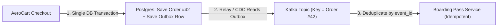

# Kafka Eventual Consistency, Transactional Outbox, CDC & Idempotent Consumers

```json continuity
{
  "previously": "In Chapter 02, we sharded AeroCart across multiple nodes using a Consistent Hashing Ring with Virtual Nodes and Bounded Load.",
  "painPoint": "When a flyer buys a $450 ticket, our Checkout service runs `db.save_order()` and then `kafka.send('OrderPaid')`. Yesterday, a server lost power 1 millisecond AFTER `db.save_order()` but BEFORE `kafka.send()`—so the customer was charged $450, but the Boarding Pass service never got the Kafka event!",
  "unlock": "Eliminate Dual-Write bugs forever by saving both the Order AND an Outbox row inside one atomic database transaction, streaming it to Kafka via CDC, and deduplicating retries on the consumer!"
}
```

```json walkthrough
[
  {
    "time": "0:00",
    "badge": "Slide 1 / 4 · The Dual-Write Trap",
    "caption": "Whenever your code writes to two separate systems in a row—like Postgres first and Kafka second—a crash right in the middle leaves them permanently out of sync!",
    "code": "db.insert_order(order_42)     # 1. Succeeds!\n# 💥 SERVER CRASHES OR NETWORK BLIPS RIGHT HERE!\nkafka.send('OrderPaid', 42)   # 2. Never happens! Customer gets no ticket!"
  },
  {
    "time": "0:25",
    "badge": "Slide 2 / 4 · What If We Flip the Order (Kafka First)?",
    "caption": "Wait—what if we send the Kafka message FIRST and commit to the database SECOND? That's just as broken! If the database commit fails (e.g., card declined or unique constraint error), Kafka already told Shipping to mail a free ticket!",
    "code": "kafka.send('OrderPaid', 42)   # 1. Sent to downstream services!\ndb.insert_order(order_42)     # 2. Fails & rolls back! ('Phantom Event')"
  },
  {
    "time": "0:52",
    "badge": "Slide 3 / 4 · The Transactional Outbox Cure",
    "caption": "Here is the magic trick: we DO have atomic transactions inside a single database! So inside ONE `BEGIN ... COMMIT` block, we insert into `orders` AND insert into an `outbox_events` table in the exact same database!",
    "code": "with db.transaction():\n    db.execute('INSERT INTO orders VALUES (42, 450)')\n    db.execute('INSERT INTO outbox VALUES (evt_99, 42)')\n# Either BOTH save together, or NEITHER saves!"
  },
  {
    "time": "1:18",
    "badge": "Slide 4 / 4 · Relay + Idempotent Consumer",
    "caption": "A background relay (or Debezium reading the database log) copies `outbox` rows into Kafka until Kafka ACKs. And because a retry might send `evt_99` twice, the receiver tracks `seen_event_ids` so it never issues two tickets!",
    "code": "if event.id not in seen_event_ids:\n    seen_event_ids.add(event.id)\n    issue_boarding_pass(event.order_id)"
  }
]
```

```json pretraining
[
  {
    "term": "The Dual-Write Bug",
    "formula": "Save to DB + Send to Queue != Atomic",
    "meaning": "Trying to update a database and a message queue in two separate steps; if the computer crashes in between, the two systems disagree forever."
  },
  {
    "term": "Transactional Outbox Table",
    "formula": "BEGIN -> Insert Order + Insert Outbox -> COMMIT",
    "meaning": "A table inside your own database where you drop outgoing event messages as part of the exact same all-or-nothing transaction as your business data."
  },
  {
    "term": "Change Data Capture (CDC)",
    "formula": "Tail Database Log (WAL) -> Stream to Kafka",
    "meaning": "A lightweight watcher (like Debezium) that reads new rows from the database's commit log and forwards them to Kafka in milliseconds."
  },
  {
    "term": "Idempotent Consumer",
    "formula": "Process Event 1x Even if Delivered 3x",
    "meaning": "A receiver that records each event's unique ID (`evt_99`) so if a network retry delivers the same message twice, the duplicate is safely ignored."
  }
]
```

```json poe
{
  "question": "To fix a Dual-Write bug in AeroCart, an engineer reverses the two lines of code: they call `kafka.send(event)` FIRST, and only after Kafka replies OK do they run `db.commit()`. Two weeks later, the Loyalty service awarded free miles to 14 flyers whose ticket purchases actually failed! How did that happen?",
  "options": [
    "Kafka invented fake messages on its own",
    "Sending to Kafka first just flips the Dual-Write bug: Kafka delivered the event to Loyalty, and 1ms later `db.commit()` failed (due to a constraint check or crash)—creating a 'Phantom Event' for an order that never committed!",
    "Postgres automatically deletes Kafka topics on rollback",
    "Kafka partitions sort messages in reverse order"
  ],
  "answerIndex": 1,
  "explanation": "`DB first, then Kafka` loses events on crash; `Kafka first, then DB` sends phantom events when the DB rolls back! Only writing both records to the same single ACID transaction (Transactional Outbox) guarantees they succeed or fail together."
}
```

## 🌱 Step 1: Plain-English Story — The Mailbox Inside the Bank Vault

Imagine you are buying a \$450 flight on **`AeroCart`**. When you click **Pay**, two things must happen:
1. **PostgreSQL Database**: Save row `Order #42 (PAID)` in the `orders` table.
2. **Kafka Event Bus**: Broadcast `"Order #42 was paid!"` so the **Boarding Pass Service** emails your QR code and the **Loyalty Service** adds 450 miles.

Most developers write those two lines back-to-back:
1. Line 1: `database.commit_order(42)`
2. Line 2: `kafka.send_event("OrderPaid", 42)`

**Why is that a ticking time bomb?**
Because PostgreSQL and Kafka live on **different computers**! What if Line 1 succeeds, and **half a millisecond later**—right before Line 2 runs—your Kubernetes pod restarts, or the network cable to Kafka hiccups?
- PostgreSQL says: *"Order #42 is paid!"*
- Kafka says: *"I never heard of Order #42!"*
- Your flyer's credit card is charged \$450, and they **never receive their boarding pass**!



**How do we make two separate systems agree 100% of the time?**
Instead of sending a network call to Kafka during checkout, we put a **`outbox` table right inside the same PostgreSQL database**!
1. Inside **one single database transaction**, we insert `Order #42` into `orders` AND insert `"Send OrderPaid #42"` into `outbox`. Because both tables live in the same database, PostgreSQL guarantees **both rows save together, or neither saves!**
2. A background worker (or **Debezium CDC**) reads unsent rows from `outbox` and pushes them to Kafka, retrying until Kafka confirms receipt!

Let's build a complete **Transactional Outbox + Idempotent Consumer** in **19 lines of code** right now!

## 🔨 Step 2: First Lines of Code — Atomic Outbox + Deduplicating Consumer in 19 Lines!

Watch all three pieces work together in a tiny, crystal-clear script:
1. `save_order_with_outbox()` writes the order and the outbox event together.
2. `relay_to_kafka()` forwards outbox events to our stream (even if a retry sends a duplicate!).
3. `consume_idempotent()` checks `seen_ids` so each boarding pass is issued **strictly once**!

```python
orders_db, outbox_db, kafka_stream = {}, [], []
seen_event_ids, boarding_passes = set(), []


def save_order_with_outbox(order_id: str, price: int) -> None:
    # 1. ATOMIC TRANSACTION: Write both to the database together!
    orders_db[order_id] = price
    outbox_db.append({"event_id": f"evt-{order_id}", "order_id": order_id, "sent": False})


def relay_to_kafka(simulate_network_retry: bool = False) -> None:
    # 2. RELAY: Copy unsent outbox rows to Kafka (At-Least-Once)
    for row in outbox_db:
        if not row["sent"]:
            kafka_stream.append(row)
            if simulate_network_retry:
                kafka_stream.append(row)  # Duplicate caused by retry!
            row["sent"] = True


def consume_idempotent() -> None:
    # 3. IDEMPOTENT CONSUMER: Ignore any event_id we already processed!
    for msg in kafka_stream:
        if msg["event_id"] not in seen_event_ids:
            seen_event_ids.add(msg["event_id"])
            boarding_passes.append(msg["order_id"])


save_order_with_outbox("ORD-42", 450)
relay_to_kafka(simulate_network_retry=True)  # Sends ORD-42 twice!
consume_idempotent()
print("Boarding passes issued:", boarding_passes)  # ['ORD-42'] (Strictly 1!)
```

### Java 17 Equivalent

```java
import java.util.*;

public class MiniOutboxDemo {
    record OutboxEvent(String eventId, String orderId) {}

    private final Map<String, Integer> ordersDb = new HashMap<>();
    private final List<OutboxEvent> outboxDb = new ArrayList<>();
    private final Set<String> seenEventIds = new HashSet<>();
    private final List<String> boardingPasses = new ArrayList<>();

    public void saveOrderWithOutbox(String orderId, int price) {
        // 1. Inside one @Transactional DB commit: save domain row + outbox row
        ordersDb.put(orderId, price);
        outboxDb.add(new OutboxEvent("evt-" + orderId, orderId));
    }

    public boolean consumeIdempotent(OutboxEvent event) {
        // 2. Set.add() returns false if eventId was ALREADY processed!
        if (!seenEventIds.add(event.eventId())) {
            return false; // Safely skipped duplicate retry!
        }
        boardingPasses.add(event.orderId());
        return true;
    }
}
```

Look how clean that is: even when `relay_to_kafka(simulate_network_retry=True)` pushed the message **twice**, `seen_event_ids` caught the duplicate and issued **exactly 1 boarding pass**!

## ⚡ Step 3: Where It Breaks in Real Life — Scrambled Partition Order, Poison Pills & `sleep(5)` Flakes

When we run our Kafka pipeline at 50,000 orders per second on `AeroCart`, watch **three real-world failure modes** that catch teams off guard:

1. **Failure Mode 1: Out-of-Order Events Across Kafka Partitions!**
   A Kafka topic is split into multiple lanes (**Partitions**). Kafka **only guarantees message order inside a single partition**! If `OrderCreated` goes to Partition 1 and `OrderCancelled` goes to Partition 2, the consumer might process `OrderCancelled` *before* `OrderCreated`!
   - **Fix**: Always set the Kafka **Partition Key = `order_id`** so every event for `ORD-42` lands in the exact same partition in strict chronological order!
2. **Failure Mode 2: The Poison Pill Jam**
   What if message #4022 on Partition 3 has corrupted JSON that crashes the consumer? If the consumer retries #4022 forever, every healthy order behind #4022 in Partition 3 is stuck!
   - **Fix**: After 3 bounded retries, route the bad message to a **Dead-Letter Queue (`DLQ`)** and alert on-call.
3. **Failure Mode 3: Flaky `time.sleep(5)` in Integration Tests**
   Beginners test async Kafka pipelines by calling `time.sleep(5)`. On a fast laptop, 4.9 seconds are wasted; on a busy CI runner, 5 seconds isn't enough and the test fails randomly!
   - **Fix**: Poll a **Causal Offset Watermark** (`wait until consumer_offset >= expected_offset`) with a 5ms loop!

```json contrast
{
  "title": "Microservice State + Event Publication Reliability",
  "naiveTitle": "Application-Level Dual Write + sleep(5s) Tests",
  "naiveMetric": "Silent Data Drift · Flaky E2E Suites",
  "naivePoints": [
    "Executes db.commit() then kafka.send() in memory—loses events on pod eviction or broker blip",
    "Uses random UUIDs as Kafka partition keys, scrambling CREATED / CANCELLED event order across partitions",
    "Assumes Kafka 'Exactly-Once' magically makes non-transactional HTTP/Email side effects idempotent",
    "Uses hardcoded Thread.sleep(5000) in integration tests to wait for async consumers"
  ],
  "staffTitle": "Transactional Outbox + Partition Keying + Watermark Poll",
  "staffMetric": "Zero Lost/Phantom Events · Deterministic <50ms E2E",
  "staffPoints": [
    "Commits domain state + outbox_events row in a single local RDBMS ACID transaction",
    "Streams Postgres WAL via Debezium keyed by order_id so per-aggregate lifecycle order is 100% preserved",
    "Enforces consumer idempotency via UNIQUE(event_id) inside the target database transaction",
    "Verifies eventual consistency deterministically by polling consumer offset watermarks against tx LSN"
  ]
}
```

Step through the **`arch-kafka-cdc-pipeline`** simulator below to trace WAL LSN commits, Debezium CDC relay, and idempotent consumer watermarks!

## 🚀 Step 4: Staff Engineer Deep-Dive — Polling vs. Log-Tailing CDC (`Debezium`) & Watermark Math

Let's examine the formal delivery equation and architectural trade-offs for Staff interviews:

1. **The Fundamental Distributed Delivery Equivalence**:
   True end-to-end "Exactly-Once" business execution across heterogeneous systems is achieved by combining **At-Least-Once** durable transport with **Idempotent** state transitions:

   $$\text{Effectively-Once Execution} \equiv \text{Transactional Outbox (At-Least-Once)} \oplus \text{Atomic Consumer Deduplication}\bigl(\text{UNIQUE}(\text{event\_id})\bigr)$$

2. **Causal Read-Your-Writes Watermark Condition**:
   When a mutation commits at database Log Sequence Number $\text{LSN}_{\text{tx}}$ (or Kafka partition offset $O_{\text{produced}}$), any downstream projection or E2E verification query is causally consistent as soon as:

   $$\text{Offset}_{\text{consumer\_committed}}(\text{partition}) \ge O_{\text{produced}}$$

| Pattern | DB Load Impact | Latency (`P99`) | Ordering Guarantee | Operational Trade-Off |
| :--- | :--- | :--- | :--- | :--- |
| **Polling Outbox Relay** (`SELECT ... FOR UPDATE SKIP LOCKED`) | Medium (Periodic index scans + `DELETE`/`UPDATE`) | $100\text{ ms}–1\text{s}$ | Per-partition if ordered by monotonic sequence | Zero extra CDC infra; works on any SQL DB immediately |
| **WAL Log-Tailing CDC** (`Debezium` + Postgres Replication Slot) | **Near-Zero** (Reads sequential WAL stream) | **$10\text{ ms}–60\text{ ms}$** | Strict commit-LSN order | **Must monitor replication slot lag** so unconsumed WAL files don't fill primary disk! |
| **Distributed `2PC` / XA** | High (Row locks held across network RTTs) | High | Strict synchronous | Coordinator single point of failure; unsupported by modern cloud queues |

### Production Blueprint: Transactional Outbox, Idempotent Consumer & Causal Watermark Poller

```python
import time
from typing import Callable


class OutboxPipeline:
    def __init__(self):
        self.orders: dict[str, dict] = {}
        self.outbox: list[dict] = []
        self.kafka_partition_log: list[dict] = []
        self.processed_event_ids: set[str] = set()
        self.search_index: dict[str, int] = {}
        self.consumer_watermark: int = -1

    def create_order_atomic(self, order_id: str, tenant_id: str, amount_cents: int) -> dict:
        """Simulates single ACID transaction writing domain row + outbox event."""
        event_id = f"evt-{order_id}-v1"
        self.orders[order_id] = {"tenant": tenant_id, "amount": amount_cents}
        self.outbox.append({
            "event_id": event_id,
            "partition_key": order_id,
            "order_id": order_id,
            "amount": amount_cents,
            "relayed": False,
        })
        return {"orderId": order_id, "eventId": event_id}

    def relay_outbox_at_least_once(self, simulate_duplicate: bool = False) -> int:
        last_offset = len(self.kafka_partition_log) - 1
        for row in self.outbox:
            if not row["relayed"]:
                self.kafka_partition_log.append(dict(row))
                if simulate_duplicate:
                    # Simulate relay crash after Kafka ACK before checkpoint update!
                    self.kafka_partition_log.append(dict(row))
                row["relayed"] = True
                last_offset = len(self.kafka_partition_log) - 1
        return last_offset

    def consume_next_idempotent(self) -> bool:
        next_idx = self.consumer_watermark + 1
        if next_idx >= len(self.kafka_partition_log):
            return False
        event = self.kafka_partition_log[next_idx]
        eid = event["event_id"]
        if eid not in self.processed_event_ids:
            self.processed_event_ids.add(eid)
            self.search_index[event["order_id"]] = event["amount"]
        self.consumer_watermark = next_idx
        return True


def await_causal_watermark(
    poll_fn: Callable[[], int],
    min_expected_offset: int,
    timeout_sec: float = 2.0,
) -> bool:
    """Staff replacement for flaky time.sleep(): bounded deadline polling on causal offset."""
    deadline = time.monotonic() + timeout_sec
    delay = 0.005
    while time.monotonic() < deadline:
        if poll_fn() >= min_expected_offset:
            return True
        time.sleep(delay)
        delay = min(0.050, delay * 1.5)
    return poll_fn() >= min_expected_offset
```

### Java 17 Equivalent

```java
import java.time.Duration;
import java.util.Set;
import java.util.concurrent.ConcurrentHashMap;
import java.util.function.LongSupplier;

public final class IdempotentEventConsumer {
    private final Set<String> seenEventIds = ConcurrentHashMap.newKeySet();

    /**
     * In production JDBC/JPA, INSERT INTO processed_events(event_id) executes inside
     * the exact same @Transactional boundary as the domain table mutation!
     */
    public boolean processOnce(String eventId, Runnable sideEffect) {
        if (!seenEventIds.add(eventId)) {
            return false; // Duplicate Kafka delivery safely skipped!
        }
        sideEffect.run();
        return true;
    }

    public static void awaitOffsetWatermark(
            LongSupplier currentConsumerOffset, long targetOffset, Duration timeout)
            throws InterruptedException {
        long deadlineNanos = System.nanoTime() + timeout.toNanos();
        long sleepMs = 5;
        while (System.nanoTime() < deadlineNanos) {
            if (currentConsumerOffset.getAsLong() >= targetOffset) {
                return;
            }
            Thread.sleep(sleepMs);
            sleepMs = Math.min(100, sleepMs * 2);
        }
        if (currentConsumerOffset.getAsLong() < targetOffset) {
            throw new AssertionError("Consumer watermark lagged past deadline; target=" + targetOffset);
        }
    }
}
```

> [!WARNING]
> **Staff Interview Gotcha — Postgres Logical Replication Slot Disk-Full Outage**:
> When using Debezium CDC on PostgreSQL, if the Debezium connector or Kafka cluster goes down for 6 hours, Postgres **retains every single WAL segment on disk** waiting for the replication slot to advance—until the primary database runs out of disk space (`PANIC: could not write to file "pg_wal/..."`) and takes down production! Always configure `max_slot_wal_keep_size` in Postgres + P0 paging alerts on `pg_replication_slots` byte lag!

**Up Next in Chapter 04**: Our `AeroCart` database writes and Kafka events are now 100% atomic! But during Black Friday, **99% of requests are READS** (flyers refreshing the homepage deal feed 250,000 times per second). What happens at `12:00:00` when the Redis cache key for `"homepage_deals"` expires and **8,000 threads simultaneously miss the cache and slam PostgreSQL**? In Chapter 04, we'll defeat **Cache Stampedes, Penetration & Stale Overwrites** with **Singleflight & Memcache Leases**!

```json quiz
[
  {
    "id": "sd-03-q1",
    "question": "Why does the Transactional Outbox pattern require downstream Kafka consumers to be idempotent?",
    "options": [
      "Because Kafka partitions sort messages alphabetically",
      "Because the Outbox/CDC relay guarantees At-Least-Once delivery—if the relay crashes after publishing to Kafka but before marking the outbox row relayed, it will republish the same event on restart",
      "Because SQLite does not support primary keys",
      "Because TLS 1.3 duplicates TCP packets"
    ],
    "answerIndex": 1,
    "explanation": "An outbox relay can crash between receiving Kafka's ACK and updating its own checkpoint, causing duplicate event publication. Consumers must deduplicate by event_id."
  },
  {
    "id": "sd-03-q2",
    "question": "In Kafka, how do you guarantee strict ordering of all state transitions (CREATED -> PAID -> SHIPPED) for a single Order ID?",
    "options": [
      "Use a random partition key on every message",
      "Use order_id as the Kafka message partition key so all events for that order hash to the exact same partition",
      "Set replication.factor=1",
      "Use UDP instead of TCP"
    ],
    "answerIndex": 1,
    "explanation": "Kafka guarantees strict total order only within a single partition. Keying messages by order_id routes all lifecycle events for that order to the same partition."
  },
  {
    "id": "sd-03-q3",
    "question": "What is the Staff-grade alternative to hardcoded sleep(5000) when testing asynchronous Kafka projections?",
    "options": [
      "Increase sleep to 30,000ms",
      "Bounded deadline polling with exponential backoff against causal offset watermarks or state predicates",
      "Disable Kafka acknowledgments (acks=0)",
      "Catch and ignore AssertionError"
    ],
    "answerIndex": 1,
    "explanation": "Polling against causal watermarks or state invariants with a deadline completes in milliseconds when the broker is fast while tolerating transient GC/rebalance pauses."
  }
]
```
