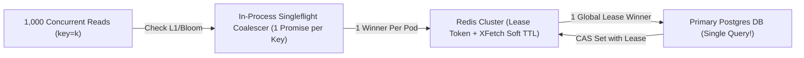

# Distributed Caching Internals: Singleflight Coalescing, Stampedes, Penetration & Memcache Leases

```json pretraining
[
  {
    "term": "Cache Stampede (Dogpile)",
    "formula": "TTL=0 on Hot Key ⇒ N Concurrent DB Queries",
    "meaning": "When a 50k-RPS cached item expires, thousands of worker threads simultaneously see a cache miss and hammer the origin database with identical heavy SQL joins."
  },
  {
    "term": "Request Coalescing (Singleflight)",
    "formula": "N Concurrent Misses → 1 In-Flight Future",
    "meaning": "Deduplicating concurrent in-process cache misses on the same key behind a shared Future/Promise so only 1 database query executes."
  },
  {
    "term": "XFetch Early Expiration",
    "formula": "now - Δ · β · ln(rand()) ≥ expiry",
    "meaning": "Probabilistically refreshing hot keys slightly BEFORE their TTL expires (weighted by DB recompute duration Δ) so external traffic never experiences a hard miss."
  },
  {
    "term": "Facebook Memcache Lease",
    "formula": "64-Bit CAS Token Invalidated on Delete",
    "meaning": "Solves both Thundering Herd AND Stale-Set Race Conditions in Cache-Aside when a slow reader tries to write an outdated DB snapshot over a fresh invalidation."
  }
]
```

```json poe
{
  "question": "In standard Cache-Aside (`Read -> Miss -> Read DB -> Set Cache`) + (`Write DB -> Delete Cache`), Reader R1 misses cache and reads `price = $100` from Postgres, then stalls in a 200ms GC pause. Meanwhile, Writer W1 updates Postgres to `price = $150` and runs `redis.del(key)`. R1 wakes up and runs `redis.set(key, $100, ttl=3600)`! Now Redis serves stale `$100` for an entire hour! What mechanism prevents this exact race?",
  "options": [
    "Decreasing Redis TCP keepalive to 10ms",
    "Memcache Leases (or versioned CAS tokens): on cache miss, Redis issues R1 a 64-bit Lease Token #77; when W1 runs `del(key)`, Lease #77 is invalidated—so R1's subsequent `cas_set(key, $100, lease=77)` is deterministically rejected!",
    "Switching from Write-Invalidate to Write-Populate without versions",
    "Adding random TTL jitter between 55 and 65 minutes"
  ],
  "answerIndex": 1,
  "explanation": "Documented in Facebook's landmark NSDI paper 'Scaling Memcache at Facebook': `Delete` on write still leaves a window where an already-in-flight slow reader overwrites the invalidated cache with stale pre-update data unless guarded by a Lease token or monotonic DB row version (`version_new > version_cached`)."
}
```

## Part I — The Three Classic Distributed Cache Failure Modes

A distributed cache cluster (`Redis` / `Memcached`) absorbs $95\%–99\%$ of read traffic, allowing a primary database provisioned for $5,000\text{ QPS}$ to back a $250,000\text{ QPS}$ product. That leverage creates a terrifying failure cliff whenever cache hit ratio suddenly drops:

1. **Cache Stampede (Hot-Key Dogpile)**: A single ultra-popular key (`homepage_trending_feed`) expires at `12:00:00.000`, and $8,000$ concurrent requests across $100$ app pods simultaneously hit `GET -> nil` and fire $8,000$ identical expensive SQL aggregations!
2. **Cache Avalanche (Synchronized Mass Expiration)**: A batch job warms $500,000$ product keys at midnight with an identical `TTL = 3600s`; at `01:00:00`, all $500,000$ keys expire simultaneously (**Fix**: always add uniform **TTL Jitter**, e.g., `ttl = 3600 + random(0, 600)`!).
3. **Cache Penetration (Non-Existent Key Attack)**: An attacker or buggy scraper queries `GET /users/{random_uuid}` for millions of IDs that exist in *neither* Redis *nor* Postgres, bypassing the cache on $100\%$ of requests (**Fix**: **Bloom Filter** at the edge + short $30\text{s}$ **Negative-Cache Tombstones** `NULL_SENTINEL`).



---

## Part II — Consistency Topologies & Stampede Defense Layers

Combining **In-Process `Singleflight`** (collapsing $500$ threads per pod down to $1$ request per pod) with **Distributed `Leases` / `XFetch`** (collapsing $100$ pods down to $1$ global DB query) protects the origin database completely:

```json contrast
{
  "title": "High-Throughput Cache-Aside Architecture (250k RPS)",
  "naiveTitle": "Raw Cache-Aside + Fixed TTLs",
  "naiveMetric": "8,000x DB Query Spike on Expiry · Stale Overwrites",
  "naivePoints": [
    "Every concurrent cache miss fires an independent SQL query directly at Postgres",
    "Batch-loaded keys share identical 3600s TTLs, causing hourly Cache Avalanche cliffs",
    "Non-existent IDs miss both Redis and Postgres repeatedly on every request",
    "Slow GC-paused readers overwrite freshly deleted keys with stale database rows"
  ],
  "staffTitle": "Singleflight + Lease CAS + XFetch + Bloom Guard",
  "staffMetric": "1 DB Query per Refresh · Zero Stale-Set Races",
  "staffPoints": [
    "Coalesces concurrent per-pod misses via Singleflight CompletableFuture / asyncio.Future",
    "Issues 10-second Memcache Leases so 99 other pods back off/serve slightly stale data while 1 pod refreshes",
    "Uses XFetch probabilistic early refresh on hot keys before hard TTL expiration ever hits",
    "Blocks non-existent key floods via edge Bloom Filter + 30s negative-cache sentinels"
  ]
}
```

### Architectural Trade-Off Table: Caching Patterns

| Caching Pattern | Write Latency | Read Consistency Risk | Best Fit Workload | Critical Engineering Guard |
| :--- | :--- | :--- | :--- | :--- |
| **Cache-Aside + Delete on Write** *(Industry Default)* | Fast (`DB Write + Cache DEL`) | Low (Only slow-reader race, solved by **Leases** or **CDC invalidation**) | General read-heavy microservices ($10:1$ to $100:1$ R/W) | **Delete** cache on write rather than updating cache directly (two concurrent writers updating DB & Cache in opposite order corrupt cache permanently!) |
| **Read/Write-Through** | Medium (`Sync DB + Cache`) | Strong per-key serializability through cache layer | Backing stores with dedicated cache proxy (`DynamoDB DAX`) | Cold-write churn: writing unread log data pollutes cache unless paired with LRU/LFU (`TinyLFU`) |
| **Write-Behind (Write-Back)** | **Ultra-Fast** (`RAM ACK`) | **Durability Risk** if cache node dies before DB flush | High-frequency counters (video view counts, rate-limit ticks) | Replicate dirty queue or accept bounded counter loss |

---

## Part III — Production Implementation Blueprints (Python 3 & Java 17)

### Python 3 Blueprint: Thread-Safe `Singleflight` Coalescer + Lease CAS Cache Store
```python
from concurrent.futures import Future
import math
import random
import threading
from typing import Any, Callable


class SingleflightGroup:
    """Coalesces N concurrent requests for the same key into 1 underlying execution."""

    def __init__(self):
        self._lock = threading.Lock()
        self._inflight: dict[str, Future] = {}

    def do(self, key: str, fn: Callable[[], Any]) -> tuple[Any, bool]:
        with self._lock:
            existing = self._inflight.get(key)
            if existing is not None:
                is_leader = False
                fut = existing
            else:
                is_leader = True
                fut = Future()
                self._inflight[key] = fut

        if not is_leader:
            return fut.result(), True  # Shared result from the single flight!

        try:
            val = fn()
            fut.set_result(val)
            return val, False
        except Exception as exc:
            fut.set_exception(exc)
            raise
        finally:
            with self._lock:
                self._inflight.pop(key, None)


class LeaseAwareCache:
    """Prevents Stale-Set overwrites when a writer invalidates a key mid-miss."""

    def __init__(self):
        self._lock = threading.Lock()
        self._data: dict[str, Any] = {}
        self._leases: dict[str, int] = {}
        self._epoch: int = 0

    def get_or_acquire_lease(self, key: str) -> tuple[bool, Any, int]:
        with self._lock:
            if key in self._data:
                return True, self._data[key], 0
            self._epoch += 1
            self._leases[key] = self._epoch
            return False, None, self._epoch

    def invalidate_on_write(self, key: str) -> None:
        with self._lock:
            self._data.pop(key, None)
            self._leases.pop(key, None)  # Revokes any in-flight reader's lease!

    def cas_set_with_lease(self, key: str, value: Any, lease_token: int) -> bool:
        with self._lock:
            if self._leases.get(key) != lease_token:
                return False  # Rejected stale reader overwrite!
            self._data[key] = value
            self._leases.pop(key, None)
            return True


def should_xfetch_early(now: float, expiry: float, recompute_delta_sec: float, beta: float = 1.0) -> bool:
    """VLDB 2015 XFetch optimal probabilistic early cache recomputation."""
    u = max(1e-9, random.random())
    return (now - recompute_delta_sec * beta * math.log(u)) >= expiry
```

### Java 17 Blueprint: Lock-Free `CompletableFuture` Singleflight Coalescer
```java
import java.util.concurrent.CompletableFuture;
import java.util.concurrent.ConcurrentHashMap;
import java.util.concurrent.ExecutionException;
import java.util.function.Supplier;

public final class SingleflightCoalescer<V> {
    private final ConcurrentHashMap<String, CompletableFuture<V>> inflight = new ConcurrentHashMap<>();

    public V executeCoalesced(String key, Supplier<V> dbLoader) {
        CompletableFuture<V> created = new CompletableFuture<>();
        CompletableFuture<V> existing = inflight.putIfAbsent(key, created);

        if (existing == null) {
            // This thread won leadership for `key` — execute the single DB call!
            try {
                V result = dbLoader.get();
                created.complete(result);
                return result;
            } catch (Throwable t) {
                created.completeExceptionally(t);
                throw t;
            } finally {
                inflight.remove(key, created);
            }
        }

        // Follower threads await the leader's CompletableFuture with zero duplicate DB load!
        try {
            return existing.get();
        } catch (InterruptedException e) {
            Thread.currentThread().interrupt();
            throw new RuntimeException("Interrupted awaiting singleflight leader", e);
        } catch (ExecutionException e) {
            throw new RuntimeException("Singleflight leader failed", e.getCause());
        }
    }
}
```

> [!WARNING]
> **Staff Interview Gotcha — Why `Update DB + Update Cache` Breaks Permanently Under Concurrent Writes**:
> Suppose Thread A writes `x = 1` and Thread B writes `x = 2`. If Thread A writes `DB(x=1)`, Thread B writes `DB(x=2)` and `Cache(x=2)`, and then Thread A finishes `Cache(x=1)`, the database holds `2` while the cache holds `1` **forever until TTL expiry**! Always **invalidate (`DEL`)** the cache on write (preferably driven asynchronously via Postgres/MySQL **CDC Outbox** so even crash windows can't orphan stale keys) or gate `SET` via monotonic row version numbers (`SET IF new_ver > cur_ver`).

---

## Part IV — End-of-Chapter Mastery Check

```json quiz
[
  {
    "id": "sd-04-q1",
    "question": "How do In-Process Singleflight and Distributed Memcache/Redis Leases complement each other during a 100,000-RPS hot-key expiration across 80 application pods?",
    "options": [
      "Singleflight encrypts payloads while Leases compress JSON",
      "In-process Singleflight collapses ~1,250 concurrent threads per pod into 1 Redis miss per pod (reducing load to 80 requests), and the Distributed Lease allows only 1 of those 80 pods to query the primary database—achieving a 100,000-to-1 database query reduction!",
      "Singleflight replaces Redis completely so only local RAM is used",
      "Leases disable TTL expiration permanently"
    ],
    "answerIndex": 1,
    "explanation": "Combining L1 in-process promise coalescing (Singleflight) with L2 distributed lease coordination bounds origin DB load to strictly 1 query across the entire fleet while slashing network chatter to Redis."
  },
  {
    "id": "sd-04-q2",
    "question": "An attacker floods your API with `GET /products/{random_64bit_id}` for millions of IDs that have never existed. Every request misses Redis and queries PostgreSQL, driving DB CPU to 100%. What is the name of this attack, and what stops it cleanly?",
    "options": [
      "Cache Stampede; solved by increasing Redis maxmemory to 512 GB",
      "Cache Penetration; solved by placing a compact in-memory/Redis Bloom Filter of valid product IDs ahead of the cache (rejecting definitely-nonexistent IDs in O(1)) combined with short-TTL Negative Caching",
      "Split-Brain Syndrome; solved by Raft leader election",
      "TCP SYN Flood; solved by disabling TLS"
    ],
    "answerIndex": 1,
    "explanation": "Negative caching alone against *random unique* IDs would fill Redis RAM with useless NULL keys; a Bloom filter requires only ~1.2 bytes per valid ID to reject 99%+ of bogus IDs with zero false negatives."
  },
  {
    "id": "sd-04-q3",
    "question": "In Cache-Aside, why should a write endpoint `DELETE` the cache key (or emit a CDC invalidation) rather than directly `SET`ting the newly written value into Redis?",
    "options": [
      "Because Redis `SET` is O(N) whereas `DEL` is O(1)",
      "Because two concurrent writers executing DB updates and Redis SETs can interleave in opposite orders (A writes DB -> B writes DB -> B sets Cache -> A sets Cache), leaving Redis permanently out of sync with the database",
      "Because `DEL` automatically restarts PostgreSQL transactions",
      "Because JSON cannot be serialized during HTTP POST requests"
    ],
    "answerIndex": 1,
    "explanation": "Lazy population on read + invalidation on write (guarded by Leases or monotonic row versions) avoids write-write ordering inversions and avoids caching cold rows that are never read."
  }
]
```
