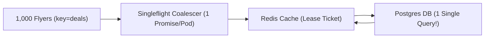

# Distributed Caching Internals: Singleflight Coalescing, Stampedes, Penetration & Memcache Leases

```json continuity
{
  "previously": "In Chapter 03, we scaled AeroCart with a Transactional Outbox and Kafka log so seat bookings and inventory updates never get lost between Postgres and downstream services.",
  "painPoint": "During a Thanksgiving flash sale, 100,000 flyers refresh the AeroCart homepage every second. When the cached 'hot_deals_nyc' key expires at 12:00:00, 8,000 worker threads simultaneously miss Redis and fire 8,000 identical heavy SQL queries at Postgres, crashing the database in 200 milliseconds!",
  "unlock": "We will build an in-process Singleflight request coalescer and a distributed Lease token gate so 100,000 concurrent cache misses collapse into a single database query."
}
```

```json walkthrough
[
  {
    "time": "0:00",
    "badge": "1. The Stampede",
    "caption": "Imagine 1,000 travelers at an airport gate asking the desk agent the exact same question when the flight board flickers off. If all 1,000 call headquarters at once, the phone lines melt.",
    "code": "GET hot_deals_nyc -> nil (x8,000 concurrent misses!)"
  },
  {
    "time": "0:25",
    "badge": "2. Singleflight",
    "caption": "With Singleflight, the first thread in an AeroCart server becomes the leader and calls the database, while the other 999 threads wait on the same shared promise.",
    "code": "leader = inflight.setdefault(key, Future())"
  },
  {
    "time": "0:50",
    "badge": "3. Lease Tokens",
    "caption": "Across 80 servers, Redis hands out a single numbered Lease Token on a miss. It also blocks slow, paused readers from overwriting fresh updates with stale prices.",
    "code": "cas_set_with_lease(key, val, lease_token=77)"
  },
  {
    "time": "1:15",
    "badge": "4. XFetch & Bloom",
    "caption": "Finally, we refresh hot keys slightly before they expire using XFetch and block fake ID attacks at the door with a compact Bloom filter.",
    "code": "if should_xfetch_early(now, expiry, delta): refresh()"
  }
]
```

```json pretraining
[
  {
    "term": "Cache Stampede (Dogpile)",
    "formula": "Expired Hot Key -> N Identical DB Queries",
    "meaning": "When a popular cached item expires, thousands of user requests see an empty cache at the exact same millisecond and all rush to query the database at once."
  },
  {
    "term": "Request Coalescing (Singleflight)",
    "formula": "N Concurrent Misses -> 1 Shared Promise",
    "meaning": "Grouping identical simultaneous requests inside a server so only one thread fetches from the database and shares the answer with everyone waiting."
  },
  {
    "term": "XFetch Early Expiration",
    "formula": "Probabilistic Refresh Before TTL Zero",
    "meaning": "Quietly refreshing a popular cache item a few seconds before its timer runs out so live users never hit an empty cache."
  },
  {
    "term": "Memcache Lease Token",
    "formula": "Ticket Number Verified Before Cache Save",
    "meaning": "A numbered ticket given to the single reader allowed to refill a missing cache key; if a new write happens meanwhile, the ticket is canceled so old data cannot overwrite new data."
  }
]
```

## 🌱 Step 1: Plain-English Story — The Airport Gate Desk Stampede

Picture `AeroCart` during a Black Friday flash sale. To keep our PostgreSQL database calm, we store the `"hot_deals_nyc"` flight list in Redis with a 60-second expiration timer. For 59 seconds, Redis answers 100,000 requests per second from memory without breaking a sweat.

Then the clock strikes `12:00:00.000`, and that single cache entry expires. Instantly, 8,000 flyers click refresh at the exact same moment. Every single worker thread checks Redis, hears *"not found!"*, and dutifully runs the same expensive 150-millisecond SQL join against Postgres. Instead of doing useful work, Postgres chokes on 8,000 duplicate copies of the exact same query!

Wait—what if, inside each `AeroCart` server, the **first** thread to notice the missing flight list raises its hand and says: *"I'm already walking to the filing cabinet for `hot_deals_nyc`—everyone else just wait right here and I'll photocopy my sheet when I get back"*? That pattern is called **Singleflight (Request Coalescing)**. Even better, if Redis itself hands out only **one** numbered ticket (a **Lease**) across all 80 `AeroCart` servers, then 8,000 concurrent cache misses collapse into **1** database query!



---

## 🔨 Step 2: First Lines of Code — Tiny In-Process Singleflight

Let's evolve `AeroCart`'s cache helper by writing a 16-line `MiniSingleflight` in Python 3 and Java 17 so concurrent callers for the same flight key share a single database call.

```python
from concurrent.futures import Future
import threading

class MiniSingleflight:
    def __init__(self):
        self._lock, self._flights = threading.Lock(), {}

    def do(self, key: str, loader):
        with self._lock:
            if key in self._flights:
                fut, is_leader = self._flights[key], False
            else:
                fut = self._flights[key] = Future()
                is_leader = True
        if not is_leader:
            return fut.result()  # Followers wait for the leader's answer
        try:
            ans = loader()
            fut.set_result(ans)
            return ans
        finally:
            with self._lock:
                self._flights.pop(key, None)
```

### Java 17 Equivalent
```java
import java.util.concurrent.*;
import java.util.function.Supplier;

public class MiniSingleflight {
    private final ConcurrentMap<String, CompletableFuture<String>> flights = new ConcurrentHashMap<>();

    public String doCall(String key, Supplier<String> loader) {
        var created = new CompletableFuture<String>();
        var existing = flights.putIfAbsent(key, created);
        if (existing != null) return existing.join(); // Follower waits on leader
        try {
            String ans = loader.get();
            created.complete(ans);
            return ans;
        } finally {
            flights.remove(key, created);
        }
    }
}
```

---

## ⚡ Step 3: Where It Breaks in Real Life — Avalanches, Penetration & Stale Overwrites

In-process Singleflight stops duplicate queries *inside one server*, but three dangerous traps still ambush `AeroCart` in production:

1. **Cache Avalanche (Mass Midnight Expiration)**: If our nightly job loads 500,000 flight routes with the exact same `TTL = 3600s`, all 500,000 keys expire at the same second an hour later.
2. **Cache Penetration (Random Bogus IDs)**: A scraper requests `GET /flights/99999999` for millions of fake IDs that exist in *neither* Redis *nor* Postgres, bypassing the cache every time.
3. **The Stale-Set Race Condition**: What if a slow reader fetches an old `$100` fare from Postgres, pauses for garbage collection while a writer updates the fare to `$150` and deletes the cache key, and then the slow reader wakes up and writes the stale `$100` back into Redis for an hour?

```json contrast
{
  "title": "High-Throughput AeroCart Cache-Aside Architecture (100k RPS)",
  "naiveTitle": "Raw Cache-Aside + Fixed TTLs",
  "naiveMetric": "8,000x DB Query Spike on Expiry · Stale Overwrites",
  "naivePoints": [
    "Every concurrent cache miss fires an independent SQL query directly at Postgres",
    "Batch-loaded flight keys share identical 3600s TTLs, causing hourly Cache Avalanche cliffs",
    "Non-existent flight IDs miss both Redis and Postgres repeatedly on every request",
    "Slow GC-paused readers overwrite freshly invalidated keys with stale database rows"
  ],
  "staffTitle": "Singleflight + Lease CAS + XFetch + Bloom Guard",
  "staffMetric": "1 DB Query per Refresh · Zero Stale-Set Races",
  "staffPoints": [
    "Coalesces concurrent per-pod misses via Singleflight Future / CompletableFuture",
    "Issues Memcache Leases so 79 other pods wait while 1 pod refreshes and blocks stale sets",
    "Uses XFetch probabilistic early refresh on hot keys before hard TTL expiration ever hits",
    "Blocks non-existent ID floods via edge Bloom Filter + 30s negative-cache sentinels"
  ]
}
```

```json poe
{
  "question": "In standard Cache-Aside (`Read -> Miss -> Read DB -> Set Cache`) + (`Write DB -> Delete Cache`), Reader R1 misses cache and reads `price = $100` from Postgres, then stalls in a 200ms GC pause. Meanwhile, Writer W1 updates Postgres to `price = $150` and runs `redis.del(key)`. R1 wakes up and runs `redis.set(key, $100, ttl=3600)`! Now Redis serves stale `$100` for an entire hour! What mechanism prevents this exact race?",
  "options": [
    "Decreasing Redis TCP keepalive to 10ms",
    "Memcache Leases (or versioned CAS tokens): on cache miss, Redis issues R1 a 64-bit Lease Token #77; when W1 runs `del(key)`, Lease #77 is invalidated—so R1's subsequent `cas_set(key, $100, lease=77)` is deterministically rejected!",
    "Switching from Write-Invalidate to Write-Populate without versions",
    "Adding random TTL jitter between 55 and 65 minutes"
  ],
  "answerIndex": 1,
  "explanation": "Documented in Facebook's landmark NSDI paper 'Scaling Memcache at Facebook': `Delete` on write still leaves a window where an already-in-flight slow reader overwrites the invalidated cache with stale pre-update data unless guarded by a Lease token or monotonic DB row version (`version_new > version_cached`)."
}
```

---

## 🚀 Step 4: Staff Engineer Deep-Dive — XFetch Math, Lease CAS & Blueprints

### 1. Mathematical Laws of XFetch & Bloom Filters

To prevent hard expirations on ultra-hot `AeroCart` keys without background polling threads, the **XFetch algorithm** (VLDB 2015) triggers a probabilistic early recomputation during a normal read at time $t_{\text{now}}$ whenever:

$$t_{\text{now}} - \Delta \cdot \beta \cdot \ln(u) \ge t_{\text{expiry}}, \quad u \sim \text{Uniform}(0, 1)$$

where $\Delta$ is the measured duration of the database query (e.g., $0.15\text{ s}$) and $\beta \ge 1.0$ is a tuning multiplier. Because $-\ln(u)$ grows exponentially near $u \to 0$, the probability that *one* reader refreshes the key in the background rises smoothly as $t_{\text{now}}$ approaches $t_{\text{expiry}}$.

To block **Cache Penetration** from bogus flight IDs using minimal RAM, an edge **Bloom Filter** with $m$ bits, $n$ valid keys, and $k = \frac{m}{n}\ln 2$ hash functions bounds the false-positive probability $p$ to:

$$p \approx \left(1 - e^{-kn/m}\right)^k \implies \frac{m}{n} = -\frac{\ln p}{(\ln 2)^2} \approx 9.6\text{ bits per key for } p = 1\%$$

### 2. Architectural Trade-Off Table: Caching Topologies

| Caching Pattern | Write Latency | Read Consistency Risk | Best Fit Workload | Critical Engineering Guard |
| :--- | :--- | :--- | :--- | :--- |
| **Cache-Aside + Delete on Write** *(Industry Default)* | Fast (`DB Write + Cache DEL`) | Low (Slow-reader race solved by **Leases** or **CDC**) | General read-heavy services ($10:1$ to $100:1$ R/W) | **Delete** cache on write rather than updating cache directly (two concurrent writers updating DB & Cache in opposite order corrupt cache!) |
| **Read/Write-Through** | Medium (`Sync DB + Cache`) | Strong per-key serializability through cache proxy | Backing stores with dedicated proxy (`DynamoDB DAX`) | Cold-write churn: writing unread data pollutes RAM unless paired with `TinyLFU` admission |
| **Write-Behind (Write-Back)** | **Ultra-Fast** (`RAM ACK`) | **Durability Risk** if cache node dies before DB flush | High-frequency counters (seat view counts, rate-limit ticks) | Replicate dirty queue across nodes or bound acceptable counter loss |

### 3. Production Blueprints (Python 3 & Java 17)

```python
from concurrent.futures import Future
import math
import random
import threading
from typing import Any, Callable


class SingleflightGroup:
    """Coalesces N concurrent requests for the same key into 1 underlying execution."""

    def __init__(self):
        self._lock = threading.Lock()
        self._inflight: dict[str, Future] = {}

    def do(self, key: str, fn: Callable[[], Any]) -> tuple[Any, bool]:
        with self._lock:
            existing = self._inflight.get(key)
            if existing is not None:
                is_leader, fut = False, existing
            else:
                is_leader, fut = True, Future()
                self._inflight[key] = fut

        if not is_leader:
            return fut.result(), True

        try:
            val = fn()
            fut.set_result(val)
            return val, False
        except Exception as exc:
            fut.set_exception(exc)
            raise
        finally:
            with self._lock:
                self._inflight.pop(key, None)


class LeaseAwareCache:
    """Prevents Stale-Set overwrites when a writer invalidates a key mid-miss."""

    def __init__(self):
        self._lock = threading.Lock()
        self._data: dict[str, Any] = {}
        self._leases: dict[str, int] = {}
        self._epoch: int = 0

    def get_or_acquire_lease(self, key: str) -> tuple[bool, Any, int]:
        with self._lock:
            if key in self._data:
                return True, self._data[key], 0
            self._epoch += 1
            self._leases[key] = self._epoch
            return False, None, self._epoch

    def invalidate_on_write(self, key: str) -> None:
        with self._lock:
            self._data.pop(key, None)
            self._leases.pop(key, None)  # Revokes any in-flight reader's lease!

    def cas_set_with_lease(self, key: str, value: Any, lease_token: int) -> bool:
        with self._lock:
            if self._leases.get(key) != lease_token:
                return False  # Rejected stale reader overwrite!
            self._data[key] = value
            self._leases.pop(key, None)
            return True


def should_xfetch_early(now: float, expiry: float, recompute_delta_sec: float, beta: float = 1.0) -> bool:
    """VLDB 2015 XFetch optimal probabilistic early cache recomputation."""
    u = max(1e-9, random.random())
    return (now - recompute_delta_sec * beta * math.log(u)) >= expiry
```

### Java 17 Equivalent
```java
import java.util.concurrent.CompletableFuture;
import java.util.concurrent.ConcurrentHashMap;
import java.util.concurrent.ExecutionException;
import java.util.function.Supplier;

public final class SingleflightCoalescer<V> {
    private final ConcurrentHashMap<String, CompletableFuture<V>> inflight = new ConcurrentHashMap<>();

    public V executeCoalesced(String key, Supplier<V> dbLoader) {
        CompletableFuture<V> created = new CompletableFuture<>();
        CompletableFuture<V> existing = inflight.putIfAbsent(key, created);

        if (existing == null) {
            try {
                V result = dbLoader.get();
                created.complete(result);
                return result;
            } catch (Throwable t) {
                created.completeExceptionally(t);
                throw t;
            } finally {
                inflight.remove(key, created);
            }
        }

        try {
            return existing.get();
        } catch (InterruptedException e) {
            Thread.currentThread().interrupt();
            throw new RuntimeException("Interrupted awaiting singleflight leader", e);
        } catch (ExecutionException e) {
            throw new RuntimeException("Singleflight leader failed", e.getCause());
        }
    }
}
```

> [!WARNING]
> **Staff Interview Gotcha — Why `Update DB + Update Cache` Breaks Permanently Under Concurrent Writes**:
> Suppose Thread A writes `fare = $100` and Thread B writes `fare = $150`. If Thread A writes `DB($100)`, Thread B writes `DB($150)` and `Cache($150)`, and then Thread A finishes `Cache($100)`, Postgres holds `$150` while Redis holds `$100` **forever until TTL expiry**! Always **invalidate (`DEL`)** the cache on write (ideally via our Chapter 03 **CDC Outbox**) or gate `SET` via monotonic row version numbers (`SET IF new_ver > cur_ver`).

**Up Next in Chapter 05**: Now that our `AeroCart` cache layer shields the database from 100,000-RPS read stampedes, what happens when the primary database node itself crashes mid-booking? In Chapter 05, we will replicate `AeroCart`'s storage across nodes using **Strict Quorums ($R + W > N$)** and **Raft Consensus** so zero confirmed seat bookings are ever lost.

```json quiz
[
  {
    "id": "sd-04-q1",
    "question": "How do In-Process Singleflight and Distributed Memcache/Redis Leases complement each other during a 100,000-RPS hot-key expiration across 80 AeroCart pods?",
    "options": [
      "Singleflight encrypts payloads while Leases compress JSON",
      "In-process Singleflight collapses ~1,250 concurrent threads per pod into 1 Redis miss per pod (reducing load to 80 requests), and the Distributed Lease allows only 1 of those 80 pods to query the primary database—achieving a 100,000-to-1 database query reduction!",
      "Singleflight replaces Redis completely so only local RAM is used",
      "Leases disable TTL expiration permanently"
    ],
    "answerIndex": 1,
    "explanation": "Combining L1 in-process promise coalescing (Singleflight) with L2 distributed lease coordination bounds origin DB load to strictly 1 query across the entire fleet while slashing network chatter to Redis."
  },
  {
    "id": "sd-04-q2",
    "question": "An attacker floods AeroCart with `GET /flights/{random_64bit_id}` for millions of IDs that have never existed. Every request misses Redis and queries PostgreSQL, driving DB CPU to 100%. What is the name of this attack, and what stops it cleanly?",
    "options": [
      "Cache Stampede; solved by increasing Redis maxmemory to 512 GB",
      "Cache Penetration; solved by placing a compact in-memory/Redis Bloom Filter of valid flight IDs ahead of the cache (rejecting definitely-nonexistent IDs in O(1)) combined with short-TTL Negative Caching",
      "Split-Brain Syndrome; solved by Raft leader election",
      "TCP SYN Flood; solved by disabling TLS"
    ],
    "answerIndex": 1,
    "explanation": "Negative caching alone against random unique IDs would fill Redis RAM with useless NULL keys; a Bloom filter requires only ~9.6 bits per valid ID to reject 99%+ of bogus IDs with zero false negatives."
  },
  {
    "id": "sd-04-q3",
    "question": "In Cache-Aside, why should a write endpoint `DELETE` the cache key (or emit a CDC invalidation) rather than directly `SET`ting the newly written value into Redis?",
    "options": [
      "Because Redis `SET` is O(N) whereas `DEL` is O(1)",
      "Because two concurrent writers executing DB updates and Redis SETs can interleave in opposite orders (A writes DB -> B writes DB -> B sets Cache -> A sets Cache), leaving Redis permanently out of sync with the database",
      "Because `DEL` automatically restarts PostgreSQL transactions",
      "Because JSON cannot be serialized during HTTP POST requests"
    ],
    "answerIndex": 1,
    "explanation": "Lazy population on read + invalidation on write (guarded by Leases or monotonic row versions) avoids write-write ordering inversions and avoids caching cold rows that are never read."
  }
]
```
