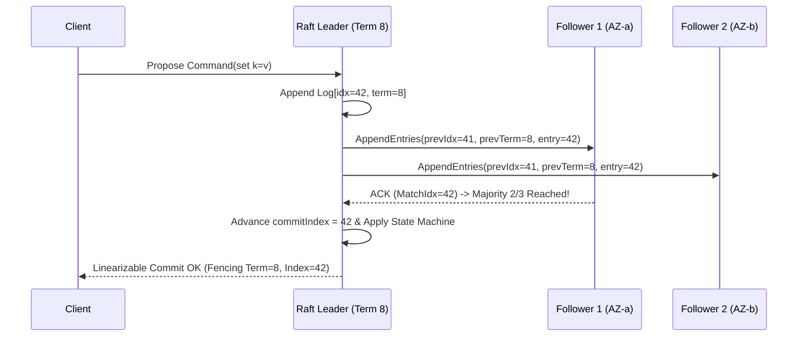

# Replication Quorums, Split-Brain Fencing Tokens & Raft Consensus Internals

```json pretraining
[
  {
    "term": "Strict Quorum Overlap",
    "formula": "R + W > N  (e.g., 2 + 2 > 3)",
    "meaning": "Pigeonhole guarantee in N-replica leaderless stores: the read set of size R and write set of size W must intersect in at least 1 replica holding the latest timestamp/version."
  },
  {
    "term": "Monotonic Fencing Token",
    "formula": "Reject Write if token < max_seen_token",
    "meaning": "Prevents a GC-paused 'zombie leader' whose distributed lock expired from corrupting storage after a new leader has already taken over."
  },
  {
    "term": "Raft Election Safety & Term",
    "formula": "≤ 1 Leader per Term t (Majority ⌊N/2⌋ + 1)",
    "meaning": "Logical clock epoch incremented on every election; candidates only win votes from peers if the candidate's log is at least as up-to-date (lastLogTerm, lastLogIndex)."
  },
  {
    "term": "Leader Completeness Invariant",
    "formula": "Committed(idx, t) ⇒ Present in Leaders(t' > t)",
    "meaning": "Once a log entry from the current term is replicated on a majority quorum, no future elected leader can ever overwrite or lose that entry."
  }
]
```

```json poe
{
  "question": "Worker 1 acquires a Redis distributed lock (TTL = 10s) to update a shared ledger file, then hits a 14-second JVM Stop-The-World GC pause! At t=11s, the lock expires, Worker 2 acquires the lock and writes Ledger Version 2. At t=14s, Worker 1 wakes up—believing it STILL holds the lock—and overwrites the file with stale Ledger Version 1! Why did the lock fail, and what exact primitive solves it?",
  "options": [
    "Increase lock TTL to 30 seconds so GC pauses never exceed TTL",
    "Wall-clock/TTL leases alone CANNOT guarantee mutual exclusion across asynchronous process pauses; the lock service must issue a monotonically increasing Fencing Token (epoch=33 to W1, epoch=34 to W2), and the storage server MUST reject W1's write because 33 < 34!",
    "Check `if (lock.isHeld())` immediately before calling `storage.write()`",
    "Switch from TCP to UDP heartbeats"
  ],
  "answerIndex": 1,
  "explanation": "Martin Kleppmann's classic distributed-locking proof: checking `if (lock.isHeld())` still has a race window right after the `if` statement! Only storage-enforced Monotonic Fencing Tokens (`epoch` / `zxid` / Raft `term`) neutralize zombie leaders deterministically."
}
```

## Part I — Leaderless Dynamo Quorums ($R + W > N$) vs. Linearizable Consensus

Distributed data systems replicate across $N$ nodes for fault tolerance using two fundamentally different families of protocols:

1. **Leaderless `Dynamo`-Style Quorums (*Cassandra, Riak, DynamoDB eventual mode*)**:
   - Clients send writes directly to all $N=3$ replicas in parallel and succeed once $W=2$ ACK; reads query $R=2$ replicas in parallel (`R + W = 4 > 3`) and return the value with the highest version/timestamp, repairing stale replicas asynchronously via **Read Repair** + background **Merkle-Tree Anti-Entropy**.
   - **Why $R + W > N$ Is STILL Not Linearizable!** Even with $N=3, W=2, R=2$: if a write partially succeeds on Node 1 (`new`) while failing on Nodes 2 & 3 (`old`), or if Reader A observes `{Node 1 (new), Node 2 (old)}` while concurrent Reader B observes `{Node 2 (old), Node 3 (old)}` before the write finishes on Node 2, Reader B sees an older value *after* Reader A already saw the new value! Furthermore, **Last-Write-Wins (`LWW`)** using wall-clock NTP timestamps silently drops concurrent writes whenever server clocks skew by $5\text{ ms}$.
2. **Consensus-Backed Replicated State Machines (`Raft` / `Multi-Paxos` — *etcd, CockroachDB, TiKV, Kafka KRaft*)**:
   - Elects **at most one Leader per Term $t$** via majority quorum ($\lfloor N/2 \rfloor + 1$). Every state mutation is appended in strict sequential order to the Leader's log and committed once replicated to a majority, providing **true Linearizability** and atomic Compare-And-Swap (`CAS`).



---

## Part II — Raft Safety Mechanics & Split-Brain Prevention

How does **Raft** (*Ongaro & Ousterhout*) prevent **Split-Brain** during an asymmetric network partition separating a 5-node cluster into `{OldLeader, N2}` (2 nodes) and `{N3, N4, N5}` (3 nodes)?
- The majority side `{N3, N4, N5}` times out waiting for heartbeats, increments `currentTerm` ($8 \to 9$), and elects `N3` (3/5 votes).
- Meanwhile, `OldLeader` on the minority side `{OldLeader, N2}` can still accept client TCP sockets—**but** `OldLeader` can only collect `2/5` ACKs on `AppendEntries`, so its `commitIndex` **freezes** (zero dirty writes can commit!). And for **Linearizable Reads**, `OldLeader` must execute a **`ReadIndex` heartbeat round** confirming a majority still recognizes `Term 8` before answering reads—preventing stale reads from a partitioned minority leader!

```json contrast
{
  "title": "Distributed Coordination & Split-Brain Safety",
  "naiveTitle": "Unfenced Lock + Async Primary-Replica Failover",
  "naiveMetric": "Data Loss & Split-Brain Corruption on Partition",
  "naivePoints": [
    "Promotes an asynchronous standby replica before all ACKed primary transactions replicated (permanent data loss!)",
    "Old partitioned primary keeps serving stale reads and accepting writes ('Split-Brain')",
    "Relies on client-side wall-clock TTL leases that break under JVM GC pauses or NTP clock jumps",
    "Uses N=3, W=2, R=2 with NTP Last-Write-Wins assuming it provides strict linearizability"
  ],
  "staffTitle": "Raft Majority Log + ReadIndex + Fencing Tokens",
  "staffMetric": "Zero Split-Brain · Provable Linearizability",
  "staffPoints": [
    "Requires majority quorum (⌊N/2⌋ + 1) for both Leader Election and Log Commit—minorities freeze safely",
    "Restricts RequestVote: voters reject any candidate whose (lastLogTerm, lastLogIndex) lags behind their own",
    "Uses ReadIndex / Leader Leases with bounded monotonic clock drift to prevent stale minority-leader reads",
    "Propagates monotonic (term, index) Fencing Tokens down to storage engines to block zombie writers"
  ]
}
```

### Architectural Trade-Off Table: Replication & Consensus Models

| Architecture | Write Availability | Read Consistency | Cross-Region WAN Latency | Canonical Production Systems |
| :--- | :--- | :--- | :--- | :--- |
| **Async Single-Leader** | High (Primary local WAL ACK) | Eventual on replicas (**Read-Your-Writes** requires primary routing or LSN pinning) | $0\text{ RTT}$ write | PostgreSQL / MySQL read-replica topologies |
| **Leaderless Quorum (`R+W>N` + Sloppy Quorum)** | **Highest** (Hinted handoff accepts writes even during partitions — `AP`) | Tunable / Eventual (Vector Clocks or `LWW`) | $1\text{ RTT}$ to nearest $W$ nodes | **Apache Cassandra, ScyllaDB, Riak** |
| **Raft / Paxos Consensus (`CP`)** | Survives $f$ failures with $2f+1$ nodes (`3` $\to$ `1`, `5` $\to$ `2`) | **Strict Linearizable** (via `ReadIndex`) | $1\text{ Quorum RTT}$ per write | **etcd (Kubernetes), CockroachDB, Spanner, Kafka KRaft** |

---

## Part III — Production Implementation Blueprints (Python 3 & Java 17)

### Python 3 Blueprint: Fenced Storage Resource + Raft Election Log-Up-To-Date Verifier
```python
from dataclasses import dataclass


class FencedStorageEngine:
    """Storage layer enforcing monotonic Fencing Tokens against GC-paused zombie leaders."""

    def __init__(self):
        self.max_fencing_token: int = 0
        self.kv: dict[str, str] = {}

    def write_fenced(self, key: str, value: str, fencing_token: int) -> dict:
        if fencing_token < self.max_fencing_token:
            return {
                "accepted": False,
                "reason": f"STALE_FENCING_TOKEN:{fencing_token}<{self.max_fencing_token}",
            }
        self.max_fencing_token = fencing_token
        self.kv[key] = value
        return {"accepted": True, "committedToken": fencing_token}


@dataclass
class RaftVoterNode:
    node_id: str
    current_term: int
    voted_for: str | None
    last_log_term: int
    last_log_index: int

    def handle_request_vote(
        self, candidate_id: str, cand_term: int, cand_last_log_term: int, cand_last_log_idx: int
    ) -> tuple[int, bool]:
        """
        Enforces Raft §5.2 & §5.4.1 Election Safety + Log Up-To-Date restriction:
        Candidate log is at least as up-to-date iff:
          (cand_last_log_term > self.last_log_term) OR
          (cand_last_log_term == self.last_log_term AND cand_last_log_idx >= self.last_log_index)
        """
        if cand_term < self.current_term:
            return self.current_term, False

        if cand_term > self.current_term:
            self.current_term = cand_term
            self.voted_for = None

        log_up_to_date = (cand_last_log_term, cand_last_log_idx) >= (
            self.last_log_term,
            self.last_log_index,
        )
        can_vote = self.voted_for in (None, candidate_id)
        if can_vote and log_up_to_date:
            self.voted_for = candidate_id
            return self.current_term, True

        return self.current_term, False
```

### Java 17 Blueprint: Quorum Overlap Validator, Fencing Guard & Raft Vote Rule
```java
public final class ConsensusInvariants {
    public record LogPosition(long term, long index) implements Comparable<LogPosition> {
        @Override
        public int compareTo(LogPosition other) {
            int cmp = Long.compare(this.term, other.term);
            return cmp != 0 ? cmp : Long.compare(this.index, other.index);
        }
    }

    public static boolean hasStrictQuorumOverlap(int replicasN, int readQuorumR, int writeQuorumW) {
        return readQuorumR >= 1
                && writeQuorumW >= 1
                && readQuorumR <= replicasN
                && writeQuorumW <= replicasN
                && (readQuorumR + writeQuorumW) > replicasN;
    }

    public static int majorityQuorumSize(int clusterSizeN) {
        if (clusterSizeN <= 0) throw new IllegalArgumentException("clusterSizeN must be positive");
        return (clusterSizeN / 2) + 1;
    }

    public static boolean shouldGrantRaftVote(
            long voterTerm,
            String votedForInTerm,
            LogPosition voterLastLog,
            String candidateId,
            long candidateTerm,
            LogPosition candidateLastLog) {
        if (candidateTerm < voterTerm) return false;
        boolean voteAvailable = (candidateTerm > voterTerm)
                || votedForInTerm == null
                || votedForInTerm.equals(candidateId);
        return voteAvailable && candidateLastLog.compareTo(voterLastLog) >= 0;
    }
}
```

> [!WARNING]
> **Staff Interview Gotcha — Why Deploying a 4-Node Raft/etcd Cluster Is Strictly WORSE Than a 3-Node Cluster!**:
> Majority quorum for $N = 3$ is $\lfloor 3/2 \rfloor + 1 = 2$ (tolerates **$1$ dead node**). Majority quorum for $N = 4$ is $\lfloor 4/2 \rfloor + 1 = 3$ (STILL tolerates **only $1$ dead node**—if 2 nodes die, $2 < 3$ halts the cluster!). Yet $N = 4$ has $33\%$ more hardware that can fail and requires an extra network ACK on every quorum! Always size consensus groups to **odd numbers ($N = 3$ or $N = 5$)**.

---

## Part IV — End-of-Chapter Mastery Check

```json quiz
[
  {
    "id": "sd-05-q1",
    "question": "Why should Raft, Paxos, and ZooKeeper clusters ALWAYS be provisioned with odd node counts (N=3 or N=5) rather than even counts (N=4)?",
    "options": [
      "Because Raft binary headers store node counts in odd bitmasks",
      "Because N=4 requires a majority quorum of 3, meaning it tolerates at most 1 node failure—the EXACT same fault tolerance as N=3—while increasing write quorum latency and adding a 4th machine whose failure counts toward losing quorum",
      "Because even-numbered clusters cannot elect a leader on Term 1",
      "Because TCP load balancers only support odd backend pools"
    ],
    "answerIndex": 1,
    "explanation": "Fault tolerance f = ⌊(N-1)/2⌋ only increments on odd steps: N=3 tolerates 1 failure, N=4 still tolerates only 1 failure, and N=5 tolerates 2 failures."
  },
  {
    "id": "sd-05-q2",
    "question": "During a network partition in a 5-node Raft cluster, the old Leader is isolated on a 2-node minority side while the 3-node majority elects a new Leader and commits `balance = $0`. A client still connected to the old Leader sends a linearizable `GET /balance` request. How does Raft prevent the old Leader from returning stale `$500`?",
    "options": [
      "The old Leader checks `System.currentTimeMillis()`",
      "Before serving a linearizable read, the Leader executes `ReadIndex`: it records its commitIndex and sends lightweight heartbeats to confirm a majority (3/5) still recognizes it as Leader; because the isolated old Leader only reaches 2/5 nodes, its ReadIndex fails and times out instead of returning stale data!",
      "Raft forces clients to query all 5 nodes on every read",
      "Followers automatically reboot partitioned leaders via SSH"
    ],
    "answerIndex": 1,
    "explanation": "Local-memory reads from a leader without ReadIndex (or bounded-drift clock leases) violate linearizability during partitions because a deposed leader may not yet know a higher-term leader exists."
  },
  {
    "id": "sd-05-q3",
    "question": "In Raft's `RequestVote` RPC, Follower F has `(lastLogTerm=6, lastLogIndex=100)` and Candidate C has `(lastLogTerm=5, lastLogIndex=150)`. Even though Candidate C has 50 MORE log entries, why MUST Follower F reject Candidate C's vote?",
    "options": [
      "Because index 150 exceeds Raft's maximum batch size",
      "Because Raft compares `lastLogTerm` FIRST before `lastLogIndex`; C's extra entries from old Term 5 were uncommitted entries from a partitioned minority leader, whereas F holds an entry from newer Term 6 that may already be committed on a majority!",
      "Because odd terms always beat even terms",
      "Because Followers only vote for the lowest node ID"
    ],
    "answerIndex": 1,
    "explanation": "Comparing `lastLogTerm` first guarantees Leader Completeness (§5.4.1): a candidate missing a higher-term committed entry can never win a majority vote."
  }
]
```
