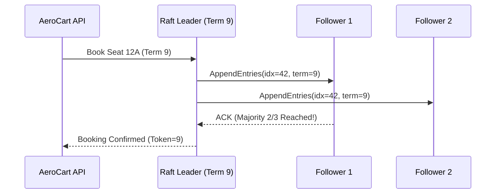

# Replication Quorums, Split-Brain Fencing Tokens & Raft Consensus Internals

```json continuity
{
  "previously": "In Chapter 04, we protected AeroCart's database from 100,000-RPS cache stampedes using Singleflight request coalescing, Memcache Lease tokens, and XFetch early refreshes.",
  "painPoint": "When AeroCart's primary database server freezes during a 14-second garbage-collection pause, our cluster elects a new primary. Suddenly the frozen old primary wakes up—still believing it is the leader—and overwrites seat 12A with a conflicting booking ('Split-Brain')!",
  "unlock": "We will build Strict Quorum overlap checks, Monotonic Fencing Tokens, and Raft Consensus voting rules so split-brain zombie leaders can never corrupt AeroCart's bookings."
}
```

```json walkthrough
[
  {
    "time": "0:00",
    "badge": "1. Two Captains",
    "caption": "Imagine a flight tower losing radio contact with Captain A for 10 seconds and promoting Captain B. If Captain A comes back online and both issue orders, the runway collides.",
    "code": "OldLeader (Term 8) vs NewLeader (Term 9) -> Split-Brain!"
  },
  {
    "time": "0:25",
    "badge": "2. Fencing Tokens",
    "caption": "Every time a new leader takes over, it gets a strictly higher Fencing Token number. The storage drive rejects any write carrying an older number.",
    "code": "if fencing_token < max_seen_token: reject_write()"
  },
  {
    "time": "0:50",
    "badge": "3. Quorum Overlap",
    "caption": "In leaderless stores with N=3 nodes, writing to W=2 and reading from R=2 guarantees at least 1 overlapping node holds the newest version.",
    "code": "R + W > N  (2 + 2 > 3 -> 1 node overlap)"
  },
  {
    "time": "1:15",
    "badge": "4. Raft Consensus",
    "caption": "In Raft, a candidate only wins election if a majority of voters confirm its log term and index are at least as up-to-date as theirs.",
    "code": "(cand_term, cand_idx) >= (voter_term, voter_idx)"
  }
]
```

```json pretraining
[
  {
    "term": "Strict Quorum Overlap",
    "formula": "R + W > N  (e.g., 2 + 2 > 3)",
    "meaning": "When you store copies on 3 servers, writing to at least 2 and reading from at least 2 guarantees that your read and write groups overlap on at least one up-to-date server."
  },
  {
    "term": "Monotonic Fencing Token",
    "formula": "Reject Write if token < max_seen_token",
    "meaning": "An ever-increasing ticket number attached to every leader write so a paused 'zombie' leader with an old ticket number is immediately blocked by the storage disk."
  },
  {
    "term": "Raft Term & Majority Election",
    "formula": "At Most 1 Leader per Term via Majority Votes",
    "meaning": "A numbered election round where a server can only become leader by winning votes from more than half the cluster."
  },
  {
    "term": "Leader Completeness Invariant",
    "formula": "Majority-Committed Entry Never Lost",
    "meaning": "Raft's rule that voters refuse to elect any candidate whose log is missing entries that were already confirmed by a majority."
  }
]
```

## 🌱 Step 1: Plain-English Story — Two Captains in the Control Tower

Imagine `AeroCart` stores seat reservations on a single database server. To survive hardware crashes, we add two backup servers (3 servers total). One night, Primary Server 1 freezes for 14 seconds during a heavy memory cleanup.

After 10 seconds of silence, Backup Server 2 says: *"Server 1 is dead! I am the new Primary!"* and sells Seat `12A` to Alice. Four seconds later, Server 1 wakes up from its pause. It has no idea time passed—it still thinks it is the boss, so it sells Seat `12A` to Bob and overwrites the disk! Now two flyers hold boarding passes for the exact same window seat. Engineers call this disaster **Split-Brain**.

How do we make Split-Brain mathematically impossible? First, every time a leader wins an election, the cluster increments an election counter called a **Term** (or **Fencing Token**): Server 1 had Token `#33`, and Server 2 gets Token `#34`. Once the storage engine sees Token `#34`, it permanently slams the door on any delayed command carrying Token `#33`. Second, before any seat booking is confirmed, the leader must copy that log entry to a **Majority Quorum** (at least 2 out of 3 servers) using **Raft Consensus**.



---

## 🔨 Step 2: First Lines of Code — Fencing Token Guard & Quorum Check

Let's write a 16-line `FencedSeatStore` in Python 3 and Java 17 that blocks zombie `AeroCart` leaders using monotonic fencing tokens and verifies strict quorum overlap.

```python
class FencedSeatStore:
    def __init__(self):
        self.max_token = 0
        self.seats = {}

    def book_seat(self, seat: str, flyer: str, token: int) -> bool:
        if token < self.max_token:
            return False  # Reject zombie leader with old token!
        self.max_token = token
        self.seats[seat] = flyer
        return True

def has_quorum_overlap(n_nodes: int, r_reads: int, w_writes: int) -> bool:
    return (r_reads + w_writes) > n_nodes
```

### Java 17 Equivalent
```java
import java.util.HashMap;
import java.util.Map;

public class FencedSeatStore {
    private long maxToken = 0;
    private final Map<String, String> seats = new HashMap<>();

    public synchronized boolean bookSeat(String seat, String flyer, long token) {
        if (token < maxToken) return false; // Reject zombie leader!
        maxToken = token;
        seats.put(seat, flyer);
        return true;
    }

    public static boolean hasQuorumOverlap(int n, int r, int w) {
        return (r + w) > n;
    }
}
```

---

## ⚡ Step 3: Where It Breaks in Real Life — Why `R + W > N` Is Still Not Linearizable

Many engineers assume that setting $N = 3, W = 2, R = 2$ in a leaderless database (like Cassandra or Dynamo) guarantees every reader immediately sees the latest write. **It does not!**

Suppose Writer W updates Seat `12A = Alice`. The write reaches **Node 1** (`Alice`), is still in flight to **Node 2** (`Empty`), and hasn't reached **Node 3** (`Empty`).
1. **Reader A** queries `{Node 1, Node 2}`, sees `Alice` (newer timestamp), and tells the user *"Seat 12A is taken!"*
2. One millisecond later, **Reader B** queries `{Node 2, Node 3}`, sees `Empty` on both, and tells a second user *"Seat 12A is free!"*—even though Reader A already observed the newer state!
3. Worse still, if servers use wall-clock timestamps for **Last-Write-Wins (LWW)** and one server's clock drifts ahead by 5 milliseconds, it will silently discard newer bookings.

True **Linearizability** (where every read globally sees the latest committed write) requires either **Raft / Paxos Consensus** with `ReadIndex` heartbeats or synchronous read-repair before returning.

```json contrast
{
  "title": "AeroCart Distributed Coordination & Split-Brain Safety",
  "naiveTitle": "Unfenced Lock + Async Primary-Replica Failover",
  "naiveMetric": "Data Loss & Split-Brain Double-Bookings on Partition",
  "naivePoints": [
    "Promotes an async replica before all ACKed primary bookings have arrived (permanent data loss!)",
    "Old partitioned primary keeps serving stale reads and accepting writes ('Split-Brain')",
    "Relies on client wall-clock TTL leases that break under GC pauses or clock jumps",
    "Uses N=3, W=2, R=2 with wall-clock Last-Write-Wins assuming it prevents double-booking"
  ],
  "staffTitle": "Raft Majority Log + ReadIndex + Fencing Tokens",
  "staffMetric": "Zero Split-Brain · Provable Linearizability",
  "staffPoints": [
    "Requires majority quorum for both Leader Election and Log Commit so minorities freeze safely",
    "Restricts RequestVote: voters reject any candidate whose (lastLogTerm, lastLogIndex) lags behind",
    "Uses ReadIndex heartbeats to confirm majority leadership before serving linearizable reads",
    "Propagates monotonic (term, index) Fencing Tokens down to storage engines to block zombie writers"
  ]
}
```

```json poe
{
  "question": "Worker 1 acquires a Redis distributed lock (TTL = 10s) to update a shared ledger file, then hits a 14-second JVM Stop-The-World GC pause! At t=11s, the lock expires, Worker 2 acquires the lock and writes Ledger Version 2. At t=14s, Worker 1 wakes up—believing it STILL holds the lock—and overwrites the file with stale Ledger Version 1! Why did the lock fail, and what exact primitive solves it?",
  "options": [
    "Increase lock TTL to 30 seconds so GC pauses never exceed TTL",
    "Wall-clock/TTL leases alone CANNOT guarantee mutual exclusion across asynchronous process pauses; the lock service must issue a monotonically increasing Fencing Token (epoch=33 to W1, epoch=34 to W2), and the storage server MUST reject W1's write because 33 < 34!",
    "Check `if (lock.isHeld())` immediately before calling `storage.write()`",
    "Switch from TCP to UDP heartbeats"
  ],
  "answerIndex": 1,
  "explanation": "Martin Kleppmann's classic distributed-locking proof: checking `if (lock.isHeld())` still has a race window right after the `if` statement! Only storage-enforced Monotonic Fencing Tokens (`epoch` / `zxid` / Raft `term`) neutralize zombie leaders deterministically."
}
```

---

## 🚀 Step 4: Staff Engineer Deep-Dive — Quorum Math, Raft Safety Laws & Blueprints

### 1. Mathematical Laws of Quorums & Raft Election Safety

In a leaderless replica set of size $N$, strict quorum intersection requires that the read set $R$ and write set $W$ satisfy the Pigeonhole Principle:

$$R + W > N \implies |S_{\text{read}} \cap S_{\text{write}}| \ge R + W - N \ge 1$$

In **Raft Consensus**, both leader elections and log commits require a strict majority quorum $Q$:

$$Q = \left\lfloor \frac{N}{2} \right\rfloor + 1, \quad f_{\text{max}} = \left\lfloor \frac{N - 1}{2} \right\rfloor$$

where $f_{\text{max}}$ is the maximum number of simultaneous node failures the cluster can tolerate. To guarantee the **Leader Completeness Invariant** (any entry committed in term $t$ is present in the log of all leaders for terms $t' > t$), Raft's `RequestVote` RPC compares log freshness lexicographically by `(lastLogTerm, lastLogIndex)`:

$$\text{UpToDate}(C, V) \iff (T_C > T_V) \lor (T_C = T_V \land I_C \ge I_V)$$

### 2. Architectural Trade-Off Table: Replication & Consensus Models

| Architecture | Write Availability | Read Consistency | Cross-Region WAN Latency | Canonical Production Systems |
| :--- | :--- | :--- | :--- | :--- |
| **Async Single-Leader** | High (Primary local WAL ACK) | Eventual on replicas (**Read-Your-Writes** needs LSN pinning) | $0\text{ RTT}$ write | PostgreSQL / MySQL read-replica topologies |
| **Leaderless Quorum (`R+W>N` + Sloppy Quorum)** | **Highest** (Hinted handoff accepts writes during partitions — `AP`) | Tunable / Eventual (Vector Clocks or `LWW`) | $1\text{ RTT}$ to nearest $W$ nodes | **Apache Cassandra, ScyllaDB, Riak** |
| **Raft / Paxos Consensus (`CP`)** | Survives $f$ failures with $2f+1$ nodes (`3` $\to$ `1`, `5` $\to$ `2`) | **Strict Linearizable** (via `ReadIndex`) | $1\text{ Quorum RTT}$ per write | **etcd (Kubernetes), CockroachDB, Spanner, Kafka KRaft** |

### 3. Production Blueprints (Python 3 & Java 17)

```python
from dataclasses import dataclass


class FencedStorageEngine:
    """Storage layer enforcing monotonic Fencing Tokens against GC-paused zombie leaders."""

    def __init__(self):
        self.max_fencing_token: int = 0
        self.kv: dict[str, str] = {}

    def write_fenced(self, key: str, value: str, fencing_token: int) -> dict:
        if fencing_token < self.max_fencing_token:
            return {
                "accepted": False,
                "reason": f"STALE_FENCING_TOKEN:{fencing_token}<{self.max_fencing_token}",
            }
        self.max_fencing_token = fencing_token
        self.kv[key] = value
        return {"accepted": True, "committedToken": fencing_token}


@dataclass
class RaftVoterNode:
    node_id: str
    current_term: int
    voted_for: str | None
    last_log_term: int
    last_log_index: int

    def handle_request_vote(
        self, candidate_id: str, cand_term: int, cand_last_log_term: int, cand_last_log_idx: int
    ) -> tuple[int, bool]:
        if cand_term < self.current_term:
            return self.current_term, False

        if cand_term > self.current_term:
            self.current_term = cand_term
            self.voted_for = None

        log_up_to_date = (cand_last_log_term, cand_last_log_idx) >= (
            self.last_log_term,
            self.last_log_index,
        )
        can_vote = self.voted_for in (None, candidate_id)
        if can_vote and log_up_to_date:
            self.voted_for = candidate_id
            return self.current_term, True

        return self.current_term, False
```

### Java 17 Equivalent
```java
public final class ConsensusInvariants {
    public record LogPosition(long term, long index) implements Comparable<LogPosition> {
        @Override
        public int compareTo(LogPosition other) {
            int cmp = Long.compare(this.term, other.term);
            return cmp != 0 ? cmp : Long.compare(this.index, other.index);
        }
    }

    public static boolean hasStrictQuorumOverlap(int replicasN, int readQuorumR, int writeQuorumW) {
        return readQuorumR >= 1
                && writeQuorumW >= 1
                && readQuorumR <= replicasN
                && writeQuorumW <= replicasN
                && (readQuorumR + writeQuorumW) > replicasN;
    }

    public static int majorityQuorumSize(int clusterSizeN) {
        if (clusterSizeN <= 0) throw new IllegalArgumentException("clusterSizeN must be positive");
        return (clusterSizeN / 2) + 1;
    }

    public static boolean shouldGrantRaftVote(
            long voterTerm,
            String votedForInTerm,
            LogPosition voterLastLog,
            String candidateId,
            long candidateTerm,
            LogPosition candidateLastLog) {
        if (candidateTerm < voterTerm) return false;
        boolean voteAvailable = (candidateTerm > voterTerm)
                || votedForInTerm == null
                || votedForInTerm.equals(candidateId);
        return voteAvailable && candidateLastLog.compareTo(voterLastLog) >= 0;
    }
}
```

> [!WARNING]
> **Staff Interview Gotcha — Why Deploying a 4-Node Raft/etcd Cluster Is Strictly WORSE Than a 3-Node Cluster!**:
> Majority quorum for $N = 3$ is $\lfloor 3/2 \rfloor + 1 = 2$ (tolerates **$1$ dead node**). Majority quorum for $N = 4$ is $\lfloor 4/2 \rfloor + 1 = 3$ (STILL tolerates **only $1$ dead node**—if 2 nodes die, $2 < 3$ halts the cluster!). Yet $N = 4$ has $33\%$ more hardware that can fail and requires an extra network ACK on every quorum! Always size consensus groups to **odd numbers ($N = 3$ or $N = 5$)**.

**Up Next in Chapter 06**: With `AeroCart`'s cache and Raft consensus storage hardened, how do we stop a single runaway bot or slow downstream payment gateway from exhausting all worker threads across our fleet? In Chapter 06, we will build **Token-Bucket / GCRA Rate Limiters, Adaptive Little's Law Concurrency Limits, and Tail-Latency Hedging**.

```json quiz
[
  {
    "id": "sd-05-q1",
    "question": "Why should Raft, Paxos, and ZooKeeper clusters ALWAYS be provisioned with odd node counts (N=3 or N=5) rather than even counts (N=4)?",
    "options": [
      "Because Raft binary headers store node counts in odd bitmasks",
      "Because N=4 requires a majority quorum of 3, meaning it tolerates at most 1 node failure—the EXACT same fault tolerance as N=3—while increasing write quorum latency and adding a 4th machine whose failure counts toward losing quorum",
      "Because even-numbered clusters cannot elect a leader on Term 1",
      "Because TCP load balancers only support odd backend pools"
    ],
    "answerIndex": 1,
    "explanation": "Fault tolerance f = ⌊(N-1)/2⌋ only increments on odd steps: N=3 tolerates 1 failure, N=4 still tolerates only 1 failure, and N=5 tolerates 2 failures."
  },
  {
    "id": "sd-05-q2",
    "question": "During a network partition in a 5-node Raft cluster, the old Leader is isolated on a 2-node minority side while the 3-node majority elects a new Leader and commits `balance = $0`. A client still connected to the old Leader sends a linearizable `GET /balance` request. How does Raft prevent the old Leader from returning stale `$500`?",
    "options": [
      "The old Leader checks `System.currentTimeMillis()`",
      "Before serving a linearizable read, the Leader executes `ReadIndex`: it records its commitIndex and sends lightweight heartbeats to confirm a majority (3/5) still recognizes it as Leader; because the isolated old Leader only reaches 2/5 nodes, its ReadIndex fails and times out instead of returning stale data!",
      "Raft forces clients to query all 5 nodes on every read",
      "Followers automatically reboot partitioned leaders via SSH"
    ],
    "answerIndex": 1,
    "explanation": "Local-memory reads from a leader without ReadIndex (or bounded-drift clock leases) violate linearizability during partitions because a deposed leader may not yet know a higher-term leader exists."
  },
  {
    "id": "sd-05-q3",
    "question": "In Raft's `RequestVote` RPC, Follower F has `(lastLogTerm=6, lastLogIndex=100)` and Candidate C has `(lastLogTerm=5, lastLogIndex=150)`. Even though Candidate C has 50 MORE log entries, why MUST Follower F reject Candidate C's vote?",
    "options": [
      "Because index 150 exceeds Raft's maximum batch size",
      "Because Raft compares `lastLogTerm` FIRST before `lastLogIndex`; C's extra entries from old Term 5 were uncommitted entries from a partitioned minority leader, whereas F holds an entry from newer Term 6 that may already be committed on a majority!",
      "Because odd terms always beat even terms",
      "Because Followers only vote for the lowest node ID"
    ],
    "answerIndex": 1,
    "explanation": "Comparing `lastLogTerm` first guarantees Leader Completeness (§5.4.1): a candidate missing a higher-term committed entry can never win a majority vote."
  }
]
```
